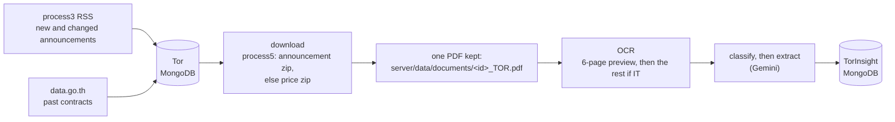

# Where TOR data comes from

GIPDP reads three government systems. This page shows how they fit together.
The details live in one page per source:

| Source | Role | Details |
|---|---|---|
| `process3.gprocurement.go.th`, the e-GP RSS feed | Finds **open** projects (drafts and invitations) and follows them to the winner | [process3_gprocurement.md](process3_gprocurement.md) |
| `process5.gprocurement.go.th`, e-GP's file services | Holds each project's documents: announcement, bidding document, TOR, price form | [process5_gprocurement.md](process5_gprocurement.md) |
| `data.go.th`, the open-data portal | Past contracts, for history and price comparison | [data_go_th.md](data_go_th.md) |

The commands and pipeline stages are in [pipeline.md](../pipeline.md). The
reasons behind them are in the decisions it links to.

**Checked 2026-10-11 for e-GP.** data.go.th hasn't been checked against its
page yet.

## The flow today

- **Two pipelines meet in the database.** Ingestion writes `Tor`; extraction
  writes `TorInsight`. Where the feed has a value, it wins over the AI's
  ([0013](../decisions/0013-split-ingestion-and-ai-extraction.md)).
- **Only workable TORs are downloaded:** Draft or Open, announced by the feed,
  with no winner ([0018](../decisions/0018-preview-ocr-before-classify.md)).
- **Each package's project files are kept, and its announcement is read in
  code** for the agency, ราคากลาง and bid window. A new stage's package is
  downloaded when the feed announces it ([0020](../decisions/0020-read-the-whole-egp-package.md)).
  The budget is read from the price form, in the price package
  ([0023](../decisions/0023-read-the-budget-from-the-price-form.md)); see
  [process5_gprocurement.md](process5_gprocurement.md#how-the-pipeline-uses-it-now).

## Where each fact is

What a bidder needs, and the file that states it most reliably:

| Fact | Best source | Text or scan |
|---|---|---|
| Project ID, title, method, announcement type, date | Feed item | Text |
| Status: draft, open, changed, cancelled, awarded | Feed's announcement codes ([0017](../decisions/0017-read-the-egp-feed-as-egp-defines-it.md)) | Text |
| ราคากลาง | Announcement (`annoudoc_*.pdf`), from the draft on | Text |
| Bid date and time | Announcement and bidding document (`doc_*.pdf`), from the invitation | Text |
| Comment deadline for a draft | **No document.** Only e-GP's website, behind Turnstile | — |
| Budget (วงเงินงบประมาณ) | Price form (`pB0.pdf` in the price zip) | Scan; read the amount in words |
| Eligibility, payment, bonds, warranty, how the winner is chosen | Bidding document | Text |
| Scope, deliverables, technical requirements | TOR | Often a scan |
| Winner and winning price | Winner page linked from a `W0` item | Text (HTML) |

## Rules for every request

- **Use only what answers a plain request.** Don't get around Cloudflare
  Turnstile, tokens or keys embedded in e-GP's website.
- **Say who we are.** e-GP accepts an honest User-Agent; imitating a browser
  isn't needed (tested 2026-10-11, see
  [process5_gprocurement.md](process5_gprocurement.md#the-firewall)).
- **At most one request a second per site,** through the request pacer
  ([0016](../decisions/0016-pipeline-runs-are-safe-to-repeat.md)).
- **No file over 50 MB** (`tor-downloader.js`).

## When each source answers

| | process3 feed | process5 files | data.go.th |
|---|---|---|---|
| **Documented** | Closed 09:00–12:00 and 13:00–17:00; open 12:01–12:59 and 17:01–08:59 (CGD manual) | Nothing published | Not checked yet |
| **Seen** | Weekday nights answered; stopped by 08:36 on a Thursday; no answer on a Sunday at 12:20 or 14:33 | Answered every call: weekday night, morning, office hours and Sunday | Not checked yet |
| **When closed** | The connection hangs until the client times out | Never seen closed | Not checked yet |

**Run fetches on weekday nights, 17:01 to 08:30.** The file services can be
called any time.

## Corrections to the previous version of this page

The version merged in #204:
- **Copied the same mistakes as the source pages:** the announcement codes,
  5-digit `deptId`, office hours as query time, the "WAF bypass" headers and a
  daily maintenance window.
- **Described storage that doesn't exist:** `latest-tors.json` and
  `scripts/lib/tor-downloader.mjs`, with a link to a file on one person's Mac.
  Documents are in `server/data/documents/` and records in MongoDB.
- **Got two details wrong:** the size cap is 50 MB, not 15. `bidding noltice.pdf` holds no
  project dates.
