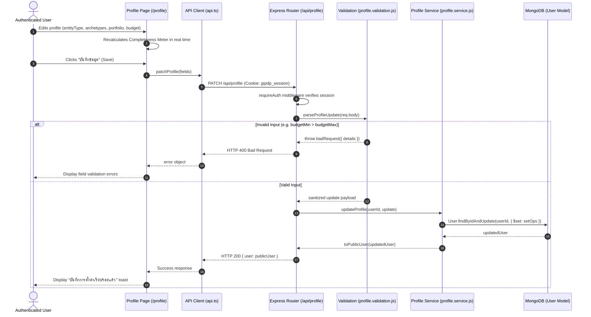
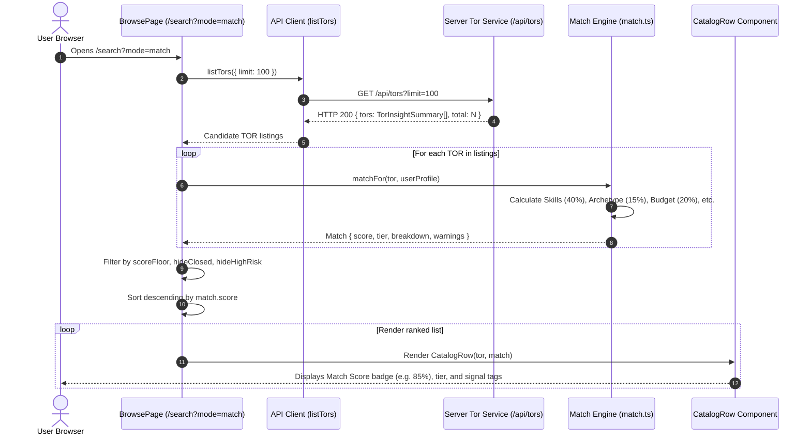

# 0033 · Capability profile and match scoring

Status: proposed · 2026-10-30 · implements FR-12 and FR-13

## Context

GIPDP is built to surface Thai government IT procurement notices to small tech companies, freelance developers, and independent software agencies who would otherwise find e-GP inaccessible. 

Under the system requirements:
- **FR-12**: Users save their technical skills, budget capacity, and preferred job size to their profile.
- **FR-13**: Score each newly posted TOR against a user's profile.
- **NFR-13**: The catalog and matchmaker must be fully responsive on mobile devices.
- **NFR-15**: Thai is the primary locale for the UI, notifications, and AI summaries.

A primitive implementation based solely on keyword matching and rigid min/max budget boundaries proved inadequate for Thai public procurement in four critical ways:

### 1. The Legal and Practical Status of Natural Persons / Freelancers
Under Sections 4 and 64 of the Public Procurement and Supplies Administration Act B.E. 2560 (พ.ร.บ. การจัดซื้อจัดจ้างและการบริหารพัสดุภาครัฐ พ.ศ. 2560), natural persons (*บุคคลธรรมดา*) have legal capacity to bid. However, in practice, electronic bidding (e-bidding) procurement for projects exceeding ฿500,000 almost universally stipulates that the bidder must be a registered juristic person (*เฉพาะนิติบุคคล*). 

Freelancers and solo engineers realistically bid as direct lead contractors only on specific selection methods (*วิธีเฉพาะเจาะจง* $\le ฿500,000$), consultant hires (*จ้างที่ปรึกษา*), or participate in larger procurements via consortiums, joint ventures (*กิจการร่วมค้า*), or subcontracting (*ผู้รับเหมาช่วง*).

If the platform blindly presents an e-bidding TOR with a high match score to a freelance developer without qualification context, the developer risks wasting substantial effort preparing a bid only to be rejected during administrative document review. Conversely, if the platform completely hides or zeroes out those listings, it deprives developers of valuable market intelligence and subcontracting opportunities.

### 2. Single-Contract Past Performance Thresholds (ผลงานในสัญญาเดียว)
Thai government procurement regulations and standard TOR forms routinely require bidders to possess past completed performance in a single contract (*ผลงานประเภทเดียวกันในสัญญาเดียว*) valued at not less than a fixed percentage—typically 40% (and occasionally 50%)—of the procurement budget or reference price.

A small software house with an outstanding React/Node.js tech stack but only ฿1,000,000 in past project history is legally disqualified from bidding as a prime contractor on a ฿30,000,000 ministry enterprise system. The matchmaker must reflect this structural threshold.

### 3. Deliverable Archetype Alignment
"Software development" spans vastly different engineering practices, from small responsive web portals to native mobile applications, nationwide ERP integrations, or GIS mapping platforms. Tech stack alone (e.g. `React`, `PostgreSQL`) cannot differentiate between an agency building an informational public portal and one building an enterprise transactional core. Profiles need to capture preferred project archetypes.

### 4. Step-Function Budget Cliffs
A binary cutoff (e.g. 0% score if a ฿2,050,000 project exceeds a ฿2,000,000 ceiling by 2.5%) produces frustrating edge-case drops. Budget alignment requires a continuous penalty decay curve.

---

## Decision

We establish an isomorphic, multi-factor capability matching system spanning the user profile schema, a 6-factor composite scoring engine, qualification risk diagnostics, and dedicated detail and catalog UI presentations.

### 1. User Capability Profile Model (`FR-12`)

The user profile (`server/src/models/user.model.js` and `client/app/_lib/api.ts`) is extended with three structured fields alongside existing skills, budget bounds, and certifications:

| Profile Field | Type | Default | Validation & Constraints | Purpose |
|---|---|---|---|---|
| `entityType` | `string` | `'juristic'` | Enum: `['juristic', 'individual']` | Identifies whether the bidder is a Juristic Person (*นิติบุคคล*) or Natural Person / Freelancer (*บุคคลธรรมดา / ฟรีแลนซ์*). |
| `preferredArchetypes` | `string[]` | `[]` | Max 10 items; validated against 9 canonical system archetypes defined in [0021](0021-find-comparable-projects.md). | Captures preferred software deliverable patterns (e.g., `web-portal`, `mobile-application`, `enterprise-system`). An empty list signifies openness to any project type. |
| `maxPastPortfolioTHB` | `number` | `0` | Number $\ge 0$, max $10,000,000,000$ | Maximum single contract value completed in past projects, used to evaluate government past performance requirements. |
| `skills` | `string[]` | `[]` | Max 150 items, trimmed, normalized. | Core technical skills, programming languages, databases, and platforms. |
| `budgetMin` / `budgetMax` | `number` | `0` | Min 0, max $10,000,000,000$; `budgetMax >= budgetMin`. | Preferred project budget capacity window in THB. |
| `certifications` | `string[]` | `[]` | Max 50 items. | Professional and organizational credentials (e.g., ISO 27001, CMMI, PMP, AWS). |

Validation rules are enforced in `server/src/features/profile/profile.validation.js` and serialized in `server/src/features/auth/auth.service.js:toPublicUser`.

---

### 2. The 6-Factor Composite Scoring Engine (`FR-13`)

The match score is evaluated on a normalized $0 - 100$ scale through a deterministic, transparent composite formula:

$$\text{Score} = 0.40 \cdot S_{\text{tech}} + 0.15 \cdot S_{\text{archetype}} + 0.20 \cdot S_{\text{budget}} + 0.10 \cdot S_{\text{portfolio}} + 0.10 \cdot S_{\text{entity}} + 0.05 \cdot S_{\text{certs}}$$

```
Normalized TOR Data + User Profile
              │
              ├──► 1. Tech Stack Fit       (Weight: 40%)  ──► Jaccard/Substring Token Match
              ├──► 2. System Archetype     (Weight: 15%)  ──► Deliverable Alignment or Open
              ├──► 3. Budget Range         (Weight: 20%)  ──► Continuous Exponential Decay
              ├──► 4. Past Experience      (Weight: 10%)  ──► Evaluated against 40% Benchmark
              ├──► 5. Entity / Legal Form  (Weight: 10%)  ──► Juristic vs Individual on e-Bidding
              └──► 6. Certifications       (Weight:  5%)  ──► Quality/Security Credential Fit
              │
              ▼
    Composite Match Score (0 - 100)
    + Structured Highlights (Positive Signals)
    + Structured Warnings (Qualification Diagnostics)
```

#### Detailed Factor Calculation:

1. **Tech Stack Fit ($S_{\text{tech}}$, 40%):**
   - Evaluates overlap between user skills and the TOR's `requiredTechStack` / `technicalRequirements`.
   - Matching uses case-insensitive word-boundary substring and tokenization matching.
   - If a TOR specifies no technical stack, a neutral baseline score of 50 is assigned.
   - Overlap ratio is scaled: $\min(100, \text{matched} / \text{required} \times 100)$.

2. **Project Archetype Alignment ($S_{\text{archetype}}$, 15%):**
   - Compares user's `preferredArchetypes` against the TOR's inferred `systemArchetype`.
   - If the user has not selected any preferred archetypes (`preferredArchetypes.length === 0`), the user is considered open to any project, scoring **100**.
   - If the TOR archetype is present in the user's preferences, it scores **100**.
   - If mismatched, it scores a non-zero baseline of **20**, allowing strong tech stacks to still surface.

3. **Budget Compatibility ($S_{\text{budget}}$, 20%):**
   - If the user has not specified a budget range (`budgetMin === 0 && budgetMax === 0`), it scores a neutral **70**.
   - If the TOR price (`referencePrice || budget`) falls within $[ \text{budgetMin}, \text{budgetMax} ]$, it scores **100**.
   - If outside bounds, it applies a continuous smooth penalty curve:
     $$\text{distanceRatio} = \begin{cases} \frac{\text{budgetMin} - \text{price}}{\text{budgetMin}} & \text{if } \text{price} < \text{budgetMin} \\ \frac{\text{price} - \text{budgetMax}}{\text{budgetMax}} & \text{if } \text{price} > \text{budgetMax} \end{cases}$$
     $$S_{\text{budget}} = \max\left(10, \text{round}\left(100 \times e^{-1.5 \times \text{distanceRatio}}\right)\right)$$
   - This eliminates cliff edges: being 10% above budget yields ~86 points; 50% above yields ~47 points.

4. **Past Experience Fit ($S_{\text{portfolio}}$, 10%):**
   - Assesses the government 40% single-contract rule: $\text{requiredPastExp} = 0.40 \times \text{referencePrice}$.
   - If the user has not declared past portfolio (`maxPastPortfolioTHB === 0`), a default neutral score of **50** is assigned.
   - If $\text{maxPastPortfolioTHB} \ge \text{requiredPastExp}$, it scores **100**.
   - If below the threshold, it scales proportionally with a floor:
     $$S_{\text{portfolio}} = \max\left(20, \text{round}\left(\frac{\text{maxPastPortfolioTHB}}{\text{requiredPastExp}} \times 100\right)\right)$$

5. **Entity & Legal Qualification Fit ($S_{\text{entity}}$, 10%):**
   - If user is `juristic` (*นิติบุคคล*), it scores **100**.
   - If the TOR explicitly allows natural persons (`companiesOnly === false`), it scores **100**.
   - If user is `individual` and the TOR requires a registered company (`companiesOnly === true`):
     - Scores **20** on entity fit.
     - Sets `disqualifiedDirectBid: true`.
     - Generates an educational diagnostic notice advising consortium or subcontracting options rather than presenting a dead end.

6. **Certification Alignment ($S_{\text{certs}}$, 5%):**
   - Matches user certifications (e.g., ISO/IEC 29110, ISO 27001, CMMI, PMP) against eligibility criteria in the TOR.
   - Scores **100** if requirements are met or no certifications are required; **30** if certifications are demanded but missing.

---

### 3. Diagnostic Transparency and Educational Feedback

In alignment with `AGENTS.md` (discovery tool, clear verdicts, no legal advice), the matchmaker pairs the numeric score with structured Thai-language diagnostic statements:

- **Highlights (Positive Signals):**
  - *"ตรงกับทักษะ 4 จาก 5 รายการที่คุณเชี่ยวชาญ"*
  - *"ประเภทโครงการตรงกับความสนใจ: เว็บพอร์ทัล / เว็บแอปพลิเคชัน"*
  - *"งบประมาณ ฿2,500,000 อยู่ในช่วงที่คุณระบุ"*
  - *"มีผลงานสัญญาเดิมเพียงพอตามเกณฑ์ 40% (฿1,000,000)"*
- **Warnings (Qualification & Strategic Advisories):**
  - *"TOR กำหนดผู้ยื่นข้อเสนอต้องเป็นนิติบุคคล (คุณลงทะเบียนเป็นบุคคลธรรมดา) — แนะนำเข้าร่วมในรูปแบบกิจการร่วมค้า (Joint Venture) หรือรับงานช่วง (Subcontract)"*
  - *"มูลค่าโครงการอาจต้องใช้ผลงานสัญญาเดิมประมาณ ฿2,000,000 ซึ่งสูงกว่าผลงานที่คุณระบุ (฿500,000)"*
  - *"งบประมาณโครงการต่ำกว่าช่วงที่คุณระบุ"*

---

### 4. Isomorphic Architecture

The scoring logic is purely functional, deterministic, and free of external runtime dependencies. It is implemented isomorphically:
1. **Client Engine (`client/app/_lib/match.ts`):** Executed in the user's browser for instant, zero-latency sorting and filtering in the catalog (`/search?mode=match`) and reactive previews on the TOR detail page as user preferences change.
2. **Server Engine (`server/src/features/match/matchmaker.js`):** Shared pure mathematical logic running on the Node.js backend. Serves API endpoints and backend queries.

Both implementations share the exact same weights, thresholds, continuous decay functions, and test cases.

---

### 5. User Interface Integration

The matchmaker is reflected across the frontend:
1. **Profile Settings & Completeness (`/profile`):**
   - Interactive radio cards for Entity Type (*นิติบุคคล* vs *บุคคลธรรมดา/ฟรีแลนซ์*).
   - Fast-fill past portfolio buttons (`฿500k`, `฿2M`, `฿5M`, `฿10M`) with live Thai currency formatting.
   - Clickable multi-select chips for the 9 canonical system archetypes.
   - **Profile Completeness Meter:** A real-time 0–100% completeness progress indicator in the sidebar displaying targeted recommendations (e.g. adding skills, archetypes, past contract size, or certifications) to maximize matching precision.
2. **Notification & Alert Settings (`/notifications` - FR-14):**
   - Configurable email alert preferences stored directly in user profile (`matchNotification`):
     - Explicit consent toggle (`enabled`, false by default in compliance with PDPA).
     - Minimum match score floor (`minScore`: 60%+, 75%+, or 85%+).
     - Delivery frequency (`frequency`: instant, daily digest, or weekly rollup).
     - Subcontracting/consortium opportunity inclusion toggle (`includeSubcontract`).
3. **TOR Detail Page (`/tor/[id]`):**
   - Inserted as **Section 4.10: ความตรงกับคุณ (Profile Match)** (`#profile-match`) directly preceding Section 4.11 (Lock-Spec Risk Analysis), complying with `docs/features/tor-detail-page.md`.
   - Displays radial match gauge, factor-by-factor breakdown progress bars, and positive/caution callouts.
   - **Strategic Guidance & Actionable Advice (แนวทางและคำแนะนำเชิงกลยุทธ์สำหรับคุณ):** Provides concrete pathways for bidders rather than dead ends:
     - Clear guidance for freelancers/natural persons on `companiesOnly` bids to pursue Joint Venture (*กิจการร่วมค้า*) or Subcontracting (*ผู้รับเหมาช่วง*) roles.
     - Guidance on the 40% single-contract threshold and partnering with seasoned prime contractors.
     - Suggestions on obtaining ISO/IEC 29110 or relevant certifications when required by the TOR.
   - Signed-out users see an explainer banner detailing the benefits of capability matching with a direct link to sign in, ensuring unauthenticated browsing is never blocked.
4. **Catalog & Search (`/search` and `catalog-row.tsx`):**
   - Added **Highest match** (*ตรงกับคุณมากที่สุด*, `match-desc`) and **Lowest match** (*ตรงกับคุณน้อยที่สุด*, `match-asc`) to the search page Sort options in both Search & Filter and Matched to Me modes.
   - When sorting by match, the catalog immediately ranks listings by composite score and displays match score indicators directly on the card.
   - **High-Scan Signal Badges:** Instead of an intrusive floating popup that causes CSS stacking context clipping, the catalog row displays compact, immediately scannable Signal Badges (`✓ ทักษะตรง X/Y`, `✓ งบตรงช่วง`, `⚠️ คุณเป็นบุคคลธรรมดา`) linking directly to the full 6-dimension breakdown in Section 4.10 (`#profile-match`).

---

### 6. Use Case Specifications

#### UC-01: Manage Capability Profile (`FR-12`)
- **Actor:** Authenticated User (SME Owner, Freelance Developer, Agency Sales)
- **Preconditions:** User is signed in with an active session cookie.
- **Trigger:** User navigates to `/profile` and modifies their technical skills, budget bounds, legal entity type, preferred archetypes, past contract size, or certifications.
- **Main Flow:**
  1. System loads and renders current profile settings from `GET /api/auth/me`.
  2. User edits capabilities (e.g., changes entity type to `individual`, sets past contract to `฿1,500,000`, adds `web-portal` archetype).
  3. Profile Completeness Meter updates in real time, offering contextual suggestions.
  4. User clicks "บันทึกข้อมูล" (Save Profile).
  5. Client sends `PATCH /api/profile` with sanitized fields.
  6. Server validates payload via `profile.validation.js` (length, ranges, allowed enum values).
  7. Server updates `users` collection via atomic `$set` operations in `profile.service.js`.
  8. System returns HTTP 200 with updated `user` object and displays confirmation toast.
- **Alternative Flows:**
  - *4a. Validation Failure:* If `budgetMin > budgetMax` (when max > 0) or values exceed bounds ($> ฿10\text{B}$), server returns HTTP 400 with field-specific errors in `error.details`. Client renders inline red alert text under the offending field.
  - *4b. Network/Server Error:* Client catches non-200 response and displays retry toast without losing draft input state.
- **Postconditions:** User profile preferences are persistently stored in MongoDB and immediately reflected in match calculations across catalog and detail views.

#### UC-02: Evaluate and Inspect TOR Capability Match (`FR-13`)
- **Actor:** Authenticated User
- **Preconditions:** User is signed in and viewing a TOR detail page (`/tor/[id]`) or catalog search (`/search?mode=match`).
- **Trigger:** Page loads or user switches to "ตรงกับโปรไฟล์คุณ" mode.
- **Main Flow:**
  1. Client retrieves normalized TOR insight data (including `technicalRequirements`, `overview.systemArchetype`, `facts.referencePriceTHB`, `eligibility`).
  2. Client executes `matchFor(tor, profile)` composite scoring engine.
  3. Engine calculates dimensional sub-scores for Skills (40%), Archetype (15%), Budget (20%), Portfolio (10%), Entity (10%), and Certifications (5%).
  4. System renders composite score badge (0–100%) and Match Tier (`strong`, `good`, `moderate`, `low`).
  5. System generates positive highlights and qualification warning callouts.
  6. On `/tor/[id]`, Section 4.10 renders 6-dimension progress bars and strategic advisory recommendations (Subcontracting/JV guidance for individual freelancers).
- **Alternative Flows:**
  - *1a. User Signed Out:* System renders public procurement facts and replaces Section 4.10 with an informational banner encouraging sign-in to unlock personalized scoring without blocking document access.
  - *2a. Missing Tech Requirements:* If TOR has no specific software stack, engine assigns neutral baseline score (75) to skills and relies on remaining 5 dimensions.
- **Postconditions:** User understands their competitive positioning and eligibility constraints before deciding to bid.

#### UC-03: Configure Match Alerts (`FR-14`)
- **Actor:** Authenticated User
- **Preconditions:** User has given PDPA notification consent (`notificationConsent: true`).
- **Trigger:** User opens `/notifications` and configures Job Match Notifications.
- **Main Flow:**
  1. System loads saved alert preferences from `user.profile.matchNotification`.
  2. User toggles match alerts switch (`enabled: true`), selects minimum score threshold (`minScore: 75`), delivery frequency (`frequency: 'daily'`), and subcontracting preference (`includeSubcontract: true`).
  3. User clicks "บันทึกการตั้งค่า" (Save Preferences).
  4. Client sends `PATCH /api/profile` with `matchNotification` object.
  5. Server validates options, stores dotted fields in MongoDB, and responds with HTTP 200.
- **Postconditions:** Profile alert preferences are saved for scheduled background notification digests.

---

### 7. Sequence Diagrams

#### 7.1 Profile Update & Validation Flow


#### 7.2 Catalog Match Scoring & Filtering Flow (`/search?mode=match`)


---

### 8. Design Patterns Used

1. **Strategy Pattern (Multi-Dimensional Scoring Strategies):**
   - Each dimension of the match calculation (Technical Skills, System Archetype, Continuous Budget Decay, Past Portfolio Gating, Legal Entity Compatibility, Certifications) is encapsulated as an independent evaluation strategy.
   - This prevents tight coupling: tweaking the budget decay coefficient or adding a new certification standard does not risk breaking tech stack tokenization or entity eligibility rules.

2. **Isomorphic Pure Functional Core Pattern:**
   - The mathematical scoring engine (`calculateMatchScore` in server, `matchFor` in client) is implemented as a deterministic, side-effect-free pure function.
   - It takes `(tor, profile)` as inputs and returns an immutable `MatchResult` data structure.
   - **Zero Network Latency:** Executed client-side for immediate responsive sorting in the browser, while identical logic is available server-side for automated email triggers (FR-14) and API consumers.

3. **Value Object & Composite Pattern:**
   - The return structure `Match` is an immutable Value Object containing numeric composite `score`, enum `tier`, structured `breakdown`, and formatted human-readable Thai/English `highlights` and `warnings`.
   - Consumer components (`tor-detail.tsx`, `catalog-row.tsx`, `search/page.tsx`) consume standard sub-objects without parsing raw strings.

4. **Repository & Service Layer Pattern:**
   - Strict separation of HTTP Transport (`server/src/features/profile/profile.routes.js`), Validation (`profile.validation.js`), Business Logic (`profile.service.js`), and Persistence (`server/src/models/user.model.js`).
   - Profile patch operations use dot-notation MongoDB operations (`profile.matchNotification.*`) preventing document overwrite collisions.

---

### 9. Function Signatures and Data Structures

#### 9.1 API Endpoints Specification

##### `PATCH /api/profile`
Updates capability profile preferences for the currently authenticated user.

- **Headers:**
  - `Content-Type: application/json`
  - `Cookie: gipdp_session=<token>` (Required)
- **Request Body (JSON Schema & Example):**
```json
{
  "entityType": "individual",
  "preferredArchetypes": ["web-portal", "mobile-app"],
  "maxPastPortfolioTHB": 1500000,
  "skills": ["Next.js", "React", "Node.js", "PostgreSQL"],
  "budgetMin": 500000,
  "budgetMax": 5000000,
  "certifications": ["ISO/IEC 29110"],
  "matchNotification": {
    "enabled": true,
    "minScore": 75,
    "frequency": "daily",
    "includeSubcontract": true
  }
}
```
- **Success Response (HTTP 200 OK):**
```json
{
  "user": {
    "id": "6722bc13d5a49801fa001234",
    "email": "somchai@devfreelance.co.th",
    "name": "สมชาย ใจดี",
    "role": "user",
    "notificationConsent": true,
    "profile": {
      "skills": ["Next.js", "React", "Node.js", "PostgreSQL"],
      "budgetMin": 500000,
      "budgetMax": 5000000,
      "certifications": ["ISO/IEC 29110"],
      "entityType": "individual",
      "preferredArchetypes": ["web-portal", "mobile-app"],
      "maxPastPortfolioTHB": 1500000,
      "matchNotification": {
        "enabled": true,
        "minScore": 75,
        "frequency": "daily",
        "includeSubcontract": true
      }
    },
    "watchlist": ["67079184063"],
    "createdAt": "2026-10-15T08:00:00.000Z",
    "updatedAt": "2026-10-30T17:00:00.000Z"
  }
}
```
- **Error Response (HTTP 400 Bad Request):**
```json
{
  "error": {
    "status": 400,
    "message": "Validation failed",
    "details": {
      "budgetMin": "Minimum budget cannot be greater than maximum budget.",
      "entityType": "Entity type must be either 'juristic' or 'individual'."
    }
  }
}
```

---

#### 9.2 Core Function Signatures & Algorithms

##### `calculateMatchScore(tor, profile)` / `matchFor(tor, profile)`
Primary scoring function executed isomorphically in `server/src/features/match/matchmaker.js` and `client/app/_lib/match.ts`.

- **Function Signature:**
```typescript
function matchFor(
  tor: TorInsightSummary | TorInsightDetail,
  profile: Profile
): Match
```

- **Parameters:**
  - `tor`: Normalized TOR insight object containing `technicalRequirements`, `overview`, `facts`, and `eligibility`.
  - `profile`: User capability profile containing `skills`, `budgetMin`, `budgetMax`, `entityType`, `preferredArchetypes`, `maxPastPortfolioTHB`, and `certifications`.

- **Return Value Structure (`Match`):**
```typescript
{
  score: number;                   // Integer bounded [0, 100]
  matched: string[];               // Overlapping technology names (e.g. ["React", "PostgreSQL"])
  missing: string[];               // Required technologies not found in profile
  tier: "strong" | "good" | "moderate" | "low";
  disqualifiedDirectBid: boolean;  // True if freelancer viewing juristic-only e-bidding
  breakdown: {
    score: number;
    tier: MatchTier;
    skills: {
      score: number;               // 0-100 (Weight: 40%)
      matched: string[];
      missing: string[];
      totalRequired: number;
    };
    archetype: {
      score: number;               // 0-100 (Weight: 15%)
      torArchetype: string | null;
      isPreferred: boolean;
    };
    budget: {
      score: number;               // 0-100 (Weight: 20%)
      status: "within_range" | "below_min" | "above_max" | "unknown";
      price: number | null;
    };
    portfolio: {
      score: number;               // 0-100 (Weight: 10%)
      userMax: number;
      estimatedRequired: number;   // 40% of reference price
      meetsThreshold: boolean;
    };
    entity: {
      score: number;               // 0-100 (Weight: 10%)
      userEntityType: "juristic" | "individual";
      companiesOnly: boolean;
      disqualifiedDirectBid: boolean;
      noticeTh?: string;
      noticeEn?: string;
    };
    certifications: {
      score: number;               // 0-100 (Weight: 5%)
      matched: string[];
      missing: string[];
      totalRequired: number;
    };
    highlightsTh: string[];        // Positive selling points in plain Thai
    highlightsEn: string[];        // Positive selling points in English
    warningsTh: string[];          // Advisory & qualification notices in plain Thai
    warningsEn: string[];          // Advisory & qualification notices in English
  };
}
```

##### Helper Signatures:
- `normalizeName(name: string): string`
  - Normalizes input string (trims, converts to lowercase, collapses consecutive whitespace).
  - *Example:* `" PostgreSQL 16 "` $\to$ `"postgresql 16"`.
- `isTorClosed(tor: TorInsightSummary): boolean`
  - Evaluates whether a TOR is dead/closed: `isDead(tor.identification.status) || Boolean(tor.contractSigned)`.

---

### 10. Data Structures Definition (`TypeScript`)

```typescript
export type MatchTier = "strong" | "good" | "moderate" | "low";

export type EntityType = "juristic" | "individual";

export type CanonicalArchetype =
  | "web-portal"
  | "mobile-app"
  | "enterprise-erp"
  | "edoc-workflow"
  | "data-analytics"
  | "gis-mapping"
  | "cybersecurity"
  | "iot-telemetry"
  | "infra-networking"
  | "other";

export type MatchNotificationConfig = {
  enabled: boolean;
  minScore: number;
  frequency: "instant" | "daily" | "weekly";
  includeSubcontract: boolean;
};

export type Profile = {
  skills: string[];
  budgetMin: number;
  budgetMax: number;
  certifications?: string[];
  entityType?: EntityType;
  preferredArchetypes?: string[];
  maxPastPortfolioTHB?: number;
  matchNotification?: MatchNotificationConfig;
  scopeSizes: ("solo" | "small-team" | "mid-size")[];
  smeRegistered: boolean;
  watchlist: string[];
};
```

---

## Consequences

- **Realistic Expectations for Bidders:** Freelancers and SMEs receive instant, honest signals on whether a project is legally, financially, and technically feasible before committing days to bid preparation.
- **Support for Subcontracting:** Instead of eliminating freelancers from enterprise listings, the platform preserves visibility while clearly signaling that participation is best pursued via consortium or subcontracting.
- **Discovery vs. Advice Separation:** Adheres strictly to `AGENTS.md`: the UI presents factual evidence and calculated match heuristics without purporting to offer binding legal counsel.
- **Performance & Zero Latency:** Pure functional calculations execute in $<1\text{ms}$ per TOR, easily handling catalog sorting on low-power mobile devices (NFR-13) and server-side evaluation with zero overhead.

