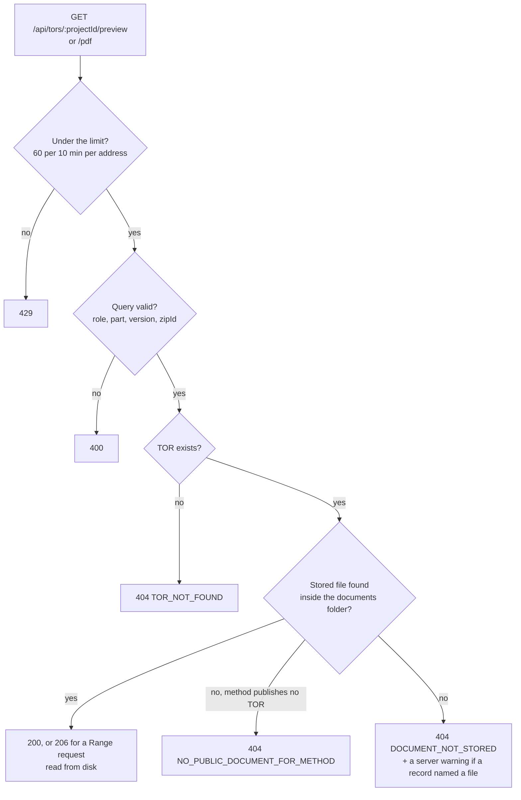

# 0038 · The PDF preview serves only files the pipeline stored

Status: accepted · 2026-11-21

## Context

The TOR detail page opens the original document in an in-page viewer
(`PdfPreviewModal`), which fetches `GET /api/tors/:projectId/preview`. Until
this decision the route tried three sources in turn:

1. a file the pipeline had stored under `server/data/documents/`;
2. an in-memory cache of earlier fetches;
3. e-GP itself, fetched during the visitor's request.

The third source made a public route into an e-GP client that anyone could
drive:

- **No pacing.** A cache miss could call e-GP five or six times: the TOR's
  direct link, two package lookups (`infoProcureDocAnnounZip`, then
  `…ZipTemp`), the price-estimate lookup (`infoDocPriceestZipHis`), the zip
  download, and the announcement template. None went through `paceRequest`,
  so a script looping over project IDs could push us far past NFR-03's one
  request a second. e-GP would then block the server, and ingestion with it.
  The route had no rate limit either.
- **Unbounded memory.** The cache held 20 whole PDFs of up to 40 MB each, with
  no limit on their total size. One miss could fill several entries, because
  it also cached the other tabs' documents.
- **Unchecked files.** Zips were unpacked in memory without checking their
  uncompressed size (a zip bomb), and files fetched this way skipped the
  pipeline's download cap and, later, its virus scan.

The cache didn't help against any of this. A script asking for different
projects misses every time, and each miss evicted an entry a real reader was
using.

The fallback also hid a problem. The pipeline records absolute paths
(`storagePath`), and those depend on the machine that wrote them: a laptop
writes `D:\…\server\data\documents\…`, while the server in Docker sees the
same files at `/app/data/documents/…`. On Docker, and in production, which had
no volume for `server/data`, the stored file was often "missing", and e-GP
quietly filled in. Measured on the development database (2026-11-21): of the
222 pipeline summaries the site shows, 221 have their TOR file stored.

## Decision

**The preview reads only files the pipeline stored. It never calls e-GP.**
When there is no file, it says so, and the viewer offers the original on
e-GP, which stays the authority (AGENTS.md §6).

- **Where a stored file is.** A recorded path is used as it is when it
  already points inside this machine's documents folder. Otherwise the part
  after its `documents` segment is looked up under ours, so a database filled
  on a laptop still works with the server in Docker. Either way, nothing
  outside the documents folder is opened, and a path that climbs out with
  `..` is refused (ASVS V5.3.2).
- **The query is checked** (ASVS V2.2.1). `role` is `tor`, `bidding` or
  `announcement`; `part` is 0–99 or a role name; `version` is 1 or more;
  `zipId` is 32 hex digits, the shape of every stored e-GP package id. A
  repeated parameter is a 400. Before, an unknown role fell back to the TOR.
- **Rate limited** per address, with one budget shared by `/preview` and
  `/pdf` ([0007](0007-rate-limiting-on-the-auth-routes.md)). A disk read is
  cheap, but every preview still sends a whole PDF of up to 40 MB, so a
  script pulling every stored document over and over would spend our
  bandwidth and slow the site for everyone.
- **Production keeps the files.** `docker-compose.yml` mounts a `server-data`
  volume at `/app/data`, and `server/.dockerignore` keeps `data/` out of the
  image, so the volume isn't seeded from the builder's own folder.
- **The viewer says why there's no file**, by code: no copy stored (with the
  e-GP button), too many requests, or a failed load (both with a retry).

## Alternatives considered

Not chosen for now. Each can be reopened, for example if the client asks for
previews of documents we haven't stored. What follows is what each would cost
today, not a reason never to build it.

- **Keep the live fetch and handle the unpaced calls:** pace every call, cap
  every download, check zip entries before unpacking, bound the cache by bytes,
  and scan each file. It would rebuild the pipeline inside a web request.
  Pacing alone would make a preview wait at least five seconds, longer while
  the nightly run holds the shared one-a-second budget. If the client wants
  live previews, this is the most direct route.
- **Fetch through a proxy.** Run the live fetch from a separate service or
  address, so that if e-GP blocks it, the block doesn't reach the server the
  pipeline uses. That protects ingestion, but the proxy's requests still count
  toward NFR-03's one a second to e-GP, so it needs the same pacing and caps.
  A second address must never be a way around a block.
- **Keep the live fetch behind a rate limit only.** A limit counts requests,
  not what each one costs. At 60 previews per address, one address could still
  set off around 300 e-GP calls in seconds, a few requests fill the cache, and
  a zip bomb needs one. To protect e-GP the limit would have to be site-wide
  and tiny, and real readers would hit it first.
- **An admin switch for the live fetch.** When on, all of the above is back;
  when off, the code still ships and still breaks the pacing rule. Nobody would
  exercise the "on" path until the day it mattered.
- **Preview for signed-in users only.** Reading must never sit behind sign-in
  (AGENTS.md §3), and once the preview is a disk read, sign-in adds little.
- **Scan each file during the request.** It adds latency and makes every
  preview depend on the scanner being up. Scanning belongs in the pipeline.

## Consequences

- **A TOR we haven't downloaded shows no preview**, only the card with the
  e-GP button. Today that's rare: one TOR whose file was downloaded on another
  machine, and the bidding and announcement tabs of four TORs stored in the
  older layout (`documents/<projectId>_TOR.pdf`), which had no package
  records.
- **A new production volume starts empty.** Until the pipeline downloads
  again, every preview there is `DOCUMENT_NOT_STORED`
  ([deployment-checklist.md](../deployment-checklist.md)).
- **A record whose file is missing logs one warning** naming the project, never
  the path. On a server that lost its files, that's one warning per preview.
- **On Windows, the drive letter's case can differ** (`D:\` recorded, `d:\`
  resolved), so the as-recorded branch misses and re-rooting finds the file.
  The result is right. Production runs on Linux, where this can't happen.
- **The folder scan stays for now.** For a bidding document or announcement
  with no record, the preview still looks in `documents/<projectId>/` for
  e-GP's file names (`doc_…`, `annoudoc…`). When scan results arrive, a file
  needs a record to carry one, and that change decides whether the scan stays.
- **The browser may show an old copy for up to an hour after an amendment.**
  The response says `Cache-Control: public, max-age=3600`, and the URL for a
  tab stays the same when a new package replaces the old one. A versioned URL
  or an `ETag` would fix it.
- **Revisit if the client asks for live previews, or if visitors often meet
  "not stored".** Count those misses first, so the choice rests on real use.
  Then choose between the routes above, or a queue: a miss asks the paced
  downloader for the project and the visitor is told to try again shortly, so
  the request itself still never calls e-GP.
