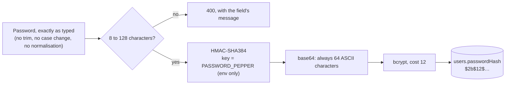

# 0039 · Passwords are peppered before bcrypt

Status: accepted · 2026-11-22

## Context

Passwords have been hashed with bcrypt at cost 12 since email sign-up arrived
(FR-08, [0004](0004-sessions-as-signed-cookies.md)). bcrypt reads only the
first **72 bytes** of what it's given and silently ignores the rest. So two
passwords that share their first 72 bytes would both open the same account.

To keep that from happening without anyone knowing, validation has refused
any password over 72 bytes from the start ([0011](0011-a-name-and-a-role-on-the-account.md)
explains the byte count). That kept the password exactly as typed, but it was
a byte limit, and Thai
takes three bytes a character in UTF-8. **A Thai password stopped at 24
characters**, an English one at 72. ASVS V6.2.9 asks that passwords of at
least 64 characters be allowed, so a 64-character Thai password (192 bytes)
had to work.

Raising the limit alone would bring the truncation back: bcrypt would quietly
use the first 72 bytes and ignore the rest, which V6.2.8 rules out (a password
is checked exactly as received).

## Decision

**Every password goes through HMAC-SHA384, keyed with a server secret
(`PASSWORD_PEPPER`), and bcrypt hashes the result:**

```
passwordHash = bcrypt( base64( HMAC-SHA384(key = PASSWORD_PEPPER, password as UTF-8) ), cost 12 )
```



Each part has a reason:

| Choice | Why |
| :--- | :--- |
| A pre-hash at all | Every password, of any length and in any script, becomes 64 characters, so bcrypt sees all of it |
| HMAC with a secret, not a plain SHA | A plain `bcrypt(sha(password))` can be "shucked": an attacker holding raw SHA hashes leaked from another site tests them against ours and skips bcrypt's cost. A keyed HMAC can't be matched without the pepper |
| SHA-384, not SHA-512 | 48 bytes are 64 characters of base64, inside bcrypt's 72. SHA-512's would be 88, and bcrypt would cut them again |
| base64, not raw bytes | Raw output can contain a zero byte, where some bcrypt implementations stop reading. base64 is plain ASCII |
| Cost 12, as before | Each hash still carries its cost, and the work per guess doesn't change |

- **The limit is now 8 to 128 characters,** counted by code point, so an emoji
  counts once. The minimum is unchanged. The ceiling only bounds the work one
  request can ask for.
- **The pepper is a secret of its own,** required at boot like `JWT_SECRET`,
  with no fallback and at least 32 bytes. Its text is the HMAC key. It is per
  developer, like `JWT_SECRET`; `server/.env.example` has the command.
- **It is not derived from `JWT_SECRET`.** Rotating `JWT_SECRET` signs everyone
  out ([0004](0004-sessions-as-signed-cookies.md)); if the pepper came from it,
  the same rotation would lock everyone out.
- **The client sets no `maxLength`.** A browser cuts a pasted value at
  `maxLength` without saying so, so a password manager would save the long
  password while the account got the short one. The server's message under the
  field says what the limit is.
- **No migration.** Hashes made before this change don't match any more. Every
  account so far is a development account; password accounts are re-created,
  and Google accounts are unaffected.

What a leak gives an attacker:

| Leaked | Before | Now |
| :--- | :--- | :--- |
| The database only (a dump, a backup) | bcrypt hashes to crack offline | Nothing testable: every guess needs the pepper |
| The pepper only | — | Nothing: no hashes to test it against |
| Both | — | Plain bcrypt strength, as before |

Tests: `auth-password.test.js` checks the pre-hash against RFC 4231's published
HMAC-SHA384 value, its 64-character shape, and that another pepper doesn't
verify. `auth.test.js` registers and signs in with 64 Thai characters, accepts
128 and refuses 129, refuses a password that matches only in its first 72
bytes, and checks that the stored hash doesn't match the raw password.
`env.test.js` checks boot refuses a missing or short pepper.

## Alternatives considered

- **Argon2id instead of bcrypt.** It has no 72-byte limit and is the current
  first choice for password storage. Node's built-in `crypto.argon2` arrived in
  Node 24.7.0, so every machine would need that or later (the one this was
  checked on runs 24.5.0). We chose not to change the Node version for this,
  because an upgrade could bring bugs of its own. An Argon2 npm package would
  work on older versions, but it adds a native add-on, and we
  prefer built-ins (AGENTS.md). The pre-hash keeps bcrypt and needs neither.
  Worth knowing if this is reopened: `server/Dockerfile` (`node:24-alpine`) and
  CI (`node-version: 24`) don't pin a minor version, so they already take the
  newest 24.x.
- **A plain SHA pre-hash.** Open to shucking (above), for no saving: the HMAC
  costs the same.
- **Raising the limit, with no pre-hash.** bcrypt would silently use the first
  72 bytes, against V6.2.8.
- **Unicode normalisation (NFKC)** before hashing, which NIST SP 800-63B
  suggests. It would change the password before checking it, against V6.2.8.
  The cost of not doing it: the same-looking password typed as different code
  points (Thai `ำ` as one character, or as `ํ` + `า`) won't match. The same keys
  on the same keyboard always send the same characters, so this takes a person
  switching input methods.
- **Accepting old hashes and re-hashing them at the next sign-in.** There are
  no real accounts to keep. It would also keep the 72-byte truncation alive for
  old accounts, and double bcrypt's work on every failed sign-in.
- **A version marker next to each hash** (for example `pepperVersion`), so a
  new pepper or algorithm could be brought in and each account re-hashed at its
  next sign-in. There's nothing to move to yet, and an unused field is one more
  thing to get right. Without it, ASVS V11.2.2 (crypto agility) isn't met.

## Consequences

- **Every process needs `PASSWORD_PEPPER`.** `env.js` is loaded by the server,
  the pipeline and the scripts (through `connect.js`), so each refuses to start
  without it, as it already does without `JWT_SECRET`. CI has a throwaway value.
- **Losing the pepper makes every password account unusable.** Back it up next
  to `MONGO_URI`. Google sign-in doesn't depend on it.
- **The pepper can't be rotated.** Every hash depends on it. A new one would
  mean every password user setting a new password.
- **Leaking the pepper alone exposes nothing,** and a leaked database alone
  can't be tested offline.
- **Existing password accounts stop working on every database** when this
  ships. Their owners register again.
- **The cost of a sign-in is the same:** one HMAC is microseconds next to
  bcrypt's cost 12.
