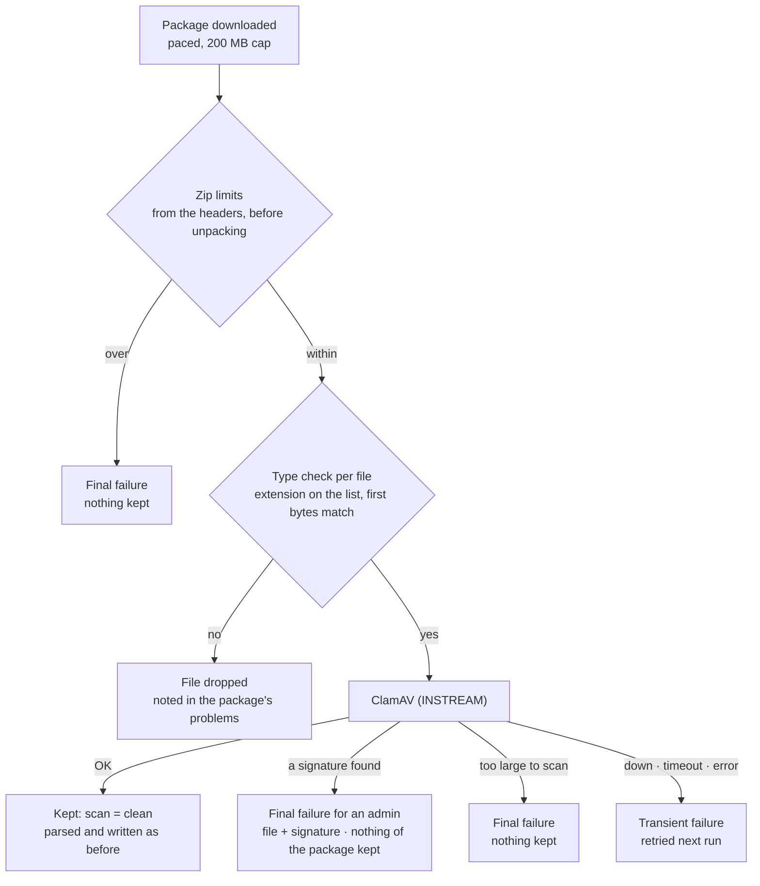

# 0040 · Files from e-GP are checked and virus-scanned before they're kept

Status: accepted · 2026-11-22

## Context

Every document the platform holds comes from e-GP, as a zip package or a
single PDF ([0020](0020-read-the-whole-egp-package.md)). The pipeline unpacks
it, reads the PDFs with pdf.js (`pdf-parse`, and `pdf-to-img` for OCR), and
keeps the files under `server/data/documents/`. Since
[0038](0038-preview-serves-stored-files-only.md) the preview serves those
stored files to anyone reading a TOR. Three things were missing on the way in:

- **Unpacking had no limits.** The download was capped (200 MB per package),
  but every entry of the zip was unpacked with no check on how many there were
  or how large they became. A small zip can unpack to gigabytes (a zip bomb)
  (ASVS V5.2.3).
- **Bytes were never checked against names.** An entry named `.pdf` went to
  pdf.js whatever it held, and every entry was written to disk whatever its type
  (ASVS V5.2.2).
- **Nothing was scanned.** A file e-GP served was kept, parsed and, through
  the preview, sent to visitors' browsers as it came (ASVS V5.4.3). e-GP is a
  government system, and agencies upload what they upload. We had no way to
  know whether a file was known to be malicious.

What was stored, measured on 2026-11-22 (1,013 packages on a development
machine):

| | Median | p99 | Most |
|---|---|---|---|
| Files kept per package | 3 | 13 | 31 |
| Package, unpacked | 1.3 MB | 66.5 MB | 179.7 MB |
| One file | | | 99.7 MB |

The kept files were `.pdf`, `.xls` and `.xlsx` only, and all 2,930 PDFs started
with `%PDF-`.

## Decision

**A file is kept only after three checks, in this order, on the bytes in
memory: the zip's limits, the file's type, and a ClamAV scan.** Nothing
reaches pdf.js, OCR or the disk before all three pass.

### The zip's limits

Checked on the sizes the zip's central directory declares, before any entry
is unpacked. adm-zip 0.6.1 never inflates an entry past its declared size
(CVE-2026-39244), so a header that lies only cuts its own entry short, and
that entry then fails its CRC check.

| Limit | Value | Most seen |
|---|---|---|
| Files in one package | 100 | 31 |
| One file, unpacked | 200 MB, the package cap | 99.7 MB |
| All files, unpacked | 400 MB, twice the package cap | 179.7 MB |

`EGP_PACKAGE_MAX_MB` raises the package cap for a retry by hand, and the
unpacked limits follow it.

### The type check

| Extension | Must start with | Then |
|---|---|---|
| `.pdf` | `%PDF-` | Scanned; may be parsed, read by OCR and served |
| `.xlsx`, `.docx` | `PK\x03\x04` (a zip) | Scanned and kept; never opened or served |
| `.xls`, `.doc` | `D0 CF 11 E0 A1 B1 1A E1` (OLE) | Scanned and kept; never opened or served |
| anything else, or a mismatch | | Not kept. One line in the package's `problems` |

Only PDFs are ever parsed or served, so for them the check is exact. For the
Office files, `PK` proves a zip, not a workbook; that's enough for files
nothing opens. A zip inside a package is "anything else", so nothing is ever
unpacked twice.

### The scan

- **ClamAV's daemon, clamd,** runs as its own container
  (`clamav/clamav:1.4_base-debian`, 1.4 being ClamAV's long-term-support
  release). The pipeline talks to it over TCP with the `INSTREAM` command, in
  `pipeline/shared/clamd.js`, built on Node's `net` module. No npm package.
- **A detection fails the whole package.** Nothing of it is kept. The failure
  is final, so it isn't downloaded again every night, and it shows in the
  admin's pipeline failures with the file's name and ClamAV's name for what
  it found. A TOR already processed keeps its earlier package.
- **Too large to scan is never clean.** clamd skips content past its
  `MaxFileSize` and `MaxScanSize` and, by default, still answers `OK`. The
  container sets `AlertExceedsMax yes`, so clamd reports
  `Heuristics.Limits.Exceeded…` instead, and the pipeline reads that as "not
  scanned", a final failure. A file larger than clamd's `StreamMaxLength`
  (200 MB, the same in `docker-compose.yml` and `clamd.js`; a test checks they
  agree) is refused before a byte is sent, because past it clamd hangs up
  mid-stream and its answer can be lost to the reset.
- **The scanner is found through `CLAMD_HOST`** (and `CLAMD_PORT`, default
  3310). Each step that downloads (the nightly download, `ingest:add`, the
  admin page's add and re-download buttons) checks first:

| `CLAMD_HOST` | What happens |
|---|---|
| Set, and clamd answers `PING` | Files are scanned |
| Set, and clamd doesn't answer | The step doesn't start; nothing is downloaded |
| Unset, production | The step doesn't start: production keeps no file it hasn't scanned |
| Unset, anywhere else | Files are kept marked `unscanned`, with a warning. The pipeline works on a laptop without clamd's 3–4 GiB of RAM |

### The result is kept with the file

Each package file, each TOR part and the TOR's `document` carry
`scan: { result, signature, scannedAt }`. `result` is `clean`, `unscanned`,
`infected` or `wrong-type`; a record from before this decision has none, which
counts as unscanned.

**The preview serves a file only when its result is `clean`.** Otherwise it
answers 404 with a code the viewer shows a card for, with the e-GP button:

| Result | Code | The viewer says |
|---|---|---|
| none, or `unscanned` | `DOCUMENT_NOT_SCANNED` | เอกสารนี้ยังตรวจความปลอดภัยไม่เสร็จ |
| `infected`, `wrong-type` | `DOCUMENT_BLOCKED` | เราไม่แสดงไฟล์นี้ … (ผลตรวจอาจผิดพลาดได้) |

A withheld file is never swapped for an older package's clean copy, which
would show a superseded document as the current one. The card says what
happened and that the check can be wrong; it never suggests the agency did
anything (AGENTS.md §7).

### Files already stored: the rescan

`npm run ingest:scan` scans every stored file with no `clean`, `infected` or
`wrong-type` result. It checks the type, sends the file to clamd and writes the
result on every record of that file. A flagged file is deleted, and its
records stay, saying why. `--all` scans clean files again with today's
signatures; `--id` does one TOR. `--self-test` sends the EICAR test string,
built in memory, and needs it flagged; it touches no database, so it's safe
on any machine.

## Alternatives considered

- **Scan during the preview request.** It adds latency and makes every
  preview depend on clamd being up, and the pipeline would still parse files
  nothing had scanned ([0038](0038-preview-serves-stored-files-only.md)).
- **Scan after writing to disk.** It leaves unscanned bytes on disk and lets
  pdf.js parse them first. The bytes are in memory at that point anyway.
- **Keep the package minus a flagged file.** It saves the rest of a package
  for a rare case, at the cost of records with no file and a download step
  that half succeeds. A detection in a government package is worth a person's
  look.
- **An npm clamd client** (`clamscan`, `clamdjs`). We need one command, and
  about 120 lines of `node:net` do it.
- **A development switch to serve unscanned files.** It's one wrong setting
  away from production.
- **Run real clamd in CI.** It loads signatures for minutes and needs about
  4 GiB. The tests talk to a fake clamd instead, and `--self-test` checks the
  real one on deploy.

## Consequences

- **After this deploys, every stored file is unscanned,** so previews show
  the "not scanned yet" card until `npm run ingest:scan` has run once. Run it
  right after the deploy, against the server's own files.
- **A developer without clamd** gets new files marked unscanned, and sees no
  previews until they run the container and one rescan. Running clamd takes
  3–4 GiB of RAM; ClamAV's docs ask for 3 GiB at least.
- **Production needs the `clamav` service running** for the nightly download
  and for the admin page's add and re-download buttons. Without it they refuse,
  and say so in the server log.
- **A false positive blocks that TOR's update** until ClamAV's signatures
  change and someone retries with `--retry-failed`. There is no override, on
  purpose.
- **Fewer file types are kept.** [0020](0020-read-the-whole-egp-package.md)
  kept every project file; now only PDF, Excel and Word files whose bytes match
  their names. The packages measured held nothing else.
- **A file blocked by a later rescan can stay in a browser's cache** for up to
  an hour (`Cache-Control: public, max-age=3600` on the preview).
- **Bidding documents and announcements with no record** (the older layout
  [0038](0038-preview-serves-stored-files-only.md) left a folder scan for) are
  no longer served: a file with no record has nowhere to keep its result.
- **Revisit** if clamd's RAM is too much for the host, or if false positives
  turn up. A weekly `--all` rescan is a small addition if new signatures should
  reach old files sooner.
