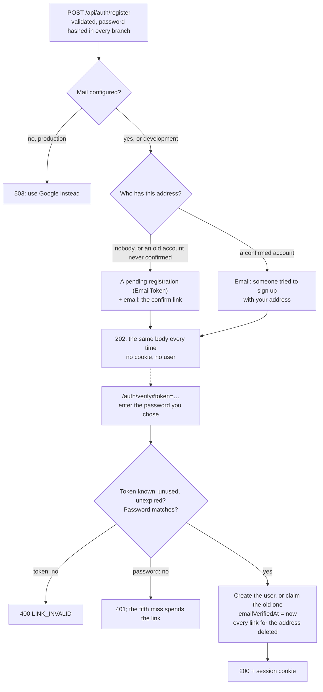

# 0041 · An address is confirmed before the account exists

Status: accepted · 2026-11-22

## Context

Registering created the account and signed you in at once
([0004](0004-sessions-as-signed-cookies.md)). Nothing checked that the address
belonged to whoever typed it, and three things followed from that.

- **An account could be taken over before its owner ever arrived.** Someone
  registers a password account with your address. Later you click "Sign in
  with Google", and [0005](0005-google-sign-in-links-by-verified-email.md)
  links Google to the account that already uses your address, which is theirs.
  You share one account, and their password still opens it. This is called
  pre-account hijacking.
- **Registration said which addresses had accounts.** A taken address got
  409 "อีเมลนี้ถูกใช้งานแล้ว". 0004 had noted that closing this "takes the
  verify-by-email flow".
- **Signing in said it too, more quietly.** A missing account skipped bcrypt
  and answered sooner. A password sign-in to an account that signs in only
  with Google answered 500, because bcrypt was asked to compare against
  nothing.

The same link also replaced a `googleId` already on the account, so a second
Google account claiming the same address took the first one's place (ASVS
V6.8.1).

A common fix creates the user unverified and refuses sign-in until a link is
clicked. Two things count against it here:

- **Every reader of users has to remember "until verified":** no sign-in, no
  match emails, no consent, no Google link. Some of those readers are other
  features (the notification senders), so the rule would live in many places.
- **A link alone isn't enough.** If the person whose address was used clicks
  the stranger's link, as people do with an email that looks routine, the
  account is verified with the stranger's password, and the takeover above
  works again.

## Decision

**A registration waits outside `users` until the address is confirmed, and
confirming asks for the password chosen at sign-up.**

- **The pending registration** is an `EmailToken` document
  ([email-token-schema.md](../database/email-token-schema.md)). It holds the
  address, the password's hash (made as the user's is,
  [0039](0039-passwords-are-peppered-before-bcrypt.md)), the name, the
  consent, the token's SHA-256, and an expiry. A TTL index deletes it after a
  day, so no unconfirmed personal data outlives it (PDPA). Nothing in `users`
  changes until the address is confirmed, so "unverified" needs no rule
  anywhere else.
- **One answer for every address** (ASVS V6.3.8): 202 "ส่งอีเมลแล้ว …",
  whether the address is new, already has an account, or is waiting for a
  link. A confirmed account's owner gets "someone tried to sign up with your
  address", with no link. Every branch hashes the password, and mail goes out
  after the response, so neither shows in the response time.
- **The token** (ASVS V6.4.1, V11.5.1): 32 bytes from the operating system's
  CSPRNG, as base64url, stored only as its SHA-256. It works once, for 24
  hours. Five wrong passwords spend it. It travels after `#` in the link, which
  never leaves the browser, so no server, proxy or `Referer` sees it. The page
  posts it, then clears it from the address bar.
- **Confirming is signing in.** The right password creates the account with
  `emailVerifiedAt`, sets the session, and deletes every other link for the
  address. There is no separate step.
- **Accounts from before this decision.** They have no `emailVerifiedAt`.
  - An account with a `googleId` counts as confirmed: Google checked the
    address when it created or linked the account.
  - A password-only account never confirmed can be claimed: registering again
    with its address and confirming sets its password, name and consent. Its
    role and profile stay, so an admin doesn't need `npm run role` again.
  - The right password on such an account gets 403 `EMAIL_NOT_VERIFIED`
    ("register again with this address"). Only someone who knows the password
    sees it.
- **Signing in costs one bcrypt compare, always.** A missing account and an
  account with no password compare against a hash made once at boot, so all
  three failures take the same time and give the same 401.
- **Google** links by address only under these rules (the
  [0005](0005-google-sign-in-links-by-verified-email.md) update has the
  detail):
  - a confirmed account keeps its password;
  - an account never confirmed loses its password, which is what ends a
    pre-hijack made before this decision;
  - an account already linked to a different Google account is refused, never
    replaced (ASVS V6.8.1);
  - the account's owner is emailed when Google is linked (part of ASVS
    V6.3.7).

  Pending registrations for the address are deleted when Google creates or
  links the account.
- **Mail.** `createApp({ mail })` takes `{ configured, send }`. The default is
  the notifications feature's `sendEmail`, wired in `app.js`, because
  notifications already imports auth's `requireAuth`. Tests pass a recorder.
  - **Production without SMTP:** registration answers 503
    `SIGNUP_UNAVAILABLE` before any lookup, saying Google sign-in still works.
  - **Development without SMTP:** the confirm link is printed to the server
    log, marked development only, with the address masked.
  - **The emails** carry nothing a user typed, not even the name, so there's
    nothing to escape. They're transactional, so they need no consent, unlike
    FR-14's match emails.
- **Limits** ([0007](0007-rate-limiting-on-the-auth-routes.md)): registration
  is also limited to 3 an hour per address, counting every request, so no one
  can flood a stranger's inbox. Confirming is limited to 30 per 15 minutes per
  caller, like login.
- **Answers a screen can tell apart.** `HttpError` takes an optional string
  `code` (`LINK_INVALID`, `WRONG_PASSWORD`, `TOO_MANY_TRIES`,
  `ALREADY_VERIFIED`, `EMAIL_NOT_VERIFIED`, `SIGNUP_UNAVAILABLE`), and the
  error handler sends it. The handler also stopped hiding an `HttpError`'s
  message on a production 5xx: those are messages written for people, and the
  503 above has to reach them. Unexpected errors are still hidden.

## Alternatives considered

- **Create the user unverified, and refuse sign-in until the link is opened.**
  It works, but "until verified" then has to hold wherever users are read,
  including other features. With a link-only confirmation it also leaves the
  stranger's password on a verified account (Context).
- **A link-only confirmation, with no password.** One field less, at the cost
  just described.
- **Choose the password after confirming** (register with the address only).
  It closes the same gap, but changes the form and the flow more than asking
  for the password again.
- **A separate "resend" endpoint.** The form already holds the values, so
  "ส่งอีกครั้ง" submits them again under the same limits.
- **Confirm in the same browser without the password**, through a cookie set
  at registration. It saves typing in the common case, and adds a second path
  to secure and test.
- **Require SMTP at boot.** It would stop CI and every developer without a
  mail account. The 503 limits it to the one route that needs mail.
- **A migration marking old accounts verified.** It would verify exactly the
  accounts nobody ever proved. The claim path covers them instead.

## Consequences

- **Registering no longer signs you in.** You open the link from your inbox,
  or, in development without SMTP, from the server log.
- **Password sign-up in production needs SMTP and a real `EMAIL_FROM`.**
  Without them it answers 503, and Google sign-in still works
  ([deployment-checklist.md](../deployment-checklist.md)).
- **A second collection holds personal data,** briefly: `emailtokens`, for
  at most a day per registration.
- **Old password accounts must be claimed once.** Their passwords stopped
  working with 0039 anyway.
- **AGENTS.md has a second exception** to "a user's records are found by
  `req.user.id`": the confirm token finds a pending registration, and only its
  address finds the user.
- **The taken-address branch does one database insert fewer** than the others.
  Both hash the password, so the gap is a few milliseconds next to about
  250 ms of bcrypt. It's noted, not padded out.
- **Tests that need someone signed in** create a confirmed account in the
  database (`test/helpers/accounts.js`) and sign in through `/login`. Tests
  about registration walk the whole journey with a recording mailer.
- **Password reset can reuse this:** `EmailToken`'s `purpose` already allows
  `reset-password`.
- **Revisit** if confirm emails are often lost (a resend limit of 3 an hour
  may then be too tight), or if a mail provider needs a link it can track,
  which the `#` fragment can't be.

## Update · 2026-11-22: reset reuses the tokens

[0042](0042-passwords-can-be-changed-reset-and-checked.md) uses `EmailToken`
with `purpose: 'reset-password'`: the same 32-byte token after `#`, stored as
its SHA-256, but lasting an hour, and only the latest one per address works.
Its page reads the token with the same hook as `/auth/verify`.
