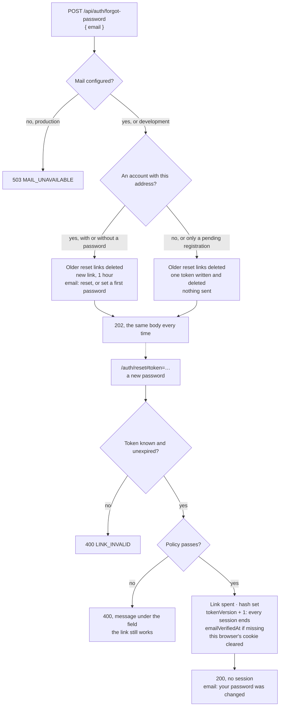

# 0042 · Passwords can be changed, reset and checked

Status: accepted · 2026-11-22

## Context

- **A forgotten password had no way back.** The only remedy was waiting out
  the 15-minute lockout ([0007](0007-rate-limiting-on-the-auth-routes.md)),
  and the sign-in form said "ยังรีเซ็ตรหัสผ่านไม่ได้". [0004](0004-sessions-as-signed-cookies.md)
  had left reset for when a mailer arrived, and
  [0041](0041-an-address-is-confirmed-before-the-account-exists.md) brought
  one, with one-time tokens whose `purpose` already allowed `reset-password`.
- **A password couldn't be changed either,** and an account that signs in only
  with Google couldn't add one. [0005](0005-google-sign-in-links-by-verified-email.md)
  left that case to whichever branch built reset.
- **Length was the only rule** on a new password: 8 to 128 characters
  ([0039](0039-passwords-are-peppered-before-bcrypt.md)). Nothing refused
  `password123`, which tops every breach list, or `gipdp2026`, which anyone can
  guess from the product's name (ASVS V6.2.4, V6.2.12, V6.1.2, V6.2.11).
- **An admin couldn't help a locked-out user** in any way (ASVS V6.4.6).
- **Sessions could already be revoked:** `tokenVersion` on the user, compared
  in `requireAuth` and bumped at logout.

## Decision

**One policy checks every new password. A forgotten password is reset by an
emailed link, which signs nothing in. A signed-in user can change their
password, which ends every other session. An admin can send the link, never
set a password.**

### The policy

`passwordProblem(password, { email, name })` in
`features/auth/password-policy.js` returns the message to show under the
field, or `null`. Registration, reset and change call it. Sign-in doesn't: an
old weak password still signs in, and is replaced only when its owner changes
it.

| Rule | Refused when | ASVS |
| :--- | :--- | :--- |
| Length | under 8 characters, or over 128 counted by code point | V6.2.1, V6.2.9 |
| Common and breached | it's in the list, ignoring case | V6.2.4, V6.2.12 |
| Context words | lowercased and trimmed of digits, symbols and spaces at both ends, it **equals** a listed word, the email's local part, or a word of the user's name | V6.1.2, V6.2.11 |

- **The list** is `features/auth/data/common-passwords.txt`: 46,945
  passwords, most common first.
  - **Source:** SecLists' `Pwdb_top-100000.txt`, compiled from public breaches,
    at commit `12274c9`. `common-passwords.LICENSE` beside it holds the commit,
    the source file's SHA-256 and SecLists' MIT licence.
  - **Filter:** `server/scripts/build-common-passwords.js` keeps the entries of
    8 to 128 characters, lowercases them, and keeps each once. It also drops
    three lines with broken bytes. It reads a file you downloaded, so it needs
    no network.
  - **Why this list:** V6.2.4 asks for at least the top 3,000 passwords that fit
    the policy. SecLists' better-known `10k-most-common.txt` has only 2,087 of
    8 characters or more.
  - **At runtime** it's read once, at import, into a `Set`: a few MB of memory,
    and one lookup per check.
- **The context words** are V6.1.2's documented list: `gipdp`, `mjolnir`,
  `mjölnir`, `egp`, `e-gp`, `gprocurement`, `procurement`, `kasetsart`, `ku`
  and `จัดซื้อจัดจ้าง`, plus the user's email local part and each word of
  their name. The code exports them as `CONTEXT_WORDS`, and a test pins that
  list to this one.
- **The match is exact.** `Gipdp2026!` and `!somchai99` are refused, while
  `mygipdpaccount` passes, and so does `kudos2026`, though it starts with
  "ku". A short word still counts, because the trimming does the work:
  `ku12345678` trims to `ku`.
- **No composition rules** (no "must contain a digit"), as V6.2.5 asks.

### Forgot and reset (ASVS V6.4.3, V6.3.8, V6.3.6)

- **One answer for every address** (V6.3.8): 202 "ถ้ามีบัญชีที่ใช้อีเมลนี้
  เราได้ส่งลิงก์ตั้งรหัสผ่านใหม่ไปแล้ว". Mail goes after the response. An
  unknown address writes and deletes a token too, so both branches do the same
  kind of database work.
- **Nothing goes to an unknown address.** A "there's no account here" email
  would help someone who forgot which address they used, but it sends mail to
  an address nobody proved they own.
- **The token** is made as 0041's: 32 bytes from the CSPRNG, as base64url,
  stored only as its SHA-256, and carried after `#`, so no server, proxy or
  `Referer` sees it.
  - It lasts an hour and works once.
  - Only the latest works, because each request deletes the older ones.
  - It's spent in one write (`findOneAndDelete`), so two uses can't both set a
    password.
  - The policy runs before it's spent, so a refused password can be replaced
    without asking for a new link.
- **A reset signs nothing in** (V6.3.6). The emailed link alone never gives a
  session.
  - `tokenVersion + 1` ends every session, an attacker's included, and this
    browser's cookie is cleared.
  - The page says the new password works and links to sign-in.
  - Reset is recovery (V6.4.3), which ASVS allows by email, so signing in after
    it would be one reading of V6.3.6, not a breach of it. This is the cautious
    reading, and it costs one step.
- **No password is asked for at reset,** since that's what the person forgot.
  The link proves the mailbox, and no MFA exists for a reset to bypass (V6.4.3).
- **A Google-only account** uses the same link to set its first password. Its
  email says "set" instead of "reset".
- **The link proves the address,** so `emailVerifiedAt` is set if missing. An
  account from before 0041, never confirmed, can therefore be claimed by reset
  as well as by registering again.

### Change, signed in (ASVS V6.2.2, V6.2.3)

- **`POST /api/auth/password` `{ currentPassword, newPassword }`,** behind
  `requireAuth`, on a new `/account` page linked from the profile.
- **The current password is checked first** (one bcrypt compare).
  - A wrong one is 401 `WRONG_PASSWORD`, with the message under its field.
  - An account with no password is 400 `NO_PASSWORD`. The page then offers to
    email a link to set one, which is the forgot route with the account's own
    address.
- **Then the policy runs on the new password,** with the account's own email
  and name as context words.
- **Then `tokenVersion + 1` and a new cookie for this browser,** so every other
  session ends and this one stays (V7.4.3).
- **The same password as before is allowed.** ASVS doesn't ask otherwise, and
  refusing it tells the user nothing useful.
- **The public user says whether an account has a password:** `toPublicUser`
  adds `hasPassword` when the hash was fetched, and leaves it out otherwise.
  `/account` asks `/me` instead of trusting the user in memory, because other
  features' answers don't fetch the hash.

### An admin sends the link (ASVS V6.4.6)

- **`POST /api/admin/users/password-reset` `{ email }`,** behind the admin
  router's guard and `adminCostly`, from a card on `/admin`'s overview.
- **It sends the same link,** and the email says an admin sent it.
- **The admin never sees the link and can't choose a password:** the route has
  no password field, and its 202 carries no link. Only the account's owner, at
  their inbox, can finish.
- **An unknown address is a 404 here.** Admins may know which accounts exist,
  unlike the public.
- **The handler is auth's** (`createAdminPasswordResetHandler(mail)`), mounted
  by the admin router, so `createAdminRoutes` now takes the mailer as
  `createAuthRoutes` does.

### Telling the owner (ASVS V6.3.7)

- **A changed or reset password emails the account's address,** after the
  response: "รหัสผ่านของคุณถูกเปลี่ยนแล้ว". The email says to use "forgot
  password" if it wasn't them, which works from any browser.
- **With 0041's notice for a linked Google account,** every change to how an
  account signs in is now told to its owner.
- **No text a user typed** goes into these emails.

### Limits ([0007](0007-rate-limiting-on-the-auth-routes.md))

| Limiter | Route | Key | Window | Limit |
| :--- | :--- | :--- | ---: | ---: |
| `forgotByIp` | `POST /auth/forgot-password` | address | 1 hour | 10 |
| `forgotByEmail` | `POST /auth/forgot-password` | normalised email | 1 hour | 3 |
| `resetByIp` | `POST /auth/reset-password` | address | 15 min | 30 |
| `passwordChangeByUser` | `POST /auth/password` | account | 1 hour | 10 |

All four count every request. The admin route shares `adminCostly`.

### Mail

- **Production without SMTP:** forgot-password and the admin route answer 503
  `MAIL_UNAVAILABLE`, as registration answers `SIGNUP_UNAVAILABLE`.
- **Development without SMTP:** the server log prints the link, marked
  development only, with the address masked and the link's kind named, as for
  confirm links.

## Alternatives considered

- **The HIBP Pwned Passwords API.** It covers far more breached passwords than
  a local list, and k-anonymity sends only five hex characters of the
  password's SHA-1. But it adds an outbound call to every registration, reset
  and change, and forces a choice, when it's down, between refusing sign-ups
  and letting them through unchecked.
- **Refusing any password that contains a context word.** It also catches
  `mygipdpaccount`, but has to make exceptions for short words inside ordinary
  ones (`ku` in "kudos", `egp` in "legpress").
- **Signing in after a reset.** One step fewer, but then the emailed link plus
  any new password yields a session (the reset section above).
- **Mailing "no account here" to an unknown address** (the reset section
  above).
- **Asking for the current password at reset.** That's what was forgotten.
- **A longer login lockout now that reset exists.** It would also make a
  malicious lockout last longer: five wrong guesses still lock anyone's account
  for 15 minutes.
- **An admin route that sets a password.** V6.4.6 rules it out.
- **Composition rules.** V6.2.5 rules them out.

## Consequences

- **A reset takes two steps:** set the password, then sign in with it.
- **Every new password is checked; an old one isn't.** A weak password from
  before this decision keeps working until its owner changes it.
- **The list is 456 KB in the repository.** Updating it means downloading a
  newer SecLists file and running the build script. Nothing fetches it at
  runtime.
- **AGENTS.md has a third exception** to "a user's records are found by
  `req.user.id`": the reset token finds a reset link, and only its address
  finds the user. Like the confirm token, it's a secret only the address's
  owner received.
- **`/auth/verify` and `/auth/reset` read their tokens with one hook,**
  `useLinkToken`. Its cache is keyed by page, so a confirm token is never
  offered to the reset page.
- **The 15-minute lockout stays,** but it's no longer the only way out
  ([0007](0007-rate-limiting-on-the-auth-routes.md)).
- **Revisit** if the local list misses passwords that matter (then HIBP), or
  if people often forget which address they signed up with.
