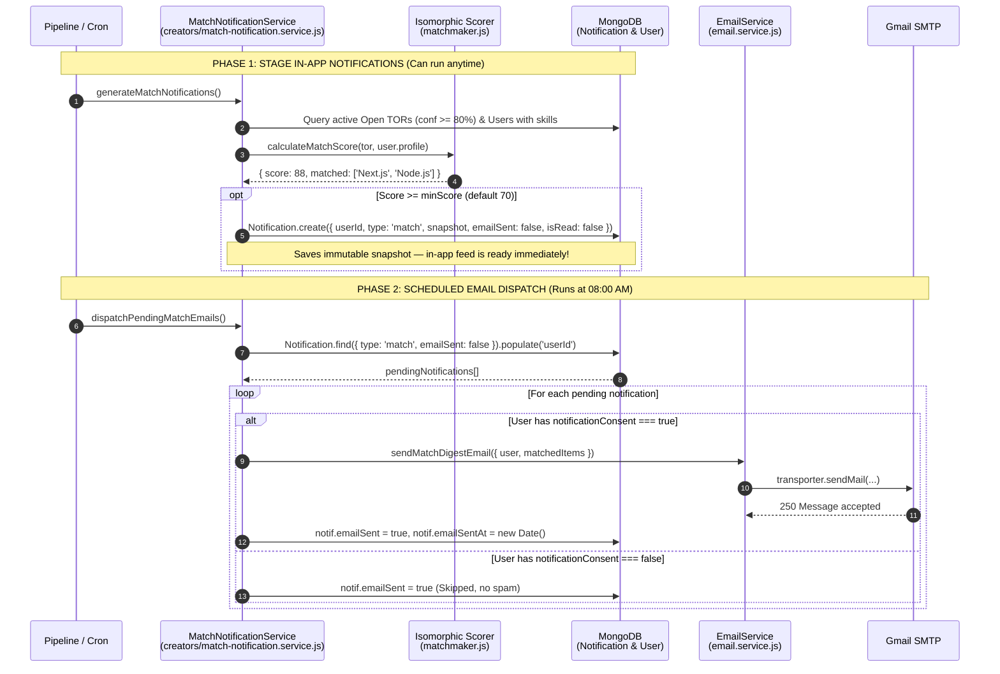
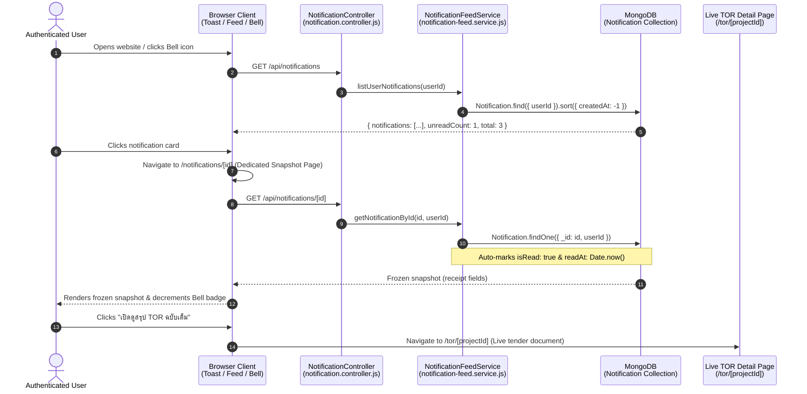
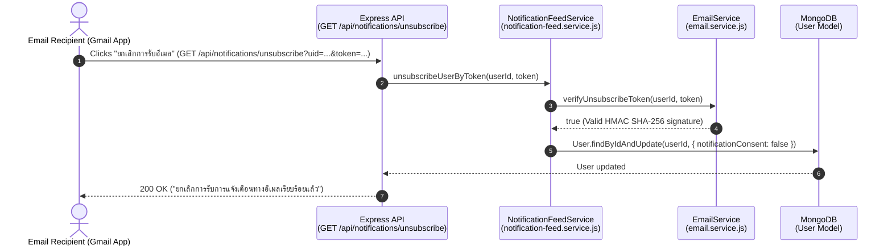
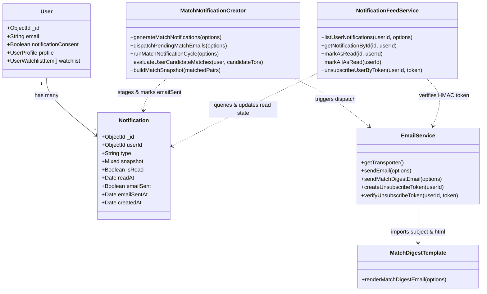

# Notification System — Part 1: Core Architecture & Match Alerts (`FR-13`, `FR-14`, `FR-16`, `FR-18`) — Decision & Design Plan

*Previously titled: "Proactive Match Notification System (`FR-13`, `FR-14`, `FR-18`) — Decision & Design Plan"*  
*Part 1 of 2 — extended by [watchlist-notification-decision-plan.md](./watchlist-notification-decision-plan.md) for watchlist amendment, status-change, and deadline alerts.*

**Status:** Implemented — see [features/notifications-and-alerts.md](../../features/notifications-and-alerts.md)  
**Revision:** 3  
**Created:** 2026-11-01  
**Last Updated:** 2026-11-25  

> **Evolution & Implementation Notes:**
> - **What stayed:** On-the-fly match scoring (`calculateMatchScore` / `matchFor`, ADR 0033), the immutable `Notification` snapshot collection, `/notifications` + `/notifications/[id]` pages, and two-phase staging → 08:00 AM email dispatch were implemented in `server/src/features/notifications/` and `client/app/(app)/(private)/notifications/`.
> - **What changed in the final code:**
>   - `PATCH /api/notifications/preferences` was not added as a separate route; notification preferences (`user.profile.matchNotification`, `user.notificationConsent`) are saved through the profile update flow.
>   - `NotificationToast` (`client/app/_components/notification-toast.tsx`) was not built; in-app alerts are surfaced via the header bell badge and `/notifications`.
>   - Earlier drafts that embedded `User.matches` or stored top-level `title` / `body` / `targetUrl` fields on `Notification` were superseded by the polymorphic `Notification.snapshot` (`Mixed`) schema.
> - **What evolved:** On `2026-11-17`, [watchlist-notification-decision-plan.md](./watchlist-notification-decision-plan.md) (Part 2) extended this same architecture to cover watchlist `amendment`, `status_change`, and `deadline` alerts using the same `Notification` model and digest pipeline.
> - **2026-11-25:** Moved to `docs/decisions/design-plans/`.

This document explains the unified architecture of the **Profile-Match & Notification System (`FR-12`, `FR-13`, `FR-14`, `FR-16`, `FR-18`)**. 

The architecture establishes a clean, maintainable separation between **on-the-fly tender fit scoring**, **immutable notification event logging**, and **decoupled two-phase email delivery**:
1. **On-the-Fly Tender Fit Scoring (ADR 0033):** Profile match scores are evaluated dynamically in memory using the isomorphic scoring engine ([`calculateMatchScore`](../../../server/src/features/match/matchmaker.js) on the backend and [`matchFor`](../../../client/app/_lib/match.ts) on the frontend). **No match scores are stored inside the `User` document.** This prevents database bloat, avoids stale cache synchronization issues whenever tenders are amended or budgets change, and keeps `user.model.js` completely clean.
2. **Immutable Snapshot Notification Log (`Notification` Collection):** Rather than mutating dynamic foreign-key references or storing fragile pointers, notifications are stored as **immutable snapshot event logs** in a dedicated `notifications` collection (`server/src/models/notification.model.js`). Uses a polymorphic `snapshot: mongoose.Schema.Types.Mixed` payload so each event type (`match`, `amendment`, `deadline`, `status_change`) stores only its relevant data with zero unused `null` fields in MongoDB.
3. **Decoupled Two-Phase Architecture (Staging $\to$ Scheduled Dispatch):**
   - **Phase 1 (Data Preparation / Staging):** Runs during the night or whenever the ingestion pipeline extracts newly approved TORs. Evaluates matches in memory and stages `Notification` records into MongoDB (`emailSent: false, isRead: false`). In-app feed and toasts are immediately available.
   - **Phase 2 (Scheduled Morning Dispatch):** Runs at exactly 08:00 AM via cron / schedule. Queries staged notifications and dispatches Thai-first HTML digests via Gmail SMTP only to users with explicit `notificationConsent === true`. Marks `emailSent: true` so no email is ever duplicated.
4. **Dedicated Notification Pages (`/notifications` & `/notifications/[id]`):** Users view their notification feed at `/notifications`, and clicking an item opens `/notifications/[id]` (Dedicated Snapshot Detail Page) to inspect the frozen snapshot of what happened at that point in time, with a 1-click CTA leading into the live `/tor/[projectId]`.

---

# Architectural Decision: On-The-Fly Scoring vs. Immutable Notification Event Log

| Architectural Layer | Store / Model | Execution | Why This Design? |
| :--- | :--- | :--- | :--- |
| **Tender Fit Scoring** | **Zero DB Storage** (No `user.matches`) | Pure functional evaluation on the fly via `matchmaker.js` / `match.ts`. | **Zero Sync Hell & Zero Bloat:** Tender scores depend on both user profile and tender facts. Storing them in DB would require updating thousands of user records every time a tender is amended. Computing on the fly takes $< 0.1$ms. |
| **Notification Snapshot Log** | `Notification` (Dedicated Collection) | Stored as self-contained event snapshots via polymorphic `Mixed` schema. | **Audit & Historical Integrity (No Foreign Keys):** If a government agency amends a tender, changes its budget, or cancels it months later, past notifications retain their frozen evidence without breaking, altering history, or returning null references. |
| **Email Delivery Staging** | `emailSent` & `emailSentAt` in `Notification` | Decoupled into `generateMatchNotifications()` and `dispatchPendingMatchEmails()`. | **Predictable Delivery & Zero Spam:** Staging notifications beforehand ensures the 08:00 AM morning email dispatch is fast, reliable, and completely immune to duplicate sends. |

> **Conclusion for Team Alignment:**  
> - **No `matches` array is added to the `User` model.** `User` continues to store only `profile` and `watchlist`.  
> - The dedicated `Notification` model stores **all notification events** (Matches, Amendments, Deadlines, Status changes).  
> - **Duplicate Policy:** Notifications are recorded as aggregated event logs (e.g. *"เราพบ 5 โครงการที่คุณอาจสนใจ"*), avoiding alert fatigue without requiring fragile per-project tracking.  
> - In-app bell counters query `Notification.countDocuments({ userId, isRead: false })`.
> - **Channel Independence:** In-app notifications and toasts are ALWAYS delivered to all users in MongoDB. Gmail email dispatch is an OPTIONAL delivery channel that requires explicit `notificationConsent === true`.

---

# Use Case Specification

## Overview & How the Unified Match Architecture Works
Match calculation is performed isomorphically via pure functional evaluation (`calculateMatchScore` on the backend and `matchFor` on the frontend). It requires **zero persistent match score storage** in the `User` document:

```
                  AUTOMATION TRIGGER (Pipeline / Schedule):
                        Pipeline extracts new IT TORs
                        (run-job.js / scripts/notify.js)
                                      │
                                      ▼
                        ┌───────────────────────────┐
                        │    calculateMatchScore    │
                        │    (On-The-Fly Engine)    │
                        └─────────────┬─────────────┘
                                      │
                                      ▼
                        ┌───────────────────────────┐
                        │   PHASE 1: STAGE IN DB    │
                        │generateMatchNotifications │
                        └─────────────┬─────────────┘
                                      │
                                      ▼
                  ┌──────────────────────────────────────┐
                  │    MONGODB: `Notification` Model     │
                  │       (Immutable Snapshot Log)       │
                  │ • userId, type: 'match'              │
                  │ • snapshot: { matchedItems: [...] }  │
                  │ • isRead: false, readAt: null        │
                  │ • emailSent: false, emailSentAt: null│
                  │ (Polymorphic Mixed — zero nulls)     │
                  └──────────┬────────────────┬──────────┘
                             │                │
           ┌─────────────────┘                └────────────────┐
           ▼                                                   ▼
┌───────────────────────────────────────┐          ┌──────────────────────────────────────┐
│        [1] USER-FACING BROWSING       │          │       [2] NOTIFICATION CHANNELS      │
│ • Catalog Matched Mode Tab (/search)  │          │ • In-App Notification Feed           │
│   Evaluated dynamically via matchFor  │          │   (/notifications)                   │
│   in browser memory (Zero DB bloat)   │          │ • Snapshot Detail View               │
│ • Profile Instant Feedback Banner     │          │   (/notifications/[id])              │
│   "บันทึกสำเร็จ! พบ X โครงการที่เหมาะ"│          │ • Floating Toast (Session Throttled) │
│ • Header Bell Icon unread badge       │          │ • Top-right Bell Icon unread badge   │
│                                       │          │ • PHASE 2: 08:00 AM GMAIL DISPATCH   │
│                                       │          │   (Only if notificationConsent: true)│
└───────────────────────────────────────┘          └──────────────────────────────────────┘
```

1. **Phase 1: Generation & Data Staging (`generateMatchNotifications`):**
   - When the pipeline extracts and approves newly posted IT TORs with confidence $\ge 80\%$ (`NFR-17`), the generator evaluates registered user profiles in memory.
   - For matches $\ge \text{minScore}$ (default 70), writes an immutable snapshot into `Notification` with `emailSent: false`.
   - In-app notification feed, toast, and bell counter update immediately.
2. **Phase 2: Scheduled Morning Email Dispatch (`dispatchPendingMatchEmails`):**
   - Runs at scheduled digest hours (e.g. 08:00 AM Bangkok time).
   - Finds staged notifications with `emailSent: false`.
   - Checks if the user gave explicit PDPA consent (`notificationConsent === true`).
   - If consented, renders the Thai-first HTML digest (`renderMatchDigestEmail`) and delivers via Gmail SMTP (`nodemailer`).
   - Marks `emailSent: true, emailSentAt: new Date()` to prevent any duplicate sending.
3. **Instant Feedback on Profile Update (`/profile`):**
   - When a user updates skills or budget on `/profile`, the API can evaluate matches in memory on the fly.
   - Immediate success banner: *"บันทึกโปรไฟล์สำเร็จ! เราพบ X โครงการที่เหมาะกับคุณ [ดูโครงการ]"*.
   - **No instant email spam on profile edit:** New matches are gathered and sent in the regular scheduled digest.
4. **Channel Separation (In-App vs Email):**
   - Users with `notificationConsent: false` (or who clicked Unsubscribe) **still receive 100% of the in-app notifications, toasts, and bell updates**.
   - Turning off email only silences external Gmail delivery—it never blocks the in-app experience.

---

## Use Case 1: Discover & Stay Informed About Matched Opportunities (`UC-01`)

| Field | Description |
| :--- | :--- |
| **Use Case ID** | `UC-01` |
| **Use Case Name** | Discover High-Fit IT Procurement Opportunities via Matched Catalog, In-App Toast, and Proactive Email |
| **Related Requirements** | <ul><li>`FR-12` (User capability profile: skills & budget range)</li><li>`FR-13` (Score newly posted TORs against user profile)</li><li>`FR-14` (Proactive email notifications for high matches with user consent)</li><li>`NFR-01` (< 2s page load via pre-computed database matches)</li><li>`NFR-15` (Thai-first notifications and summaries)</li><li>`NFR-17` (Withhold extractions with < 80% confidence from public/notifications)</li></ul> |
| **Primary Actor** | Registered Developer / SME Bidder (Recipient) & Background Pipeline Scheduler (`run-job.js` / cron) |
| **Supporting Actors** | MongoDB (`TorInsight`, `Tor`, `User`, `Notification`), Gmail SMTP Transport (`nodemailer`) |
| **Preconditions** | 1. User has saved skills in `/profile`.<br>2. A newly posted IT TOR is processed with OCR/LLM confidence $\ge 80\%$ (`NFR-17`). |
| **Trigger** | Scheduled batch execution (`npm run notify:send`), pipeline job completion, or user visiting the web app. |
| **Main Success Scenario** | 1. **Automated Match Scoring on Server (`FR-13`):** Server evaluates `calculateMatchScore(tor, profile)`.<br>2. **Stage Notification in MongoDB (Phase 1):** Server inserts an immutable notification record with frozen receipt fields (`emailSent: false, isRead: false`).<br>3. **In-App Consumption:** User sees the toast notification and unread bell badge; clicking navigates to `/notifications/[id]` to inspect the frozen snapshot.<br>4. **Proactive Email Alert (Phase 2, `FR-14`):** At 08:00 AM, `dispatchPendingMatchEmails` checks `notificationConsent`. If `true`, sends a Thai-first email summary with 1-click unsubscribe link. |
| **Alternative Flows** | - **A1: Confidence Under 80% (`NFR-17`):** Held for admin review; never matched.<br>- **A2: Consent Disabled:** Notification snapshot is created for in-app feed, but email dispatch is safely skipped (`emailsSkipped += 1`).<br>- **A3: Email Failure:** SMTP network error logs a warning; notification remains logged. |
| **Postconditions** | Notifications are persistently recorded in `Notification` collection, powering in-app feed, while emails are delivered to consented users without duplicates. |

---

## Use Case 2: Manage Alert Channels, Cadence & One-Click Unsubscribe (`UC-02`)

| Field | Description |
| :--- | :--- |
| **Use Case ID** | `UC-02` |
| **Use Case Name** | Configure Alert Channels, Email Delivery Frequency, or One-Click PDPA Unsubscribe |
| **Related Requirements** | <ul><li>`FR-14` (Proactive email notifications with explicit consent)</li><li>`PDPA` (Explicit opt-in, off by default, easy to withdraw)</li><li>`NFR-15` (Thai-first UI and email copy)</li></ul> |
| **Primary Actor** | Authenticated User (on `/notifications`) or Email Recipient (via Email Unsubscribe link) |
| **Supporting Actors** | Frontend `NotificationsPage`, Backend `NotificationController`, MongoDB (`User`) |
| **Trigger** | User navigates to `/notifications` preferences tab or clicks the unsubscribe link in an email footer. |
| **Main Success Scenario** | 1. **In-App Toggle:** User updates consent switch on `/notifications` $\to$ `PATCH /api/notifications/preferences` updates `User.notificationConsent`.<br>2. **One-Click Unsubscribe from Email Footer:** Recipient clicks `"ยกเลิกการรับอีเมลแจ้งเตือนทั้งหมด"` in Gmail $\to$ `GET /api/notifications/unsubscribe?uid=...&token=...` validates the HMAC SHA-256 token and immediately sets `notificationConsent = false` without requiring authentication. |
| **Postconditions** | Consent changes take effect immediately; subsequent email dispatch rounds skip this user. |

---

# Sequence Diagrams — Detailed End-to-End Notification Flows

## Flow 1: Two-Phase Decoupled Pipeline (Stage $\to$ Scheduled Dispatch)



---

## Flow 2: User Consumption $\to$ Snapshot Detail Inspection $\to$ Actionable Redirect



---

## Flow 3: One-Click PDPA Unsubscribe from Email Footer



---

# Design Patterns Used (Refactoring.Guru Catalog)

All design patterns in this architecture map directly to standard GoF patterns documented in the [Refactoring.Guru Design Patterns Catalog](https://refactoring.guru/design-patterns/catalog):

### 1. Producer-Consumer Pattern — *Architectural*
* **Where It Lives:** `creators/match-notification.service.js` (Producer) vs `notification-feed.service.js` (Consumer).
* **Roles in System:**
  * **Producer:** Evaluates newly extracted TORs, builds snapshots, and inserts records into MongoDB.
  * **Consumer:** Serves the frontend inbox, counts unread notifications, and manages read status.
* **Why:** Completely decouples backend data generation from frontend consumption. The ingestion pipeline can run at any hour without impacting user read performance.

### 2. Strategy Pattern — *Behavioral*
* **Catalog Reference:** [Refactoring.Guru — Strategy](https://refactoring.guru/design-patterns/strategy)
* **Where It Lives:** `calculateMatchScore` in `server/src/features/match/matchmaker.js` and `client/app/_lib/match.ts`.
* **Roles in System:**
  * Evaluates 6 independent capability dimensions: Skill fit (40%), Archetype (15%), Budget (20%), Portfolio (10%), Entity type (10%), Certifications (5%).
* **Why:** Keeps each capability scoring rule encapsulated and independently testable, making it easy to tune weights without touching existing scoring logic.

### 3. Template Method Pattern — *Behavioral*
* **Where It Lives:** `server/src/features/notifications/templates/match-digest.template.js`.
* **Roles in System:** Pure template generator taking structured snapshot data and returning `{ subject, html }`.
* **Why:** Separates copywriting, Thai script formatting, and responsive email layouts from SMTP transport logic (`email.service.js`).

---

# Function and Data Structure

## 1. Directory Structure (`server/src/features/notifications/`)

```
server/src/features/notifications/
├── index.js                           <-- Public interface & route export
├── notification.routes.js             <-- Express router (/api/notifications)
├── notification.controller.js         <-- Express request/response handlers
├── notification-feed.service.js       <-- User inbox queries, unread count & read state
├── email.service.js                   <-- Reusable nodemailer transport & HMAC unsubscribe
│
├── templates/
│   └── match-digest.template.js       <-- Subject line + Thai responsive email layout
│
└── creators/
    └── match-notification.service.js  <-- Two-phase generator: staging & 08:00 dispatch
```

---

## 2. Dedicated `Notification` Schema (`server/src/models/notification.model.js`)

Stores frozen notification event logs. Uses a polymorphic `Mixed` snapshot so each event type carries only its own clean payload:

```javascript
// server/src/models/notification.model.js
import mongoose from 'mongoose';

const notificationSchema = new mongoose.Schema(
  {
    userId: {
      type: mongoose.Schema.Types.ObjectId,
      ref: 'User',
      required: true,
      index: true,
    },
    type: {
      type: String,
      enum: ['match', 'amendment', 'deadline', 'status_change'],
      required: true,
    },

    // Immutable snapshot payload shaped by service layer helper functions (Polymorphic Mixed)
    snapshot: {
      type: mongoose.Schema.Types.Mixed,
      required: true,
    },

    // User interaction state (powers header bell unread badge and toast dismissal)
    isRead: { type: Boolean, default: false, index: true },
    readAt: { type: Date, default: null },

    // Email dispatch state (decouples staging from scheduled 08:00 AM dispatch)
    emailSent: { type: Boolean, default: false, index: true },
    emailSentAt: { type: Date, default: null },
  },
  { timestamps: true },
);

// Fast compound lookup for unread count and chronological user feed
notificationSchema.index({ userId: 1, isRead: 1, createdAt: -1 });

export const Notification = mongoose.model('Notification', notificationSchema);
```

### The 7 Receipt Fields inside `snapshot.matchedItems`:
For `type === 'match'`, `snapshot.matchedItems` holds the frozen receipt of what matched at alert time:
1. `projectId`: 11-digit e-GP ID to link to `/tor/[projectId]`.
2. `projectTitle`: Title at alert time.
3. `agency`: Issuing agency name.
4. `budget`: Reference price or budget in THB (`null` if unspecified per ADR 0014).
5. `matchScore`: Fit percentage ($0$–$100$) evaluated at alert time.
6. `matchedSkills`: Specific skills from user's profile that matched the TOR.
7. `submissionDeadline`: The actual closing `Date` (replaces relative countdowns; frontend computes accurate remaining days live).

---

## 3. Email Configuration (`server/src/common/config/env.js`)

Configured via standard environment variables:
```ini
SMTP_HOST=smtp.gmail.com
SMTP_PORT=465
SMTP_USER=your_sender_account@gmail.com
SMTP_PASS=xxxx xxxx xxxx xxxx
EMAIL_FROM="GIPDP ระบบแจ้งเตือน TOR <your_sender_account@gmail.com>"
```

---

## 4. CLI & Cron Automation Scripts (`server/scripts/`)

| Command | File | Description |
| :--- | :--- | :--- |
| `npm run notify` | `scripts/notify.js` | Runs Phase 1 (`generateMatchNotifications`): stages in-app notifications in MongoDB. |
| `npm run notify:send` | `scripts/notify.js --send` | Runs Phase 2 (`dispatchPendingMatchEmails`): dispatches staged emails to consented users at 08:00 AM. |
| `npm run notify:all` | `scripts/notify.js --all` | Runs both Phase 1 and Phase 2 in one command. |
| `npm run test:notify -- <email>` | `scripts/test-notify.js` | Developer test runner: ensures consent & skills, evaluates matches, and delivers real test email. |

---

## 5. API Specification (`/api/notifications`)

| Method & Path | Auth | Handler | Purpose |
| :--- | :---: | :--- | :--- |
| `GET /api/notifications` | Required | `getFeed` | Returns `{ notifications, unreadCount, total }` for Bell and Feed. |
| `GET /api/notifications/:id` | Required | `getDetail` | Returns single snapshot detail and auto-marks `isRead: true`. |
| `PATCH /api/notifications/:id/read` | Required | `markSingleRead` | Marks single notification read (e.g. toast dismissal). |
| `PATCH /api/notifications/read-all` | Required | `markAllRead` | Marks all unread notifications read for the user. |
| `GET\|POST /api/notifications/unsubscribe` | Public (HMAC) | `unsubscribe` | 1-click PDPA opt-out via `?uid=...&token=...`. |

---

## 6. Automated Unit Tests (`server/test/notifications.test.js`)

All 4 unit tests pass cleanly:
```
✔ notifications: creates and verifies HMAC unsubscribe token (1.2ms)
✔ notifications: renders match digest email template with subject and Thai cards (20.0ms)
✔ notifications: buildMatchSnapshot correctly formats receipt fields (0.9ms)
✔ notifications: evaluateUserCandidateMatches filters by score and returns empty for empty skills (0.7ms)
ℹ pass 4, fail 0
```

---

# UML Class Diagram


