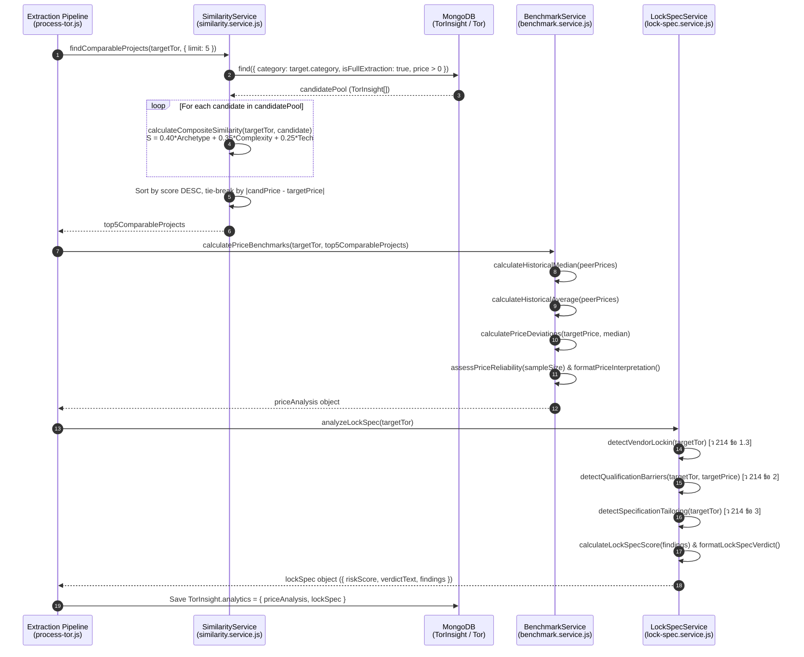
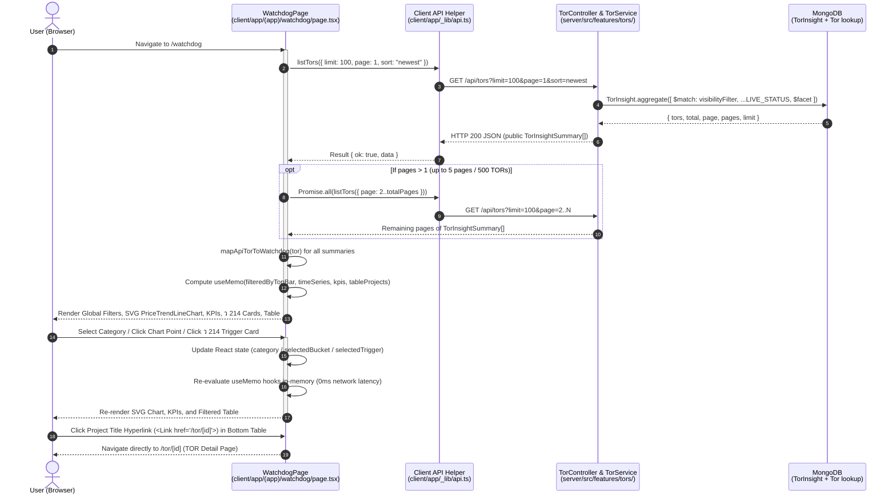
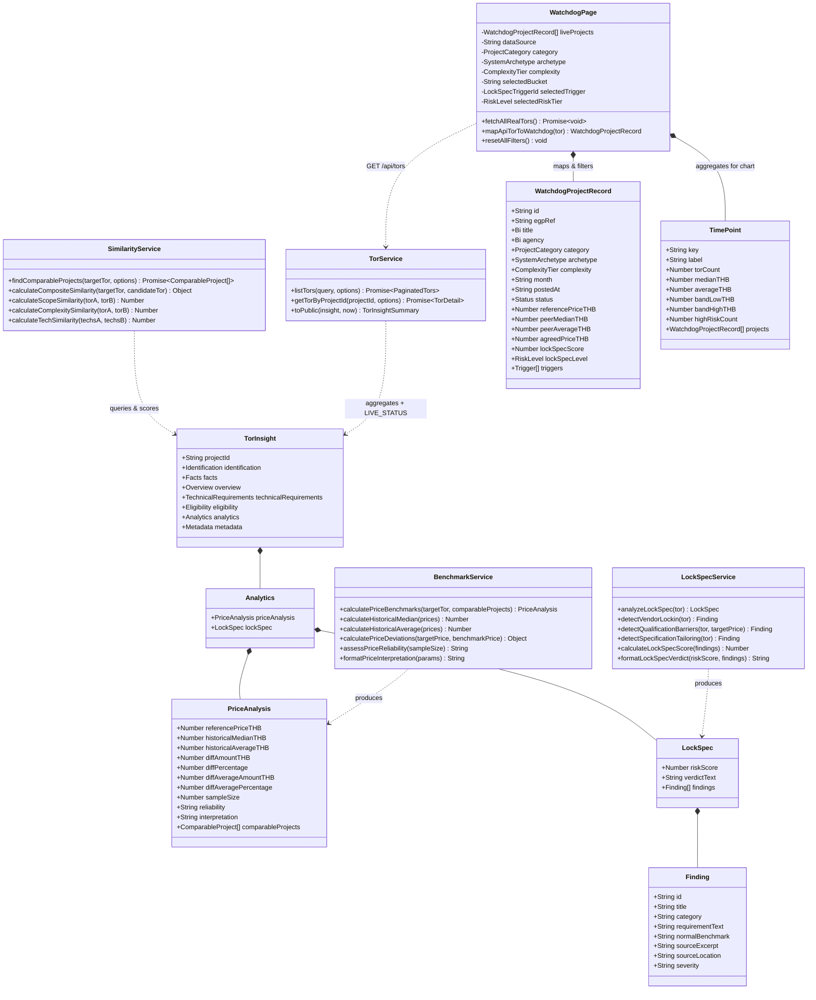

# Watchdog Page & Functionality — Decision & Design Plan

**Status:** Implemented — see [features/reality-check-and-benchmarking.md](../../features/reality-check-and-benchmarking.md) and [features/lock-spec-risk-detection.md](../../features/lock-spec-risk-detection.md)  
**Revision:** 2  
**Created:** 2026-10-31  
**Last Updated:** 2026-11-25  

> **Evolution & Implementation Notes:**
> - **What stayed:** The 5-section `/watchdog` layout, global top-bar filtering, client-side `useMemo` drill-downs, and pipeline pre-computation were implemented in `client/app/(app)/watchdog/`.
> - **What changed in the final code:**
>   - The backend modules listed below under `server/src/features/reality-check/` (`similarity.service.js`, `benchmark.service.js`, `lock-spec.service.js`) were split into three separate feature folders (`0003`): `server/src/features/similarity/`, `server/src/features/price-reality-check/`, and `server/src/features/lock-spec/`.
>   - Under the finalized SRS v0.3, `FR-19` covers comparable project grouping, `FR-20` covers historical price benchmarking & deviation analysis, and `FR-21` covers Circular ว 214 rule-based lock-spec checks and high-risk flagging (all implemented, with 10× scale guardrails and `enterprise` tier isolation added in [ADR 0044](../0044-price-benchmark-scale-guardrails.md)).
> - **2026-11-25:** Moved to `docs/decisions/design-plans/` and replaced external `.svg` links with inline Mermaid diagrams.

This document explains how the **Watchdog Page (`/watchdog`)** and its underlying **Reality Check & Lock-Spec Analysis Engine (`FR-19`, `FR-20`, `FR-21`)** 

---

# Use case specification

## Overview & How the 5 Sections of `/watchdog` Connect
The **Watchdog Page** (`/watchdog`) is GIPDP's public **Historical Procurement Dashboard & Analysis** screen. It enables SME owners, freelance developers, civic watchdogs, and journalists to:
1. **Compare historical reference price trends** (*ราคากลาง*) across similar government IT projects over time (Monthly or Quarterly) against a $\pm 15\%$ normal market band (**FR-19**, **FR-20**).
2. **Inspect Lock-Spec risk distributions** and statutory competition barriers under Comptroller General's Circular ว 214 (*หนังสือเวียน กวจ. ด่วนที่สุด ที่ กค (กวจ) 0405.2/ว 214*) (**FR-21**).
3. **Drill down into flagged or notable TORs** in the bottom table (*"โครงการที่ควรจับตาในกลุ่มนี้"* / *"Notable & flagged projects in this slice"*) to examine price deviations ($\Delta\%$) and verbatim lock-spec clauses before clicking into the full TOR detail page (`/tor/[id]`).

### Visual Map of How Filters, Charts, and the Bottom Table Work Together
- **The Top Filter Bar (`[1]`) does NOT only control the graph** — it is a **Global Filter** (`filteredByTopBar`) that updates **all 4 sections below it at the same time**: the Price Trend Graph (`[2]`), the 4 KPI Summary Cards (`[3]`), the Lock-Spec Risk & ว 214 Cards (`[4]`), and the Bottom "Notable & Flagged Projects" Table (`[5]`).
- **Sections `[2]` and `[4]` also act as Drill-Down Sub-Filters for the Bottom Table (`[5]`):** Clicking a month/quarter point on the Line Graph (`selectedBucket`) or clicking a Risk Tier / ว 214 Card (`selectedRiskTier` / `selectedTrigger`) filters the Bottom Table (`[5]`) to show those exact projects.

```
┌───────────────────────────────────────────────────────────────────────────────┐
│ [1] TOP GLOBAL FILTER BAR (Category, Archetype, Complexity, Agency, Price,    │
│     Start–End Month)  ──► Creates `filteredByTopBar` (Controls ALL sections!) │
└───────────────┬───────────────────────────────┬───────────────────────────────┘
                │                               │
                ▼                               ▼
┌───────────────────────────────────────┐ ┌─────────────────────────────────────┐
│ [2] HISTORICAL PRICE TREND LINE GRAPH │ │ [4] LOCK-SPEC RISK & ว 214 CARDS    │
│ • Plots Monthly / Quarterly Medians   │ │ • Left: High / Med / Low Risk Bar   │
│   & Averages + ±15% Normal Band       │ │ • Right: 3 Circular ว 214 Triggers  │
│ • Clicking a point sets               │ │ • Clicking a row/card sets          │
│   `selectedBucket` (Sub-filter)       │ │   `selectedRiskTier` / `Trigger`    │
├───────────────────────────────────────┤ └─────────────────┬───────────────────┘
│ [3] 4 KPI SUMMARY CARDS               │                   │
│ • Total TORs, Median, Avg, Risk Rate% │                   │
└───────────────┬───────────────────────┘                   │
                │                                           │
                └─────────────────────┬─────────────────────┘
                                      ▼
┌───────────────────────────────────────────────────────────────────────────────┐
│ [5] BOTTOM TABLE: "โครงการที่ควรจับตาในกลุ่มนี้"                              │
│     (Notable & flagged projects in this slice — `tableProjects`)              │
│ • Filtered by [1] Global Filter Bar + [2] Clicked Chart Point + [4] Clicked   │
│   Risk Tier / ว 214 Card                                                      │
│ • Has 4 View Mode Tabs:                                                       │
│   1. "flagged" (Default: Price outlier > ±15% OR Lock-Spec score ≥ 35)        │
│   2. "price"   (Sorted by biggest price deviation ±%)                         │
│   3. "lockspec"(Only projects with Lock-Spec score > 0, sorted highest first) │
│   4. "all"     (All projects in the slice, sorted newest first)               │
│ • Quick-Jump Hyperlink (`<Link href="/tor/[id]">`): Clicking any project      │
│   title in Col 1 takes the user directly to that TOR's Detail Page to         │
│   inspect its full requirements, price comparison, and verbatim PDF clauses.  │
└───────────────────────────────────────────────────────────────────────────────┘
```

---

## Use Case 1: Explore Historical Price Trends & Market Benchmarks (`UC-01`)

| Field | Description |
| :--- | :--- |
| **Use Case ID** | `UC-01` |
| **Use Case Name** | Explore Historical Reference Price Trends, Market Benchmarks & Price Outliers |
| **Related Requirements** |<ul> <li> `FR-19` (Group comparable projects)</li><li> `FR-20` (Calculate median/average price benchmarks & deviations)</li><li> `NFR-01` (< 2s load time)</li><li> `NFR-15` (Thai-first UI)</li> </ul> |
| **Primary Actor** | Unauthenticated or Authenticated User (Watchdog / Journalist / SME Bidder / Freelancer) |
| **Supporting Actors** | Backend TOR API (`GET /api/tors`), MongoDB (`TorInsight` & `Tor` collections), Reality Check Pipeline (`similarity.service.js`, `benchmark.service.js`) |
| **Preconditions** | 0. The user navigates to `/search`. <br> 1. The user navigates to `/watchdog`.<br>2. Pre-computed `TorInsight` documents exist in MongoDB. |
| **Trigger** | User opens `/watchdog`, changes any Global Filter at the top of the page, toggles Monthly/Quarterly view, clicks a time point on the graph, or selects the `"Flagged"` / `"By price deviation (±%)"` tab in the bottom table. |
| **Main Success Scenario** | 1. **Fetch Data:** On mount, `WatchdogPage` requests up to 500 TORs via `listTors({ limit: 100, page: 1..5, sort: "newest" })`.<br>2. **Normalize Records:** Each `TorInsightSummary` is mapped via `mapApiTorToWatchdog(tor)` into a normalized `WatchdogProjectRecord` with `referencePriceTHB`, `peerMedianTHB`, `peerAverageTHB`, `lockSpecScore`, and `triggers`.<br>3. **Apply Top Global Filters (Updates Whole Page):** The client filters records (`filteredByTopBar`) matching the selected `category`, `archetype`, `complexity`, `agencyFilter`, `priceBand`, and month range (`effectiveStartMonth` to `effectiveEndMonth`). This updates the Graph, KPIs, Risk Cards, and Bottom Table simultaneously.<br>4. **Aggregate Time-Series:** The system buckets filtered projects into Monthly (`YYYY-MM`) or Quarterly (`Q1/69`..`Q4/69`) `TimePoint` objects, calculating the bucket's median (`computeMedian`), average (`computeAverage`), and $\pm 15\%$ normal band (`bandLowTHB`, `bandHighTHB`).<br>5. **Render Trend Chart & KPIs:** `PriceTrendLineChart` draws the SVG time-series chart (shaded $\pm 15\%$ band, solid median line, dashed average line, and individual project dots colored by price verdict). The 4 KPI cards below update to show total analyzed TORs, overall median, overall average, and lock-spec risk rate.<br>6. **Drill Down to the Bottom "Notable & Flagged Projects" Table:** The user optionally clicks a specific month/quarter point on the SVG chart (`onSelectBucket`) to narrow the bottom table to that period, and inspects the bottom table (*"โครงการที่ควรจับตาในกลุ่มนี้"*) under the **`Flagged`** or **`By price deviation (±%)`** tab to compare each project's `Reference Price vs. Peer Median` and `PriceDeltaBadge` ($\Delta\%$).<br>7. **Quick-Jump Hyperlink to TOR Detail (`/tor/[id]`):** Once the user spots an outlier project in the bottom table, they click the **project title hyperlink** (`<Link href="/tor/${proj.id}">`) in the first column to jump directly to that TOR's Detail Page and inspect its full price reality check, peer list, and original e-GP documents without having to search for it again in the catalog. |
| **Alternative / Exception Flows** | - **A1: Backend API Unreachable or Empty Database:** If `GET /api/tors` fails or returns 0 records, the page displays a clear empty/error state explaining that live procurement data is currently unavailable (never substituting fake/unseen fixture data that would confuse the user).<br>- **A2: Filter Combination Yields 0 Projects:** If the chosen filters match 0 projects, `PriceTrendLineChart` and the bottom table render `EmptyState` components with a `"ล้างตัวกรองทั้งหมด" (Reset all filters)` button (`resetAllFilters`). |
| **Postconditions** | The user sees accurate historical median/average price trends, the $\pm 15\%$ normal band, and can click any flagged project's hyperlink in the bottom table to immediately open `/tor/[id]`. |

 **Why ± 15 % ?**
> Guidelines from the State Audit Commission (คตง. / สตง.) and e-GP price evaluation standards treat variations within ± 15 % as standard market noise (attributable to inflation, agency location, or extended warranty terms).

---

## Use Case 2: Inspect Lock-Spec Risk Signals & Statutory Barriers (`UC-02`)

| Field | Description |
| :--- | :--- |
| **Use Case ID** | `UC-02` |
| **Use Case Name** | Inspect Lock-Spec Risk Signals, Circular (ว 214) Triggers & Quick-Jump to Flagged Projects |
| **Related Requirements** |  <ul><li> `FR-21` (Assess technical/qualification deviations against Circular ว 214 and flag high lock-spec risk with evidence)</li><li> `NFR-15` ("Describe, don't accuse" copy principle)</li> </ul>|
| **Primary Actor** | Unauthenticated or Authenticated User (Watchdog / Journalist / SME Bidder / Freelancer) |
| **Preconditions** | `WatchdogPage` has loaded project records with lock-spec scores (`0–100`), risk tiers (`low`, `medium`, `high`), and statutory trigger categories (`Specification Tailoring`, `Qualification Barrier`, `Vendor Lock-in`). |
| **Trigger** | User filters the slice using the Top Global Filter Bar (e.g., selecting a specific Agency or Category), clicks a Risk Tier row (`high`, `medium`, `low`), clicks one of the 3 Circular ว 214 Trigger cards, or switches tabs in the bottom `"Notable & flagged projects in this slice"` table (`flagged`, `price`, `lockspec`, `all`). |
| **Main Success Scenario** | 1. **Filter by Top Global Filter Bar (Optional):** User selects a Category, Archetype, Complexity Tier, Agency, Price Range, or Month Range at the top (`filteredByTopBar`) to inspect lock-spec risk within that specific group.<br>2. **View Macro Risk Distribution:** The left panel displays a proportional stacked bar and counts for High ($\ge 70$), Medium ($35–69$), and Low ($< 35$) risk TORs in the active slice.<br>3. **View Statutory Trigger Breakdown:** The right panel displays frequency bars for the 3 Circular ว 214 categories:<br>   - **ว 214 ข้อ 3 (`Specification Tailoring`):** Locked brand/version without *"หรือเทียบเท่า"* (or equivalent).<br>   - **ว 214 ข้อ 2 (`Qualification Barrier`):** Minimum single-contract past experience $> 50\%$ of reference price.<br>   - **ว 214 ข้อ 1.3 (`Vendor Lock-in`):** Requiring OEM reseller/distributor authorization (MAF) on software development/integration contracts.<br>4. **Drill Down by Trigger or Tier:** Clicking a Circular ว 214 card sets `selectedTrigger` and automatically switches the bottom table tab (`tableTab`) to `"lockspec"`. Clicking a risk tier row sets `selectedRiskTier` and switches `tableTab` to `"all"`.<br>5. **Inspect Bottom "Notable & Flagged Projects" Table (*"โครงการที่ควรจับตาในกลุ่มนี้"*):** The bottom table filters and sorts matching TORs across 4 selectable tabs (`Flagged`, `By price deviation`, `Lock-spec findings only`, `All projects in slice`) and row limits (`5`, `10`, `15`, `All`), showing each TOR's `StatusBadge`, `PriceDeltaBadge`, `LockSpecBadge` (score out of 100), and `[Trigger Category]` tags.<br>6. **Quick-Jump Hyperlink to Full Evidence (`/tor/[id]`):** To verify *why* a project was flagged, the user clicks the **project title hyperlink** (`<Link href="/tor/${proj.id}">`) in the bottom table, which immediately opens that TOR's Detail Page where they can read the exact verbatim PDF clause excerpt, page number, and Circular ว 214 comparison. |
| **Alternative / Exception Flows** | - **A1: No Flagged Projects in Selected Slice:** If the user selects the `"Lock-spec findings only"` or `"Flagged"` tab (or clicks a ว 214 card) and 0 projects in that slice have lock-spec barriers, the bottom table displays an `EmptyState` prompting the user to switch to the `"All projects in slice"` tab or reset filters (`resetAllFilters`). |
| **Postconditions** | The user identifies which projects in the bottom table have restrictive specifications or abnormal pricing and uses the row hyperlink to jump straight to `/tor/[id]` to inspect the verbatim evidence. |

---

# Sequence Diagram

## 0. Where the data we visualize comefrom: Pre-Computing Watchdog Analytics (`FR-19`, `FR-20`, `FR-21`)
Per **ADR 0022** (*Pre-compute benchmarks in the pipeline*), heavy similarity matching and price/lock-spec calculations happen during pipeline extraction and batch refresh—never during an HTTP request—so `/watchdog` loads in under 2 seconds (**NFR-01**).



## 2. Runtime Page Load & Interactive Filtering on `/watchdog`



---

# Design Pattern used

1. **Layered Feature Architecture (Controller – Service – Data Access Pattern)**
   - **Where:** `server/src/features/tors/` (`tor.routes.js` $\rightarrow$ `tor.controller.js` $\rightarrow$ `tor.service.js`) and `server/src/features/reality-check/` (`similarity.service.js`, `benchmark.service.js`, `lock-spec.service.js`).
   - **Why:** Keeps HTTP routing, request parsing, business logic, and Mongoose database queries strictly separated (per **ADR 0003**).

2. **Pre-Computed Materialized View / Read-Model Pattern**
   - **Where:** `TorInsight.analytics.priceAnalysis` and `TorInsight.analytics.lockSpec` (per **ADR 0022**), combined with `LIVE_STATUS` MongoDB `$lookup` in `tor.service.js` (per **ADR 0013**).
   - **Why:** Computing peer similarity and lock-spec rules across hundreds of TORs on every page load would violate **NFR-01** (< 2s load time). Instead, analytics are pre-computed in the pipeline and embedded into `TorInsight`, while volatile lifecycle fields (`status`, `isAmended`, `referencePriceTHB`) are overlaid live from the `Tor` collection via `$lookup`.

3. **Adapter / Data Mapper Pattern**
   - **Where:** `mapApiTorToWatchdog(tor: TorInsightSummary): WatchdogProjectRecord | null` in `client/app/(app)/watchdog/page.tsx` and `toPublic(insight, now)` in `server/src/features/tors/tor.service.js`.
   - **Why:** Decouples the raw database/API schema (`TorInsightSummary`) from the frontend visualization model (`WatchdogProjectRecord`), normalizing missing fields, inferring fallback trigger categories when summary projections omit nested arrays, and stripping internal admin metadata (`confidenceScore`, file storage paths).

4. **Rule Engine / Strategy Pattern**
   - **Where:** `server/src/features/reality-check/lock-spec.service.js` (`detectVendorLockin`, `detectQualificationBarriers`, `detectSpecificationTailoring`).
   - **Why:** Each statutory rule from Circular ว 214 is encapsulated as an independent detector function that inspects a normalized `TorInsight` object and returns either a standardized `Finding` object or `null`. `analyzeLockSpec(tor)` orchestrates all detectors and aggregates their severity points.

5. **Reactive Derived State (Memoized Pipeline Pattern)**
   - **Where:** Chained `useMemo` hooks in `WatchdogPage` (`allProjects` $\rightarrow$ `filteredByTopBar` $\rightarrow$ `timeSeries` & `kpis` & `tableProjects` $\rightarrow$ `visibleRows`).
   - **Why:** Ensures that changing a top-bar filter or clicking a chart node recalculates time-series medians, $\pm 15\%$ bands, KPI counters, and table sorting synchronously in memory without redundant API calls.

---

# Function and Data Structure

## 1. API Specification

### Endpoint: List TOR Insights (Used by Watchdog Page & Catalog)
- **Method & Path:** `GET /api/tors`
- **Authentication:** Public (No auth required — **FR-10**, **NFR-10**)

**Request Query Parameters**
*(Note: Being a `GET` endpoint, parameters are passed in the URL query string rather than a JSON request body)*
```json
{
  "q": "ระบบสารบรรณ",
  "status": ["Open", "Awarded"],
  "amended": "false",
  "minBudget": 1000000,
  "maxBudget": 20000000,
  "tech": ["PostgreSQL", "React"],
  "agency": ["กรุงเทพมหานคร"],
  "closingWithin": 14,
  "excludeHighRisk": "false",
  "sort": "newest",
  "page": 1,
  "limit": 100
}
```

**Response (`200 OK`)**
```json
{
  "tors": [
    {
      "projectId": "69069041234",
      "identification": {
        "titleTh": "จ้างพัฒนาระบบบริหารจัดการข้อมูลน้ำท่วมและระบบเตือนภัยล่วงหน้า ระยะที่ 2",
        "titleEn": "Flood data management and early-warning system, phase 2",
        "agency": "สำนักการระบายน้ำ กรุงเทพมหานคร",
        "department": "สำนักการระบายน้ำ",
        "category": "data-and-ai",
        "status": "Open"
      },
      "facts": {
        "budgetTHB": 12500000,
        "referencePriceTHB": 12400000,
        "agreedPriceTHB": null,
        "submissionDeadline": "2026-11-15T09:30:00.000Z",
        "postedDate": "2026-06-30T00:00:00.000Z",
        "procurementMethod": "e-bidding",
        "penaltyClause": "0.20% ต่อวัน",
        "webUrl": "https://process3.gprocurement.go.th/..."
      },
      "overview": {
        "systemArchetype": "iot-telemetry",
        "complexityTier": "enterprise"
      },
      "technicalRequirements": {
        "requiredTechnologies": [
          {
            "name": "Windows Server",
            "version": "2019",
            "category": "os",
            "allowsEquivalent": false
          },
          {
            "name": "NGINX Plus",
            "version": null,
            "category": "server",
            "allowsEquivalent": false
          }
        ]
      },
      "companiesOnly": true,
      "amendmentInfo": {
        "isAmended": false,
        "lastAmendedDate": null
      },
      "contractSigned": false,
      "latestAnnouncement": {
        "code": "D0",
        "publishedAt": "2026-06-30T00:00:00.000Z"
      },
      "lastChangeAt": null,
      "latestChange": null,
      "analytics": {
        "lockSpec": {
          "riskScore": 100,
          "verdictText": "ความเสี่ยงสูง: พบเงื่อนไขที่อาจจำกัดการแข่งขันเฉพาะราย",
          "findings": [
            {
              "id": "FIND-69069041234-01",
              "title": "กำหนดหนังสือแต่งตั้งตัวแทนจำหน่าย (MAF) ในงานจ้างพัฒนาซอฟต์แวร์",
              "category": "Vendor Lock-in",
              "requirementText": "ผู้ยื่นข้อเสนอต้องแนบหนังสือแต่งตั้งตัวแทนจำหน่าย (Manufacturer Authorization) จากเจ้าของลิขสิทธิ์ซอฟต์แวร์",
              "normalBenchmark": "งานจ้างพัฒนาซอฟต์แวร์ทั่วไปประเมินจากทักษะและผลงานของทีมพัฒนา ไม่กำหนดหนังสือตัวแทนจำหน่าย (ว 214 ข้อ 1.3)",
              "sourceExcerpt": "ต้องมีหนังสือรับรองการเป็นตัวแทนจำหน่ายอย่างเป็นทางการจากผู้ผลิต NGINX Plus ในประเทศไทย",
              "sourceLocation": "หน้า 8",
              "severity": "high"
            }
          ]
        },
        "priceAnalysis": {
          "referencePriceTHB": 12400000,
          "historicalMedianTHB": 8900000,
          "historicalAverageTHB": 9650000,
          "diffPercentage": 39.3,
          "sampleSize": 4,
          "reliability": "sufficient"
        }
      },
      "review": {
        "origin": "pipeline",
        "status": "approved",
        "checked": true,
        "score": 94,
        "failedChecks": 0,
        "processedAt": "2026-06-30T02:15:00.000Z"
      },
      "createdAt": "2026-06-30T02:15:00.000Z"
    }
  ],
  "total": 67,
  "page": 1,
  "pages": 1,
  "limit": 100
}
```

---

## 2. Core Data Structures

### `WatchdogProjectRecord` (`client/app/_data/watchdog.ts`)
The normalized frontend structure used by all charts, KPIs, and tables on `/watchdog`:
```typescript
type ProjectCategory =
  | "software-development"
  | "systems-integration"
  | "data-and-ai"
  | "network-and-security"
  | "maintenance-and-support"
  | "software-licenses"
  | "other-it";

type SystemArchetype =
  | "web-portal"
  | "mobile-app"
  | "enterprise-erp"
  | "edoc-workflow"
  | "data-analytics"
  | "gis-mapping"
  | "cybersecurity"
  | "iot-telemetry"
  | "infra-networking"
  | "other";

type ComplexityTier = "basic" | "standard" | "enterprise";

type LockSpecTriggerId =
  | "Specification Tailoring"
  | "Qualification Barrier"
  | "Vendor Lock-in";

type WatchdogProjectRecord = {
  id: string;
  egpRef: string;
  title: { th: string; en: string };
  agency: { th: string; en: string };
  category: ProjectCategory;
  archetype: SystemArchetype;
  complexity: ComplexityTier;
  month: string;              // "YYYY-MM" bucket
  postedAt: string;           // "YYYY-MM-DD"
  status: "Draft" | "Open" | "Awarded" | "Closed" | "Cancelled";
  referencePriceTHB: number;  // ราคากลาง (THB)
  peerMedianTHB: number;      // ค่ามัธยฐานของกลุ่มเปรียบเทียบ (THB)
  peerAverageTHB: number;     // ค่าเฉลี่ยของกลุ่มเปรียบเทียบ (THB)
  agreedPriceTHB?: number;    // ราคาตามสัญญาที่ชนะ (THB)
  lockSpecScore: number;      // 0–100 (ADR 0030)
  lockSpecLevel: "low" | "medium" | "high";
  triggers: {
    category: LockSpecTriggerId;
    summary: { th: string; en: string };
    clauseExcerpt: string;
  }[];
};
```

### `TimePoint` (`client/app/(app)/watchdog/page.tsx`)
Represents a single Monthly or Quarterly bucket plotted on `PriceTrendLineChart`:
```typescript
type TimePoint = {
  key: string;                        // e.g. "2026-06" or "Q3/69"
  label: string;                      // e.g. "มิ.ย. 69" or "Jun 26"
  torCount: number;                   // Number of TORs in this bucket
  medianTHB: number;                  // Median of peerMedianTHB in bucket
  averageTHB: number;                 // Average of peerAverageTHB in bucket
  bandLowTHB: number;                 // medianTHB * 0.85 (-15% normal band)
  bandHighTHB: number;                // medianTHB * 1.15 (+15% normal band)
  highRiskCount: number;              // Count of TORs with lockSpecLevel === "high"
  projects: WatchdogProjectRecord[];  // Individual TORs plotted as dots in this bucket
};
```

---

## 3. Core Functions (Backend & Frontend)

### Backend — Similarity Engine (`server/src/features/reality-check/similarity.service.js`)

`findComparableProjects(targetTor, options = { limit: 5, candidatesPool: null })`
- **Parameters:** `targetTor` (`TorInsight` document), `options` (`limit`, optional `candidatesPool`).
- **Process:** Queries MongoDB for fully extracted `TorInsight` records in the same `identification.category` with a valid positive price (`referencePriceTHB` or `budgetTHB`), scores each candidate using `calculateCompositeSimilarity`, sorts descending by score (tie-breaking by price proximity), and slices the top `limit` (5) peers.
- **Returns:** `Promise<Array<{ projectId, title, year, referencePriceTHB, score, breakdown, candidate }>>`

`calculateCompositeSimilarity(targetTor, candidateTor)`
- **Parameters:** `targetTor` (`object`), `candidateTor` (`object`).
- **Formula:** $S = 0.40 \cdot S_{\text{archetype}} + 0.35 \cdot S_{\text{complexity}} + 0.25 \cdot S_{\text{tech}}$
- **Returns:** `{ score: number, breakdown: { archetypeSim, complexitySim, techSim, scopeSim, scaleSim } }`

`calculateScopeSimilarity(torA, torB)`
- **Parameters:** `torA` (`object`), `torB` (`object`).
- **Returns:** `number` (`1.0` if same `systemArchetype`, `0.15` if different archetype, `0.50` if unspecified/`other`).

`calculateComplexitySimilarity(torA, torB)`
- **Parameters:** `torA` (`object`), `torB` (`object`).
- **Returns:** `number` (`1.0` if same `complexityTier`, `0.50` if 1 tier apart, `0.10` if 2 tiers apart (`basic` vs `enterprise`), `0.50` if missing).

`calculateTechSimilarity(techsA = [], techsB = [])`
- **Parameters:** `techsA` (`Array<{ name: string }>`), `techsB` (`Array<{ name: string }>`).
- **Returns:** `number` (Jaccard similarity $\frac{|A \cap B|}{|A \cup B|} \in [0, 1]$, `0.5` if both empty, `0.2` if only one is empty).

---

### Backend — Price Benchmark Engine (`server/src/features/reality-check/benchmark.service.js`)

`calculatePriceBenchmarks(targetTor, comparableProjects = [])`
- **Parameters:** `targetTor` (`object`), `comparableProjects` (`Array<object>` from `findComparableProjects`).
- **Process:** Extracts valid peer prices, computes historical median (`calculateHistoricalMedian`) and mean (`calculateHistoricalAverage`), computes percentage/amount deviations (`calculatePriceDeviations`), evaluates sample reliability (`assessPriceReliability`: `'none'` for $N=0$, `'low'` for $1 \le N < 3$, `'sufficient'` for $N \ge 3$), and generates non-accusatory Thai interpretation copy (`formatPriceInterpretation`).
- **Returns:**
  ```javascript
  {
    referencePriceTHB,
    historicalMedianTHB,
    historicalAverageTHB,
    diffAmountTHB,
    diffPercentage,
    diffAverageAmountTHB,
    diffAveragePercentage,
    sampleSize,
    reliability,
    interpretation,
    comparableProjects: [{ title, year, referencePriceTHB, agreedPriceTHB }]
  }
  ```

`calculateHistoricalMedian(prices = [])`
- **Parameters:** `prices` (`number[]`).
- **Returns:** `number | null` (Sorted middle value for odd $N$, or rounded average of two middle values for even $N$; `null` if empty).

`calculatePriceDeviations(targetPrice, benchmarkPrice)`
- **Parameters:** `targetPrice` (`number | null`), `benchmarkPrice` (`number | null`).
- **Returns:** `{ diffAmountTHB: number | null, diffPercentage: number | null }` where $\Delta\% = \text{round}\left(\frac{T - B}{B} \times 100, 1\right)$.

---

### Backend — Lock-Spec Detection Engine (`server/src/features/reality-check/lock-spec.service.js`)

`analyzeLockSpec(tor)`
- **Parameters:** `tor` (`TorInsight` document).
- **Process:** Runs the 3 statutory rule detectors (`detectVendorLockin`, `detectQualificationBarriers`, `detectSpecificationTailoring`), sums severity points via `calculateLockSpecScore(findings)` (`high` = 35 pts, `medium` = 15 pts, `low` = 5 pts, capped at 100), and formats the Thai verdict (`formatLockSpecVerdict`).
- **Returns:** `{ riskScore: number, verdictText: string, findings: Array<Finding> }`

`detectVendorLockin(tor)`
- **Parameters:** `tor` (`object`).
- **Rule:** Checks if `category` is `software-development` or `systems-integration` (or `procurementKind === 'hire'`) AND `eligibility.manufacturerAuthorizations` is non-empty (Circular ว 214 Clause 1.3).
- **Returns:** `Finding | null` (`severity: 'high'`, `category: 'Vendor Lock-in'`).

`detectQualificationBarriers(tor, targetPrice)`
- **Parameters:** `tor` (`object`), `targetPrice` (`number | null`).
- **Rule:** Checks if `eligibility.previousExperienceMinTHB / targetPrice > 0.5` (exceeds 50% ceiling under Circular ว 214 Clause 2).
- **Returns:** `Finding | null` (`severity: 'high'`, `category: 'Qualification Barrier'`).

`detectSpecificationTailoring(tor)`
- **Parameters:** `tor` (`object`).
- **Rule:** Checks `technicalRequirements.requiredTechnologies` for locked commercial/legacy platforms (`windows server`, `red hat`, `rhel`, `oracle`) with an explicit `version` where `allowsEquivalent` is not `true` and the quote lacks *"เทียบเท่า"* / *"equivalent"* (Circular ว 214 Clause 3).
- **Returns:** `Finding | null` (`severity: 'high'`, `category: 'Specification Tailoring'`).

---

### Frontend — Watchdog Page (`client/app/(app)/watchdog/page.tsx` & `client/app/_data/watchdog.ts`)

`mapApiTorToWatchdog(tor: TorInsightSummary)`
- **Parameters:** `tor` (`TorInsightSummary` from `GET /api/tors`).
- **Returns:** `WatchdogProjectRecord | null` (Returns `null` if project has no positive `referencePriceTHB` or `budgetTHB`; maps category, archetype, complexity, peer median/average, lock-spec level, and Circular ว 214 triggers).

`calcPriceDeltaPct(project: WatchdogProjectRecord)`
- **Parameters:** `project` (`WatchdogProjectRecord`).
- **Returns:** `number` (Percentage deviation $\frac{\text{referencePriceTHB} - \text{peerMedianTHB}}{\text{peerMedianTHB}} \times 100$ rounded to 1 decimal place).

`formatMonthBucket(monthKey: string)`
- **Parameters:** `monthKey` (`string` in `"YYYY-MM"` format, e.g., `"2025-10"`).
- **Returns:** `{ key: string, labelTh: string, labelEn: string, quarter: string }` (Converts Gregorian `"YYYY-MM"` into Thai Buddhist Era short labels like `"ต.ค. 68"` and Thai Fiscal Year quarters like `"Q1/69"`, where Oct–Dec is Q1 of the next fiscal year).

`PriceTrendLineChart({ series, lang, activeBucket, onSelectBucket })`
- **Parameters:** `series` (`TimePoint[]`), `lang` (`"th" | "en"`), `activeBucket` (`string | null`), `onSelectBucket` (`(key: string | null) => void`).
- **Returns:** `JSX.Element` (Interactive SVG line chart with P92 outlier ceiling scaling, $\pm 15\%$ shaded normal band polygon, median solid polyline, average dashed polyline, jittered project dots colored by price verdict, and click-to-filter bucket selection).

---

# UML diagram (optional)



