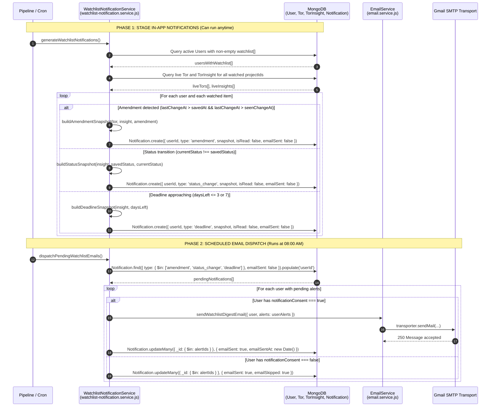
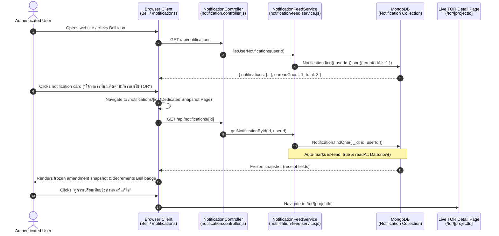
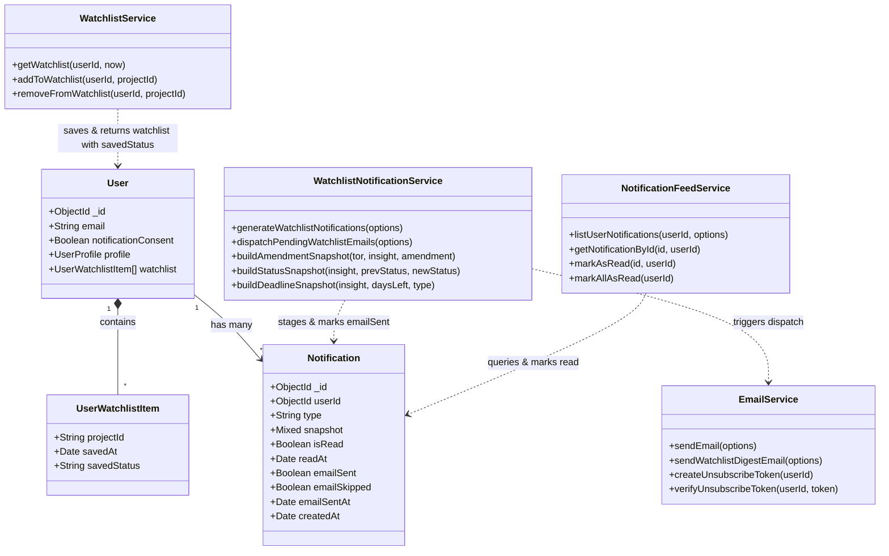

# Notification System — Part 2: Watchlist Amendment & Status Alerts (`FR-17`, `FR-18`) — Decision & Design Plan

*Previously titled: "Watchlist Amendment & Status Notification System (`FR-18`) — Decision & Design Plan"*  
*Part 2 of 2 — builds on [notification-decision-plan.md](./notification-decision-plan.md) using the same `Notification` model and 08:00 AM digest pipeline.*

**Status:** Implemented — see [features/notifications-and-alerts.md](../../features/notifications-and-alerts.md)  
**Revision:** 2  
**Created:** 2026-11-17  
**Last Updated:** 2026-11-25  

> **Evolution from Earlier Plan ([notification-decision-plan.md](./notification-decision-plan.md), 2026-11-01):**
> - **What stayed:** Reused the `Notification` collection, polymorphic immutable `snapshot` log, `/notifications` + `/notifications/[id]` UI, and two-phase staging → 08:00 AM SMTP dispatch without creating a separate notifications collection.
> - **What was added:** Extended the notification system beyond match alerts (`type: 'match'`) to support `amendment`, `status_change`, and `deadline` alerts via modular creators in `server/src/features/notifications/creators/`, daily rollup/de-duplication, and `User.watchlist[].savedStatus` tracking.
> - **What changed in the final code:** `User.watchlist[].seenChangeAt` and `PUT /api/watchlist/:id/seen` are not implemented on the backend (`server/src/models/user.model.js` and `server/src/features/watchlist/watchlist.routes.js` only store/manage `projectId`, `savedAt`, and `savedStatus`; the `"รับทราบ"` button in `client/app/(app)/(private)/watchlist/page.tsx` is UI-only for now).
> - **2026-11-25:** Moved to `docs/decisions/design-plans/`.

This document explains the unified architecture of the **Watchlisted TOR Amendment, Status Change & Deadline Alerting System (`FR-17`, `FR-18`)**.

The architecture establishes a clean, maintainable separation between **on-the-fly change detection against user save timestamps**, **immutable snapshot notification event logging**, and **decoupled two-phase email delivery**:

1. **On-the-Fly Change Detection (`Tor.lastChangeAt > User.watchlist[].savedAt`):** Rather than polling external systems constantly or mutating the user profile, watchlist changes are evaluated dynamically against the project's detected changes (`Tor.amendments[]`, `Tor.lastChangeAt`, and `TorInsight.identification.status`). This prevents state drift, ensures a TOR amended before a user saved it never triggers spurious alerts, and aligns with **ADR 0032**.
2. **Immutable Snapshot Notification Log (`Notification` Collection):** Rather than relying on live joins or fragile pointers to dynamic project records, notifications are stored as **immutable snapshot event logs** in the existing `Notification` collection (`server/src/models/notification.model.js`). It leverages the polymorphic `snapshot: mongoose.Schema.Types.Mixed` payload so each event type (`amendment`, `status_change`, `deadline`) records only its relevant receipt fields with zero unused `null` fields in MongoDB.
3. **Decoupled Two-Phase Architecture (Staging $\to$ Scheduled Dispatch):**
   - **Phase 1 (Data Preparation / Staging):** Runs during nightly ingestion, feed polling, or recheck runs. Evaluates active user watchlists in memory and stages `Notification` records into MongoDB (`emailSent: false, isRead: false`). In-app notification feeds, header bell badges, and watchlist change markers update immediately.
   - **Phase 2 (Scheduled Morning Dispatch):** Runs at 08:00 AM via cron / schedule (`scripts/notify.js`). Queries staged notifications and dispatches a consolidated Thai-first HTML digest via SMTP only to users with explicit PDPA consent (`User.notificationConsent === true`). Marks `emailSent: true` to prevent any duplicate transmission.
4. **Dedicated In-App Notification Surfaces (`/notifications` & `/notifications/[id]`):** Users manage unread/read alert statuses exclusively in their notification inbox at `/notifications` and inspect frozen receipts at `/notifications/[id]`. The `/watchlist` page belongs to `FR-17` and is strictly out of scope for this feature.

---

# Architectural Decision: Watchlist Evaluation vs. Immutable Notification Event Log

| Architectural Layer | Store / Model | Execution | Why This Design? |
| :--- | :--- | :--- | :--- |
| **Change Detection Rule** | `Tor.lastChangeAt` & `User.watchlist[].savedAt` | Evaluated in memory: `lastChangeAt > savedAt`. | **No Stale Sync & Temporal Accuracy:** A user should only be alerted to changes that occurred *after* they saved the TOR. Comparing timestamps ensures that pre-existing amendments are ignored, while new amendments immediately trigger. |
| **Status Transition Tracking** | `User.watchlist[].savedStatus` vs `TorInsight.identification.status` | Evaluated on feed poll: `currentStatus !== savedStatus`. | **Clean Lifecycle Alerts:** Allows detecting when an open tender transitions to `Awarded`, `Cancelled`, or `Closed` without requiring complex webhook infrastructure. |
| **Notification Snapshot Log** | `Notification` (Dedicated Collection) | Stored as self-contained event snapshots via polymorphic `Mixed` schema. | **Audit & Historical Integrity (No Foreign Keys):** If an agency amends a project multiple times or cancels it later, past notification receipts in the user's feed preserve the exact state and clause diff from the moment the alert was issued. |
| **Email Delivery Staging** | `emailSent` & `emailSentAt` in `Notification` | Decoupled into `generateWatchlistNotifications()` and `dispatchPendingWatchlistEmails()`. | **Predictable Delivery & Zero Spam:** Bundling pending alerts into a single 08:00 AM morning digest prevents flooding users' inboxes when multiple watchlisted projects update on the same day. |

> **Conclusion for Team Alignment:**  
> - **No separate notifications collection is needed.** We leverage the existing `Notification` model which already defines `enum: ['match', 'amendment', 'deadline', 'status_change']`.  
> - In `User.watchlist`, we store `savedStatus` (to detect status transitions).  
> - **Scope Boundary:** Modifying or building the `/watchlist` page is out of scope for `FR-18` (handled by `FR-17`). `FR-18` exclusively owns notification evaluation, the in-app feed (`/notifications`), snapshot detail (`/notifications/[id]`), bell counter, and email digests.
> - **Channel Independence:** In-app notifications and bell counter updates are ALWAYS delivered to all users in MongoDB. Email dispatch is an OPTIONAL delivery channel requiring explicit `notificationConsent === true` under Thai PDPA.

---

# Use Case Specification

## Overview & How the Watchlist Notification Architecture Works

```
                  AUTOMATION TRIGGER (Pipeline Ingestion / Cron):
                         Pipeline detects amended package
                         or status update from e-GP feed
                                       │
                                       ▼
                         ┌───────────────────────────┐
                         │   changedSinceSaved Check │
                         │   (On-The-Fly Evaluation) │
                         └─────────────┬─────────────┘
                                       │
                                       ▼
                         ┌───────────────────────────┐
                         │   PHASE 1: STAGE IN DB    │
                         │generateWatchlistNotifs()  │
                         └─────────────┬─────────────┘
                                       │
                                       ▼
                   ┌──────────────────────────────────────┐
                   │    MONGODB: `Notification` Model     │
                   │       (Immutable Snapshot Log)       │
                   │ • userId, type: 'amendment' /        │
                   │   'status_change' / 'deadline'       │
                   │ • snapshot: { ...receipt fields }    │
                   │ • isRead: false, readAt: null        │
                   │ • emailSent: false, emailSentAt: null│
                   │ (Polymorphic Mixed — zero nulls)     │
                   └──────────┬────────────────┬──────────┘
                              │                │
            ┌─────────────────┘                └────────────────┐
            ▼                                                   ▼
 ┌───────────────────────────────────────┐          ┌──────────────────────────────────────┐
 │     [1] IN-APP NOTIFICATION INBOX     │          │       [2] NOTIFICATION CHANNELS      │
 │ • In-App Notification Feed            │          │ • Scheduled Morning Email Digest     │
 │   (/notifications)                    │          │   (08:00 AM Bangkok Time)            │
 │ • Dedicated Snapshot Detail Page      │          │ • Anti-phishing defanged links       │
 │   (/notifications/[id])               │          │ • 1-click HMAC unsubscribe footer    │
 │ • Header Bell Icon unread badge count │          │ • PHASE 2: 08:00 AM EMAIL DISPATCH   │
 │ • 1-click CTA leading to live TOR     │          │   (Only if notificationConsent: true)│
 └───────────────────────────────────────┘          └──────────────────────────────────────┘
```

1. **Phase 1: Generation & Data Staging (`generateWatchlistNotifications`):**
   - Whenever an amendment package is ingested or feed statuses change, the generator checks active user watchlists.
   - For amendments (`lastChangeAt > savedAt`), status changes (`status !== savedStatus`), and urgent deadlines ($\le 3$ or $7$ days), it writes an immutable snapshot into `Notification` with `emailSent: false`.
   - The in-app feed (`/notifications`) and header bell counter update immediately.
2. **Phase 2: Scheduled Morning Email Dispatch (`dispatchPendingWatchlistEmails`):**
   - Runs at scheduled digest hours (08:00 AM Bangkok time).
   - Finds staged notifications with `emailSent: false` belonging to users with `notificationConsent === true`.
   - Bundles alerts into a clean, Thai-first HTML digest with anti-phishing defanged links and delivers via SMTP.
   - Marks `emailSent: true, emailSentAt: new Date()`.
3. **In-App Consumption (`/notifications` & `/notifications/[id]`):**
   - Users view their alerts in `/notifications`, with dedicated badge icons for amendments, status changes, and approaching deadlines.
   - Clicking an alert opens `/notifications/[id]`, displaying the frozen snapshot and auto-marking the item as read.
   - A direct link on the detail page takes the user to the live TOR at `/tor/[id]`.

---

## Use Case 1: Alert Users on Watchlisted TOR Updates (`UC-10`)

| Field | Description |
| :--- | :--- |
| **Use Case ID** | `UC-10` |
| **Use Case Name** | Watchlist Change & Lifecycle Alerting (Amendments, Status Changes, Deadlines) |
| **Related Requirements** | <ul><li>`FR-15` (Track and show current lifecycle status: Draft, Open, Awarded, Closed, Cancelled)</li><li>`FR-16` (Hash and diff amended TOR clauses)</li><li>`FR-17` (Users save TORs to personal watchlist)</li><li>`FR-18` (Alert users in-app or by email when a watchlisted TOR changes status or is amended)</li><li>`NFR-15` (Thai-first notifications and summaries)</li></ul> |
| **Primary Actor** | Authenticated User (Applicant / SME Bidder) & Background Scheduler (`scripts/notify.js`) |
| **Supporting Actors** | MongoDB (`Tor`, `TorInsight`, `User`, `Notification`), SMTP Transport (`nodemailer`) |
| **Preconditions** | 1. User is signed in and has added at least one TOR to their personal watchlist (`User.watchlist`).<br>2. An issuing agency amends a TOR, updates its lifecycle status, or the submission deadline approaches. |
| **Trigger** | Ingestion pipeline detection (`package` / `feed` change), daily morning schedule (`npm run notify:all`), or approaching deadline threshold ($\le 3$ or $7$ days). |
| **Main Success Scenario** | 1. **Change Detection:** System identifies that `Tor.lastChangeAt > savedAt` or `status !== savedStatus`.<br>2. **Stage Notification in MongoDB (Phase 1):** System builds a frozen snapshot and inserts a `Notification` document (`isRead: false, emailSent: false`).<br>3. **In-App Notice:** User observes header bell badge increment (+1); opening `/notifications` reveals the alert card.<br>4. **Inspection:** User clicks the notification card to inspect details at `/notifications/[id]`, which marks it as read and provides a 1-click CTA to `/tor/[projectId]#changes`.<br>5. **Email Digest (Phase 2):** At 08:00 AM, system checks `notificationConsent`. If `true`, dispatches a consolidated HTML summary to the user's inbox. |
| **Alternative Flows** | - **A1: Consent Disabled:** Notification record is created for the in-app feed, but email dispatch is safely skipped (`emailSkipped: true`).<br>- **A2: Pre-existing Amendment:** If the TOR was amended *before* the user saved it (`lastChangeAt <= savedAt`), no alert is generated.<br>- **A3: Duplicate Prevention:** System verifies deduplication key `(userId, projectId, type, eventIdentifier)`; duplicate notifications are never inserted. |
| **Postconditions** | An immutable notification record exists in MongoDB; in-app unread badge updates; consented users receive a single morning email digest. |

---

# Sequence Diagrams — Detailed End-to-End Notification Flows

## Flow 1: Watchlist Evaluation & Two-Phase Staging $\to$ Scheduled Morning Dispatch



---

## Flow 2: In-App User Consumption $\to$ Snapshot Detail Inspection $\to$ Actionable Redirect



---

# Design Patterns Used (Refactoring.Guru Catalog)

All design patterns in this architecture map directly to standard GoF patterns documented in the [Refactoring.Guru Design Patterns Catalog](https://refactoring.guru/design-patterns/catalog):

### 1. Observer Pattern — *Behavioral*
* **Catalog Reference:** [Refactoring.Guru — Observer](https://refactoring.guru/design-patterns/observer)
* **Where It Lives:** `watchlist-notification.service.js`.
* **Roles in System:**
  * **Subject (Publisher):** The procurement database (`Tor` / `TorInsight`) publishing detected amendments and status transitions.
  * **Observers (Subscribers):** Users who added the tender to their `User.watchlist`.
* **Why:** Completely decouples ingestion crawlers and scraper jobs from user alert logic. The ingestion workers simply save detected changes to MongoDB, while the notification observer queries subscriptions and generates notifications asynchronously.

### 2. Memento / Snapshot Pattern — *Behavioral*
* **Catalog Reference:** [Refactoring.Guru — Memento](https://refactoring.guru/design-patterns/memento)
* **Where It Lives:** `Notification.snapshot` and `buildAmendmentSnapshot()`.
* **Roles in System:** Captures and stores an immutable snapshot of the project’s state (title, agency, budget, changed clauses, old status, new status) at the exact moment the alert was produced.
* **Why:** Government procurement documents are amended continuously. If a user opens a notification from two weeks ago, they must see what changed *at that point in time*, even if the agency has since cancelled or re-tendered the project.

### 3. Factory Method Pattern — *Creational*
* **Catalog Reference:** [Refactoring.Guru — Factory Method](https://refactoring.guru/design-patterns/factory-method)
* **Where It Lives:** `buildAmendmentSnapshot()`, `buildStatusSnapshot()`, `buildDeadlineSnapshot()`.
* **Roles in System:** Encapsulates the construction logic of distinct snapshot shapes based on event type.
* **Why:** Ensures clean, polymorphic JSON payloads without polluting the core models with null fields or runtime validation errors.

### 4. Template Method Pattern — *Behavioral*
* **Catalog Reference:** [Refactoring.Guru — Template Method](https://refactoring.guru/design-patterns/template-method)
* **Where It Lives:** `server/src/features/notifications/templates/watchlist-digest.template.js`.
* **Roles in System:** Pure template engine taking structured alert snapshots and generating Thai-first responsive email HTML.
* **Why:** Separates presentation and anti-phishing autolink neutralization from SMTP delivery transport.

---

# Function and Data Structure

## 1. System File Tree & Module Architecture

### 1.1 Backend Modules (`server/`)

```
server/src/
├── features/
│   ├── notifications/
│   │   ├── index.js                           <-- [Update] Re-export watchlist creators & dispatch functions
│   │   │       ├── export { generateWatchlistNotifications }
│   │   │       ├── export { dispatchPendingWatchlistEmails }
│   │   │       └── export { runWatchlistNotificationCycle }
│   │   │
│   │   ├── notification.routes.js             <-- [Existing] In-app inbox and read status routes
│   │   │       ├── GET    /api/notifications
│   │   │       ├── GET    /api/notifications/:id
│   │   │       ├── PATCH  /api/notifications/:id/read
│   │   │       ├── PATCH  /api/notifications/read-all
│   │   │       └── GET|POST /api/notifications/unsubscribe
│   │   │
│   │   ├── notification.controller.js         <-- [Existing] HTTP handlers for notifications feed & read status
│   │   │       ├── getFeed(req, res)
│   │   │       ├── getDetail(req, res)
│   │   │       ├── markSingleRead(req, res)
│   │   │       ├── markAllRead(req, res)
│   │   │       └── unsubscribe(req, res)
│   │   │
│   │   ├── notification-feed.service.js       <-- [Existing] Query inbox, unread bell count & mark read state
│   │   │       ├── listUserNotifications(userId, options)
│   │   │       ├── getNotificationById(id, userId)
│   │   │       ├── markAsRead(id, userId)
│   │   │       ├── markAllAsRead(userId)
│   │   │       └── unsubscribeUserByToken(userId, token)
│   │   │
│   │   ├── email.service.js                   <-- [Update] Add watchlist HTML digest sender
│   │   │       ├── getTransporter()
│   │   │       ├── sendEmail({ to, subject, html, text })
│   │   │       ├── sendMatchDigestEmail({ user, matchedItems })
│   │   │       ├── sendWatchlistDigestEmail({ user, alerts })  <-- [New Function]
│   │   │       ├── createUnsubscribeToken(userId)
│   │   │       └── verifyUnsubscribeToken(userId, token)
│   │   │
│   │   ├── templates/
│   │   │   ├── match-digest.template.js       <-- [Existing] Profile match email HTML generator
│   │   │   └── watchlist-digest.template.js   <-- [New] Watchlist amendment, status & deadline HTML layout
│   │   │           └── renderWatchlistDigestEmail({ user, alerts, unsubscribeUrl })
│   │   │
│   │   └── creators/
│   │       ├── match-notification.service.js  <-- [Existing] Matchmaker evaluator & 08:00 AM dispatch
│   │       ├── find-notification-duplication.js <-- [Update] Deduplication check for watchlist updates
│   │       │       ├── getNotifiedProjectIds(userId, type)
│   │       │       └── hasExistingWatchlistNotification(userId, projectId, type, eventKey) <-- [New Function]
│   │       └── watchlist-notification.service.js <-- [New] Evaluator & generator for watchlisted TOR updates
│   │               ├── generateWatchlistNotifications(options)
│   │               ├── buildAmendmentSnapshot(tor, insight, amendment)
│   │               ├── buildStatusSnapshot(insight, previousStatus, newStatus)
│   │               ├── buildDeadlineSnapshot(insight, daysRemaining, deadlineType)
│   │               ├── dispatchPendingWatchlistEmails(options)
│   │               └── runWatchlistNotificationCycle(options)
│   │
│   └── watchlist/
│       ├── watchlist.routes.js                <-- [Existing] Watchlist router (/api/watchlist)
│       │       ├── GET    /api/watchlist
│       │       ├── PUT    /api/watchlist/:projectId
│       │       └── DELETE /api/watchlist/:projectId
│       ├── watchlist.controller.js            <-- [Existing] HTTP handlers for watchlist operations
│       │       ├── list(req, res)
│       │       ├── save(req, res)
│       │       └── remove(req, res)
│       └── watchlist.service.js               <-- [Update] Save & return savedStatus
│               ├── getWatchlist(userId, now)
│               ├── addToWatchlist(userId, projectId)
│               └── removeFromWatchlist(userId, projectId)
│
├── models/
│   ├── user.model.js                          <-- [Update] Schema field for savedStatus
│   └── notification.model.js                  <-- [Existing] Polymorphic snapshot event log
│
└── scripts/
    └── notify.js                              <-- [Update] Execute both match and watchlist cycles
            ├── --stage (Stages match + watchlist notifications)
            ├── --send  (Dispatches pending match + watchlist emails)
            └── --all   (Runs full cycle: staging + morning email dispatch)
```

---

### 1.2 Frontend Modules (`client/`)

```
client/app/
├── _lib/
│   ├── api.ts                                 <-- [Update] API client & notification types
│   │       ├── export type NotificationType = "match" | "amendment" | "status_change" | "deadline"
│   │       ├── export type NotificationSnapshot = { ...polymorphic payload }
│   │       ├── export type NotificationFeedItem = { ... }
│   │       ├── export type WatchlistItem = { ...savedStatus }
│   │       ├── fetchNotifications(params)
│   │       ├── fetchNotificationById(id)
│   │       ├── markNotificationRead(id)
│   │       └── markAllNotificationsRead()
│   │
│   └── changes.ts                             <-- [Existing] Watchlist change evaluation helper
│           ├── changedSinceSaved(tor)              <-- Compares lastChangeAt > savedAt
│           ├── changedFields(fields, lang)
│           ├── changeWhen(change, lang)
│           └── markerSource(tor, badgeSaysChanged)
│
└── (app)/
    └── (private)/
        └── notifications/
            ├── page.tsx                       <-- [Update] Inbox feed supporting amendment, status & deadline cards
            │       ├── NotificationTypeIcon({ type })      <-- Renders FileText, RefreshCw, AlertCircle
            │       ├── NotificationFeedCard({ item })       <-- Type-specific title, subtitle & preview
            │       └── FilterTabs ("ทั้งหมด", "ยังไม่ได้อ่าน")
            │
            └── [id]/
                └── page.tsx                   <-- [Update] Polymorphic detail view based on notification.type
                        ├── MatchSnapshotView({ snapshot })        <-- Existing matched tenders list
                        ├── AmendmentSnapshotView({ snapshot })    <-- [New] Clause diff summary & /tor/[id]#changes CTA
                        ├── StatusChangeSnapshotView({ snapshot }) <-- [New] Old vs New status badge & date
                        └── DeadlineSnapshotView({ snapshot })     <-- [New] Days left countdown & submission CTA
```

---

## 2. Function Signatures & Specifications

### 2.1 Backend Functions

#### `server/src/features/notifications/creators/watchlist-notification.service.js`
```typescript
/**
 * Scans active users' watchlists and stages in-app notifications
 * for detected amendments, status changes, and approaching deadlines.
 * 
 * @param {Object} [options]
 * @param {Date} [options.now=new Date()] - Evaluated clock time
 * @returns {Promise<{
 *   stagedAmendments: number,
 *   stagedStatusChanges: number,
 *   stagedDeadlines: number,
 *   totalUsersChecked: number
 * }>}
 */
export async function generateWatchlistNotifications(options?: { now?: Date }): Promise<{
  stagedAmendments: number;
  stagedStatusChanges: number;
  stagedDeadlines: number;
  totalUsersChecked: number;
}>;

/**
 * Builds the immutable snapshot payload for an amendment notification event.
 */
export function buildAmendmentSnapshot(tor: Object, insight: Object, amendment: Object): {
  projectId: string;
  projectTitle: string;
  agency: string;
  budget: number | null;
  amendmentHeadline: string;
  changedFields: string[];
  changedFieldsTh: string[];
  detectedAt: Date;
};

/**
 * Builds the immutable snapshot payload for a lifecycle status transition.
 */
export function buildStatusSnapshot(insight: Object, previousStatus: string, newStatus: string): {
  projectId: string;
  projectTitle: string;
  agency: string;
  budget: number | null;
  previousStatus: string;
  newStatus: string;
  changedAt: Date;
};

/**
 * Builds the snapshot payload for an approaching submission or comment deadline.
 */
export function buildDeadlineSnapshot(insight: Object, daysRemaining: number, deadlineType: 'submission' | 'comment'): {
  projectId: string;
  projectTitle: string;
  agency: string;
  budget: number | null;
  deadlineType: 'submission' | 'comment';
  deadlineDate: Date;
  daysRemaining: number;
};

/**
 * Dispatches scheduled morning email digests to consented users.
 * Gathers all unstaged alerts ('amendment', 'status_change', 'deadline') and sends 1 bundled email.
 */
export async function dispatchPendingWatchlistEmails(): Promise<{
  sentCount: number;
  skippedCount: number;
}>;

/**
 * Runs the complete watchlist notification cycle (staging + email dispatch).
 */
export async function runWatchlistNotificationCycle(): Promise<{
  staging: Object;
  dispatch: Object;
}>;
```

#### `server/src/features/notifications/email.service.js`
```typescript
/**
 * Formats and dispatches a consolidated HTML email digest of watchlist updates to a single user.
 * 
 * @param {Object} options
 * @param {Object} options.user - User document ({ _id, email, name })
 * @param {Array} options.alerts - Array of notification snapshot items
 * @returns {Promise<{ sent: boolean, messageId?: string, reason?: string }>}
 */
export async function sendWatchlistDigestEmail(options: {
  user: { _id: string; email: string; name?: string };
  alerts: Array<Object>;
}): Promise<{ sent: boolean; messageId?: string; reason?: string }>;
```

---

### 2.2 Frontend Functions & Helpers

#### `client/app/_lib/changes.ts`
```typescript
/**
 * Returns true if the TOR changed after the user saved it.
 * 
 * Rule: lastChangeAt > savedAt
 */
export function changedSinceSaved(tor: {
  lastChangeAt?: string | null;
  savedAt?: string | null;
}): boolean;
```

---

## 3. Data Structures & Schemas

### 3.1 Backend Models (Mongoose)

#### `User.watchlist` Subdocument (`server/src/models/user.model.js`)
```javascript
watchlist: [
  {
    _id: false,
    projectId: {
      type: String,
      required: true,
      trim: true,
    },
    savedAt: {
      type: Date,
      default: Date.now,
    },
    // Status at the time the user saved it (e.g. "Draft", "Open")
    savedStatus: {
      type: String,
      default: null,
    },
  },
]
```

#### `Notification` Model (`server/src/models/notification.model.js`)
```javascript
const notificationSchema = new mongoose.Schema(
  {
    userId: {
      type: mongoose.Schema.Types.ObjectId,
      ref: 'User',
      required: true,
      index: true,
    },
    type: {
      type: String,
      enum: ['match', 'amendment', 'deadline', 'status_change'],
      required: true,
    },
    snapshot: {
      type: mongoose.Schema.Types.Mixed,
      required: true,
    },
    isRead: { type: Boolean, default: false, index: true },
    readAt: { type: Date, default: null },
    emailSent: { type: Boolean, default: false, index: true },
    emailSkipped: { type: Boolean, default: false, index: true },
    emailSentAt: { type: Date, default: null },
  },
  { timestamps: true },
);

// Compound index for user feed and unread badge queries
notificationSchema.index({ userId: 1, isRead: 1, createdAt: -1 });
```

---

### 3.2 Frontend TypeScript Interfaces (`client/app/_lib/api.ts`)

```typescript
export type NotificationType = "match" | "amendment" | "status_change" | "deadline";

export type AmendmentSnapshot = {
  projectId: string;
  projectTitle: string;
  agency: string;
  budget: number | null;
  amendmentHeadline: string;
  changedFields: string[];
  changedFieldsTh: string[];
  detectedAt: string;
};

export type StatusChangeSnapshot = {
  projectId: string;
  projectTitle: string;
  agency: string;
  budget: number | null;
  previousStatus: "Draft" | "Open" | "Awarded" | "Closed" | "Cancelled";
  newStatus: "Draft" | "Open" | "Awarded" | "Closed" | "Cancelled";
  changedAt: string;
};

export type DeadlineSnapshot = {
  projectId: string;
  projectTitle: string;
  agency: string;
  budget: number | null;
  deadlineType: "submission" | "comment";
  deadlineDate: string;
  daysRemaining: number;
};

export type NotificationSnapshot =
  | { matchedItems: MatchedTorSummary[] } // For type === "match"
  | AmendmentSnapshot                     // For type === "amendment"
  | StatusChangeSnapshot                  // For type === "status_change"
  | DeadlineSnapshot;                     // For type === "deadline"

export type NotificationFeedItem = {
  _id: string;
  userId: string;
  type: NotificationType;
  snapshot: NotificationSnapshot;
  isRead: boolean;
  readAt?: string | null;
  emailSent?: boolean;
  emailSentAt?: string | null;
  createdAt: string;
  updatedAt?: string;
};

export type WatchlistItem = TorSummary & {
  savedAt: string;
  savedStatus?: string | null;
  seenChangeAt?: string | null;
  lastChangeAt?: string | null;
  latestChange?: LatestChange | null;
};
```

---

## 4. API Endpoints Specification

### 4.1 `GET /api/notifications`
Retrieves paginated notifications and unread count for the active user.

- **Authentication:** Required (`requireAuth`)
- **Query Parameters:**
  - `type` (optional): Filter by `"amendment" | "status_change" | "deadline" | "match"`
  - `limit` (optional): Default 50, max 100
  - `skip` (optional): Offset for pagination
- **Response (200 OK):**
```json
{
  "notifications": [
    {
      "_id": "6739b6e8a1...",
      "userId": "6732a10b...",
      "type": "amendment",
      "isRead": false,
      "snapshot": {
        "projectId": "69099324161",
        "projectTitle": "โครงการจ้างบริการบำรุงรักษาและพัฒนาระบบ...",
        "agency": "สำนักงานสถิติแห่งชาติ",
        "budget": 4952350,
        "amendmentHeadline": "ประกาศแก้ไขเปลี่ยนแปลงร่าง TOR ครั้งที่ 1",
        "changedFields": ["facts.referencePriceTHB", "facts.submissionDeadline"],
        "changedFieldsTh": ["ราคากลาง", "วันยื่นข้อเสนอ"],
        "detectedAt": "2026-11-17T06:00:00.000Z"
      },
      "emailSent": false,
      "createdAt": "2026-11-17T06:00:00.000Z"
    }
  ],
  "unreadCount": 1,
  "total": 1
}
```

---

### 4.3 `GET /api/notifications/:id`
Retrieves frozen snapshot of a specific notification and auto-marks it as read (`isRead: true`).

- **Authentication:** Required (`requireAuth`)
- **Path Parameters:**
  - `id` (string): Notification Mongo ObjectId
- **Response (200 OK):**
```json
{
  "_id": "6739b6e8a1...",
  "userId": "6732a10b...",
  "type": "status_change",
  "isRead": true,
  "readAt": "2026-11-17T06:50:00.000Z",
  "snapshot": {
    "projectId": "69099324161",
    "projectTitle": "โครงการจ้างบริการบำรุงรักษาและพัฒนาระบบ...",
    "agency": "สำนักงานสถิติแห่งชาติ",
    "budget": 4952350,
    "previousStatus": "Open",
    "newStatus": "Awarded",
    "changedAt": "2026-11-17T06:00:00.000Z"
  },
  "unreadCount": 0
}
```

---

## 5. CLI & Cron Automation Scripts (`server/scripts/`)

| Command | File | Description |
| :--- | :--- | :--- |
| `npm run notify` | `scripts/notify.js` | Runs Phase 1 (`generateMatchNotifications` & `generateWatchlistNotifications`): stages notifications in MongoDB. |
| `npm run notify:send` | `scripts/notify.js --send` | Runs Phase 2 (`dispatchPendingMatchEmails` & `dispatchPendingWatchlistEmails`): dispatches staged emails at 08:00 AM. |
| `npm run notify:all` | `scripts/notify.js --all` | Runs both Phase 1 and Phase 2 in a single pipeline run. |

---

# UML Class Diagram


