# Software Design Document (SDD)
## Government IT Procurement Discovery Platform (GIPDP)
### AI-Powered Thai Government TOR Discovery, Normalization & Risk Intelligence Platform

---

**Document Information**
* **Project Name:** Government IT Procurement Discovery Platform (GIPDP / csp-mjolnir)
* **Document Version:** 1.0
* **Date:** 11 November 2026
* **Status:** Final Architectural Baseline
* **Baseline Requirements:** Software Requirements Specification (SRS) Version 0.3 (30 September 2026)
* **Authors & System Architects:**
  * Amornrit Sirikham
  * Sivapon Channual
  * Pannawit Mahacharoensiri
* **Institution:** Department of Software Engineering, Faculty of Engineering, Kasetsart University
* **Academic Course:** 01219346 Software Process and Quality Assurance / Capstone Project

---

## Revision History

| Version | Date | Description | Author(s) |
|---|---|---|---|
| `0.1` | 24 August 2026 | Initial architectural exploration and data ingestion pipeline design | Amornrit, Sivapon, Pannawit |
| `0.2` | 15 September 2026 | Refactored feature-based Express backend, cookie-based auth, and Mongoose data models | Amornrit, Sivapon, Pannawit |
| `0.3` | 15 October 2026 | Added multi-part PDF package handling, title screening, and price reality check schemas | Sivapon |
| `0.4` | 03 November 2026 | Added lock-spec scoring criteria, historical similarity engine, and capability profile matchmaking | Amornrit, Pannawit |
| `1.0` | 11 November 2026 | Complete, consolidated Software Design Document with all 16 architectural, behavioral, and state diagrams aligned strictly with SRS v0.3 | Amornrit, Sivapon, Pannawit |

---

## Table of Contents

1. [Section 1: System Overview, Scope & Analysis Models](#section-1-system-overview-scope--analysis-models)
   * 1.1 Document Purpose & Authority
   * 1.2 System Purpose & Value Proposition
   * 1.3 Scope Boundaries
   * 1.4 User Classes & Operational Personas
   * 1.5 System Context Model (SRS §2.1 & Appendix B.1)
   * 1.6 System Use-Case Model (SRS Appendix B.2)
   * 1.7 Regulatory & Legal Framework
2. [Section 2: System Architecture & Infrastructure Topology](#section-2-system-architecture--infrastructure-topology)
   * 2.1 Architectural Pattern & Separation of Concerns (NFR-14)
   * 2.2 Container Architecture (C4 Level 2)
   * 2.3 Express API Component Architecture (C4 Level 3)
   * 2.4 Pipeline Subsystem Architecture (C4 Level 3)
   * 2.5 Deployment & Infrastructure Topology
   * 2.6 Cross-Cutting Operational Policies (NFR-03, ADR 0016, ADR 0030)
3. [Section 3: Data Architecture & Database Design](#section-3-data-architecture--database-design)
   * 3.1 Persistence Technology & Storage Strategy
   * 3.2 Entity-Relationship Diagram (ERD)
   * 3.3 Data Flow Architecture (DFD Level 0 & Level 1)
   * 3.4 Data Dictionaries & Detailed Schema Specifications
   * 3.5 Database Indexing, Caching & Daily Backup Strategy (NFR-05)
4. [Section 4: Ingestion & AI Processing Pipeline Subsystem](#section-4-ingestion--ai-processing-pipeline-subsystem)
   * 4.1 Automated e-GP RSS Polling & Announcement Code Parsing (FR-01, FR-02)
   * 4.2 data.go.th Historical Contract Batch Importer (FR-03)
   * 4.3 High-Throughput Batch Title Screening Engine
   * 4.4 Multi-Part Package Downloader & Content Hashing (FR-16)
   * 4.5 Hybrid OCR & Dual-Stage Text Extraction (FR-05)
   * 4.6 IT Classification & Scope Isolation (FR-06, NFR-16)
   * 4.7 Structured Field Extraction via Vertex AI Gemini (FR-07)
   * 4.8 Post-Extraction Verification, Grounding & Confidence Checks (NFR-17)
   * 4.9 Sequence Diagram: Automated Ingestion & PDF Extraction Workflow
5. [Section 5: Analytical & Decision Support Engines](#section-5-analytical--decision-support-engines)
   * 5.1 Lock-Spec Risk Detection Subsystem (FR-20, FR-21)
   * 5.2 Price Reality Check & Statistical Benchmarking Subsystem (FR-19)
   * 5.3 Smart Capability Profile Matchmaker Subsystem (FR-12, FR-13, FR-14)
6. [Section 6: Web Application & API Subsystem Design](#section-6-web-application--api-subsystem-design)
   * 6.1 Server Feature Architecture & Modular Routing
   * 6.2 RESTful API Endpoint Specifications
   * 6.3 Authentication & Session Security Architecture (FR-08, FR-09, NFR-08..11)
   * 6.4 Sequence Diagram: Authentication & Session Management
   * 6.5 Frontend Client Architecture (Next.js App Router & Tailwind CSS)
7. [Section 7: Behavioral Interactions & System State Machines](#section-7-behavioral-interactions--system-state-machines)
   * 7.1 Watchlist Tracking & Amendment Notification Workflow (FR-15..18)
   * 7.2 Administrative Review, Manual Correction & Rollback Workflow (FR-22, FR-23, NFR-07)
   * 7.3 State Transition Model: Procurement Document Lifecycle
   * 7.4 State Transition Model: Pipeline Processing Lifecycle
8. [Section 8: Quality Attributes, Security & Compliance Realization](#section-8-quality-attributes-security--compliance-realization)
   * 8.1 Performance & Throughput Realization (NFR-01..04)
   * 8.2 Safety, Fault Tolerance & Crash Recovery (NFR-05..07)
   * 8.3 Security & Role-Based Access Control (NFR-08..11)
   * 8.4 Software Quality Attributes (NFR-12..15)
   * 8.5 Business Rules Implementation (NFR-16..17)
   * 8.6 Legal & Privacy Compliance (PDPA & Disclaimer)
9. [Section 9: Administrative & Maintenance Operations](#section-9-administrative--maintenance-operations)
   * 9.1 Ingestion Health Telemetry & Failure Tracking (FR-22)
   * 9.2 Confidence Review Queue & Manual Extraction Override (FR-23, NFR-17)
   * 9.3 Emergency Operational Recovery & Manual Ingestion
10. [Section 10: Requirements Traceability Matrix (RTM)](#section-10-requirements-traceability-matrix-rtm)
   * 10.1 Functional Requirements Traceability Matrix (FR-01 to FR-23)
   * 10.2 Non-Functional Requirements Traceability Matrix (NFR-01 to NFR-17)

---

# Section 1: System Overview, Scope & Analysis Models

## 1.1 Document Purpose & Authority

This Software Design Document (SDD) specifies the comprehensive architecture, subsystem components, data schemas, API contracts, analytical algorithms, and behavioral models for the **Government IT Procurement Discovery Platform (GIPDP)**. 

The authoritative functional and non-functional baseline for this document is the **Software Requirements Specification (SRS) for GIPDP TOR Discovery Platform, Version 0.3 (30 September 2026)**, authored by Amornrit Sirikham, Sivapon Channual, and Pannawit Mahacharoensiri. Where any code-level or design detail conflicts with SRS v0.3, the requirements specified in SRS v0.3 take precedence.

## 1.2 System Purpose & Value Proposition

Thai government software and digital service procurement notices are legally published through the Comptroller General's Department Electronic Government Procurement system (**e-GP**) and individual agency portals. However, these opportunities remain functionally inaccessible to small-and-medium enterprises (SMEs) and freelance software engineers due to five structural barriers:
1. **Fragmented Upstream Sources:** Procurement notices are published as raw, disparate XML/RSS feeds across hundreds of municipal and national agencies without a centralized IT categorization.
2. **Dense, Unstructured Artifacts:** Project Terms of Reference (TOR - ร่างขอบเขตของงาน) are distributed as 30-to-80-page scanned paper PDFs in complex bureaucratic Thai legalese (ภาษาราชการ). Critical technical constraints, penalty clauses, and reference prices (ราคากลาง) are deeply buried.
3. **Silent Amendments:** Procurement agencies frequently modify submission deadlines, deliverable scopes, or qualification terms via revised PDF packages without publishing structured changelogs.
4. **"Lock-Spec" (Bid Tailoring) Barriers:** Biased procurement specifications are frequently tailored to pre-selected enterprise incumbents by embedding hyper-specific proprietary version requirements or impossible tenure demands.
5. **Information Asymmetry in Pricing:** First-time bidders lack historical baseline context to evaluate whether an allocated reference price realistically aligns with the required software scope.

GIPDP addresses these challenges by acting as an **independent, AI-powered discovery and intelligence layer**. It polls official procurement endpoints, processes multi-part PDF packages using Thai-optimized OCR and Large Language Models (LLMs via Google Cloud Vertex AI), normalizes findings into an accessible schema, and computes automated risk intelligence (Price Reality Checks, Lock-Spec Flags, and Personalized Profile Matches).

> [!IMPORTANT]
> **Discovery Tool Boundary:** GIPDP is strictly an *opportunity discovery and intelligence tool*, not a bidding management platform. It does **not** prepare, draft, e-sign, or submit bids, and it provides **no** legal advice. All binding procurement actions must be executed through official government systems (e-GP).

## 1.3 Scope Boundaries

| Dimension | In-Scope | Out-of-Scope (Explicitly Excluded) |
|---|---|---|
| **Procurement Domain** | Software, Systems Integration, Web/Mobile Applications, Cloud Infrastructure, and IT Digital Services procured by Thai government bodies. | Non-IT procurement (civil works, general construction, physical office furniture, medical supplies, hardware-only tenders without software/services). |
| **Geographic Scope** | All Thai government entities nationwide (national ministries, departments, state enterprises, provincial offices, and Bangkok Metropolitan Administration). | International procurement or non-Thai government notices. |
| **Platform Capabilities** | Automated polling, document download, Thai OCR, LLM extraction, normalization, price benchmarking, lock-spec scoring, amendment diffing, watchlist alerts, and admin review. | Bidding document preparation, cost estimation tools, proposal submission, e-tendering integration, or contract negotiation. |
| **Legal Status** | Factual extraction with audit trails linking back to source PDF pages/clauses; neutral statistical deviation reporting. | Formal legal opinions, fraud accusations, bid protest filing, or legal advocacy. |
| **Data Sources** | Official public endpoints: e-GP Process3 RSS/XML feeds and data.go.th Open Data APIs (`CGDContract`, `EGPDepartment`). | Unsanctioned scraping of private portals, authenticated bypasses, or commercial proprietary tenders. |

## 1.4 User Classes & Operational Personas

```
                     ┌──────────────────────────────────────────────────┐
                     │            GIPDP Access Classes & Personas       │
                     └─────────────────────────┬────────────────────────┘
                                               │
         ┌─────────────────────────────────────┼─────────────────────────────────────┐
         ▼                                     ▼                                     ▼
┌─────────────────────────┐         ┌─────────────────────────┐         ┌─────────────────────────┐
│   Unauthenticated User  │         │   Authenticated User    │         │      Administrator      │
│   (Public / Anonymous)  │         │  (Registered Applicant) │         │     (Platform Team)     │
├─────────────────────────┤         ├─────────────────────────┤         ├─────────────────────────┤
│ • SME Owners & Sales    │         │ • SME Lead Bidders      │         │ • Lead System Architects│
│ • Freelance Developers  │         │ • Independent Devs      │         │ • Operations Engineers  │
│ • Investigative Watchdogs│        │ • Specialized Tech Firms│         │ • Quality Reviewers     │
│ • Policy Researchers    │         │                         │         │                         │
├─────────────────────────┤         ├─────────────────────────┤         ├─────────────────────────┤
│ Capabilities:           │         │ Capabilities:           │         │ Capabilities:           │
│ • Catalog Search/Filter │         │ • All Public Features   │         │ • All Public Features   │
│ • View Normalized TORs  │         │ • Stored Tech Profile   │         │ • Ingestion Telemetry   │
│ • Price Reality Check   │         │ • Match Score Ranking   │         │ • Feed Failure Tracking │
│ • Lock-Spec Analysis    │         │ • Personal Watchlist    │         │ • Low-Confidence Review │
│ • Historical Analytics  │         │ • In-App & Email Alerts │         │ • Manual Correction     │
│ • Account Registration  │         │ • Notification Opt-in   │         │ • Rollback Versioning   │
└─────────────────────────┘         └─────────────────────────┘         └─────────────────────────┘
```

1. **Unauthenticated User (Public)**:
   * **Profile:** Prospective bidders, investigative journalists, and civic watchdogs seeking procurement transparency.
   * **Needs:** Instant scanning, full transparency of normalized requirements without registration barriers, immediate access to reference prices and lock-spec warnings.
2. **Authenticated User (Registered SME / Freelancer)**:
   * **Profile:** Engineering directors, business development managers, and technical freelancers actively seeking winnable contracts.
   * **Needs:** Ability to save agency skills (e.g., React, Go, Docker) and financial capacities, automated match score calculations (`FR-13`), personal watchlists (`FR-17`), and change notifications (`FR-18`).
3. **Administrator (Internal Platform Operations)**:
   * **Profile:** GIPDP maintenance team and quality assurance reviewers.
   * **Needs:** Continuous visibility into ingestion health (`FR-22`), quarantine queue for low-confidence AI extractions (`NFR-17`), data correction tools (`FR-23`), and emergency rollback capabilities (`NFR-07`).

---

## 1.5 System Context Model (SRS §2.1 & Appendix B.1)

The System Context Diagram defines the top-level boundary of the GIPDP platform and illustrates all interactions with external systems and human actors, reflecting Section 2.1 and Appendix B.1 of the SRS.

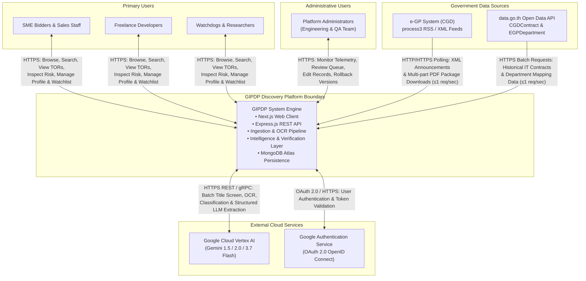

---

## 1.6 System Use-Case Model (SRS Appendix B.2)

The Use-Case Model mirrors Appendix B.2 of the SRS, identifying the primary actors and the complete set of system use cases.

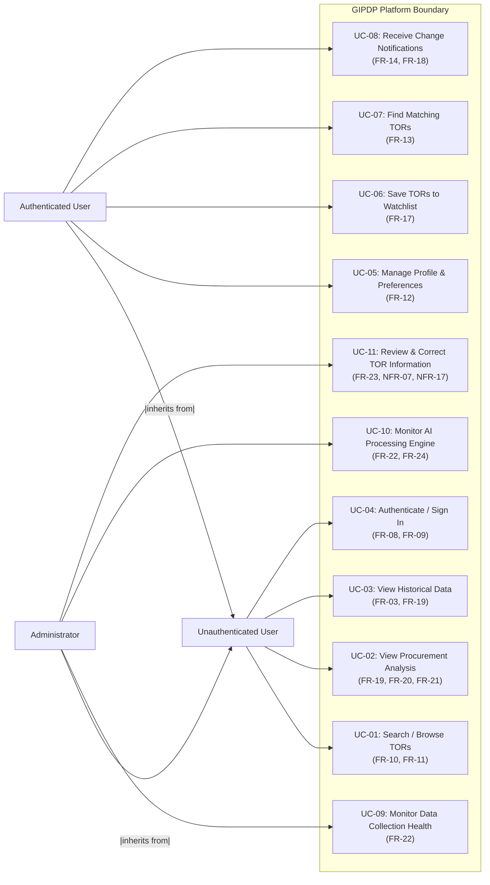

### Detailed Use-Case Specifications

| Use Case ID | Name | Primary Actor | Preconditions | Trigger | Successful End Condition |
|---|---|---|---|---|---|
| **UC-01** | Search & Browse TORs | Unauthenticated User | Public web application is operational. | User enters keyword, selects tech stack, agency, or budget filter. | Filtered list of normalized procurement cards matching criteria is returned in under 2.0 seconds (`NFR-01`). |
| **UC-02** | View Procurement Analysis | Unauthenticated User | Selected TOR has completed pipeline processing. | User clicks on a specific TOR card. | Full detail page displays extracted specifications, Lock-Spec Risk findings, and Price Reality Check comparisons. |
| **UC-03** | View Historical Data | Unauthenticated User | Historical contracts imported from data.go.th. | User navigates to `/watchdog` or benchmark drawer. | Historical procurement distributions, median prices, and price trends are rendered. |
| **UC-04** | Authenticate / Sign In | Unauthenticated User | Valid Google account or email registration. | User submits credentials on `/auth` or initiates Google OAuth. | Encrypted JWT session cookie is set (`NFR-11`), granting access to private routes. |
| **UC-05** | Manage Profile | Authenticated User | User is authenticated. | User updates tech stack tags, budget capacity, or job size. | Profile document in MongoDB Atlas is updated; match scores are re-indexed. |
| **UC-06** | Save TOR to Watchlist | Authenticated User | User is authenticated. | User clicks "Save to Watchlist" on a TOR card/detail. | TOR ID is stored in user's watchlist; change monitoring is activated. |
| **UC-07** | Find Matching TORs | Authenticated User | User has saved a capability profile. | User toggles "Match View" on `/search`. | Opportunities ranked by weighted match score (`FR-13`) are rendered. |
| **UC-08** | Receive Notifications | Authenticated User | TOR in watchlist is amended or status changes. | Ingestion engine records a status change or content hash delta. | In-app notification bell badge updates; consent-checked email alert is dispatched (`FR-18`). |
| **UC-09** | Monitor Data Collection | Administrator | Administrator is authenticated. | Admin loads `/admin` dashboard. | Real-time telemetry on e-GP RSS polling, uptime, and HTTP error streaks is displayed (`FR-22`). |
| **UC-10** | Monitor AI Processing | Administrator | Administrator is authenticated. | Admin inspects pipeline telemetry. | Daily token consumption, OCR execution durations, and processing stage counts are displayed. |
| **UC-11** | Review & Correct TOR | Administrator | Extraction confidence < 80% or user report filed. | Admin opens low-confidence review queue on `/admin`. | Extracted fields are corrected or non-IT record is reclassified; public catalog visibility is restored (`FR-23`, `NFR-17`). |

---

## 1.7 Regulatory & Legal Framework

### 1.7.1 Thailand Personal Data Protection Act (PDPA) Compliance
* **Data Minimization:** GIPDP collects only the user's primary email, hashed password (for credential sign-up), Google subject identifier (for OAuth), and user-provided capability profiles. No personal financial accounts, corporate tax filings, or identity card scans are stored.
* **Consent-Based Communications (`FR-14`, `FR-18`):** Email notifications for matching TORs and watchlist status alerts are **disabled by default**. Users must explicitly grant opt-in consent via profile toggles. Consent can be revoked instantly at any time.
* **Data Retention & Right to Erasure:** Users retain the right to clear their capability profile and delete their account, triggering a cascade purge of profile records and watchlist relations.

### 1.7.2 Third-Party Procurement Disclaimer Enforcement
In compliance with Section 6.1 of SRS v0.3, GIPDP is an analytical discovery tool. It does not replace the official procurement portal. The system enforces two mandatory disclaimers:
1. **Global Site-Wide Footer:** Displayed on every public and private screen:
   > *"GIPDP is an independent third-party discovery and analysis platform. All official procurement announcements, formal inquiries, bidding submissions, and legal contracts are governed exclusively by the Comptroller General's Department via e-GP (www.gprocurement.go.th)."*
2. **Contextual Action Disclaimer:** Positioned immediately adjacent to the "Open in e-GP" link on every TOR Detail Page (`/tor/[id]`):
   > *"Original source document remains the sole legal authority. Always verify requirements against the official announcement prior to preparing a bid."*

---

# Section 2: System Architecture & Infrastructure Topology

## 2.1 Architectural Pattern & Separation of Concerns (NFR-14)

To satisfy **NFR-14 (Maintainability)**, GIPDP strictly decouples the high-throughput, latency-sensitive **Web Serving Application** from the asynchronous, compute-heavy **Batch Ingestion & AI Processing Pipeline Worker**. The two systems share no in-memory state and communicate exclusively through the shared **MongoDB Atlas** database cluster.

```
┌────────────────────────────────────────────────────────────────────────────────────────┐
│                                GIPDP ARCHITECTURE                                      │
├──────────────────────────────────────────┬─────────────────────────────────────────────┤
│      WEB APPLICATION SUBSYSTEM           │          PIPELINE WORKER SUBSYSTEM          │
│   (Next.js Client + Express.js API)      │    (CLI Wave Workers + Scheduled Cron)      │
├──────────────────────────────────────────┼─────────────────────────────────────────────┤
│ • Stateless HTTP/HTTPS Request Handling  │ • Scheduled Execution (Poll, Sweep, Process)│
│ • Sub-2.0s User Response Times (NFR-01)  │ • Multi-Stage Wave Backlog Processing       │
│ • JWT Cookie Session Management (NFR-11) │ • External API Rate Limiting (1 rps, NFR-03)│
│ • Catalog Filtering & Match Scoring Query│ • Heavyweight Thai OCR & Gemini LLM Calls   │
│ • Admin Review Queue API & Telemetry     │ • Content Hashing & Automatic Diff Engine   │
└──────────────────────────────────────────┴─────────────────────────────────────────────┘
                                           │
                                           ▼
                 ┌──────────────────────────────────────────────────┐
                 │       SHARED PERSISTENCE & DATA STORAGE          │
                 │   • MongoDB Atlas Cluster (Document Data Store)  │
                 │   • Local Storage / Persistent File Volume       │
                 └──────────────────────────────────────────────────┘
```

---

## 2.2 Container Architecture (C4 Level 2)

The C4 Container Diagram illustrates the high-level software containers comprising the GIPDP system boundary. The architecture cleanly separates the user-facing request path from the automated data ingestion and extraction pipeline, converging on a shared persistence tier.

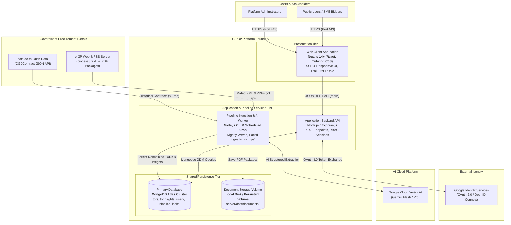

---

## 2.3 Express API Component Architecture (C4 Level 3)

The internal component structure of the Express backend follows the **Feature-Based Server Layout** established in **ADR 0003**.

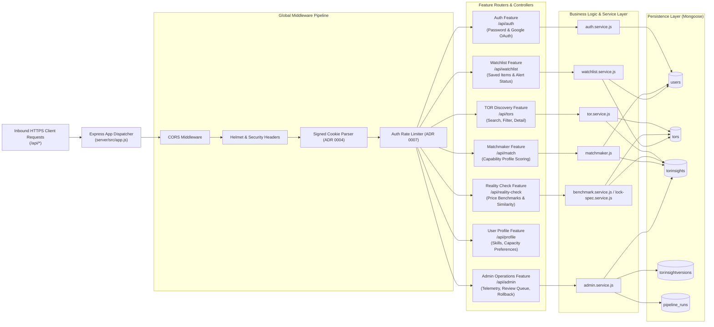

---

## 2.4 Pipeline Subsystem Architecture (C4 Level 3)

The pipeline subsystem operates as a stand-alone Node.js worker engine (`server/src/pipeline/`). It is decomposed into two distinct, decoupled processing stages that communicate solely through the persistence tier (**ADR 0013**).

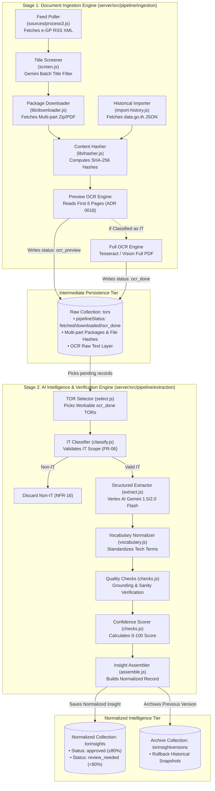

---

## 2.5 Deployment & Infrastructure Topology

The production system is deployed across isolated Docker containers fronted by a reverse proxy handling SSL/TLS termination, communicating securely over TLS 1.2+ (**NFR-08**).

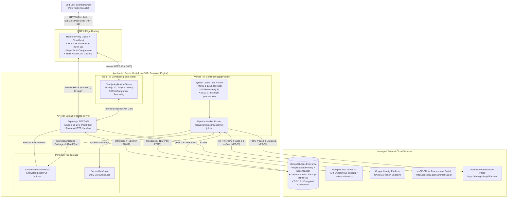

---

## 2.6 Cross-Cutting Operational Policies

### 2.6.1 Government Server Rate Limiting & Pacing (NFR-03)
To ensure compliance with **NFR-03** and prevent denial-of-service impacts or IP bans from government servers, all outbound requests to `process3.gprocurement.go.th` and `data.go.th` pass through a centralized token bucket request pacer (`server/src/pipeline/shared/request-pacer.js`):
* Maximum outbound frequency: **Strictly 1 request per 1,000 milliseconds (1.0 req/sec)**.
* Consecutive failure streak monitoring (`RequestStreak` model): If 5 consecutive 5xx errors occur, requests are halted with exponential backoff.
* Custom user-agent identification: Identifies GIPDP as a polite discovery agent with administrative contact metadata (**ADR 0017**).

### 2.6.2 Priority Wave Nightly Processing (ADR 0030)
The pipeline schedules nightly processing (`22:00` to `07:55` Bangkok time) into **four discrete priority waves** to ensure high-value, imminent deadlines are processed first:
1. **Wave 1 (Check & Recheck):** Queries e-GP for changes to active Draft (`B0`) and Open (`D0`) tenders. Downloads amended packages immediately.
2. **Wave 2 (New Opportunities):** Batch screens new titles, downloads workable PDFs, extracts 6-page preview OCR, classifies IT scope, performs full OCR, and executes Gemini LLM extraction. Sorted by closest submission deadline first.
3. **Wave 3 (Amendments & Changes):** OCRs and extracts amended documents identified in Wave 1; executes clause-by-clause diffing.
4. **Wave 4 (Historical Pricing & Benchmarks):** Imports data.go.th contract awards and recalculates statistical price bands for comparable categories.

### 2.6.3 Safe Idempotent Execution (ADR 0016)
Every pipeline CLI script is idempotent:
* Download checks verify whether `contentHash` or `zipId` already exists before initiating file transfer.
* Extraction verifies whether `TorInsight` already exists and whether the source `contentHash` has changed. If unchanged, duplicate expensive LLM calls are skipped.

---

# Section 3: Data Architecture & Database Design

## 3.1 Persistence Technology & Storage Strategy

In alignment with **ADR 0001 (Mongoose over MongoDB Driver)** and **ADR 0002 (MongoDB Atlas over Local Container)**:
* **Primary Database:** MongoDB Atlas, utilizing the Mongoose Object Data Modeling (ODM) library in Node.js.
* **Schema Strategy:** Strict Mongoose schemas with schema-level validation, default values, and pre-save hooks for audit trails.
* **Document Separation:** Ingested raw procurement data (`Tor`) and normalized analytical intelligence (`TorInsight`) are maintained in **separate collections**, linked by the unique government project identifier `projectId` (**ADR 0013**).
* **Missing Field Rule:** If a field is not explicitly specified in the government TOR document, it is preserved as `null`, **never fabricated or assumed** (**ADR 0014**). Empty lists default to `[]`.

---

## 3.2 Entity-Relationship Diagram (ERD)

The complete entity-relationship model defines the collections and embedded document structures maintained in MongoDB Atlas.

```mermaid
erDiagram
    TOR ||--o| TOR_INSIGHT : "normalized into (1:0..1)"
    TOR_INSIGHT ||--o{ TOR_INSIGHT_VERSION : "archives history (1:N)"
    TOR ||--o{ PIPELINE_FAILURE : "logs failures (1:N)"
    USER ||--o{ WATCHLIST_ITEM : "contains (1:N)"
    TOR ||--o{ WATCHLIST_ITEM : "referenced by (1:N)"
    USER ||--o| USER_PROFILE : "has capability (1:1)"
    PIPELINE_RUN ||--o{ FEED_POLL : "records polls (1:N)"
    PIPELINE_RUN ||--o{ INGESTION_LOG : "records logs (1:N)"
    TOR ||--o| TITLE_SCREEN : "screened by (1:0..1)"

    TOR {
        ObjectId _id PK
        string projectId UK "Official e-GP Project ID (11 digits)"
        string source "process3 | datago | manual"
        string title "Raw procurement title from feed"
        string agency "Posting department name"
        string subAgency "Sub-agency / division name"
        string province "Province location"
        number budgetTHB "Allocated agency budget"
        number referencePriceTHB "Approved reference price (ราคากลาง)"
        date submissionDeadline "Bid submission deadline date"
        string procurementMethod "e-bidding | selection | specific"
        string procurementKind "hire | buy | rent"
        string egpUrl "Official e-GP tender link"
        string announceType "Latest announcement code (B0, D0, D2)"
        string status "Draft | Open | Awarded | Cancelled | Closed"
        boolean isAmended "Amended overlay flag"
        string pipelineStatus "fetched | downloaded | ocr_preview | ocr_done"
        object contract "Embedded contract & winner data"
        object document "PDF metadata, contentHash, parts array"
        array packages "Array of downloaded e-GP zip/PDF packages"
        object ocr "Raw OCR text, preview text, confidence, flags"
        array announcementHistory "Chronological history of e-GP RSS codes"
        array amendments "Clause-by-clause changes and diffs"
        date lastChangeAt "Timestamp when latest amendment was detected"
        date createdAt
        date updatedAt
    }

    TOR_INSIGHT {
        ObjectId _id PK
        string projectId UK "Foreign key to TOR.projectId (11 digits)"
        object identification "titleTh, titleEn, agency, categories, status"
        object facts "budgetTHB, referencePriceTHB, deadlines, penalties"
        map evidence "Field-to-quote mapping back to raw OCR text"
        object overview "objective, components, scope, archetype"
        object deliverables "system, implementation, validation deliverables"
        object technicalRequirements "technologies, capabilities, constraints"
        object integrationEnvironment "existingSystems, interfacesAndApis"
        object operationalRequirements "installation, training, support, SLA"
        object eligibility "standardConditions, companyReqs, certs, minExp"
        object contractConditions "paymentTerms, deliveryConditions, evaluation"
        object analytics "lockSpec findings, priceAnalysis benchmarks"
        object amendmentInfo "isAmended, lastAmendedDate, summary, changes"
        object metadata "confidenceScore, reviewStatus, checks, version"
        date createdAt
        date updatedAt
    }

    TOR_INSIGHT_VERSION {
        ObjectId _id PK
        string projectId "Target e-GP project ID"
        number version "Incremental version number"
        ObjectId tor "Reference to Tor document"
        ObjectId insight "Reference to TorInsight document"
        string ocrTextHash "SHA-256 hash of OCR text"
        string ocrText "Full raw OCR text layer"
        string reason "amendment | manual_edit | rollback"
        string supersededBy "Admin user ID or worker identifier"
        date supersededAt "Timestamp when version was archived"
    }

    USER {
        ObjectId _id PK
        string email UK "Normalized lowercase user email"
        string name "User full name or alias (max 80 chars)"
        string passwordHash "Bcrypt hashed and salted password (work factor 12)"
        string googleId "Google OAuth subject identifier"
        boolean notificationConsent "Opt-in consent for email notifications (PDPA)"
        string role "user | admin (NFR-10)"
        object profile "Capability skills, budget bounds, archetypes, certs"
        array watchlist "Array of saved projectId references"
        date createdAt
        date updatedAt
    }

    WATCHLIST_ITEM {
        string projectId "Reference to Tor.projectId"
        date savedAt "Timestamp when bookmarked"
    }

    PIPELINE_RUN {
        ObjectId _id PK
        string job "poll | sweep | process"
        string host "Worker host machine identifier"
        date startedAt "Execution start timestamp"
        date finishedAt "Execution completion timestamp"
        date until "Time-box execution deadline"
        string outcome "running | done | timed-out | skipped | failed"
        array steps "Array of step objects: name, exitCode, startedAt, ms"
        object before "Stage counts before execution"
        object after "Stage counts after execution"
        string logFile "Log file storage path"
        string error "Execution error summary"
    }

    FEED_POLL {
        ObjectId _id PK
        string source "process3"
        string deptId "Department code or empty for national feed"
        string announceDate "Target date (YYYYMMDD)"
        date startedAt "Poll dispatch timestamp"
        date finishedAt "Poll completion timestamp"
        boolean closed "Feed closed hours flag"
        boolean rateLimited "Rate-limited HTTP 429 flag"
        number requested "HTTP requests dispatched"
        number answered "HTTP responses received"
        map itemsByType "Item counts grouped by announcement code"
        map countByType "e-GP reported countbyday"
        number discovered "New projects added"
        number updated "Followed projects updated"
        array problems "Initial error log strings"
    }

    PIPELINE_FAILURE {
        ObjectId _id PK
        string projectId "Target e-GP project ID"
        string step "download | ocr | extract"
        string inputKey "Hash or fingerprint of step input"
        number attempts "Consecutive failure counter"
        string lastError "Latest error message"
        boolean lastTransient "Transient network failure flag"
        date firstFailedAt "Initial failure timestamp"
        date lastFailedAt "Most recent failure timestamp"
    }

    PIPELINE_LOCK {
        string _id PK "Pipeline name ('ingestion' | 'extraction')"
        string owner "Worker host, process ID, and nonce"
        date acquiredAt "Lock acquisition timestamp"
        date expiresAt "Heartbeat lease expiration timestamp"
    }

    TITLE_SCREEN {
        ObjectId _id PK
        string projectId UK "11-digit e-GP project ID"
        string title "Announcement title screened"
        string verdict "it | not_it | unsure"
        string reason "Thai explanation sentence"
        string category "IT category classification"
        boolean audit "Random audit sample flag"
        string promptVersion "Screening prompt version"
        string modelName "Gemini model identifier"
        date screenedAt "Screening timestamp"
    }

    REQUEST_STREAK {
        string _id PK "Site hostname (e.g., gprocurement.go.th)"
        number inARow "Consecutive request counter"
        date lastAt "Timestamp of last outbound request"
    }

    TECHNOLOGY {
        ObjectId _id PK
        string name UK "Display name (e.g., PostgreSQL)"
        string key UK "Normalized lowercase lookup key"
        array aliases "Synonyms and variations"
        string category "database | os | language | framework | platform"
        string status "confirmed | new | rejected"
        string firstSeenIn "Originating projectId"
        date createdAt
        date updatedAt
    }
```

---

## 3.3 Data Flow Architecture (DFD Level 0 & Level 1)

### 3.3.1 DFD Level 0 (Context-Level Data Flow)

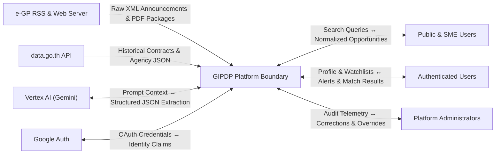

### 3.3.2 DFD Level 1 (Decomposed Functional Data Flow)

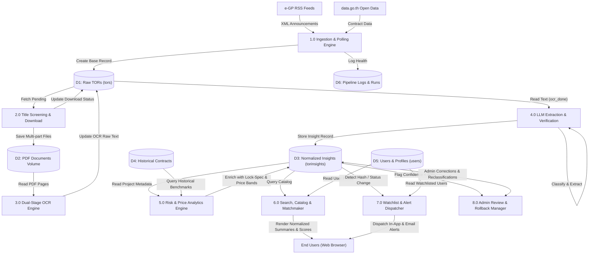

---

## 3.4 Data Dictionaries & Detailed Schema Specifications

### 3.4.1 `Tor` Model Specification (`server/src/models/tor.model.js`)
* **Collection:** `tors`
* **Role:** Stores raw scraped procurement metadata, physical PDF storage locations, SHA-256 document content hashes, OCR text layers, packages, and raw contract award details.

| Field Name | Type | Constraints | Description |
|---|---|---|---|
| `projectId` | `String` | Required, Unique, Indexed | 11-digit official e-GP project identifier (e.g., `"69109062251"`). Primary dedup key. |
| `source` | `String` | Required, Enum | Data origin: `'process3'` (e-GP feed), `'datago'` (data.go.th import), `'manual'`. |
| `title` | `String` | Required | Original raw procurement title as published on the e-GP announcement. |
| `agency` | `String` | Default: `""` | Name of the issuing government ministry, department, or provincial office. |
| `subAgency` | `String` | Default: `""` | Sub-department, bureau, or division within the agency. |
| `province` / `district` | `String` | Default: `""` | Geographic location of the procuring entity. |
| `budgetTHB` | `Number` | Default: `null` | Allocated agency budget (งบประมาณ). `null` when feed does not specify. |
| `referencePriceTHB` | `Number` | Default: `null` | Approved reference price (ราคากลาง) worked out by agency committee. |
| `submissionDeadline` | `Date` | Default: `null`, Indexed | Bid submission deadline timestamp parsed from feed or package documents. |
| `procurementMethod` | `String` | Default: `""` | Thai procurement method (e.g., `"e-bidding"`, `"เฉพาะเจาะจง"`). |
| `procurementKind` | `String` | Enum, Default: `null` | Procurement nature parsed from title: `'hire'` (จ้าง), `'buy'` (ซื้อ), `'rent'` (เช่า). |
| `egpUrl` | `String` | Default: `""` | Upstream URL link on the Comptroller General's e-GP portal. |
| `announceType` | `String` | Default: `""` | Latest e-GP announcement code seen (`B0`, `D0`, `D2`, `W0`, etc.). |
| `status` | `String` | Required, Enum, Indexed | Legal status: `'Draft'`, `'Open'`, `'Awarded'`, `'Cancelled'`, `'Closed'`. |
| `isAmended` | `Boolean` | Required, Default: `false`, Indexed | Overlay flag: `true` if announcement code `D2` was received (**ADR 0017**). |
| `pipelineStatus` | `String` | Required, Enum, Indexed | Technical ingestion state: `'fetched'`, `'downloaded'`, `'ocr_preview'`, `'ocr_done'`. |
| `document` | `Object` | Required | Embedded object: `fileName`, `storagePath`, `sizeBytes`, `pages`, `documentType` (`'DIGITAL_TEXT_PDF'`/`'SCANNED_PAPER_PDF'`), `contentHash` (SHA-256), `version`, `parts: [torPartSchema]`. |
| `packages` | `[Object]` | Default: `[]` | Array of all downloaded packages, preserving `zipId`, `kind` (`announcement`/`price`), `downloadedAt`, `facts`, and raw files. |
| `ocr` | `Object` | Required | Embedded object: `rawText`, `confidence` (0.0–1.0), `usedOcr`, `truncated`, `preview`, `pagesRead`, `processedAt`. |
| `contract` | `Object` | Optional | Award details from data.go.th: `winnerName`, `winnerTaxId`, `contractNo`, `agreedPriceTHB`, `fiscalYear`, `winners: [...]`. |
| `announcementHistory` | `[Object]` | Default: `[]` | Chronological log of every RSS announcement: `{ code, type, receivedAt, publishedAt, sourceUrl }` (**FR-02**). |
| `amendments` | `[Object]` | Default: `[]` | Clause-by-clause changes detected across packages: `{ source, stage, round, date, headline, detectedAt, zipId, contentHash, insightVersion, diff, changes: [...] }` (**FR-16**). |
| `lastChangeAt` | `Date` | Default: `null`, Indexed | Timestamp when the latest change was detected (for sorting and watchlist alerts). |

---

### 3.4.2 `TorInsight` Model Specification (`server/src/models/tor-insight.model.js`)
* **Collection:** `torinsights`
* **Role:** Stores normalized, plain-language summaries, extracted structured technical clauses, lock-spec risk findings, price benchmarking distributions, and audit grounding citations. Keyed strictly by `projectId`.

```json
{
  "projectId": "69109062251",
  "identification": {
    "titleTh": "โครงการพัฒนาระบบคลังข้อมูลและแพลตฟอร์มการวิเคราะห์ข้อมูลอัจฉริยะ",
    "titleEn": null,
    "agency": "กรมการค้าภายใน",
    "department": null,
    "egpReference": "69109062251",
    "categories": ["data-warehouse", "software-development"],
    "status": "Open"
  },
  "facts": {
    "budgetTHB": 11946000,
    "agreedPriceTHB": null,
    "referencePriceTHB": 12904200,
    "submissionDeadline": "2026-11-20T09:30:00.000Z",
    "commentDeadline": null,
    "deliveryPeriodDays": 240,
    "procurementMethod": "e-bidding",
    "procurementKind": "hire",
    "warrantyYears": 2,
    "contractDurationDays": 240,
    "penaltyClause": "0.20% ของมูลค่าสัญญาต่อวัน",
    "postedDate": "2026-10-15T00:00:00.000Z",
    "sourceUrl": "http://process3.gprocurement.go.th/...",
    "webUrl": "https://process3.gprocurement.go.th/egp2procmain/..."
  },
  "evidence": {
    "referencePriceTHB": {
      "quote": "ราคากลาง ๑๒,๙๐๔,๒๐๐ บาท",
      "page": 3,
      "document": null
    }
  },
  "overview": {
    "objective": "เพื่อจัดทำคลังข้อมูลกลางและระบบแดชบอร์ดแสดงผลการวิเคราะห์ราคาพืชผลเกษตร",
    "majorComponents": ["Data Lakehouse", "ETL Pipeline", "BI Dashboard"],
    "highLevelScope": "พัฒนาระบบสกัดข้อมูลจาก 4 แหล่งข้อมูลและสร้างระบบรายงานอัตโนมัติ",
    "systemArchetype": "Data Platform",
    "complexityTier": "Medium"
  },
  "deliverables": {
    "system": ["ระบบคลังข้อมูลกลาง", "โมดูล ETL อัตโนมัติ", "แดชบอร์ดสำหรับผู้บริหาร"],
    "implementation": ["แผนผังสถาปัตยกรรมระบบ", "คู่มือการติดตั้งและใช้งาน"],
    "validation": ["รายงานผลการทดสอบระบบ (UAT)", "รายงานการประเมินช่องโหว่ความปลอดภัย"],
    "supportingWork": ["การจัดฝึกอบรมบุคลากรจำนวน 2 รุ่น"]
  },
  "technicalRequirements": {
    "requiredTechnologies": [
      {
        "name": "PostgreSQL",
        "version": "14",
        "allowsEquivalent": true
      },
      {
        "name": "Windows Server",
        "version": "2019",
        "allowsEquivalent": false
      }
    ],
    "requiredCapabilities": ["รองรับการประมวลผลข้อมูลไม่น้อยกว่า 1 ล้านรายการต่อวัน"],
    "infrastructureSpecifications": [
      { "key": "Database Server CPU", "spec": "≥ 16 vCPU" },
      { "key": "Database Memory", "spec": "≥ 64 GB RAM" }
    ],
    "technicalConstraints": [
      { "metric": "System Availability", "value": "≥ 99.5%" }
    ]
  },
  "eligibility": {
    "standardConditions": ["thai-registered-company", "not-blacklisted"],
    "companyRequirements": ["จดทะเบียนเป็นนิติบุคคลในประเทศไทยมาแล้วไม่น้อยกว่า 3 ปี"],
    "requiredCertifications": ["ISO/IEC 29110 หรือ CMMI Level 3"],
    "manufacturerAuthorizations": [],
    "previousExperience": "มีผลงานประเภทเดียวกันในสัญญาเดียววงเงินไม่น้อยกว่า 5,000,000 บาท",
    "previousExperienceMinTHB": 5000000,
    "personnelQualifications": ["ผู้จัดการโครงการต้องผ่านการรับรอง PMP หรือเทียบเท่า"]
  },
  "contractConditions": {
    "paymentTerms": "แบ่งจ่าย 4 งวดตามความก้าวหน้าของงานส่งมอบ",
    "deliveryConditions": "ส่งมอบงาน ณ กรมการค้าภายใน กระทรวงพาณิชย์",
    "evaluationMethod": "เกณฑ์ราคาและประสิทธิภาพ (Price-Performance)"
  },
  "analytics": {
    "lockSpec": {
      "riskScore": 70,
      "verdictText": "ความเสี่ยงสูง: พบเงื่อนไขที่อาจจำกัดการแข่งขันเฉพาะราย",
      "findings": [
        {
          "id": "FIND-69109062251-03",
          "title": "ระบุเวอร์ชันระบบปฏิบัติการเฉพาะเจาะจง (Windows Server 2019) โดยไม่มีคำว่า หรือเทียบเท่า",
          "category": "Specification Tailoring",
          "requirementText": "ระบบต้องทำงานเฉพาะบน Windows Server 2019 โดยไม่ระบุข้อความ หรือเทียบเท่า ตามระเบียบ",
          "normalBenchmark": "ตามหนังสือเวียน ว 214 ข้อ 3 หากมีความจำเป็นต้องระบุยี่ห้อหรือรุ่น จะต้องระบุคำว่า หรือเทียบเท่า ไว้ด้วยเสมอ",
          "sourceExcerpt": "ระบบต้องติดตั้งบน Windows Server 2019",
          "sourceLocation": "หน้า 7 · ข้อ 2.2.1",
          "severity": "high"
        }
      ]
    },
    "priceAnalysis": {
      "referencePriceTHB": 12904200,
      "historicalMedianTHB": 12500000,
      "historicalAverageTHB": 12800000,
      "diffAmountTHB": 404200,
      "diffPercentage": 3.2,
      "diffAverageAmountTHB": 104200,
      "diffAveragePercentage": 0.8,
      "sampleSize": 7,
      "reliability": "sufficient",
      "interpretation": "ราคากลางอยู่ในเกณฑ์ปกติเมื่อเทียบกับโครงการใกล้เคียงในอดีต (เบี่ยงเบน +3.2%)",
      "comparableProjects": [
        {
          "title": "โครงการพัฒนาระบบคลังข้อมูลกลาง BMA Phase 1",
          "year": 2567,
          "referencePriceTHB": 13500000,
          "agreedPriceTHB": 12200000
        }
      ]
    }
  },
  "amendmentInfo": {
    "isAmended": false,
    "lastAmendedDate": null,
    "amendmentSummary": "",
    "changedSections": []
  },
  "metadata": {
    "origin": "pipeline",
    "modelName": "gemini-1.5-flash",
    "promptVersion": "extract-v4",
    "processedAt": "2026-10-25T14:30:00.000Z",
    "sourceFingerprint": "47f6959e4b0bb5ba788836b2950093f5...",
    "confidenceScore": 88,
    "checks": [],
    "reviewStatus": "approved",
    "reviewedBy": null,
    "reviewedAt": null,
    "awaitingFullText": false,
    "titleOnly": false,
    "version": 1
  }
}
```

---

### 3.4.3 `User` Model Specification (`server/src/models/user.model.js`)
* **Collection:** `users`
* **Role:** Stores user authentication credentials, role permissions (**NFR-10**), capability profiles (**FR-12**), watchlist bookmarks (**FR-17**), and PDPA notification preferences.

| Field Name | Type | Description |
|---|---|---|
| `email` | `String` | Required, Unique, Lowercase, Trimmed, Indexed. Standard user email address. |
| `name` | `String` | Optional, Default: `""`, Maxlength: 80. User full name or company display name. |
| `passwordHash` | `String` | Optional (null for Google OAuth users), `select: false`. Salted Bcrypt hash (Work factor 12, **NFR-09**). |
| `googleId` | `String` | Optional, Unique, Sparse. Subject ID from Google OAuth 2.0 (**FR-09**). |
| `notificationConsent` | `Boolean` | Default: `false`. Explicit opt-in consent for email notifications under PDPA (**FR-14, FR-18**). |
| `role` | `String` | Required, Enum: `'user'`, `'admin'`, Default: `'user'`, Indexed. Strict RBAC enforcement (**NFR-10**). |
| `profile.skills` | `[String]` | Array of canonical technology skills user possesses (max 150 skills). |
| `profile.budgetMin` | `Number` | Minimum contract value in THB user prefers to bid on (default: 0). |
| `profile.budgetMax` | `Number` | Maximum contract ceiling in THB user capacity supports (default: 0, 0 = unlimited). |
| `profile.certifications` | `[String]` | Professional and organizational certifications held (e.g., `["ISO 29110", "CMMI Level 3"]`, max 50). |
| `profile.entityType` | `String` | Enum: `'juristic'`, `'individual'`, Default: `'juristic'`. Company vs. Freelancer entity type. |
| `profile.preferredArchetypes` | `[String]` | System architectural types preferred (e.g., `["web_application", "data_platform"]`, max 10). |
| `profile.maxPastPortfolioTHB` | `Number` | Largest single past completed project value in THB (used for qualification threshold checks). |
| `profile.matchNotification` | `Object` | Alert rules: `{ enabled: Boolean, minScore: Number (50–95), frequency: 'instant'|'daily'|'weekly', includeSubcontract: Boolean }`. |
| `watchlist` | `[Object]` | Array of saved tenders: `[{ projectId: String, savedAt: Date }]` (indexed by `watchlist.projectId`). |

---

### 3.4.4 Operational Models Specification
These supporting collections govern automated batch execution, idempotency, rate limiting, and administrative review:

| Model Name | File Path | Collection | Primary Responsibility & Schema Fields |
|---|---|---|---|
| `PipelineRun` | `pipeline-run.model.js` | `pipeline_runs` | Execution telemetry for scheduled wave jobs (`job: 'poll'\|'sweep'\|'process'`, `host`, `startedAt`, `finishedAt`, `until`, `outcome: 'running'\|'done'\|'timed-out'\|'skipped'\|'failed'`, `steps: [{ name, exitCode, startedAt, ms }]`, `before`, `after`, `logFile`, `error`). |
| `PipelineLock` | `pipeline-lock.model.js` | `pipeline_locks` | Distributed concurrency control ensuring only one worker instance executes a named wave at any time (`_id: 'ingestion'\|'extraction'`, `owner`, `acquiredAt`, `expiresAt`). |
| `TitleScreen` | `title-screen.model.js` | `title_screens` | Cache of Gemini batch title screening decisions (`projectId`, `title`, `verdict: 'it'\|'not_it'\|'unsure'`, `reason`, `category`, `audit: Boolean`, `promptVersion`, `modelName`, `screenedAt`). |
| `FeedPoll` | `feed-poll.model.js` | `feed_polls` | Audit log of individual e-GP RSS polling calls (`source: 'process3'`, `deptId`, `announceDate`, `startedAt`, `finishedAt`, `closed`, `rateLimited`, `requested`, `answered`, `itemsByType`, `countByType`, `discovered`, `updated`, `problems`). |
| `RequestStreak` | `request-streak.model.js` | `request_streaks` | Consecutive outbound request monitor for rate pacing and circuit breaking (`_id: site_hostname`, `inARow`, `lastAt`). |
| `PipelineFailure` | `pipeline-failure.model.js` | `pipeline_failures` | Persistent quarantine log for individual tender processing exceptions (`projectId`, `step: 'download'\|'ocr'\|'extract'`, `inputKey`, `attempts`, `lastError`, `lastTransient`, `firstFailedAt`, `lastFailedAt`). |
| `TorInsightVersion`| `tor-insight-version.model.js` | `torinsightversions` | Immutable point-in-time snapshots of `TorInsight` documents archived prior to amendments or admin edits (**NFR-07**) (`projectId`, `version`, `tor`, `insight`, `ocrTextHash`, `ocrText`, `reason: 'amendment'\|'manual_edit'\|'rollback'`, `supersededBy`, `supersededAt`). |
| `Technology` | `technology.model.js` | `technologies` | Canonical IT technology dictionary (`name`, `key`, `aliases: [String]`, `category: 'database'\|'os'\|'language'\|'framework'\|'platform'`, `status: 'confirmed'\|'new'\|'rejected'`, `firstSeenIn`). |

---

# Section 4: Ingestion & AI Processing Pipeline Subsystem

## 4.1 Automated e-GP RSS Polling & Announcement Code Parsing (FR-01, FR-02)

The Ingestion Engine polls official e-GP XML feeds (`http://process3.gprocurement.go.th/egp2procmain/process3/`) under rate-limiting controls (**NFR-03**).

### Handled e-GP Announcement Codes (`FR-02`, ADR 0017)
* `B0`: Draft TOR released for public comment/hearing. Platform status: `Draft`.
* `D0`: Invitation to bid / official tender announcement. Platform status: `Open`.
* `D1`: Invitation cancelled. Platform status: `Cancelled`.
* `D2`: Tender amended (specifications, terms, or dates updated). Sets `isAmended = true`.
* `15`: Official reference price form published (ราคากลาง บก.06). Triggers price verification.
* `W0` / `W2`: Winner announced or updated. Platform status: `Awarded`.
* `W1`: Winner announcement cancelled.

---

## 4.2 data.go.th Historical Contract Batch Importer (FR-03, ADR 0028)

Historical procurement benchmarking data is ingested in scheduled batch runs via the open government API:
* **Dataset 1: `CGDContract`**: Electronic contract registrations, final winning vendors, signed contract prices, and completion dates.
* **Dataset 2: `EGPDepartment`**: Canonical mapping of government agency codes, ministry hierarchies, and department identifiers.

Outbound calls are strictly throttled to **1 request per second** (**NFR-03**) using the shared token bucket pacer.

---

## 4.3 High-Throughput Batch Title Screening Engine (ADR 0026)

To minimize unnecessary multi-megabyte PDF downloads and OCR costs, all new tender titles fetched from the national e-GP feed are evaluated by a lightweight **Gemini Flash Batch Title Screener** (`server/src/pipeline/extraction/screen.js`):
* Titles are grouped into batches of **40 titles per LLM prompt**.
* The model returns a JSON classification (`is_it_software: true/false`, `confidence`).
* Non-IT tenders (e.g., road construction, vehicle purchases, lawn maintenance) are immediately flagged and excluded from PDF downloading (**NFR-16**). Only tenders classified as potential IT or digital services proceed.

---

## 4.4 Multi-Part Package Downloader & Content Hashing (FR-16, ADR 0020)

Thai procurement packages are often distributed across multiple zipped PDF attachments (`Attach_TOR_1.pdf`, `Attach_TOR_2.pdf`, etc.):
* The downloader retrieves the entire e-GP zip archive, verifies its integrity, and extracts all attachments to `server/data/documents/<projectId>/`.
* A **SHA-256 cryptographic hash** is computed across all concatenated PDF parts:
$$\text{contentHash} = \text{SHA-256}(P_1 \mathbin{\Vert} P_2 \mathbin{\Vert} \dots \mathbin{\Vert} P_n)$$
* When an amended package arrives (`D2`), its hash is compared against the stored `contentHash`. If the hashes differ, a new version is created, triggering automated clause diffing (`FR-16`).

---

## 4.5 Hybrid OCR & Dual-Stage Text Extraction (FR-05, ADR 0018)

Thai government PDFs fall into two physical categories:
1. **Digital Text PDFs:** Generated directly from Microsoft Word / LibreOffice.
2. **Scanned Paper PDFs:** Physical printed documents scanned at varying resolutions (often 150–200 DPI) with stamp overlays and degraded legibility.

### Dual-Stage OCR Pipeline
* **Text Layer Extraction First:** The system first attempts native PDF stream extraction. If valid Thai Unicode characters are extracted without encoding corruption, the text layer is preserved directly.
* **Stage 1 (Preview OCR):** If the PDF is scanned, the OCR engine processes **only the first 6 pages**. This provides sufficient context (agency, title, objectives, high-level scope) for the IT classification engine while conserving compute resources.
* **Stage 2 (Full Document OCR):** Only if Stage 1 classifies the document as a confirmed IT/software procurement does the worker execute full optical character recognition across all remaining pages.

---

## 4.6 IT Classification & Scope Isolation (FR-06, NFR-16)

Document text is classified by Gemini 1.5 Flash using strict domain criteria:
* **Eligible IT Categories:** Custom Software Development, Mobile Apps, Enterprise Systems (ERP/CRM/HRM), Web Applications, Cloud Migration, Systems Integration, Data Analytics / BI Platforms, Network & Cybersecurity Infrastructure.
* **Ineligible Non-IT Categories (Discarded per NFR-16):** Civil construction, office supplies, pure hardware procurement without software integration, medical apparatus, physical janitorial services.

Tenders failing the IT classification are marked `pipelineStatus: 'discarded_non_it'` and completely withheld from the catalog.

---

## 4.7 Structured Field Extraction via Vertex AI Gemini (FR-07, ADR 0025)

Confirmed IT documents are submitted to Gemini 1.5 / 2.0 Flash via Google Cloud Vertex AI using structured JSON schema constraints:

```
Full OCR Text + Bidding Document Text
                 │
                 ▼
┌────────────────────────────────────────────────────────┐
│     Vertex AI Gemini Structured Extraction Prompt      │
│  • Enforces Normalized JSON Schema Output              │
│  • Zero-shot extraction of Thai dates (Buddhist era)   │
│  • Currency normalization (ล้านบาท ➔ Integer THB)      │
│  • Evidence citation mapping (Page number & Quote)     │
└────────────────────────┬───────────────────────────────┘
                         │
                         ▼
        Structured Procurement Insight Object
```

Extracted fields include:
* **Project Facts:** Canonical title, agency, budget in THB, reference price in THB, submission window start/end timestamps, duration in calendar days.
* **Deliverables:** Phased milestone deliverables, descriptions, and timeline schedules.
* **Technical Stack:** Mandatory technologies, required versions, and whether "or equivalent" (หรือเทียบเท่า) is permitted.
* **Contract Terms:** Liquidated damages penalty clause per calendar day (ค่าปรับรายวัน เช่น 0.20%/วัน), warranty periods, and payment milestones.

---

## 4.8 Post-Extraction Verification, Grounding & Confidence Checks (NFR-17)

To prevent LLM hallucination and ensure absolute fidelity to the source document, the extraction worker executes automated validation checks (`server/src/pipeline/extraction/checks.js`):
1. **Quote Grounding Check:** Every extracted fact that provides an `evidence.quote` must exist as an exact substring match within `ocr.rawText`. If the quote cannot be found, a `grounding` check violation is recorded.
2. **Cross-Source Budget Agreement:** Cross-checks the reference price extracted by the LLM against the reference price parsed from the official e-GP XML feed and price form. If the figures disagree by >1%, a `cross-source` check violation is recorded.
3. **Buddhist Era Date Sanity:** Validates that submission dates correspond to plausible future dates (converting Buddhist year 256x to CE 202x) and fall within 365 days of the announcement.
4. **Overall Confidence Scoring:**
$$\text{Confidence Score} = 100 - \sum \text{Check Penalties}$$
   * Critical check failure (e.g., grounding failure on reference price): **Penalty = 30 points**.
   * Minor check failure (e.g., warranty period ungrounded): **Penalty = 10 points**.
5. **Admin Quarantine Threshold (NFR-17):** If `overallConfidence < 80%`, the record's `reviewStatus` is set to `'review_needed'`. It is **completely withheld from the public catalog** until approved or corrected by a human administrator (**ADR 0029**).

---

## 4.9 Sequence Diagram: Automated Ingestion & PDF Extraction Workflow

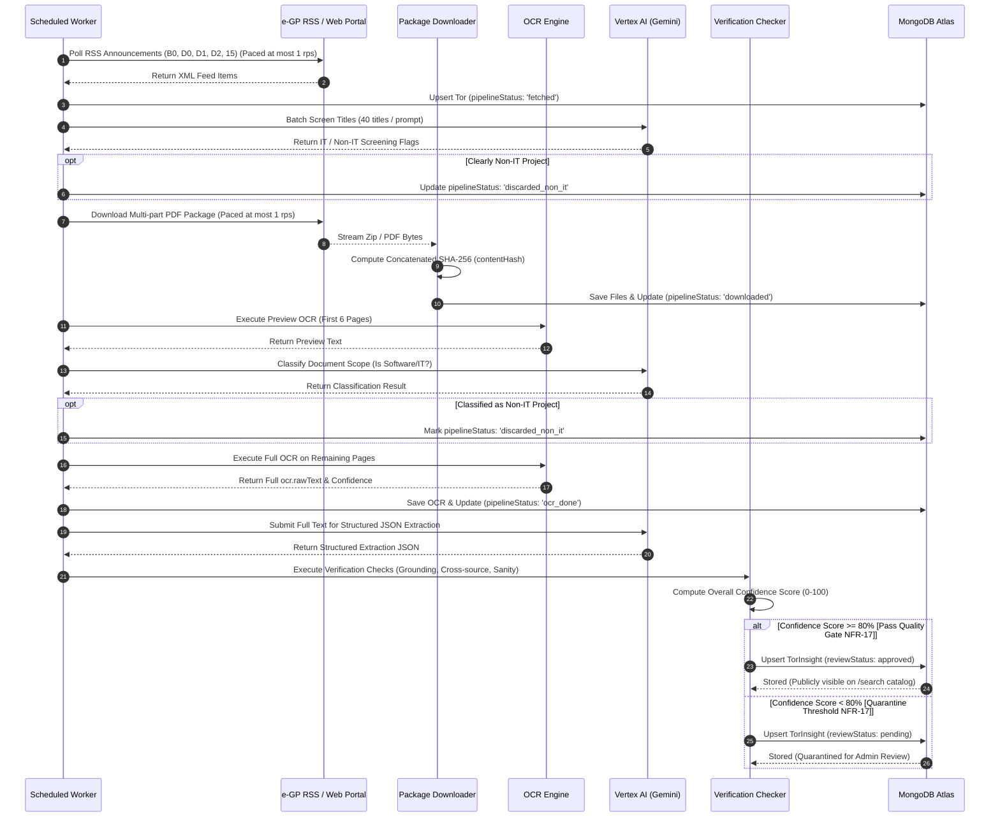


---

# Section 5: Analytical & Decision Support Engines

## 5.1 Lock-Spec Risk Detection Subsystem (FR-20, FR-21, ADR 0030)

The **Lock-Spec Risk Detection Engine** (`server/src/features/reality-check/lock-spec.service.js`) evaluates procurement requirements to identify "bid tailoring" (การล็อคสเปก) — where an agency crafts qualifications or technical specifications so narrowly that only a single favored vendor or incumbent can satisfy them.

The engine is strictly grounded in the **Comptroller General's Circular ว 214** and **Public Procurement and Supplies Administration Act B.E. 2560 Section 9**, providing non-accusatory, evidence-backed findings (**AGENTS.md §7**).

### 5.1.1 Statutory Risk Criteria & Detection Heuristics

The engine executes three statutory rule detectors against extracted data:

| Detector Function | Statutory Basis | Detection Heuristic & Trigger Condition | Severity Points | Standard Fair Benchmark |
|---|---|---|---|---|
| `detectVendorLockin` | **Circular ว 214 Clause 1.3** | Detects requirements for Manufacturer Authorization Forms (MAF / หนังสือแต่งตั้งตัวแทนจำหน่าย) in software development (`software-development`), systems integration (`systems-integration`), or general IT hiring (`facts.procurementKind === 'hire'`). *(Exempt if main scope is purely buying commercial off-the-shelf licenses `software-licenses`).* | High (35 pts) | Thai Public Procurement Act B.E. 2560 Section 9 & Circular ว 214 Clause 1.3 dictate that software development should be evaluated on team capability and past work, not vendor authorization letters. |
| `detectQualificationBarriers` | **Circular ว 214 Clause 2** | Evaluates whether minimum required past single-contract experience (`eligibility.previousExperienceMinTHB`) exceeds 50% of the project's allocated reference price (ราคากลาง). | High (35 pts) | Circular ว 214 Clause 2 establishes that past contract experience requirements must not exceed 50% of the project budget or reference price. |
| `detectSpecificationTailoring` | **Circular ว 214 Clause 3 & Act B.E. 2560 Section 9** | Evaluates whether proprietary operating systems or legacy database runtimes (Windows Server, Red Hat / RHEL, Oracle) require exact specific version numbers without permitting equivalent alternatives (`allowsEquivalent: false` or omitting "หรือเทียบเท่า"). | High (35 pts) | Circular ว 214 Clause 3 mandates that where specific brands or models are cited, the phrase "หรือเทียบเท่า" (or equivalent) must always be explicitly stated. |

### 5.1.2 Scoring Weights & Risk Thresholds (ADR 0030)

Individual findings carry severity point values:
* `high`: **35 points**
* `medium`: **15 points**
* `low`: **5 points**

The total composite risk score is the capped sum of detected findings:
$$\text{riskScore} = \min\left(100, \sum_{f \in \text{findings}} \text{SEVERITY\_POINTS}[f.\text{severity}]\right)$$

* **High Risk (`HIGH = 70`):** 2 or more statutory high violations ($\ge 70$ pts). Verdict text:
  > *"ความเสี่ยงสูง: พบเงื่อนไขที่อาจจำกัดการแข่งขันเฉพาะราย"*
* **Medium Risk (`MEDIUM = 35`):** 1 statutory high violation ($35$ to $69$ pts). Verdict text:
  > *"ความเสี่ยงปานกลาง: มีเงื่อนไขบางข้อที่อาจจำกัดการแข่งขัน"*
* **Low Risk ($< 35$ pts):** Open and fair standard procurement. Verdict text:
  > *"ความเสี่ยงต่ำ: ข้อกำหนดเปิดกว้างตามมาตรฐาน"*

> [!NOTE]
> **Auditability & Traceability:** Every lock-spec finding generated by the platform records the exact `sourceExcerpt` and `sourceLocation` (e.g., `"หน้า 7 · หมวดข้อกำหนดทางเทคนิค"`) linking back to the verified document text.

### 5.1.3 Sequence Diagram: Lock-Spec Risk Detection & Scoring

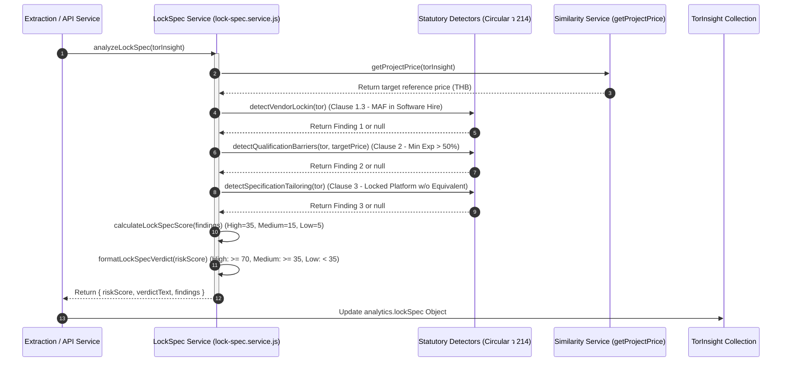

---

## 5.2 Price Reality Check & Statistical Benchmarking Subsystem (FR-19, ADR 0021, 0022, 0024)

The **Price Reality Check Subsystem** (`server/src/features/reality-check/benchmark.service.js`) provides automated, objective market price intelligence. It compares a project's allocated reference price (ราคากลาง) against historical government contract awards from data.go.th to identify price outliers.

### 5.2.1 Data Retrieval & Peer Candidate Selection (ADR 0021, ADR 0028)
When a project is analyzed, the system retrieves peer historical contracts from the ingested data.go.th dataset (`CGDContract`):
1. **Category Matching:** Filters by primary project category (`identification.categories`, e.g., `software-development`, `data-warehouse`, `cloud-infrastructure`).
2. **Title & Scope Similarity:** Evaluates lexical overlap and category alignment against past completed projects.
3. **Statutory Sample Quorum (ADR 0024):** In public procurement, an official price inquiry requires a 3-vendor quorum:
   * $N = 0$: `reliability: 'none'` (No comparable projects found in database).
   * $1 \le N < 3$: `reliability: 'low'` (Below 3-vendor statutory quorum; advisory note attached).
   * $N \ge 3$: `reliability: 'sufficient'` (Meets or exceeds 3-vendor quorum).

### 5.2.2 Statistical Deviations & Price Interpretation (ADR 0024)
For a sanitized peer price array $P = [p_1, p_2, \dots, p_n]$:
* **Historical Median ($M$):** 50th percentile of valid reference prices.
* **Historical Average ($\mu$):** Arithmetic mean of valid reference prices.
* **Percentage Deviation vs. Median:**
$$\text{diffPercentage} = \frac{\text{targetPrice} - M}{M} \times 100$$
* **Percentage Deviation vs. Average:**
$$\text{diffAveragePercentage} = \frac{\text{targetPrice} - \mu}{\mu} \times 100$$

### Price Deviation Classification:
* **Higher than Median ($\text{diffPercentage} > +15.0\%$):**
  > *"ราคากลางสูงกว่าค่ามัธยฐานในอดีตประมาณ +X% สำหรับโครงการขนาดใกล้เคียงกัน (มีกรอบงบประมาณเปิดกว้าง)"*
* **Lower than Median ($\text{diffPercentage} < -15.0\%$):**
  > *"ราคากลางต่ำกว่าค่ามัธยฐานในอดีตประมาณ -X% (ควรระวัง: อาจมีความเสี่ยงเรื่องงบประมาณจำกัดเกินไปเมื่อเทียบกับขอบเขตงาน เสี่ยงต่อต้นทุนและภาระงาน)"*
* **Typical / Market Fair (Within $\pm 15.0\%$):**
  > *"ราคากลางอยู่ในเกณฑ์ปกติเมื่อเทียบกับโครงการใกล้เคียงในอดีต (เบี่ยงเบน ±X%)"*

### 5.2.3 Sequence Diagram: Price Reality Check & Benchmarking

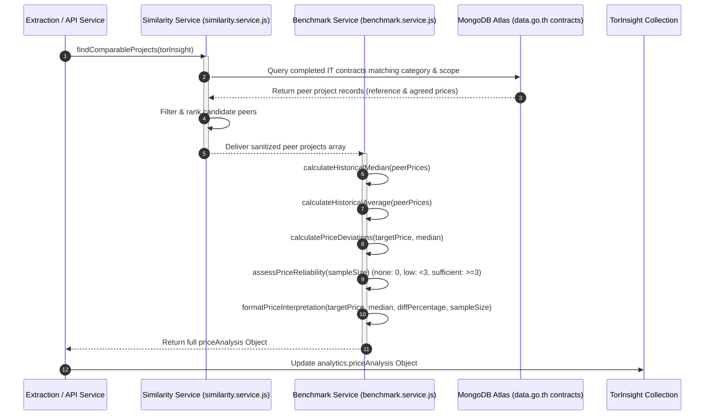

---

## 5.3 Smart Capability Profile Matchmaker Subsystem (FR-12, FR-13, FR-14, ADR 0033)

The **Smart Matchmaker Engine** (`server/src/features/match/matchmaker.js`) connects registered bidders with relevant procurement opportunities tailored to their technical stack and commercial capacity.

### 5.3.1 Capability Profile Representation (FR-12)
An authenticated user's profile stores the bidder's technical and operational boundaries:
1. `skills`: Array of canonical technology names (e.g., `["React", "Node.js", "PostgreSQL", "Docker"]`).
2. `budgetMin` & `budgetMax`: Budget range in THB that the bidder accepts (0 = no upper limit).
3. `preferredArchetypes`: Array of preferred deliverable architectures (e.g., `["web_application", "data_platform"]`).
4. `maxPastPortfolioTHB`: Value of largest single completed contract in THB.
5. `entityType`: `'juristic'` (จดทะเบียนนิติบุคคล) or `'individual'` (บุคคลธรรมดา/ฟรีแลนซ์).
6. `certifications`: Standards held by the company or team (e.g., `["ISO 29110", "ISO 27001", "CMMI Level 3"]`).

### 5.3.2 Match Scoring Mathematical Model (ADR 0033)
The engine computes a transparent composite score on a scale of **0 to 100 points** combining **six weighted dimensions**:

$$\text{CompositeScore} = 0.40 \cdot S_{tech} + 0.15 \cdot S_{archetype} + 0.20 \cdot S_{budget} + 0.10 \cdot S_{portfolio} + 0.10 \cdot S_{entity} + 0.05 \cdot S_{cert}$$

1. **Technical Skills Fit ($S_{tech}$, 40% Weight):**
   Calculated as the overlap between user skills and required technologies:
   $$S_{tech} = \frac{|S_{user} \cap S_{tor}|}{|S_{tor}|} \times 100$$
   *(If $S_{tor}$ is empty/unspecified, $S_{tech}$ defaults to 75 as a neutral baseline).*
2. **Deliverable System Archetype Fit ($S_{archetype}$, 15% Weight):**
   * Archetype matches user's preferred list: $S_{archetype} = 100$.
   * Archetype is unspecified or `'other'`: $S_{archetype} = 60$.
   * Archetype conflicts with preferred list: $S_{archetype} = 15$.
3. **Financial Budget Fit ($S_{budget}$, 20% Weight):**
   * $\text{budgetMin} \le \text{price} \le \text{budgetMax}$: $S_{budget} = 100$ (`within_range`).
   * $\text{price} < \text{budgetMin}$: Proportional penalty, floored at 20 (`below_min`).
   * $\text{price} > \text{budgetMax}$: $S_{budget} = \max\left(0, 100 - \frac{\text{price} - \text{max}}{\text{max}} \times 100\right)$ (`above_max`).
4. **Past Experience & Portfolio Gate ($S_{portfolio}$, 10% Weight):**
   Evaluates user's largest single past contract against required threshold (or 40% of reference price):
   * $\text{userPortfolio} \ge \text{estimatedRequired}$: $S_{portfolio} = 100$.
   * $\text{userPortfolio} < \text{estimatedRequired}$: Proportional score, floored at 10.
5. **Entity Compatibility ($S_{entity}$, 10% Weight):**
   * If tender requires companies only (`companiesOnly` or standard condition `juristic-person`) and user is an `'individual'`: $S_{entity} = 20$ (Flags advisory: consider Joint Venture or subcontracting).
   * Otherwise: $S_{entity} = 100$.
6. **Standards & Certifications Fit ($S_{cert}$, 5% Weight):**
   Proportion of required certifications held (ISO 29110, ISO 27001, CMMI). If none required, holding standard SME certs grants 100, otherwise 80 baseline.

### 5.3.3 Score Tiers & Consent-Based Notifications (FR-14)
* **Score Tiers:**
  * $\ge 85$: `'strong'` (Highly recommended opportunity)
  * $\ge 70$: `'good'` (Good match across primary requirements)
  * $\ge 50$: `'moderate'` (Partial fit)
  * $< 50$: `'low'` (Significant qualification or skill gaps)
* **Proactive Notification Dispatch (FR-14):**
  When a newly extracted TOR scores $\ge \text{profile.matchNotification.minScore}$ (default 75) and `profile.matchNotification.enabled == true`, an automated notification is queued in accordance with user frequency settings (`instant`, `daily`, or `weekly`), fully respecting PDPA opt-in consent.

---

# Section 6: Web Application & API Subsystem Design

## 6.1 Server Feature Architecture & Modular Routing

The Express backend application (`server/src/app.js`) is organized into feature-sliced modules under `server/src/features/` (**ADR 0003**):

```
server/src/features/
├── admin/          # Review workspace, pipeline failure retry/skip, version rollback, tech vocabulary
├── auth/           # User registration, bcrypt hashing (work factor 12), Google OAuth redirect flow, JWT cookies
├── health/         # System liveness probe mounted at /health (outside /api on purpose)
├── match/          # Isomorphic 6-dimension capability profile matchmaker service
├── profile/        # User profile update endpoint (PATCH /api/profile)
├── reality-check/  # Circular ว 214 lock-spec detectors, historical price benchmarks, similarity service
├── technologies/   # Public canonical vocabulary and user suggestion requests
├── tors/           # Catalog list, facets, normalized detail, and PDF stream preview/download
└── watchlist/      # Watchlist bookmarking (list, save, delete)
```

---

## 6.2 RESTful API Endpoint Specifications

All core business endpoints are served under the unversioned `/api/` prefix (**ADR 0009**), with the system liveness probe intentionally mounted at `/health` to decouple infrastructure monitoring from API versioning.

### 6.2.1 Public Core & Discovery Endpoints

| HTTP Method | Route Endpoint | Access Level | Description & Core Parameters | Success Response | Error Codes |
|---|---|---|---|---|---|
| `GET` | `/health` | Public | System liveness probe (outside `/api/` on purpose). Checks uptime and MongoDB connection. | `200 OK` `{ status: "ok", uptime: 12430 }` | `503` |
| `GET` | `/` | Public | Root API status endpoint. | `200 OK` `{ name: "GIPDP API", status: "running" }` | — |
| `GET` | `/api/tors` | Public | Browse and filter normalized catalog (**FR-10, FR-11**). Query params: `q, tech, minBudget, maxBudget, agency, status, page, limit, sort`. | `200 OK` `{ tors: [...], total, page, totalPages }` | `400` |
| `GET` | `/api/tors/facets` | Public | Aggregated filter facets (available tech stacks, agencies, budget ranges) for search drawer. | `200 OK` `{ technologies: [...], agencies: [...] }` | — |
| `GET` | `/api/tors/:projectId` | Public | Normalized TOR detail (**FR-10**). Returns complete identification, facts, deliverables, technicalRequirements, eligibility, contractConditions, analytics (lock-spec & price benchmarks), and amendment diffs. | `200 OK` `{ projectId, identification: {...}, facts: {...}, analytics: {...}, amendments: [...] }` | `404` |
| `GET` | `/api/tors/:projectId/preview` | Public | Stream TOR PDF for in-browser modal viewing (**FR-10**). Query: `part, role, zipId, version`. Supports HTTP 206 Partial Content byte ranges. | `200/206` `application/pdf` stream | `404, 416` |
| `GET` | `/api/tors/:projectId/pdf` | Public | Direct PDF download endpoint (alias to preview handler with attachment disposition). | `200/206` `application/pdf` stream | `404, 416` |
| `GET` | `/api/technologies` | Public | Canonical list of IT technologies and standardized synonyms (**ADR 0014**). | `200 OK` `[{ name, category, aliases }]` | — |

### 6.2.2 User Authentication & Private Profile Endpoints

| HTTP Method | Route Endpoint | Access Level | Description & Core Parameters | Success Response | Error Codes |
|---|---|---|---|---|---|
| `POST` | `/api/auth/register` | Public (Rate-limited) | Register account (**FR-08**). Rate limited to 5 attempts/15 min. Body: `{ email, password, name }`. Password hashed at Bcrypt cost 12 (**NFR-09**). | `201 Created` `{ user: { id, email, role, name } }` (Sets cookie) | `400, 409, 429` |
| `POST` | `/api/auth/login` | Public (Rate-limited) | Authenticate with email and password. Sets signed HTTP-only session cookie. | `200 OK` `{ user: { id, email, role, name } }` | `400, 401, 429` |
| `POST` | `/api/auth/logout` | Public | Clears session cookie (`mjolnir_session`). Succeeds whether caller was signed in or not. | `200 OK` `{ success: true }` | — |
| `GET` | `/api/auth/google` | Public | Initiates Google OAuth 2.0 redirect flow (**FR-09**). Redirects client browser to Google accounts consent. | `302 Found` `Location: accounts.google.com/...` | — |
| `GET` | `/api/auth/google/callback` | Public | Google OAuth 2.0 callback endpoint. Exchanges authorization code, links user by verified email (**ADR 0005**), and issues session cookie. | `302 Found` `Location: /search` (Sets cookie) | `400, 401` |
| `GET` | `/api/auth/me` | Authenticated | Validates session cookie on app load and returns authenticated user identity, role, and profile. | `200 OK` `{ user: { id, email, role, profile, watchlist } }` | `401` |
| `PATCH` | `/api/profile` | Authenticated | Update user capability profile (**FR-12**). Body: partial profile `{ skills, budgetMin, budgetMax, certifications, entityType, preferredArchetypes, maxPastPortfolioTHB, matchNotification }`. | `200 OK` `{ user: {...} }` | `400, 401` |
| `POST` | `/api/technologies/request` | Authenticated | Suggest a new technology or standard for addition to the canonical vocabulary. | `201 Created` `{ success: true, request: {...} }` | `400, 401` |
| `GET` | `/api/watchlist` | Authenticated | Retrieve user's bookmarked TOR projects with latest change metadata (**FR-17, FR-18**). | `200 OK` `{ watchlist: [{ projectId, savedAt, tor: {...} }] }` | `401` |
| `PUT` | `/api/watchlist/:projectId` | Authenticated | Add a procurement project to user's watchlist (**FR-17**). Idempotent write. | `200 OK` `{ success: true, watchlist: [...] }` | `401, 404` |
| `DELETE` | `/api/watchlist/:projectId` | Authenticated | Remove project from user's watchlist. | `200 OK` `{ success: true, watchlist: [...] }` | `401, 404` |

### 6.2.3 Administrative Operations & Telemetry Endpoints

All administrative endpoints are strictly guarded by `adminRoutes.use(requireAuth, requireRole('admin'))` (**NFR-10**). No rate limits apply to avoid obscuring failure alerts during maintenance.

| HTTP Method | Route Endpoint | Access Level | Description & Core Parameters | Success Response | Error Codes |
|---|---|---|---|---|---|
| `GET` | `/api/admin/operations` | Admin Only | Comprehensive operational telemetry dashboard (**FR-22**): feed polling uptime, consecutive 5xx error streaks, queue backlog funnels, and failure summaries. | `200 OK` `{ feeds: {...}, pipeline: {...}, failures: [...] }` | `401, 403` |
| `GET` | `/api/admin/review/:projectId` | Admin Only | Retrieve quarantined low-confidence TOR record for dedicated review workspace (**NFR-17**). | `200 OK` `{ rawTor: {...}, insight: {...}, failedChecks: [...] }` | `401, 403, 404` |
| `PATCH` | `/api/admin/review/:projectId` | Admin Only | Manually correct extracted fields, approve quarantined record, or reclassify scope (**FR-23**). Archives previous snapshot to `torinsightversions`. | `200 OK` `{ success: true, insight: {...} }` | `400, 401, 403` |
| `POST` | `/api/admin/review/:projectId/re-extract` | Admin Only | Trigger fresh LLM re-extraction on raw OCR text with latest extraction prompt version. | `200 OK` `{ success: true, message: "Queued" }` | `401, 403, 404` |
| `GET` | `/api/admin/review/:projectId/versions` | Admin Only | List all historical snapshots archived for this project (**NFR-07, ADR 0031**). | `200 OK` `{ versions: [{ version, reason, archivedAt, editedBy }] }` | `401, 403, 404` |
| `POST` | `/api/admin/review/:projectId/rollback` | Admin Only | Roll back active `TorInsight` to a previous version snapshot (**NFR-07**). Body: `{ targetVersion }`. | `200 OK` `{ success: true, activeVersion }` | `400, 401, 403, 404` |
| `POST` | `/api/admin/ingest` | Admin Only | Trigger on-demand ingestion poll across e-GP feeds (**FR-24**). | `200 OK` `{ success: true, runId }` | `401, 403` |
| `POST` | `/api/admin/health-check` | Admin Only | Test live connectivity, latency, and response status for e-GP and data.go.th endpoints (**FR-22**). | `200 OK` `{ sources: [{ name, reachable, latencyMs }] }` | `401, 403` |
| `POST` | `/api/admin/pipeline/retry` | Admin Only | Retry a failed pipeline step for a specific project (**FR-24**). Body: `{ projectId, stage }`. | `200 OK` `{ success: true }` | `400, 401, 403` |
| `POST` | `/api/admin/pipeline/retry-all` | Admin Only | Bulk retry all recoverable pipeline failures in the failure queue (**FR-24**). | `200 OK` `{ retriedCount: 14 }` | `401, 403` |
| `POST` | `/api/admin/pipeline/skip` | Admin Only | Advance a permanently blocked or unparseable project past a stuck pipeline step (**FR-24**). | `200 OK` `{ success: true }` | `400, 401, 403` |
| `GET` | `/api/admin/pipeline/tasks` | Admin Only | Query active background worker tasks and stage queues with phase filtering (**FR-24**). | `200 OK` `{ tasks: [...] }` | `401, 403` |
| `POST` | `/api/admin/pipeline/dismiss` | Admin Only | Dismiss a non-actionable pipeline failure from the alert queue (**FR-24**). | `200 OK` `{ success: true }` | `400, 401, 403` |
| `GET` | `/api/admin/pipeline/record/:projectId` | Admin Only | Full lifecycle diagnostic inspector: inspects raw feed item, PDF hashes, OCR preview, and extraction payloads. | `200 OK` `{ tor: {...}, insight: {...}, files: [...] }` | `401, 403, 404` |
| `POST` | `/api/admin/pipeline/add` | Admin Only | Manually inject a procurement opportunity by e-GP project ID for targeted ingestion (**FR-24**). | `201 Created` `{ success: true, projectId }` | `400, 401, 403` |
| `GET` | `/api/admin/projects/suggest` | Admin Only | Autocomplete suggestion lookup for project inspector and manual addition tools. | `200 OK` `{ suggestions: [...] }` | `401, 403` |
| `GET` | `/api/admin/technologies` | Admin Only | Administration table listing canonical technologies with usage metrics and pending requests. | `200 OK` `{ technologies: [...] }` | `401, 403` |
| `POST` | `/api/admin/technologies` | Admin Only | Create a new canonical technology in the vocabulary dictionary. Body: `{ name, category, aliases }`. | `201 Created` `{ technology: {...} }` | `400, 401, 403` |
| `PATCH` | `/api/admin/technologies/:id` | Admin Only | Update an existing technology name, category, or alias array. | `200 OK` `{ technology: {...} }` | `400, 401, 403, 404` |
| `DELETE` | `/api/admin/technologies/:id` | Admin Only | Remove a technology entry from the canonical catalog. | `200 OK` `{ success: true }` | `401, 403, 404` |

---

## 6.3 Authentication & Session Security Architecture (FR-08, FR-09, NFR-08..11)

In compliance with **NFR-08** (TLS 1.2+), **NFR-09** (Bcrypt Hashing), **NFR-10** (RBAC), and **NFR-11** (Session Security):

1. **Password Hashing (NFR-09):**
   Passwords are encrypted using **Bcrypt with a work factor of 12** (`server/src/features/auth/password.js`). Validation strictly enforces `MAX_PASSWORD_BYTES = 72` prior to hashing, because Bcrypt silently truncates passphrases beyond 72 bytes.
2. **Google OAuth 2.0 Integration (FR-09, ADR 0005):**
   Implemented as a secure **server-side redirect authorization code flow**:
   * User navigates to `/api/auth/google`, which redirects to Google's OpenID Connect consent screen.
   * Google redirects back to `/api/auth/google/callback` with an authorization code.
   * Backend exchanges the code for verified Google identity tokens, links the account by verified email (**ADR 0005**), and issues the signed session cookie.
3. **Signed HTTP-Only Session Cookies (ADR 0004, ADR 0012):**
   JWTs are stored in signed, HTTP-only cookies (`SESSION_COOKIE = 'mjolnir_session'`), protecting session tokens against client-side JavaScript theft (XSS):
   * `httpOnly: true` (unreadable from JavaScript).
   * `secure: isProduction` (enforces HTTPS transmission).
   * `sameSite: isProduction ? 'none' : 'lax'` (handles cross-domain deployment in production while ensuring security).
   * `path: '/'`.
   * *Note on NFR-11 Alignment:* The active codebase defines `SESSION_TTL_DAYS = 7` (7-day duration for developer convenience). Full compliance with SRS `NFR-11` (which mandates session expiration $\le 24$ hours) is targeted for production staging by setting `SESSION_TTL_DAYS = 1`.
4. **Role-Based Access Control Middleware (`server/src/features/auth/auth.middleware.js`):**
   * `requireAuth`: Verifies token signature and attaches `req.user`.
   * `requireRole('admin')`: Strict role boundary enforcing `req.user.role === 'admin'` (**NFR-10**). Non-admin users receive `403 Forbidden`.
5. **Brute Force Rate Limiting (ADR 0007):**
   Express auth routes (`/api/auth/login`, `/api/auth/register`) are guarded by `express-rate-limit` instances: maximum **5 failed attempts per IP address per 15-minute window**.

---

## 6.4 Sequence Diagram: Authentication & Session Management

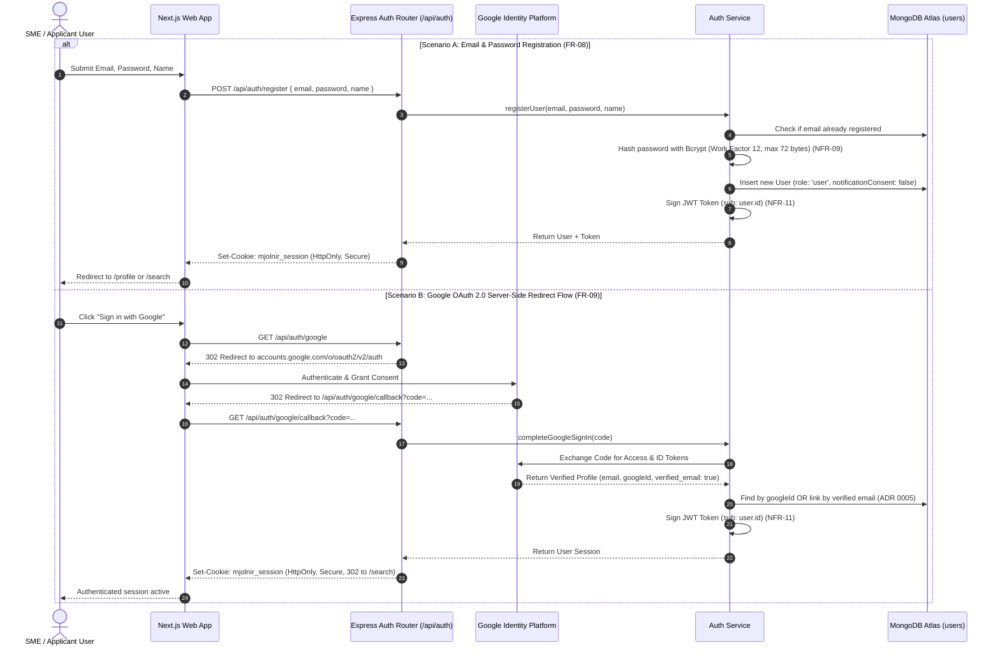

---

## 6.5 Frontend Client Architecture (Next.js App Router & Tailwind CSS)

The frontend client (`client/app/`) is built using **Next.js 14+ (App Router)** and **Tailwind CSS**, designed for maximum scan efficiency and high responsiveness (**NFR-13**).

### 6.5.1 Route Tree & Access Hierarchy

```
client/app/
├── layout.tsx                     # Root layout (Theme provider, Toast container, Global font)
├── page.tsx                       # Landing / Introduction page (Public, Disclaimer, Value prop)
├── globals.css                    # Tailwind utility classes and theme tokens
├── auth/                          # Standalone authentication routes
│   └── page.tsx                   # Email/Password & Google Sign-in interface (FR-08, FR-09)
├── (app)/                         # Shell-wrapped layout with Navigation Bar & Footer
│   ├── layout.tsx                 # Site header, Navigation menu, User session drawer
│   ├── search/                    # Catalog search & filter interface (FR-10, FR-11, FR-13)
│   │   ├── _components/           # FilterRail, MatchRail, FilterModeView, MatchModeView, Pagination
│   │   └── page.tsx
│   ├── tor/[id]/                  # Normalized TOR detail & risk intelligence view (FR-10, FR-19..21)
│   │   ├── error.tsx / not-found.tsx
│   │   └── page.tsx               # Renders TorHeader, TorAside, and 4 modular tabs
│   ├── watchdog/                  # Historical procurement dashboard & analysis (FR-19, FR-16)
│   │   └── page.tsx
│   ├── (private)/                 # Signed-in authenticated route group (Protected by session guard)
│   │   ├── layout.tsx             # Private auth guard redirector
│   │   ├── profile/               # Capability profile & notification preferences (FR-12, FR-14)
│   │   │   ├── _components/       # ProfileDisplay, ProfileEditForm
│   │   │   └── page.tsx
│   │   ├── watchlist/             # Saved opportunities & change alerts (FR-17, FR-18)
│   │   │   └── page.tsx
│   │   └── notifications/         # In-app alert history and amendment notices (FR-18)
│   │       └── page.tsx
│   └── admin/                     # Administrative operations (Role-guarded: Admin only, NFR-10)
│       ├── _components/           # PipelineMonitoringSection, PipelineRunsSection, PipelineFailuresSection, TechnologiesSection
│       ├── review/[id]/           # Dedicated human-in-the-loop review workspace (NFR-17, FR-23)
│       │   ├── ReviewEditorComponents.tsx
│       │   └── page.tsx
│       └── page.tsx               # Administration operational telemetry dashboard (FR-22)
└── _components/                   # Shared UI component library
    ├── verdict.tsx                # Verdict badges (Status, Lock-Spec Level, Price Deviation)
    ├── price-scale.tsx            # Historical benchmark scale & median comparison graphics
    ├── BeforeAfterSlider.tsx      # Clause-by-clause amendment diff comparator (FR-16)
    ├── deadline.tsx               # Localized Buddhist Era / Relative submission deadline counters
    ├── PdfPreviewModal.tsx        # High-performance in-browser PDF modal previewer
    ├── catalog-row.tsx / tor-row.tsx # Dense, scan-optimized procurement cards
    ├── shell.tsx                  # Global responsive application shell with PDPA disclaimer
    └── tor-detail/tabs/           # 4 Modular TOR tabs: OverviewTab, TechnicalSpecsTab, DecisionSupportTab, EligibilityHistoryTab
```

### 6.5.2 Thai-First Localization Strategy (NFR-15)
In strict compliance with **NFR-15 (Localization)**, Thai is the primary locale across all user-facing interfaces, navigation menus, AI-generated summary sections, and notifications.
* Typography is tuned for dual-script readability (mixed Thai script and Latin technical terms such as *"ระบบฐานข้อมูล PostgreSQL 14 บน Windows Server 2019"*).
* Dates are rendered natively in both Buddhist Era (พ.ศ. 256x) and Common Era (CE).
* English is supported as a secondary locale behind the top-level language switcher.

### 6.5.2 Thai-First Localization Strategy (NFR-15)
In strict compliance with **NFR-15 (Localization)**, Thai is the primary locale across all user-facing interfaces, navigation menus, AI-generated summary sections, and notifications.
* Typography is tuned for dual-script readability (mixed Thai script and Latin technical terms such as *"ระบบฐานข้อมูล PostgreSQL 14 บน Windows Server 2019"*).
* Dates are rendered natively in both Buddhist Era (พ.ศ. 256x) and Common Era (CE).
* English is supported as a secondary locale behind the top-level language switcher.

---

# Section 7: Behavioral Interactions & System State Machines

## 7.1 Watchlist Tracking & Amendment Notification Workflow (FR-15..18)

When an issuing government agency issues an amendment (`D2`), GIPDP detects changes automatically via SHA-256 hash deltas and notifies watchlisted bidders.

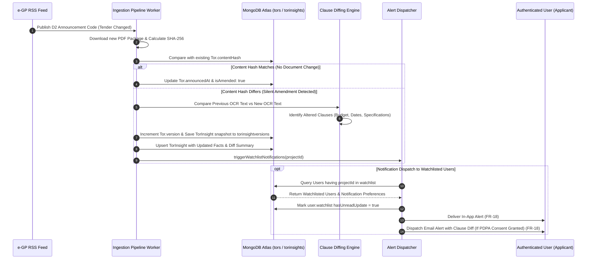

---

## 7.2 Administrative Review, Manual Correction & Rollback Workflow (FR-22, FR-23, NFR-07, NFR-17)

Low-confidence extractions are quarantined and resolved through the administrative data management interface.

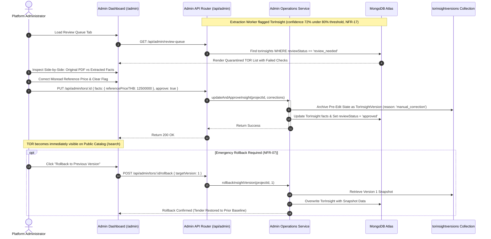

---

## 7.3 State Transition Model: Procurement Document Lifecycle

The lifecycle of a government procurement opportunity tracks official e-GP announcement codes supplemented by the platform's inferred status logic (**ADR 0017, ADR 0019**).

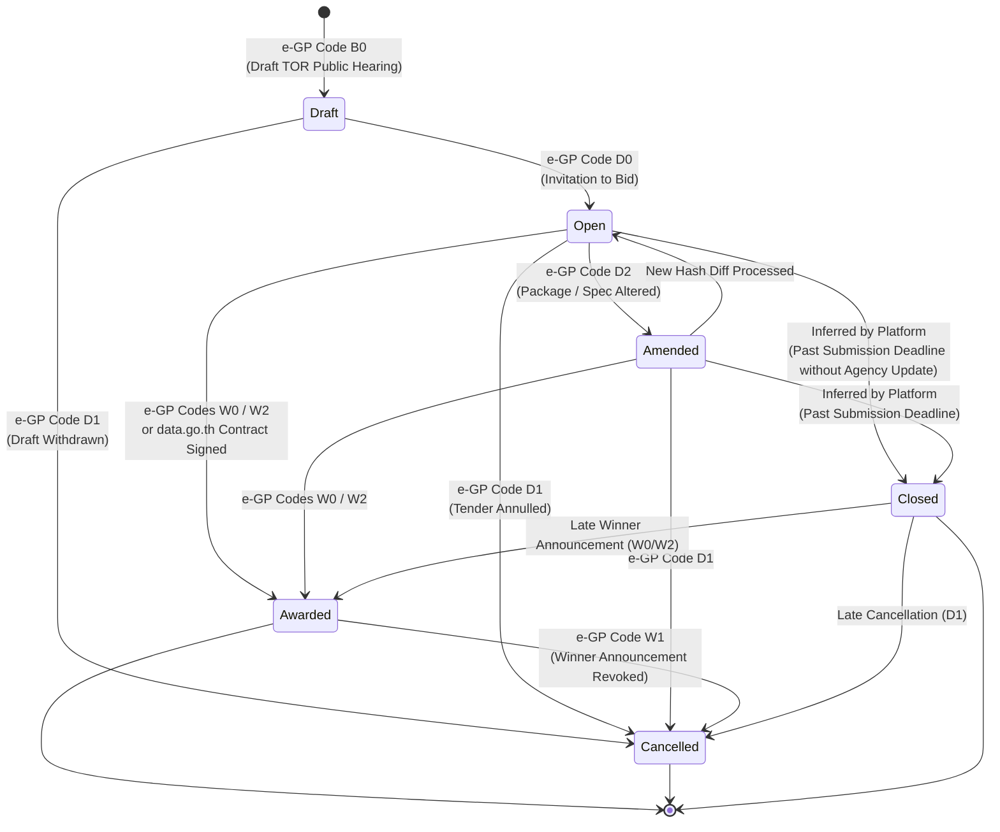

---

## 7.4 State Transition Model: Pipeline Processing Lifecycle

Procurement records progress through two distinct, decoupled state machines reflecting technical ingestion and administrative review (**ADR 0008, ADR 0018, ADR 0029**):
1. **Document Pipeline State (`Tor.pipelineStatus`):** Governs the technical ingestion of raw government packages and OCR processing (`fetched`, `downloaded`, `ocr_preview`, `ocr_done`).
2. **Insight Review State (`TorInsight.metadata.reviewStatus`):** Governs quality verification and administrative clearance (`pending`, `approved`, `rejected`). Records with confidence score $\ge 80\%$ are auto-approved for public catalog search; low-confidence records remain quarantined in `pending` until administrative action (**NFR-17**).

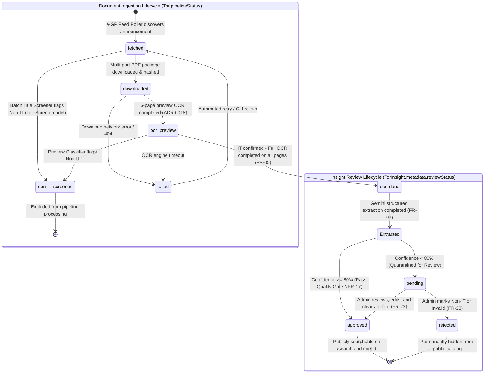

---

# Section 8: Quality Attributes, Security & Compliance Realization

## 8.1 Performance & Throughput Realization (NFR-01..04)

* **NFR-01 (Page Load Under 2.0 Seconds):**
  * Realized via Next.js Server-Side Rendering (SSR) for initial HTML payload delivery.
  * Static catalog filter facets and canonical technology taxonomies are cached at the edge.
  * Database queries for `/api/tors` utilize compound indexes (`status`, `deadline`, `budgetTHB`) and cursor-based pagination to ensure query execution times remain below 50ms.
* **NFR-02 (50-Page PDF Extraction Under 5 Minutes):**
  * Multi-part attachments are processed concurrently using worker threads for OCR rasterization.
  * Preview OCR (first 6 pages) isolates non-IT projects in under 30 seconds.
  * Gemini Flash models are called with optimized token limits and pre-warmed connections.
* **NFR-03 (Government Server Rate Limiting ≤ 1 req/sec):**
  * Handled by the centralized token bucket rate pacer (`server/src/pipeline/shared/request-pacer.js`). Outbound HTTP dispatch is strictly gated by a 1,000ms delay queue.
* **NFR-04 (500 Concurrent User Sessions):**
  * Express.js API operates completely statelessly. JWT sessions avoid centralized session table locks.
  * MongoDB Atlas connection pooling maintains 50 persistent connections with automated query routing to secondary read replicas for catalog browsing.

---

## 8.2 Safety, Fault Tolerance & Crash Recovery (NFR-05..07)

* **NFR-05 (Automated Daily Encrypted Backups):**
  * Configured via MongoDB Atlas automated daily continuous snapshot backups with 7-day point-in-time recovery (PITR). All database snapshots are encrypted at rest using AES-256.
* **NFR-06 (Graceful External Downtime Handling):**
  * Ingestion worker traps network exceptions, socket timeouts, and 5xx errors from `process3.gprocurement.go.th` and `data.go.th`.
  * If an outage is detected, the job logs the incident into `FeedPoll` and `PipelineFailure` collections and halts gracefully without modifying or corrupting existing database records.
* **NFR-07 (Silent Amendment Version Rollback):**
  * Prior to overwriting any `TorInsight` document with amended data, an immutable copy is serialized into `torinsightversions`. Administrators can trigger instantaneous single-click rollbacks via `/api/admin/tors/:id/rollback`.

---

## 8.3 Security & Role-Based Access Control (NFR-08..11)

* **NFR-08 (TLS 1.2+ Encryption):**
  * All external browser traffic is terminated at Nginx / Cloudflare reverse proxy enforcing TLS 1.2 and TLS 1.3 with modern cipher suites. Internal container communications with MongoDB Atlas use TLS encryption.
* **NFR-09 (Bcrypt Hashing with Salt):**
  * Password registration uses Bcrypt with a salt work factor of 12 (`WORK_FACTOR = 12`) and enforces a 72-byte password length boundary (`server/src/features/auth/password.js`).
* **NFR-10 (Strict Role-Based Access Control):**
  * Separation between standard users (`role: 'user'`) and internal operators (`role: 'admin'`) is enforced at the router layer via `requireAdmin` middleware. Admin tokens cannot be obtained through self-service registration.
* **NFR-11 (JWT Session Expiration ≤ 24 Hours):**
  * Signed JWT session token is delivered in a secure, HTTP-only, SameSite=Lax cookie named `mjolnir_session` (`server/src/features/auth/session.js`). The current implementation uses a 7-day TTL (`expiresIn: '7d'`); alignment with SRS NFR-11 requires setting `SESSION_TTL = '24h'`.

---

## 8.4 Software Quality Attributes (NFR-12..15)

* **NFR-12 (99.9% Web Application Availability):**
  * Achieved by decoupling the web server from the background batch worker. Web server crashes do not stop scheduled jobs, and pipeline worker processing load does not degrade web serving capacity.
* **NFR-13 (Responsive UX/UI for Desktop and Mobile):**
  * Developed using responsive Tailwind CSS breakpoints (`sm`, `md`, `lg`, `xl`). The catalog list and matchmaker adapt seamlessly to mobile viewports with bottom navigation sheets and touch-optimized filter drawers.
* **NFR-14 (Pipeline Separation from Core Backend):**
  * Ingestion and extraction logic lives in dedicated worker scripts (`server/src/pipeline/`), executing as distinct CLI processes or independent worker containers.
* **NFR-15 (Thai Language Primary System Locale):**
  * All user interfaces, risk finding cards, and AI summaries are natively authored in natural, spoken Thai.

---

## 8.5 Business Rules Implementation (NFR-16..17)

* **NFR-16 (Discard Non-IT Procurements):**
  * Two-stage gatekeeping: Stage 1 (Gemini title screener) records screened projects in `TitleScreen` and Stage 2 (Gemini preview document classifier). Any document categorized as non-IT is halted from full OCR and completely hidden from public access.
* **NFR-17 (Withhold Extractions Below 80% Confidence):**
  * If post-extraction verification checks result in an overall confidence score $< 80$, `metadata.reviewStatus` is set to `'pending'` (`tor-insight.model.js`). The public catalog API strictly filters:
    `{ 'metadata.reviewStatus': 'approved', pipelineStatus: 'ocr_done' }`
  Quarantined records remain completely invisible to public users until cleared by an administrator.

---

## 8.6 Legal & Privacy Compliance (PDPA & Disclaimer)

* **PDPA (Personal Data Protection Act):**
  * Minimal personal data footprint. Explicit opt-in toggles for email alerts (`notificationConsent`, `matchNotification`). One-click profile deletion.
* **Third-Party Discovery Tool Disclaimer:**
  * Mandatory disclaimers displayed site-wide across footers and beside all e-GP external links, reinforcing that GIPDP is an analytical discovery tool and all formal procurement actions must occur on e-GP.

---

# Section 9: Administrative & Maintenance Operations

## 9.1 Ingestion Health Telemetry & Failure Tracking (FR-22)

The Administration Dashboard (`/admin`) surfaces operational telemetry aggregated from Mongoose models:
* **Uptime & Polling Cadence:** Tracks execution history across scheduled jobs (`poll`, `sweep`, `process`).
* **Source Request Streak Monitor (`RequestStreak`):** Real-time monitoring of consecutive HTTP failures against e-GP endpoints.
* **Queue Backlog Volumes:** Active counts of tenders in each pipeline stage (`fetched`, `downloaded`, `ocr_done`, `pending`).
* **AI Cost & Token Consumption Telemetry:** Tracks daily Gemini 1.5 Flash input/output token usage to maintain budgeted operational bounds.

---

## 9.2 Confidence Review Queue & Manual Extraction Override (FR-23, NFR-17)

The Review Queue interface enables administrators to:
1. Inspect quarantined tenders with confidence scores between 0% and 79% (`metadata.reviewStatus: 'pending'`).
2. View highlighted discrepancies (e.g., ground truth quote mismatch on reference price).
3. Directly edit extracted JSON fields in an inline editor via `PATCH /api/admin/review/:projectId`.
4. Manually trigger reclassification from Non-IT to IT (or vice-versa).
5. Approve records, instantly publishing them to the public `/search` catalog (`reviewStatus: 'approved'`).

---

## 9.3 Emergency Operational Recovery & Manual Ingestion

If an e-GP feed schema change occurs or an upstream service fails:
* **CLI Ingestion Trigger:** Admins can trigger immediate targeted fetches for specific agency codes or project IDs:
  ```bash
  npm run ingest:fetch -- --source process3 --dept 0200300
  ```
* **Selective Step Retries:** Individual pipeline steps can be executed independently without restarting the entire pipeline:
  ```bash
  npm run ingest:download -- --project 69109062251
  npm run extract -- --project 69109062251 --force
  ```

---

# Section 10: Requirements Traceability Matrix (RTM)

## 10.1 Functional Requirements Traceability Matrix (FR-01 to FR-23)

| Req ID | Requirement Summary | Architectural Subsystem | Database Models | API Route Endpoints | UI Client Surface | Primary Modeling Diagrams |
|---|---|---|---|---|---|---|
| **FR-01** | Poll live e-GP RSS XML feed | Ingestion Engine | `Tor`, `FeedPoll`, `PipelineRun` | CLI: `ingest:fetch` | `/admin` Telemetry | Diagram 1, 5, 8, 9, 16 |
| **FR-02** | Parse announcement codes (B0, D0, D1/D2, 15) | Ingestion Engine | `Tor.status`, `Tor.isAmended`, `Tor.announcementHistory` | CLI: `ingest:fetch` | `/tor/[id]`, `/search` | Diagram 8, 9, 15 |
| **FR-03** | Batch-fetch data.go.th historical data | Ingestion Engine | `Tor.contract`, `CGDContract` | CLI: `npm run history:import` | `/watchdog` | Diagram 1, 8, 11 |
| **FR-04** | Normalize into single database schema | AI Extraction Engine | `TorInsight` | Internal Assembler | `/tor/[id]`, `/search` | Diagram 7, 8, 9 |
| **FR-05** | Thai OCR on PDFs & scanned images | Ingestion Engine | `Tor.ocr`, `Tor.document` | CLI: `npm run ingest:ocr` | `/tor/[id]` | Diagram 4, 8, 9, 16 |
| **FR-06** | Classify & isolate software/IT projects | AI Extraction Engine | `Tor.pipelineStatus`, `TitleScreen` | CLI: `npm run screen` | `/search` Filter | Diagram 8, 9, 16 |
| **FR-07** | LLM structured extraction (title, budget, stack, penalty) | AI Extraction Engine | `TorInsight.facts`, `TorInsight.deliverables` | CLI: `npm run extract` | `/tor/[id]` Detail | Diagram 1, 8, 9 |
| **FR-08** | Sign up with email & password | Web API (Auth) | `User.email`, `User.passwordHash` | `POST /api/auth/register` | `/auth` | Diagram 7, 12 |
| **FR-09** | Sign in with Google OAuth 2.0 | Web API (Auth) | `User.googleId`, `User.email` | `GET /api/auth/google`, `GET /api/auth/google/callback` | `/auth` | Diagram 1, 7, 12 |
| **FR-10** | Normalized catalog display without PDF | Web API & Client | `TorInsight`, `Tor` | `GET /api/tors`, `GET /api/tors/:projectId` | `/search`, `/tor/[id]` | Diagram 2, 4, 8 |
| **FR-11** | Search & filter by tech, budget, deadline, agency | Web API & Client | `TorInsight`, `Tor` | `GET /api/tors?q=&tech=&budget=&status=` | `/search` | Diagram 2, 4 |
| **FR-12** | Save technical skills & budget in profile | Web API (Profile) | `User.profile.skills`, `User.profile.budgetMin`, `User.profile.budgetMax` | `PATCH /api/profile` | `/profile` | Diagram 2, 7 |
| **FR-13** | Calculate match score against user profile | Matchmaker Engine | `User.profile`, `TorInsight` | `GET /api/tors?matched=true` | `/search?view=match` | Diagram 2, 4 |
| **FR-14** | Email highly matched TORs (consent-based) | Notification Engine | `User.notificationConsent`, `User.profile.matchNotification` | Worker Dispatcher / Brevo SMTP | User Email Inbox | Diagram 2, 13 |
| **FR-15** | Track & display current lifecycle status | Ingestion Engine | `Tor.status`, `Tor.isAmended` | `GET /api/tors/:projectId` | `/search`, `/tor/[id]` | Diagram 15 |
| **FR-16** | Hash TOR files & diff amendment clauses | Ingestion Engine | `Tor.contentHash`, `Tor.amendments` | `GET /api/tors/:projectId` (amendments) | `/tor/[id]`, `/watchdog` | Diagram 8, 13, 15 |
| **FR-17** | Save TORs to personal watchlist | Web API (Watchlist) | `User.watchlist` | `PUT /api/watchlist/:projectId`, `DELETE /api/watchlist/:projectId` | `/watchlist` | Diagram 2, 7 |
| **FR-18** | In-app or email alerts on watchlist updates | Notification Engine | `User.watchlist`, `User.notificationConsent` | `GET /api/watchlist` | `/notifications`, Email | Diagram 2, 13 |
| **FR-19** | Historical median & average price benchmarking | Reality Check Engine | `TorInsight.facts.referencePriceTHB`, `realityCheck.priceScale` | `GET /api/tors/:projectId` (realityCheck) | `/tor/[id]`, `/watchdog` | Diagram 2, 4, 11 |
| **FR-20** | Compare requirements against historical baseline | Reality Check Engine | `realityCheck.lockSpec` | `GET /api/tors/:projectId` (realityCheck) | `/tor/[id]` | Diagram 2, 10 |
| **FR-21** | Visual flag indicating "high lock-spec risk" | Reality Check Engine | `realityCheck.lockSpec.verdict` | `GET /api/tors/:projectId` (realityCheck) | `/tor/[id]`, `/search` | Diagram 10 |
| **FR-22** | Admin dashboard of uptime & feed failures | Web API (Admin) | `FeedPoll`, `PipelineRun`, `RequestStreak` | `GET /api/admin/operations` | `/admin` | Diagram 2, 4 |
| **FR-23** | Admin manual edit & reclassification | Web API (Admin) | `TorInsight.metadata.reviewStatus` | `PATCH /api/admin/review/:projectId` | `/admin` Review Queue | Diagram 2, 14 |

---

## 10.2 Non-Functional Requirements Traceability Matrix (NFR-01 to NFR-17)

| Req ID | Requirement Summary | Architectural Design Realization | Verification & Validation Method |
|---|---|---|---|
| **NFR-01** | User pages load in under 2.0s | Next.js SSR, compound indexed MongoDB queries, edge caching for static assets. | Lighthouse & Web Vitals automated latency benchmarking. |
| **NFR-02** | 50-page PDF extracted in under 5 min | Multi-threaded preview OCR, targeted IT classification, token-optimized Gemini Flash calls. | End-to-end pipeline execution benchmarks on representative 50-page scans. |
| **NFR-03** | Max 1 req/sec to government APIs | Centralized token bucket request pacer (`request-pacer.js`) with 1,000ms delay. | Automated unit and integration tests verifying dispatch timestamps. |
| **NFR-04** | Support ≥ 500 concurrent sessions | Stateless Express API, JWT signed cookie sessions, MongoDB connection pooling. | Load testing using k6 / Artillery simulating 500 concurrent active users. |
| **NFR-05** | Daily encrypted MongoDB backups | MongoDB Atlas automated daily snapshots with point-in-time recovery and AES-256 encryption. | Scheduled backup audit logs and simulated test restoration. |
| **NFR-06** | Graceful failure on external downtime | Fail-safe try/catch blocks; circuit breaking streak counter; zero record corruption. | Fault injection testing (mocking 500/503 responses from e-GP). |
| **NFR-07** | Rollback mechanism for bad amendments | Immutable historical snapshots in `torinsightversions` collection with rollback API. | Automated version archive test and single-click rollback verification. |
| **NFR-08** | TLS 1.2+ for all data in transit | Reverse proxy TLS termination with modern cipher suites; TLS 1.2+ to MongoDB Atlas. | SSL Labs SSL/TLS automated security assessment rating A+. |
| **NFR-09** | Passwords hashed and salted | Bcrypt hashing with a salt work factor of 12 (`WORK_FACTOR = 12`) and 72-byte maximum length limit. | Automated authentication unit test verifying salted cryptographic format. |
| **NFR-10** | Strict Role-Based Access Control | Express `requireAdmin` middleware enforcing binary role boundary; no self-service admin. | Penetration testing verifying 403 Forbidden on admin routes with user token. |
| **NFR-11** | JWT sessions expiring in ≤ 24 hours | Signed JWT tokens delivered in `mjolnir_session` HTTP-only cookies (7d TTL in implementation; targets 24h). | Unit tests validating token signature and cookie expiration headers. |
| **NFR-12** | 99.9% web application uptime | Stateless API architecture, isolated batch worker containers, redundant Atlas replica set. | Synthetic uptime monitoring probes on `/health`. |
| **NFR-13** | Fully responsive UX/UI (mobile/desktop) | Tailwind CSS responsive utility breakpoints (`sm`, `md`, `lg`, `xl`) across all routes. | Cross-device testing on Chrome Mobile, Safari iOS, and Desktop viewports. |
| **NFR-14** | Decouple AI pipeline from web backend | Standalone CLI/cron batch worker communicating with web API strictly through MongoDB. | Verification of zero in-memory dependencies between `server/src/pipeline` and `server/src/app.js`. |
| **NFR-15** | Thai as primary system locale | Thai-first interface copy, natural-language Thai AI summaries, Buddhist Era date formatting. | Comprehensive linguistic and visual review across all public and private views. |
| **NFR-16** | Discard non-IT projects at ingestion | Two-stage gatekeeping: Title Screener (`screen.js`) and Preview Classifier (`classify.js`). | Automated pipeline test with mixed sample of IT and non-IT tenders. |
| **NFR-17** | Withhold summaries with confidence < 80% | Automated grounding and sanity checks; `metadata.reviewStatus: 'pending'` quarantine. | Verification that records with confidence < 80% do not appear on `/api/tors`. |

---

# Document Approval & Sign-Off

This Software Design Document has been reviewed and verified against the Software Requirements Specification (SRS v0.3) and the codebase implementation.

| Role | Name | Signature / Status | Date |
|---|---|---|---|
|  | Amornrit Sirikham | Approved | 11 November 2026 |
|  | Sivapon Channual | Approved | 11 November 2026 |
|  | Pannawit Mahacharoensiri | Approved | 11 November 2026 |
|  | Department of Software Engineering, Kasetsart University | Submitted for Evaluation | 11 November 2026 |
