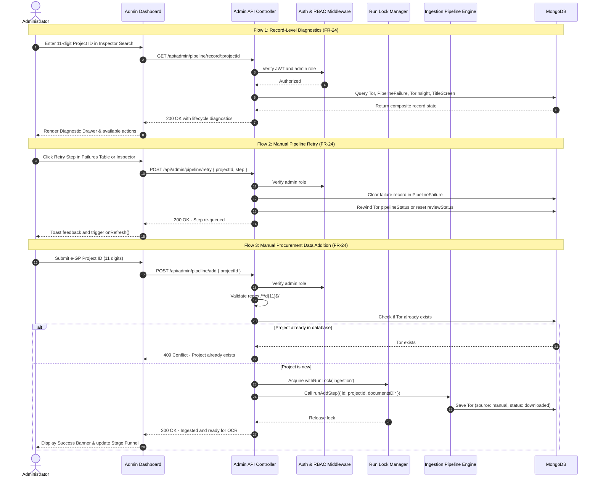

# Feature Specification: Pipeline Administration, Monitoring & Recovery

**Feature:** Pipeline Administration, Monitoring & Recovery  
**Related Requirements:**  
- `FR-22`: Dashboard of ingestion uptime, polling health, and feed request failures  
- `FR-23`: Edit extracted data, approve extractions, and reclassify misclassified TORs  
- `FR-24`: Investigate pipeline failures, inspect individual record status, manually initiate or retry operations, and ingest additional procurement data  
- `NFR-03`: Paced requests (maximum 1 req/sec to government endpoints)  
- `NFR-10`: Strict role-based separation (administrator only)  
- `NFR-17`: Extractions under 80% confidence withheld from public catalog  
**Related Decisions:**  
- [`0013 · Split ingestion and AI extraction into separate pipelines`](../decisions/0013-split-ingestion-and-ai-extraction.md)  
- [`0016 · Pipeline runs are safe to repeat`](../decisions/0016-pipeline-runs-are-safe-to-repeat.md)  
- [`0020 · Read the whole e-GP package`](../decisions/0020-read-the-whole-egp-package.md)  
- [`0027 · Run the pipeline on a schedule`](../decisions/0027-run-the-pipeline-on-a-schedule.md)  
- [`0029 · Admin monitoring metrics, review queue fields, and dataset integrity`](../decisions/0029-admin-monitoring-and-review-fields.md)  
**Status:** Active  
**Last Updated:** 2026-10-18  

---

## 1. Overview & Objective

The Thai Government IT Procurement Discovery Platform (GIPDP) processes procurement notices across two decoupled pipelines:
1. **Ingestion Pipeline (Deterministic / Network & OCR):** Fetches notices from e-GP RSS, downloads PDF packages, and performs OCR extraction without Gemini API costs.
2. **AI Understanding Pipeline (LLM / Extraction):** Pre-filters IT relevance via Title Screening, classifies document previews, extracts structured facts (budget, tech stack, penalties, lock-spec risks), and evaluates confidence.

Because government endpoints (e-GP) and scanned PDFs are prone to rate limiting (HTTP 429), maintenance blackouts, OCR noise, and document variations, administrators need self-service operational capabilities. **FR-24** eliminates the need for direct SSH access, CLI execution, or MongoDB surgery by providing:
- **Operations Catalog:** Documented list of administrative operations for each pipeline stage.
- **Record-Level Lifecycle Diagnostics:** Deep inspection of any procurement project across all pipeline collections.
- **Manual Ingestion of Missing Records:** Ingesting specific e-GP reference IDs on demand.
- **Manual Retry & Recovery Execution:** Safely rewinding failed steps with concurrency protection.
- **Verification & Immediate Feedback:** Live visual outcome reporting and stage metric updates.

---

## 2. Operations Catalog by Pipeline (FR-24 Task 1)

### 2.1 Ingestion Pipeline Operations

```
[e-GP RSS Feed] ──► Fetch (process3) ──► Download (Package) ──► OCR (Tesseract / Digital) ──► Tor Record
         ▲                    ▲                   ▲                      ▲
         │                    │                   │                      │
   Admin: Add Ref      Admin: Trigger      Admin: Retry Step      Admin: Retry Step
   (Manual Record)     (On-demand Poll)     (Reset to fetched)    (Reset to downloaded)
```

| Operation ID | Target Stage | What Administrators Inspect | Manual / Recovery Action | Required Role | Operational Safeguards & Locks |
|---|---|---|---|---|---|
| `OP-ING-01` | **Feed Poll** (`fetch`) | Polling health, HTTP 429 rate limits, feed unresponsive flags, last poll time, items discovered vs ingested in `IngestionLog`. | Trigger on-demand feed poll (`POST /api/admin/ingest`). | `admin` | Restricted to e-GP open hours (17:01–08:29 Bangkok time); rate-paced burst; logged to `IngestionLog`. |
| `OP-ING-02` | **Manual Ingestion** (`add`) | Missing procurement notices that were not captured by scheduled RSS sweeps. | Submit 11-digit e-GP project ID (`POST /api/admin/pipeline/add`). | `admin` | Validates 11-digit regex; checks `Tor.exists`; calls `runAddStep`; acquires `withRunLock('ingestion')`. |
| `OP-ING-03` | **Download Package** (`download`) | Download failures in `PipelineFailure`: HTTP 404/500, socket timeouts, missing attachments, attempt counter. | 1. **Retry Download** (`POST /api/admin/pipeline/retry { step: 'download' }`).<br>2. **Dismiss Failure** (`POST /api/admin/pipeline/dismiss`). | `admin` | Max 3 automated retries before stopping; manual retry clears failure and rewinds `pipelineStatus` to `fetched`. |
| `OP-ING-04` | **OCR Text Extraction** (`ocr`) | OCR failures: unreadable scans, corrupt PDF headers, memory timeouts, attempt counter, truncated flag. | 1. **Retry OCR** (`POST /api/admin/pipeline/retry { step: 'ocr' }`).<br>2. **Dismiss Failure** (`POST /api/admin/pipeline/dismiss`). | `admin` | Resets attempt count; rewinds `pipelineStatus` to `downloaded`. |

---

### 2.2 AI Understanding Pipeline Operations

```
[Tor Record] ──► Title Screen ──► Preview Classify ──► Structured Extraction ──► Review Queue ──► Public Catalog
                       ▲                  ▲                      ▲                     ▲
                       │                  │                      │                     │
                  Admin: Review      Admin: Override        Admin: Retry /        Admin: Approve /
                  Reclassify         Classification          Re-extract             Edit Fields
```

| Operation ID | Target Stage | What Administrators Inspect | Manual / Recovery Action | Required Role | Operational Safeguards & Locks |
|---|---|---|---|---|---|
| `OP-AI-01` | **Title Screening** (`screen`) | Category classification in `TitleScreen`, rejection reasoning, token cost estimates. | Reclassify project category (`PATCH /api/admin/review/:projectId`). | `admin` | Prevents downloading PDFs for non-IT projects; maintains reclassification audit log. |
| `OP-AI-02` | **Preview Classification** (`classify`) | 6-page preview classification status (`Tor.ocr.preview`), IT vs. non-IT flag. | Override classification or re-queue for full OCR. | `admin` | Non-IT previews stay at preview stage to prevent full OCR spend. |
| `OP-AI-03` | **Fact Extraction** (`extract`) | Extraction failure records in `PipelineFailure`: schema validation failures, Gemini 503 timeouts, missing mandatory fields. | 1. **Retry Extraction** (`POST /api/admin/pipeline/retry { step: 'extract' }`).<br>2. **Re-extract Document** (`POST /api/admin/review/:projectId/re-extract`).<br>3. **Dismiss Failure** (`POST /api/admin/pipeline/dismiss`). | `admin` | Re-extraction clears old facts cleanly; low-confidence extractions (<80%) stay hidden until reviewed (NFR-17). |
| `OP-AI-04` | **Review & Field Correction** (`review`) | OCR/LLM confidence score (0–100%), extracted facts (budget, deadline, tech stack, penalties), review status. | 1. **Approve** document.<br>2. **Edit fields** manually.<br>3. **Reclassify** as non-IT. | `admin` | Edits update `TorInsight` directly; tracks reviewing administrator in audit trail. |

---

## 3. Data Flow & Sequence Diagram



---

## 4. API Endpoints Specification

All endpoints reside under the `/api/admin` router and strictly enforce `requireAuth` and `requireRole('admin')`.

### 4.1 Record Lifecycle Diagnostics
- **Method & Path:** `GET /api/admin/pipeline/record/:projectId`
- **Parameters:** `projectId` (11-digit string)
- **Response Contracts:**
  - `200 OK`: Composite payload containing:
    - Core metadata (`title`, `agency`, `status`, `pipelineStatus`, `source`, `announceDate`, `budgetTHB`, `referencePriceTHB`).
    - Document attachment metadata (`fileName`, `pages`, `sizeBytes`, `documentType`).
    - OCR diagnostics (`usedOcr`, `confidence`, `previewClassification`).
    - Active failure details from `PipelineFailure` (`step`, `attempts`, `lastError`, `lastTransient`, `lastFailedAt`).
    - Extraction insight details from `TorInsight` (`confidence`, `reviewStatus`, `facts`, `lockSpecAnalysis`, `excluded`).
    - Title screening metadata from `TitleScreen` (`category`, `isItRelated`, `reasoning`).
  - `400 Bad Request`: `projectId` missing or invalid format.
  - `404 Not Found`: No record found across `Tor` or `TitleScreen`.

### 4.2 Manual Procurement Ingestion
- **Method & Path:** `POST /api/admin/pipeline/add`
- **Request Body:** `{ "projectId": "69099683466" }`
- **Response Contracts:**
  - `200 OK`: `{ "ok": true, "projectId": "69099683466", "title": "...", "pipelineStatus": "downloaded", "message": "..." }`
  - `400 Bad Request`: Invalid ID format (must match `/^\d{11}$/`).
  - `409 Conflict`: Project already exists in database, or ingestion lock is held by another process.
  - `422 Unprocessable Entity`: e-GP package contains no readable announcement or could not be downloaded.

### 4.3 Pipeline Step Retry
- **Method & Path:** `POST /api/admin/pipeline/retry`
- **Request Body:** `{ "projectId": "69099683466", "step": "download" | "ocr" | "extract" }`
- **Response Contracts:**
  - `200 OK`: `{ "ok": true, "projectId": "69099683466", "step": "ocr", "status": "re-queued", "message": "..." }`
  - `400 Bad Request`: Missing `projectId` or invalid `step`.
  - `404 Not Found`: Project not found in `Tor`.
  - `409 Conflict`: Run lock held.

### 4.4 Pipeline Failure Dismissal
- **Method & Path:** `POST /api/admin/pipeline/dismiss`
- **Request Body:** `{ "projectId": "69099683466", "step": "download" | "ocr" | "extract", "reason"?: string }`
- **Response Contracts:**
  - `200 OK`: `{ "ok": true, "projectId": "69099683466", "step": "download", "status": "dismissed", "message": "..." }`
  - `400 Bad Request`: Missing parameters.
  - `404 Not Found`: Project not found.

---

## 5. Security & Operational Safeguards Matrix

| Threat / Risk | Safeguard Mechanism | Implementation Details |
|---|---|---|
| **Unauthorized Access** | JWT Role Verification | `requireAuth` + `requireRole('admin')` blocks guests (401) and normal users (403). |
| **Concurrent Pipeline Corruption** | Distributed Run Lock | `withRunLock('ingestion')` prevents manual addition from running concurrently with scheduled poll sweeps. |
| **Duplicate Ingestion** | Database Pre-check | `Tor.exists({ projectId })` aborts before triggering network downloads, returning HTTP 409 Conflict. |
| **Invalid e-GP Reference** | Strict Regex & Format Check | Client and server enforce `/^\d{11}$/`, preventing directory traversal or invalid parameters. |
| **Infinite Retry Loops** | Max Attempt Enforcement | `PipelineFailure` caps automated retries at `MAX_ATTEMPTS = 3`; manual retry is required to reset attempt counts. |
| **Rate Limit Violations (NFR-03)** | Request Pacer | `request-pacer.js` keeps all calls to `process3.gprocurement.go.th` at least 1,000ms apart. |
| **Audit Trails** | Source & Admin Attribution | Manually ingested records set `source: 'manual'`; re-extraction and dismissal log timestamps and reasons in `TorInsight.metadata`. |
