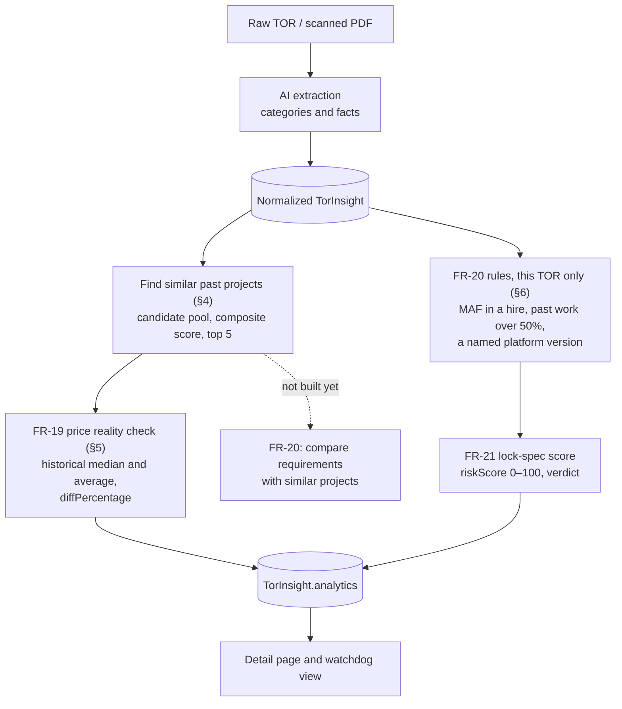

# Feature Specification: Reality Check Dashboard & Lock-Spec Flagging

**Feature:** Reality Check Dashboard & Lock-Spec Flagging  
**Related Requirements:**  
- `FR-19`: Show the historical median and average price of similar past IT projects, from data.go.th. Finding the similar projects (§4) is how it gets its sample.  
- `FR-20`: Compare a TOR's technical and qualification requirements against normalized historical baselines. **Partly met:** lock-spec checks each TOR against fixed rules from Circular ว 214 (§6). Comparing its requirements with similar past projects isn't built yet; it waits until there are enough processed TORs of each type.  
- `FR-21`: Visibly flag "high lock-spec risk" on TORs with statistically unusual or hyper-specific requirements.  

The wording is the SRS's, as in [requirements.md](../requirements.md). An earlier version of this page gave its own wording, in which FR-19 was finding similar projects and FR-20 was the price check; code and decisions written from it have been brought back to the SRS's numbering.  
**Related Decisions:**  
- [`0021 · Match comparable projects in code, not with an LLM`](../decisions/0021-find-comparable-projects.md)  
- [`0022 · Pre-compute benchmarks in the pipeline, refresh by batch`](../decisions/0022-precompute-benchmarks-in-the-pipeline.md)  
- [`0024 · Price benchmark bands and sample size thresholds`](../decisions/0024-price-benchmark-bands-and-sample-size-thresholds.md)  
**Status:** Proposed  
**Last Updated:** 2026-11-12  

---

## 1. Overview & Objective

The Reality Check & Lock-Spec feature is GIPDP's signature analytical capability. It shifts the platform from a passive PDF viewer into an **active decision-support discovery tool**.

Small Thai tech companies and freelance developers often cannot tell if:
1. **The budget is realistic** (is the project underfunded or inflated vs. historical market norms?)
2. **The procurement is locked / tailored** (are qualification conditions or technical specs rigged to favor an incumbent?)

This feature addresses both questions by:
- Finding comparable past projects and computing statistical price benchmarks from them (**FR-19**)
- Checking requirements against the rules in Circular ว 214 (**FR-20**, partly: the comparison with past projects isn't built)
- Scoring and visually flagging lock-spec risks with concrete evidence (**FR-21**)

---

## 2. Information Architecture & Data Flow



The two branches don't feed each other: lock-spec reads only the TOR in front of it, not the similar projects.

---

## 3. Data Fields Used from `TorInsight`

All benchmarking and analysis rely on fields already normalized by the extraction pipeline:

| Section in `TorInsight` | Field | Role & Justification |
|---|---|---|
| `identification` | `categories` | **Primary Hard Filter, and Category Matching ($S_{\text{category}}$, 15%).** A peer shares at least one (`software-development`, `network-and-security`, `maintenance-and-support`); sharing more of them, in the same order, scores higher ([ADR 0034](../decisions/0034-a-tor-can-have-several-categories.md)). |
| `overview` | `systemArchetype` | **Deliverable Architecture Matching ($S_{\text{archetype}}$, 35%).** Direct AI-extracted system archetype (grounded in DES/DGA standards: `mobile-app`, `web-portal`, `enterprise-erp`, `edoc-workflow`, `data-analytics`, `gis-mapping`, `cybersecurity`, `iot-telemetry`, `infra-networking`, `other`). |
| `overview` | `complexityTier` | **Engineering Scope Matching ($S_{\text{complexity}}$, 30%).** Standardized scale tier (`basic`, `standard`, `enterprise`). Replaces circular budget brackets to ensure peers operate at comparable technical complexity. |
| `technicalRequirements` | `requiredTechnologies` | **Tech Overlap Bonus ($S_{\text{tech}}$, 20%).** Jaccard similarity of normalized technology names. Explicit versions are flagged as lock-spec signals. |
| `identification` | `titleTh` | **Display & Traceability.** Administrative project title shown on output cards and audit trails; excluded from scoring to avoid phrase noise. |
| `facts` | `referencePriceTHB`, `budgetTHB` | **Benchmark Output Target.** Evaluated against the peer median *after* technical peers are selected to detect price anomalies. |
| `facts` | `deliveryPeriodDays` | **Scope Scale Context.** Reflects expected project delivery timeframe (never a hard filter). |
| `eligibility` | `previousExperienceMinTHB` | **Qualification Deviation Check.** Compares past experience requirement against project reference price. |
| `eligibility` | `requiredCertifications` | **Not used by this analysis.** Neither the price check nor lock-spec reads certificates (the match score does). Comparing them with similar projects would be part of FR-20's unbuilt half. |
| `eligibility` | `manufacturerAuthorizations` | **Lock-Spec Check.** Detects OEM authorization requirements (MAF) on pure software development services. |

---

## 4. Grouping & Similarity Matching Algorithm (FR-19's sample)

### 4.1 Candidate Pool Query (Stage 1)
Given a target TOR $T$, query MongoDB with:

$$C.\text{categories} \cap T.\text{categories} \neq \emptyset$$
$$\text{Full Extraction} = \text{true}$$
$$\text{projectId} \neq T.\text{projectId}$$

*(Note: Candidate selection does NOT filter by price, completely eliminating circular reasoning in price deviation testing).*

### 4.2 Composite Similarity Scoring (Stage 2)
For each candidate $C$ in the retrieved pool, calculate a composite similarity score $S \in [0, 1]$:

$$S = 0.35 \cdot S_{\text{archetype}} + 0.30 \cdot S_{\text{complexity}} + 0.20 \cdot S_{\text{tech}} + 0.15 \cdot S_{\text{category}}$$

- **Architecture Similarity ($S_{\text{archetype}}$):**
  Matches `overview.systemArchetype` directly:
  - Same archetype = $1.00$
  - Different archetype = $0.15$
  - Hybrid projects = Jaccard set overlap $\frac{|A \cap B|}{|A \cup B|}$.

- **Complexity Scope Similarity ($S_{\text{complexity}}$):**
  Matches `overview.complexityTier`:
  - Same tier (`standard` vs `standard`) = $1.00$
  - Adjacent tier (`basic` vs `standard`, or `standard` vs `enterprise`) = $0.50$
  - Distant tier (`basic` vs `enterprise`) = $0.10$
  - Unclassified or 'other' records = neutral $0.50$ baseline score.

- **Technology Similarity ($S_{\text{tech}}$):**
  $$S_{\text{tech}} = \frac{|\text{Tech}_T \cap \text{Tech}_C|}{|\text{Tech}_T \cup \text{Tech}_C|}$$
  Defaults to $0.50$ when neither project specifies technologies.

The top 5 highest-scoring candidates populate `analytics.priceAnalysis.comparableProjects`.
Once selected, their historical reference prices are gathered to compute the **Historical Median** (FR-19).

---

## 5. FR-19: Price Reality Check & Deviation Calculation

### 5.1 Purpose & Scope
The Price Reality Check evaluates whether a target TOR's declared budget or reference price is in line with historical market reality for comparable IT procurements. It computes statistical benchmarks—both **Historical Median** and **Historical Average**—using the Top-$K$ comparable projects found in §4, and assesses price deviations.

### 5.2 Price Field Selection Rules

In Thai government procurement, projects state both an approved budget (*งบประมาณที่ได้รับจัดสรร*) and an official reference price (*ราคากลาง*).

#### A. Target TOR ($T$)
The evaluation baseline price is resolved using the following precedence:
1. **Primary:** `facts.referencePriceTHB` (*ราคากลาง*) — The statutory price ceiling used to evaluate bids.
2. **Fallback:** `facts.budgetTHB` (*งบประมาณที่ได้รับจัดสรร*) — Used only when the reference price is not yet declared (e.g. draft TOR stage `B0`).
3. **If neither is available:** Price benchmarking cannot be performed. The system records `sampleSize: 0, reliability: 'none'`, and sets calculated metrics to `null` (adhering to ADR 0014: *Missing is not invented — never default to ฿0*).

#### B. Comparable Historical Projects ($C_i$)
For historical projects in MongoDB (`TorInsight`) or archives synced from data.go.th:
- Baseline field: `facts.referencePriceTHB` (with fallback to `facts.budgetTHB`).
- All comparisons use positive numeric values in Thai Baht (THB).

### 5.3 Handling Invalid, Missing, and Outlier Prices

To guarantee statistical validity and prevent poisoned averages:

| Condition | Criteria | System Action |
|---|---|---|
| **Invalid Type / NaN** | `typeof price !== 'number' \|\| Number.isNaN(price)` | Exclude project from calculation pool. |
| **Distant Complexity Outliers** | Mismatched complexity tier (e.g. `basic` vs `enterprise`) | Heavily penalized ($S_{\text{complexity}} = 0.10$) at Stage 2 of the matching in §4 (ADR 0021). |
| **Missing Target Price** | $T_{\text{price}} = \text{null}$ | Skip benchmarking; return `reliability: 'none'`. |

### 5.4 Mathematical Benchmark Calculations

Let the valid prices of the selected comparable projects be sorted in ascending order:
$$P = [p_{(1)}, p_{(2)}, \dots, p_{(N)}] \quad \text{where } p_{(1)} \le p_{(2)} \le \dots \le p_{(N)}$$
where $N = |P|$ is the sample size (`sampleSize`).

#### A. Historical Average (Mean: $\bar{P}$)
$$\bar{P} = \frac{1}{N} \sum_{i=1}^{N} p_i$$
- **Rounding:** Rounded to the nearest integer Baht (`Math.round(mean)`).

#### B. Historical Median ($\tilde{P}$)
The median is the **primary baseline** because procurement prices can have skewed distributions:
$$\tilde{P} = \begin{cases} 
p_{\left(\frac{N+1}{2}\right)} & \text{if } N \text{ is odd} \\
\frac{p_{\left(\frac{N}{2}\right)} + p_{\left(\frac{N}{2} + 1\right)}}{2} & \text{if } N \text{ is even}
\end{cases}$$
- **Rounding:** Rounded to the nearest integer Baht (`Math.round(median)`).

#### C. Price Difference Percentage ($\Delta$)
The primary deviation is calculated against the Historical Median:
$$\Delta = \left( \frac{T_{\text{price}} - \tilde{P}}{\tilde{P}} \right) \times 100\%$$
*(Secondary deviation against Average $\Delta_{\text{avg}} = \frac{T_{\text{price}} - \bar{P}}{\bar{P}} \times 100\%$ is also preserved for transparency).*
- **Rounding:** Stored to 1 decimal place (e.g. `+12.4%`, `-8.2%`).

### 5.5 Sample Size Reporting & Confidence Thresholds

The system explicitly reports the sample size ($N$) alongside reliability indicators:

| Sample Size ($N$) | Reliability | Interpretation & System Behavior |
|---|---|---|
| **$N = 0$** | `none` | **No benchmark available.**<br>Copy: *"ไม่พบโครงการเปรียบเทียบที่มีลักษณะงานใกล้เคียงกัน"*<br>Metrics (`historicalMedianTHB`, `diffPercentage`) remain `null`. |
| **$1 \le N < 3$** | `low` | **Low sample size advisory.**<br>Calculations displayed with an advisory disclaimer.<br>Copy: *"คำนวณจากโครงการเปรียบเทียบจำนวน {N} โครงการ ข้อมูลอาจยังไม่สะท้อนแนวโน้มตลาดทั้งหมด (เบี่ยงเบน {Δ}%)"* |
| **$3 \le N \le 5$** | `sufficient` | **Standard confidence.**<br>Full Reality Check classification and verdict assigned. |

### 5.6 Verdict & Classification Rules (When $N \ge 3$)

| Difference Range | Classification | Tone | Interpretation Copy (Thai) |
|---|---|---|---|
| $\Delta > +15\%$ | Premium / Over Benchmark | Amber / Warning | *"ราคากลางสูงกว่าค่ามัธยฐานในอดีตประมาณ +X% สำหรับโครงการขนาดใกล้เคียงกัน"* |
| $-15\% \le \Delta \le +15\%$ | Market Normal | Neutral / Open | *"ราคากลางอยู่ในเกณฑ์ปกติเมื่อเทียบกับโครงการใกล้เคียงในอดีต (เบี่ยงเบน X%)"* |
| $\Delta < -15\%$ | Underfunded / Outlier | Crimson / Risk | *"ราคากลางต่ำกว่าค่ามัธยฐานในอดีตประมาณ -X% อาจมีความเสี่ยงเรื่องงบประมาณจำกัดเกินไป"* |

### 5.7 Data Model Schema (`TorInsight.analytics.priceAnalysis`)

Stored in `TorInsight` as pre-computed fields:

```javascript
priceAnalysis: {
  referencePriceTHB: { type: Number, default: null },
  historicalMedianTHB: { type: Number, default: null },
  historicalAverageTHB: { type: Number, default: null },
  diffPercentage: { type: Number, default: null }, // vs median
  diffAveragePercentage: { type: Number, default: null }, // vs mean
  sampleSize: { type: Number, default: 0 },
  reliability: { 
    type: String, 
    enum: ['none', 'low', 'sufficient'], 
    default: 'none' 
  },
  interpretation: { type: String, default: '', trim: true },
  comparableProjects: [comparableProjectSchema],
}
```

### 5.8 Reference Implementation

```javascript
export function calculatePriceBenchmarks(targetTor, comparableProjects = []) {
  const targetPrice = getProjectPrice(targetTor);

  // Filter valid positive prices
  const validPrices = (comparableProjects || [])
    .map((p) => p.referencePriceTHB ?? getProjectPrice(p.candidate))
    .filter((price) => typeof price === 'number' && !Number.isNaN(price) && price > 0)
    .sort((a, b) => a - b);

  const sampleSize = validPrices.length;

  if (!targetPrice || sampleSize === 0) {
    return {
      referencePriceTHB: targetPrice ?? null,
      historicalMedianTHB: null,
      historicalAverageTHB: null,
      diffPercentage: null,
      diffAveragePercentage: null,
      sampleSize: 0,
      reliability: 'none',
      interpretation: 'ไม่พบโครงการเปรียบเทียบในหมวดหมู่และช่วงงบประมาณเดียวกัน',
      comparableProjects: [],
    };
  }

  // 1. Average (Mean)
  const sum = validPrices.reduce((acc, val) => acc + val, 0);
  const average = Math.round(sum / sampleSize);

  // 2. Median (Odd vs Even handling)
  const mid = Math.floor(sampleSize / 2);
  const median =
    sampleSize % 2 !== 0
      ? validPrices[mid]
      : Math.round((validPrices[mid - 1] + validPrices[mid]) / 2);

  // 3. Difference Percentages
  const diffPercentage = Number((((targetPrice - median) / median) * 100).toFixed(1));
  const diffAvg = Number((((targetPrice - average) / average) * 100).toFixed(1));
  const reliability = sampleSize >= 3 ? 'sufficient' : 'low';

  // 4. Interpretation copy
  let interpretation = '';
  if (reliability === 'low') {
    interpretation = `คำนวณจากโครงการเปรียบเทียบจำนวน ${sampleSize} โครงการ ข้อมูลอาจยังไม่สะท้อนแนวโน้มตลาดทั้งหมด (เบี่ยงเบน ${diffPercentage > 0 ? '+' : ''}${diffPercentage}%)`;
  } else if (diffPercentage > 15) {
    interpretation = `ราคากลางสูงกว่าค่ามัธยฐานในอดีตประมาณ +${diffPercentage}% สำหรับโครงการขนาดใกล้เคียงกัน`;
  } else if (diffPercentage < -15) {
    interpretation = `ราคากลางต่ำกว่าค่ามัธยฐานในอดีตประมาณ ${diffPercentage}% อาจมีความเสี่ยงเรื่องงบประมาณจำกัดเกินไป`;
  } else {
    interpretation = `ราคากลางอยู่ในเกณฑ์ปกติเมื่อเทียบกับโครงการใกล้เคียงในอดีต (เบี่ยงเบน ${diffPercentage > 0 ? '+' : ''}${diffPercentage}%)`;
  }

  return {
    referencePriceTHB: targetPrice,
    historicalMedianTHB: median,
    historicalAverageTHB: average,
    diffPercentage,
    diffAveragePercentage: diffAvg,
    sampleSize,
    reliability,
    interpretation,
    comparableProjects: comparableProjects.map((p) => ({
      title: p.title,
      year: p.year,
      referencePriceTHB: p.referencePriceTHB,
    })),
  };
}
```

---

## 6. FR-20 rules and FR-21 lock-spec flag

The full rules, scoring and examples are in
[lock-spec-risk-detection.md](lock-spec-risk-detection.md). In short:

- **This TOR only.** `analyzeLockSpec` in `lock-spec.service.js` reads the one
  TOR. It doesn't use the similar projects from §4, so its baseline is the
  rulebook (Circular ว 214), not history. That's the met half of FR-20.
- **Three rules, each a `high` finding (35 points):**
  1. A manufacturer authorization (MAF) required in a hire or development job,
     unless the main category is `software-licenses`
     ([ADR 0034](../decisions/0034-a-tor-can-have-several-categories.md)).
  2. A minimum past contract over 50% of the TOR's ราคากลาง (or its budget,
     when there's no ราคากลาง).
  3. A Windows Server, RHEL or Oracle version named without "หรือเทียบเท่า".
- **Score and verdict:** `riskScore` is the sum of points, capped at 100. 70 or
  more is high risk, 35 or more medium, under 35 low. One finding gives medium;
  two give high.

Each finding carries the clause, the rule it was compared with
(`normalBenchmark`), and the page it came from, so a reader can check it
against the original.

---

## 7. Update Lifecycle & Operational Commands

### 7.1 Lifecycle Triggers
1. **Pipeline Execution (Ingestion Trigger):**
   Computed immediately after Gemini extraction in `server/src/pipeline/extraction/process-tor.js`. Pre-calculated data is written to `TorInsight.analytics`.
2. **Batch Refresh Trigger (`npm run comparable -- --all --save`):**
   Scheduled job (e.g., weekly) that re-runs similarity and median calculations across active `Open` TORs to incorporate newly completed historical tenders from data.go.th.
3. **HTTP Serving:**
   API endpoints (`/api/tors/:id`) read pre-computed analytics directly from MongoDB with zero on-the-fly math, ensuring page load times remain $< 2\text{s}$ (NFR-01).

### 7.2 Operational Commands

#### Local Execution (from `server/`)
```bash
# Test one TOR
npm run comparable -- --id <projectId>

# Run across all projects and save to MongoDB
npm run comparable -- --all --save
```

#### Docker Execution
```bash
# If containers are already running (docker compose up):
docker compose exec server npm run comparable -- --id <projectId>
docker compose exec server npm run comparable -- --all --save

# As a one-off task (starts dependencies automatically):
docker compose run --rm server npm run comparable -- --id <projectId>
docker compose run --rm server npm run comparable -- --all --save
```
