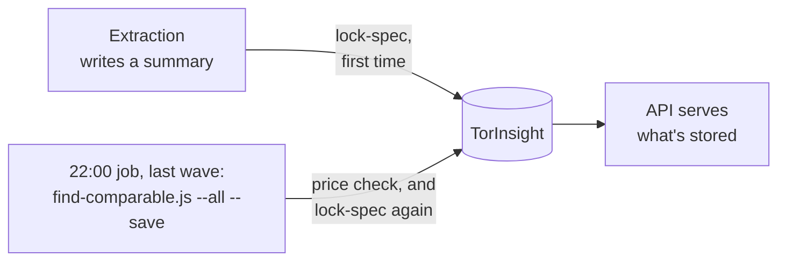
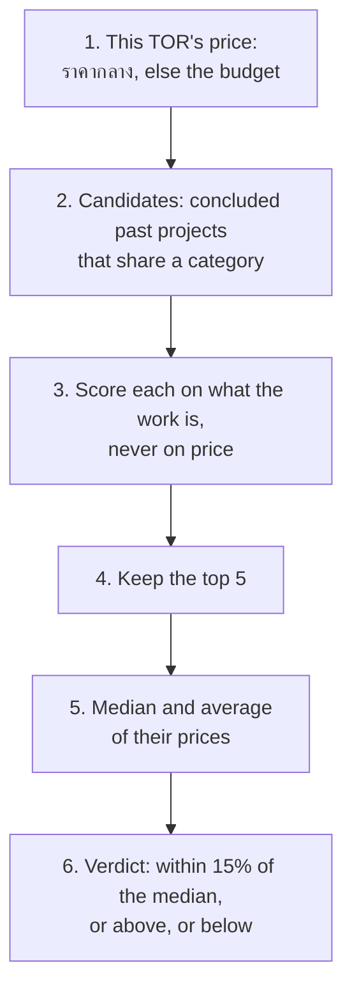

# How GIPDP reaches its verdicts

Every TOR's detail page carries two verdicts the agency never wrote: whether
its price is in line with similar past projects, and whether its requirements
look tailored to one vendor (lock-spec, ล็อกสเปก). This page explains how
each is reached, when, and where the limits are. The full rules are in the
feature docs it links to.

| Verdict | Requirement | Code | Stored in |
| :--- | :--- | :--- | :--- |
| Price check | FR-19 | `similarity.service.js`, `benchmark.service.js` | `TorInsight.analytics.priceAnalysis` |
| Lock-spec | FR-20 (partly), FR-21 | `lock-spec.service.js` | `TorInsight.analytics.lockSpec` |

All three files are in `server/src/features/reality-check/`, a feature with no
routes ([server-features.md](server-features.md#the-features)).

Three rules hold for both:

- **Code decides, not the AI.** Gemini extracts the facts (categories, prices,
  eligibility clauses, technologies); plain code compares them
  ([0021](../decisions/0021-find-comparable-projects.md)). The same inputs always
  give the same verdict, and every step can be checked by hand.
- **Worked out in the pipeline, served as stored.** The API does no
  arithmetic; it reads what the pipeline saved
  ([0022](../decisions/0022-precompute-benchmarks-in-the-pipeline.md)).
- **A conclusion, not a fact.** The page shows both as GIPDP's analysis,
  apart from what the TOR states, and each says what it compared
  (`AGENTS.md` §6). Neither ever claims intent (§7).

## When they run

- **Lock-spec** runs as soon as extraction writes a summary
  (`assemble.js`), and again every night.
- **The price check runs only at night**, in the last wave of the 22:00 job,
  twice: first, so the night knows which open TORs still lack similar
  projects and can choose past projects for them; then again after those are
  read, so they count by morning
  ([0030](../decisions/0030-run-the-night-in-priority-waves.md)). A TOR extracted
  during the day has no price check until then, and none at all on a night
  the job doesn't run ([system-overview.md](system-overview.md#a-day-of-the-pipeline)).
- **Every fully read summary is analysed.** Title-only records, preview-only
  records and excluded ones are skipped (`FULL_EXTRACTION`).

## The price check (FR-19)

1. **This TOR's price** is its ราคากลาง, or its budget when there's no
   ราคากลาง ([0014](../decisions/0014-price-names-and-insight-data-rules.md)).
   With neither, or with no category, there's nothing to compare.
2. **Candidates** are summaries that are:
   - fully read, with a confidence score of 80 or more (NFR-17);
   - concluded: stored status Closed or Awarded;
   - in at least one of this TOR's categories
     ([0034](../decisions/0034-a-tor-can-have-several-categories.md));
   - priced.
3. **Each candidate gets a similarity score** from 0 to 1:

   | Part | Weight | Compares |
   | :--- | :--- | :--- |
   | System archetype | 35% | What's being built: a web portal, an ERP, a mobile app… |
   | Complexity tier | 30% | `basic`, `standard` or `enterprise` |
   | Technologies | 20% | The share of required technologies in common |
   | Categories | 15% | How many categories match, in the same order |

   **Price is left out on purpose.** If similar meant similar in price, an
   overpriced TOR would be compared only with other overpriced ones and look
   normal. Price only breaks ties: the closer one wins.
4. **The top 5 are kept**, however low their scores. There's no minimum.
5. **The median and the average** of their prices are worked out. The median
   comes first, because a few very large projects pull the average up.
6. **The verdict** compares this TOR's price with the median:

   | Difference | Verdict (in Thai on the page) |
   | :--- | :--- |
   | More than 15% above | Higher than similar past projects |
   | More than 15% below | Lower than similar past projects; the budget may be tight for the scope |
   | Within 15% | In line with similar past projects |

   **How much to trust it** depends on how many projects it rests on
   ([0024](../decisions/0024-price-benchmark-bands-and-sample-size-thresholds.md)):
   none gives no verdict; 1 or 2 give one with a note that the sample is
   small; 3 or more count as enough. Three is the minimum the procurement
   rules ask for when a committee sets a ราคากลาง from market prices
   (ไม่น้อยกว่า 3 ราย).

The comparable projects are **copied** into the summary: title, year, price
and, where known, the contract price. They don't change when the past
project's record does, until the next night's run.

**Where past projects come from.** Most are past IT contracts imported from
data.go.th (`npm run history:import`). Every night, up to 20 of them have
their documents read in full, chosen for the open TORs closing soonest, until
each has 5 similar projects
([0028](../decisions/0028-past-projects-from-data-go-th.md),
[pipeline-guide.md](../pipeline-guide.md)).

The calculation, with a worked example:
[price-benchmark-calculations.md](../features/price-benchmark-calculations.md).
How the candidates are scored:
[comparable-projects-matching.md](../features/comparable-projects-matching.md).

### Known limits

- **TORs followed from open to award don't become candidates yet.** The
  candidate rule reads the status copied into the summary when it was
  extracted. A winner announcement doesn't update that copy, and Closed is
  never stored at all. So in practice the candidates are the past projects
  from data.go.th.
- **"No similar projects found" looks like "not analysed".** With no
  candidates, the stored analysis has no median and no projects, and the API
  sends `null`, the same as a TOR the comparison never ran on
  ([what-the-public-sees.md](what-the-public-sees.md#what-a-visible-tor-carries)).

## Lock-spec (FR-20 rules, FR-21 flag)

Lock-spec reads **this TOR only**. It checks three rules from the
Comptroller General's Circular ว 214, each a `high` finding worth 35 points:

| Rule | Flagged when | Not flagged when |
| :--- | :--- | :--- |
| Vendor lock-in | A manufacturer authorization (MAF, หนังสือแต่งตั้งตัวแทนจำหน่าย) is required in a hire or a development job | The main category is `software-licenses`: buying licenses can need one |
| Past-work barrier | The minimum past contract (ผลงาน) is over 50% of the TOR's ราคากลาง (or budget) | It's 50% or less |
| Specification tailoring | A Windows Server, Red Hat or Oracle version is named without "หรือเทียบเท่า" ("or equivalent") | The TOR allows an equivalent, in the item or its quote |

The score is the sum of the findings' points, capped at 100:

| Score | Verdict | Means |
| :--- | :--- | :--- |
| 70 or more | High risk | Two or more rules broken |
| 35 to 69 | Medium risk | One rule broken |
| Under 35 | Low risk | None |

Each finding carries the clause as the TOR states it, the rule it was
compared with, and the page it's on, so a reader can check it against the
original. The catalog's "hide high risk" filter uses the same line of 70.

**FR-20 is partly met.** The requirement asks for a TOR's requirements to be
compared with similar past projects too: for example, a certificate that
similar projects never asked for. That comparison isn't built; it waits until
there are enough fully read projects of each type. Until then the baseline
is the rulebook, not history.

The full rules, and why each one matters to a small bidder:
[lock-spec-risk-detection.md](../features/lock-spec-risk-detection.md).

## Where to go next

| To read… | Go to |
| :--- | :--- |
| The whole analysis feature, its data fields and flow | [reality-check-and-benchmarking.md](../features/reality-check-and-benchmarking.md) |
| Why matching is done in code | [0021](../decisions/0021-find-comparable-projects.md) |
| Why results are worked out in advance | [0022](../decisions/0022-precompute-benchmarks-in-the-pipeline.md) |
| The verdict bands and sample sizes | [0024](../decisions/0024-price-benchmark-bands-and-sample-size-thresholds.md) |
| The lock-spec criteria and scoring | [0035](../decisions/0035-lock-spec-risk-criteria-and-scoring.md) |
| What the fields mean | [tor-insight-schema.md](../database/tor-insight-schema.md) |
