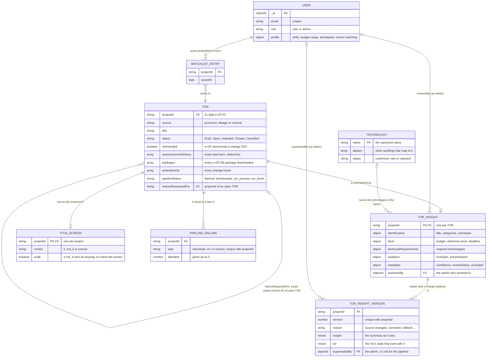

# The data model

GIPDP keeps everything in one MongoDB database: 12 collections, each with a
Mongoose schema in `server/src/models/`. This page shows how they connect and
who writes each one. The field-by-field detail is in [database/](../database/).

## The one key: `projectId`

Every piece of TOR data hangs off the **e-GP project ID** (`projectId`), the
11-digit string e-GP gives a project, such as `"68049205582"`. Collections
link by storing it, not by Mongoose references. There are no foreign keys, so
nothing stops a `TorInsight` from naming a `projectId` that no `Tor` has; the
pipelines keep them in step.

Only two fields are real references, both to an admin's `User` `_id`:
`TorInsight.metadata.reviewedBy` and `TorInsightVersion.supersededBy`.

## How the TOR data connects

Reading it:

- **A `Tor` comes first.** Ingestion creates it from the e-GP feed or the
  data.go.th import. Everything else about the project attaches to it later.
- **A `Tor` has at most one `TorInsight`**, the normalized summary extraction
  writes. Many TORs have none yet: not downloaded, not IT, or waiting for OCR.
- **When a change replaces a summary, the old one becomes a
  `TorInsightVersion`** with the `Tor` state that went with it, so an admin
  can roll back (NFR-07, [0031](../decisions/0031-keep-the-summary-a-change-replaces.md)).
  `Tor.amendments[].insightVersion` says which version a change replaced.
- **The watchlist lives inside `User`**: an array of `{ projectId, savedAt }`.
  `savedAt` is what "changed since you saved it" compares against
  ([watchlist-changes.md](../features/watchlist-changes.md)).
- **Technologies link by name.** Extraction maps every spelling a TOR uses
  ("Postgres", "PostgreSQL 14") to one canonical `Technology.name`, and
  stores that name in the insight ([0014](../decisions/0014-price-names-and-insight-data-rules.md)).
- **Comparable projects are copied, not linked.**
  `analytics.priceAnalysis.comparableProjects` holds each one's title, year
  and price as they were when the nightly comparison ran.

## The pipeline's bookkeeping

Five more collections record how the pipeline is running. None holds TOR data,
and they don't link to the collections above, except that `PipelineFailure`
names a `projectId`.

| Collection | One document is | Key |
| :--- | :--- | :--- |
| `pipelinelocks` | A pipeline run in progress, so a second run waits | `_id`: `'ingestion'` or `'extraction'` |
| `pipelineruns` | One scheduled job: its steps and the counts before and after | `startedAt` |
| `feedpolls` | One time a source was asked: the national feed, or one agency in a sweep | `startedAt` |
| `ingestionlogs` | One fetch run against a source, with an `ok`, `degraded` or `failed` status | `source`, `status` |
| `requeststreaks` | One government site's count of requests in a row, shared across processes | `_id`: the site |

`feedpolls` and `ingestionlogs` overlap: both record whether the feed
answered. The admin dashboard reads both.

## Who writes what, and who sees it

[0003](../decisions/0003-feature-based-server-layout.md) says a collection has one
owner that writes it. In practice some have more than one writer; this table
lists them all. [server-features.md](server-features.md#where-the-rules-bend)
explains why.

| Collection | Main writer | Also written by | Read by | Public? |
| :--- | :--- | :--- | :--- | :--- |
| `tors` | Ingestion (fetch, download, OCR, `history:import`) | `pipeline/shared/amendments.js` | `tors`, extraction, `admin` | Yes, through `toPublic` |
| `torinsights` | Extraction (`process-tor.js`; `screen.js` for title-only records) | `admin` (corrections), `insight-versions.js` (rollback), `find-comparable.js` (`analytics`) | `tors`, `watchlist`, `admin`, `reality-check` | Yes, once visible ([0015](../decisions/0015-pilot-mode-and-demo-data.md), NFR-17) |
| `torinsightversions` | `pipeline/shared/insight-versions.js` | — | The same file, for `admin`'s version list and rollback | No |
| `titlescreens` | `pipeline/extraction/screen.js` | `admin` | Ingestion (what to download), `admin` | No |
| `users` | `auth` (the account) | `profile` (`profile`), `watchlist` (`watchlist`), `npm run role` | `auth` on every signed-in request | Only to that user |
| `technologies` | Extraction (`vocabulary.js`) | `technologies` (requests, as `new`), `admin` (curation) | Search filters, extraction | Yes, `GET /api/technologies` |
| `pipelinefailures` | `pipeline/shared/failures.js` | `admin` (retry, skip, dismiss) | The pipelines, `admin` | No |
| `pipelinelocks` | `pipeline/shared/run-lock.js` | — | The pipelines | No |
| `pipelineruns` | `pipeline/jobs/run-job.js` | — | `admin`, `npm run report` | No |
| `feedpolls` | Ingestion (fetch, sweep) | — | `admin`, `npm run report` | No |
| `ingestionlogs` | Ingestion (fetch) | `admin` | `admin` | No |
| `requeststreaks` | `pipeline/shared/request-pacer.js` | — | The same file, `admin` (e-GP's count against its burst limit, and the cooldown) | No |

## Where to go next

- Every field of a collection: [tor-schema.md](../database/tor-schema.md),
  [tor-insight-schema.md](../database/tor-insight-schema.md),
  [user-schema.md](../database/user-schema.md),
  [technology-schema.md](../database/technology-schema.md),
  [pipeline-run-schema.md](../database/pipeline-run-schema.md).
  `TitleScreen`, `FeedPoll`, `RequestStreak` and `IngestionLog` have no page
  yet; read their model files.
- How the code that writes them is laid out: [server-features.md](server-features.md).
- The model files: `server/src/models/`, one per collection, all exported from
  `models/index.js`.
