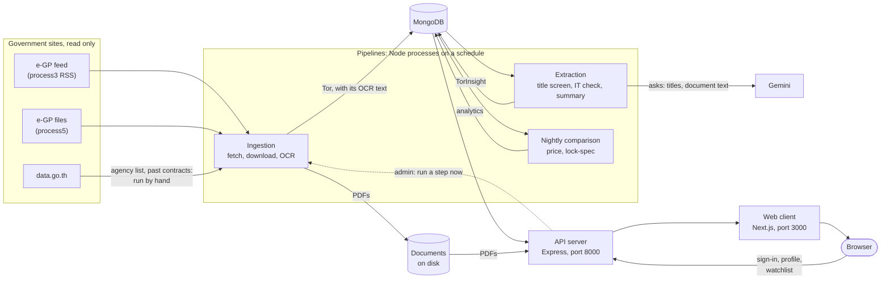

# GIPDP on one page

GIPDP reads Thai government IT procurement notices, turns each TOR into a
plain-language summary, and shows it on a website anyone can search. This page
names the parts, shows how a TOR travels through them, and lists what isn't
built yet. Each section links to the page with the details.

## The picture

Arrows follow the data. Reading it:

- **The pipelines and the website never call each other.** The pipelines write
  MongoDB and the documents folder; the API reads them
  ([0013](../decisions/0013-split-ingestion-and-ai-extraction.md)). The one
  exception is the dotted arrow: an admin's "run now" makes the API run an
  ingestion step itself ([server-features.md](server-features.md#where-the-features-meet-the-pipelines)).
- **Gemini is only asked by extraction.** OCR runs locally, and the API never
  calls Gemini.
- **The API and the pipelines must share a disk.** The API serves each TOR's
  PDF from the file the pipeline downloaded, and only falls back to fetching
  it from e-GP. Whoever chooses the host has to keep that true
  ([deployment-checklist.md](../deployment-checklist.md)).

## The parts

| Part | What it is | Code | How it runs |
| :--- | :--- | :--- | :--- |
| Web client | Next.js 16.3, React 19, Tailwind 4. Thai interface | `client/` | `npm run dev`, or the `client` container on port 3000 |
| API server | Express 5 on Node 24. One router per feature, under `/api` | `server/src/app.js`, `server/src/features/` | `npm start`, or the `server` container on port 8000 |
| Ingestion | Finds projects in the feed, downloads their documents, reads them with OCR | `server/src/pipeline/ingestion/` | Its own process, one step at a time |
| Extraction | Screens titles, decides whether a project is IT, writes the summary | `server/src/pipeline/extraction/` | Its own process |
| Nightly comparison | Similar past projects, price benchmark, lock-spec refresh | `server/scripts/find-comparable.js`, `server/src/features/reality-check/` | The last step of the night's job |
| Jobs | Runs the steps above in order, at set times | `server/src/pipeline/jobs/` | `npm run schedule`, or `npm run job -- <name>` |
| MongoDB | 12 collections, linked by the e-GP `projectId` | `server/src/models/` | Local `mongo:8` container in development ([0006](../decisions/0006-local-mongodb-for-development.md)); Atlas otherwise ([0002](../decisions/0002-atlas-over-local-docker-mongodb.md)) |
| Documents | Every file downloaded, one folder per project and package | `server/data/documents/<projectId>/<package>/` | Written by download; read by OCR and the API |
| OCR | `pdf-parse` for a PDF with a text layer; Tesseract.js (Thai and English) for a scan | `server/src/pipeline/ingestion/lib/ocr.js` | On this machine, no cloud service |
| Gemini | Reads titles and documents, returns structured fields | `server/src/pipeline/extraction/gemini.js` | Google Cloud, through `@google/genai` (`GOOGLE_CLOUD_PROJECT`, `GEMINI_MODEL`) |
| Google sign-in | OAuth, linked to an account by verified email ([0005](../decisions/0005-google-sign-in-links-by-verified-email.md)) | `server/src/features/auth/` | Optional: off when its env vars aren't set |

`docker compose up` starts MongoDB, the API and the client. It doesn't start
the pipelines.

## A day of the pipeline

The jobs run at fixed times, Bangkok time
([0027](../decisions/0027-run-the-pipeline-on-a-schedule.md)). The fetches are
timed to the e-GP feed, which answers only from 17:01 to 08:29:

| Time | Job | What it does |
| :--- | :--- | :--- |
| 08:00 | `poll` | The national feed once more before it closes, then the new projects and the changed ones |
| 17:05 | `poll` | The day's announcements, as soon as the feed opens |
| 18:00 | `sweep` | Every agency's feed, for what the national feed missed and for stage changes |
| 22:00 | `process` | The night, in waves: check draft and open TORs for changed documents, read new TORs, re-read changed ones, then read a few past projects and compare prices ([0030](../decisions/0030-run-the-night-in-priority-waves.md), [0028](../decisions/0028-past-projects-from-data-go-th.md)) |

Each job stops taking new work 5 minutes before the next one starts. How each
step works, and how to check a run went well:
[pipeline-guide.md](../pipeline-guide.md).

**The schedule runs only while someone runs `npm run schedule`.** Nothing in
`docker-compose.yml` starts it. On a server, cron or Cloud Scheduler would
start `npm run job -- <name>` at the same times instead.

## Who uses it

| Who | Pages | Calls | Can change |
| :--- | :--- | :--- | :--- |
| Anyone, signed out | `/`, `/search`, `/tor/[id]`, `/watchdog` | `GET /api/tors` and its facets, `/api/tors/:projectId` and its PDF, `/api/technologies` | Nothing |
| Signed in | The above, plus `/profile`, `/watchlist`, `/notifications` | `/api/auth`, `/api/profile`, `/api/watchlist` | Their profile and watchlist. The match score is worked out in the browser, from the profile |
| Admin | `/admin`, `/admin/review/[id]` | `/api/admin/*`, guarded by `requireRole('admin')` | Corrections, approvals, rollbacks, pipeline retries, fetches. No sign-up path makes an admin: `npm run role` does |

A session is a signed cookie that lasts 7 days
([0004](../decisions/0004-sessions-as-signed-cookies.md),
[0012](../decisions/0012-how-the-browser-holds-a-session.md)). The browser calls
the API directly with it; pages rendered on the server call the API too, through
`API_INTERNAL_URL` inside Docker.

The public sees a TOR only once it has passed review:
[what-the-public-sees.md](what-the-public-sees.md).

## What isn't built yet

| Gap | Where it shows |
| :--- | :--- |
| Email alerts for matches and watchlist changes (FR-14, FR-18) | No code sends email |
| In-app notifications (FR-18) | `/notifications` shows sample data |
| The historical dashboard (FR-19, FR-16) | `/watchdog` shows sample data. Each TOR's own price comparison is real, on its detail page |
| Comparing a TOR's requirements with similar past projects (FR-20) | Lock-spec checks fixed rules only ([reality-check-and-benchmarking.md](../features/reality-check-and-benchmarking.md)) |
| A host | Nothing is deployed; the choice is open ([deployment-checklist.md](../deployment-checklist.md)) |
| The schedule on a server | Only `npm run schedule` on someone's computer |

## Where to go next

| To understand… | Read |
| :--- | :--- |
| Every file, in one line each | [project-map.md](../project-map.md) |
| How the server's features are laid out and what they share | [server-features.md](server-features.md) |
| How the collections connect | [data-model.md](data-model.md) |
| The pipeline, step by step, in plain words | [pipeline-guide.md](../pipeline-guide.md) |
| Where the data comes from | [data-sources/data_flow_architecture.md](../data-sources/data_flow_architecture.md) |
| What the product has to do | [requirements.md](../requirements.md) |
| Why it's built this way | [decisions/](../decisions/) |
