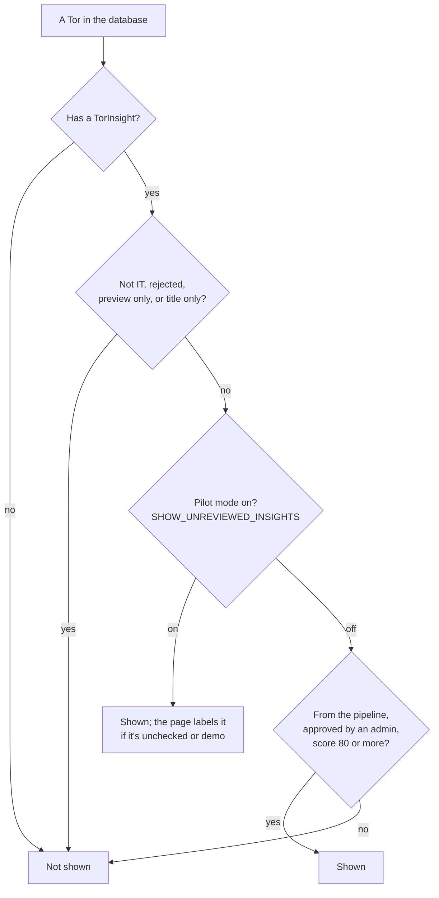

# What the public sees

Anyone can search the catalog and read every TOR's detail page without signing
in. Not every TOR in the database reaches them, though: a summary is shown only
once it has passed review (NFR-17). This page explains that gate, what a
visible TOR carries, and what stays internal.

The rules live in one place, `server/src/features/tors/tor.service.js`:
`visibilityFilter` decides what is shown, `toPublic` shapes it. The catalog,
its facets and the detail page all go through both.

## The gate

**Hidden in every mode:**

| Condition | Field | Why |
| :--- | :--- | :--- |
| No summary yet | no `TorInsight` | Not downloaded, not IT by its title, or waiting for OCR. The catalog is built from summaries, so a bare `Tor` has nothing to show |
| Not IT | `metadata.excluded` | Extraction decided it isn't IT, and recorded why with a quote ([0018](../decisions/0018-preview-ocr-before-classify.md)) |
| Rejected | `metadata.reviewStatus: 'rejected'` | An admin rejected it in the review workspace |
| Preview only | `metadata.awaitingFullText` | Classified as IT from its first pages; the full text hasn't been read yet ([0018](../decisions/0018-preview-ocr-before-classify.md)) |
| Title only | `metadata.titleOnly` | A past project known only from its title and its data.go.th row ([0028](../decisions/0028-past-projects-from-data-go-th.md)) |

**Also hidden when pilot mode is off:**

| Condition | Field |
| :--- | :--- |
| Demo data | `metadata.origin: 'demo'`, the seed's made-up summaries |
| Not approved by an admin | `metadata.reviewStatus` other than `'approved'` |
| Confidence under 80 | `metadata.confidenceScore` below 80 |

### Pilot mode

Pilot mode is one setting, `SHOW_UNREVIEWED_INSIGHTS`
([0015](../decisions/0015-pilot-mode-and-demo-data.md)). It's **on by default
everywhere but production**, and off in production unless someone turns it on.

It matters because, during the pilot, extraction marks **every** result
`pending` (`assemble.js`), whatever its score. So:

- **On:** the public sees unreviewed summaries and demo data, each labelled.
  The catalog row and the detail header say when a summary is demo data or
  nobody has checked it yet.
- **Off:** the public sees only what an admin has approved. Before reviews
  start, the catalog is empty ([deployment-checklist.md](../deployment-checklist.md)).

## What a visible TOR carries

`toPublic` changes a stored summary in four ways before it leaves the API:

- **The status is today's, not the stored one.** The `Tor`'s status, which
  ingestion keeps up to date from the feed, replaces the copy extraction made.
  A signed contract makes it Awarded. An Open TOR past its deadline reads as
  Closed: that is worked out on every request and never stored
  ([0013](../decisions/0013-split-ingestion-and-ai-extraction.md)).
- **The feed's facts win.** Where the `Tor` has the agency, budget, ราคากลาง
  or deadline, read from the feed or the e-GP documents, they replace the AI's
  ([0020](../decisions/0020-read-the-whole-egp-package.md)). A price of 0 counts
  as none ([0014](../decisions/0014-price-names-and-insight-data-rules.md)).
- **Analysis that wasn't done is `null`, not 0.** A lock-spec score of 0 would
  read as "measured, no risk", so unrun analysis is sent as `null`, and the
  page says it hasn't been analysed yet (ยังไม่วิเคราะห์).
- **`review` replaces `metadata`.** It says where the summary came from
  (`pipeline` or `demo`), its review status, whether a person checked it, its
  score, how many checks failed, and when it was processed. The pages use it
  for labels and don't show the score: confidence stays out of the public UI
  (`AGENTS.md` §5), though the API reply carries it
  ([0015](../decisions/0015-pilot-mode-and-demo-data.md)).

It also adds `companiesOnly` when the TOR admits only companies
(นิติบุคคล), since that settles the question for a freelancer.

The detail page (`GET /api/tors/:projectId`) adds:

| Field | What it holds |
| :--- | :--- |
| `document` | The file's name, size, pages and type. Never where the server keeps it, or its hash |
| `ocr` | Whether OCR was used, and whether the text was cut short |
| `source` | `process3`, `datago` or `manual` |
| `amendments` | Every change found, oldest first, without the ones an admin rolled back. `rereadPending` marks a change the summary doesn't reflect yet ([0032](../decisions/0032-record-what-changed-in-a-tor.md)) |

## What stays internal

- **From each summary:** `metadata`: the full confidence breakdown, the
  failed checks, the model and prompt version, who reviewed it.
- **From each `Tor`:** where its files are stored, its hashes, its
  `pipelineStatus`, and the raw feed history.
- **Whole collections:** `torinsightversions`, `titlescreens`,
  `pipelinefailures` and the pipeline's bookkeeping. Only admins see them,
  through `/api/admin`.
- **Users:** a profile and watchlist go only to their owner.

Which collection holds what: [data-model.md](data-model.md).

## Two doors that skip the gate

- **The PDF routes.** `GET /api/tors/:projectId/pdf` and `/preview` look up
  the `Tor` without `visibilityFilter`, so the file of any TOR the pipeline
  downloaded can be fetched by its ID, shown in the catalog or not. They're
  public e-GP documents, so nothing private leaks. When the file isn't on disk,
  the route fetches it from e-GP itself, outside the request pacer the other
  government requests go through.
- **The technology list.** `GET /api/technologies` returns every name in the
  vocabulary, including ones a signed-in user has just requested (`new`) and
  ones an admin rejected.

## Where the rules come from

- NFR-17: under 80% confidence is withheld until an admin clears it
  ([requirements.md](../requirements.md)).
- [0015](../decisions/0015-pilot-mode-and-demo-data.md): pilot mode and demo
  data.
- [0029](../decisions/0029-admin-monitoring-and-review-fields.md): what the
  review workspace shows and edits.
- `AGENTS.md` §3 and §5: the three access classes, and confidence staying out
  of public UI.
