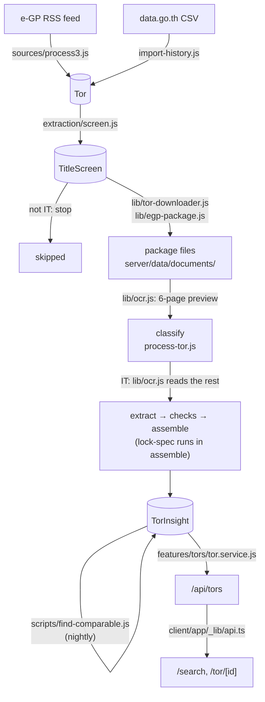

# Project map

Every file in the repository, one line each, so you can find the right file
without opening ten. It says **where** things are; the decision records say
**why**.

Snapshot of `main` at `f9cceeb` (2026-11-11). When a PR adds, moves or deletes
a file, update its row in the same PR.

- [Start here](#start-here): the file to open for common tasks
- [How a TOR moves through the code](#how-a-tor-moves-through-the-code)
- [Before you trust a file](#before-you-trust-a-file): duplicates, leftovers, fixtures
- [Repository root](#repository-root)
- [Server](#server): [common](#servercommon) · [models](#servermodels) · [features](#serverfeatures) · [pipeline](#serverpipeline) · [scripts](#serverscripts) · [tests](#servertest)
- [Client](#client): [routes](#routes) · [route files](#route-files) · [shared components](#client_components) · [lib](#client_lib) · [tests](#clienttest)
- [Docs](#docs): [guides](#guides) · [data sources](#docsdata-sources) · [database](#docsdatabase) · [features](#docsfeatures) · [decisions](#docsdecisions)

---

## Start here

| You want to… | Open |
| :--- | :--- |
| Change what an API route returns | `server/src/features/<feature>/`: `*.routes.js` (URL) → `*.controller.js` (HTTP) → `*.service.js` (logic). Mounted in [app.js](../server/src/app.js). |
| Add a field to the database | [server/src/models/](../server/src/models/), then its page in [docs/database/](database/) |
| Change which TORs the public can see | `visibilityFilter` in [tor.service.js](../server/src/features/tors/tor.service.js) (NFR-17, [0015](decisions/0015-pilot-mode-and-demo-data.md)) |
| Change what a TOR looks like in the API | `toPublic` in [tor.service.js](../server/src/features/tors/tor.service.js) |
| Change how a status is worked out | [status-engine.js](../server/src/pipeline/shared/status-engine.js) and [announcement-codes.js](../server/src/pipeline/shared/announcement-codes.js) |
| Change what Gemini is asked | [prompts/](../server/src/pipeline/extraction/prompts/) for wording, [schema.js](../server/src/pipeline/extraction/schema.js) for each field's rules |
| Change how far an extraction is trusted | [checks.js](../server/src/pipeline/extraction/checks.js) (confidence comes from here, never from the model) |
| Change which value wins, feed or AI | [assemble.js](../server/src/pipeline/extraction/assemble.js) |
| Change when the pipeline runs | [schedule.js](../server/src/pipeline/jobs/schedule.js), [run-job.js](../server/src/pipeline/jobs/run-job.js), [queues.js](../server/src/pipeline/shared/queues.js) |
| Change how fast we call e-GP | [request-pacer.js](../server/src/pipeline/shared/request-pacer.js) (NFR-03) |
| Change the catalog page | [client/app/(app)/search/](../client/app/(app)/search/) |
| Change the TOR detail page | [client/app/_components/tor-detail/](../client/app/_components/tor-detail/); the route file only loads data |
| Change a badge, status colour or risk marker | [verdict.tsx](../client/app/_components/verdict.tsx) and [stage.ts](../client/app/_lib/stage.ts) |
| Call a new endpoint from the client | [api.ts](../client/app/_lib/api.ts), the only client file that calls `fetch` |
| Look up a requirement ID from a comment | [requirements.md](requirements.md); older `FR07`-style IDs are translated at its end |
| Run the pipeline, or read its output | [pipeline.md](pipeline.md) for commands, [pipeline-guide.md](pipeline-guide.md) for what the log lines mean |

## How a TOR moves through the code

Ingestion writes `Tor`; extraction writes `TorInsight`. The two never import
each other ([0013](decisions/0013-split-ingestion-and-ai-extraction.md)). The
nightly `process` job runs the same steps in priority order
([0030 night waves](decisions/0030-run-the-night-in-priority-waves.md)).

## Before you trust a file

- **The match score exists twice.** Users see the one in
  [client/app/_lib/match.ts](../client/app/_lib/match.ts), computed in the
  browser. The server copy in
  [features/match/matchmaker.js](../server/src/features/match/matchmaker.js)
  is not called by any route yet, only by its test. Change both together.
- **"ADR 0030" means two decisions.** Two records share the number:
  [lock-spec scoring](decisions/0030-lock-spec-risk-criteria-and-scoring.md)
  and [night waves](decisions/0030-run-the-night-in-priority-waves.md).
  `lock-spec.service.js` means the first; `queues.js` and `run-job.js` mean
  the second.
- **Old requirement IDs.** Code written before the SRS cites the proposal's
  numbering (`FR07` is match scoring, not extraction). Translate with the table
  at the end of [requirements.md](requirements.md).
- **Fixture data is still live in two pages.**
  [client/app/_data/tors.ts](../client/app/_data/tors.ts) supplies the TORs
  shown on `/watchdog` and `/notifications`. Every other page uses it only for
  types and helpers (`pick`, `formatTHB`, `Lang`).
- **The admin dashboard can show sample data.**
  [admin.service.js](../server/src/features/admin/admin.service.js) falls back
  to [ops.fixtures.js](../server/src/features/admin/ops.fixtures.js) when the
  review queue is empty or a query fails. A dashboard full of numbers does not
  prove the pipeline ran.
- **Unused files.** [tor-row.tsx](../client/app/_components/tor-row.tsx) is
  imported by nothing; [catalog-row.tsx](../client/app/_components/catalog-row.tsx)
  replaced it. In [modules.tsx](../client/app/_components/modules.tsx) only
  `AmendmentModule` is used (on `/watchdog`); the detail page draws its own
  modules in `DecisionSupportTab.tsx`, so
  [price-scale.tsx](../client/app/_components/price-scale.tsx) is unused too.
  `client/public/*.svg` are create-next-app leftovers.
- **Two files named AGENTS.md.** The [root one](../AGENTS.md) is the frontend
  design guide. [client/AGENTS.md](../client/AGENTS.md) is a note that
  `next dev` writes for coding agents.

## Repository root

| File | What it is |
| :--- | :--- |
| [AGENTS.md](../AGENTS.md) | Frontend design guide: audiences, screens, data fields, visual and copy rules. Read before touching `client/app/`. |
| [CONTRIBUTING.md](../CONTRIBUTING.md) | Setup, branches, commit style, how to record a decision. |
| [docker-compose.yml](../docker-compose.yml) | Production stack: server and client containers. |
| [docker-compose.override.yml](../docker-compose.override.yml) | Adds local MongoDB for development; Compose loads it automatically. |
| [.github/workflows/fullstack-ci-setup.yml](../.github/workflows/fullstack-ci-setup.yml) | CI: client lint, test, build; server tests against a MongoDB service. |
| `.gitignore` | Keeps out `.env`, `node_modules`, `context/`, downloaded documents. |
| `context/` | Not in git. Full SRS and working notes, local only. Never commit or link it. |

---

## Server

Node + Express API and the two pipelines. Imports use the aliases
`#common/*`, `#models/*`, `#features/*` and `#pipeline/*` (set in
`server/package.json`).

| File | What it is |
| :--- | :--- |
| [package.json](../server/package.json) | Dependencies and every `npm run` command. Pipeline commands are explained in [pipeline.md](pipeline.md). |
| [.env.example](../server/.env.example) | Every setting the server reads, with a note on each. Copy to `server/.env`. |
| [Dockerfile](../server/Dockerfile) | Production image: Node 24, production dependencies, `npm start`. |
| [src/server.js](../server/src/server.js) | Entry point. Connects to MongoDB, then listens. |
| [src/app.js](../server/src/app.js) | Builds the Express app: CORS, cookies, JSON, one mount per feature under `/api`, `/health` outside it. Tests import it without listening. |

### server/common

Plumbing every feature uses. Never imports from `features/` ([0003](decisions/0003-feature-based-server-layout.md)).

| File | What it is |
| :--- | :--- |
| [config/env.js](../server/src/common/config/env.js) | Reads and checks environment variables once. Boot stops without `MONGO_URI` or `JWT_SECRET`. |
| [db/connect.js](../server/src/common/db/connect.js) | Connects Mongoose, pins the database name `mjolnir`, registers every model. |
| [errors/http-error.js](../server/src/common/errors/http-error.js) | `HttpError` and `badRequest`, `unauthorized`, `forbidden`, `notFound`. Throw these from services. |
| [middleware/error-handler.js](../server/src/common/middleware/error-handler.js) | Turns any thrown error into JSON; hides 500 details in production. |
| [middleware/not-found.js](../server/src/common/middleware/not-found.js) | JSON 404 for an unknown route. |
| [middleware/rate-limit.js](../server/src/common/middleware/rate-limit.js) | The counting mechanism for rate limits, in memory. Features choose the numbers ([0007](decisions/0007-rate-limiting-on-the-auth-routes.md)). |

### server/models

Shape only: fields, enums, indexes. Behaviour lives in the feature or pipeline
that owns the collection. Import models from `#models/index.js`.

| File | What it is |
| :--- | :--- |
| [index.js](../server/src/models/index.js) | Registers and re-exports every model, so `populate` never finds one missing. |
| [tor.model.js](../server/src/models/tor.model.js) | `Tor`: one e-GP project as ingestion knows it. Feed fields, package files, OCR text, status, announcement history, changes, `pipelineStatus`. Spec: [tor-schema.md](database/tor-schema.md). |
| [tor-insight.model.js](../server/src/models/tor-insight.model.js) | `TorInsight`: the normalized summary extraction builds. Identification, facts, requirements, eligibility, contract terms, lock-spec and price analytics, evidence, review state. Spec: [tor-insight-schema.md](database/tor-insight-schema.md). |
| [tor-insight-version.model.js](../server/src/models/tor-insight-version.model.js) | `TorInsightVersion`: a summary a change replaced, kept for diffs and rollback ([0031](decisions/0031-keep-the-summary-a-change-replaces.md)). |
| [user.model.js](../server/src/models/user.model.js) | `User`: account, role, capability profile, watchlist. Spec: [user-schema.md](database/user-schema.md). |
| [technology.model.js](../server/src/models/technology.model.js) | `Technology`: one canonical name per technology, with aliases ([0014](decisions/0014-price-names-and-insight-data-rules.md)). Spec: [technology-schema.md](database/technology-schema.md). |
| [project-categories.js](../server/src/models/project-categories.js) | The seven kinds of IT project a TOR can be ([0034](decisions/0034-a-tor-can-have-several-categories.md)). Mirrored in `client/app/_lib/categories.ts`. |
| [standard-conditions.js](../server/src/models/standard-conditions.js) | The eligibility conditions every e-GP TOR repeats, as keys. |
| [title-screen.model.js](../server/src/models/title-screen.model.js) | `TitleScreen`: Gemini's `it` / `not_it` / `unsure` on a title, before anything is downloaded ([0026](decisions/0026-screen-titles-before-downloading.md)). |
| [pipeline-run.model.js](../server/src/models/pipeline-run.model.js) | `PipelineRun`: one scheduled job, its steps and how each ended ([0027](decisions/0027-run-the-pipeline-on-a-schedule.md)). |
| [pipeline-failure.model.js](../server/src/models/pipeline-failure.model.js) | `PipelineFailure`: a TOR stuck at a step. Deleted when the step succeeds ([0016](decisions/0016-pipeline-runs-are-safe-to-repeat.md)). |
| [pipeline-lock.model.js](../server/src/models/pipeline-lock.model.js) | `PipelineLock`: a lease so two runs of one pipeline never overlap. |
| [feed-poll.model.js](../server/src/models/feed-poll.model.js) | `FeedPoll`: one request to the e-GP feed and what came back. Polling health for FR-22. |
| [request-streak.model.js](../server/src/models/request-streak.model.js) | `RequestStreak`: requests in a row per site, so the pacer's pause holds across processes. |
| [ingestion-log.model.js](../server/src/models/ingestion-log.model.js) | `IngestionLog`: per-source run telemetry for the admin dashboard (FR-22). |

### server/features

One folder per feature. A feature's `index.js` is the only file other code
imports; a request goes `*.routes.js` → `*.controller.js` → `*.service.js`.

**admin**: `/api/admin`, every route admin-only

| File | What it is |
| :--- | :--- |
| [admin.routes.js](../server/src/features/admin/admin.routes.js) | Every admin URL. Guards the whole router with `requireAuth` and `requireRole('admin')`. |
| [admin.controller.js](../server/src/features/admin/admin.controller.js) | Reads params and body, calls the service. |
| [admin.service.js](../server/src/features/admin/admin.service.js) | ~2,200 lines; search it by function name. Dashboard data, review queue and workspace (edit, approve, reclassify, re-extract), version rollback, pipeline retry/skip/dismiss, record inspector, manual add, technology vocabulary. |
| [ops.fixtures.js](../server/src/features/admin/ops.fixtures.js) | Sample dashboard data the service falls back to. See [Before you trust a file](#before-you-trust-a-file). |
| [index.js](../server/src/features/admin/index.js) | Exports `adminRoutes`. |

**auth**: `/api/auth`

| File | What it is |
| :--- | :--- |
| [auth.routes.js](../server/src/features/auth/auth.routes.js) | Register, login, logout, Google start and callback, `me`. Rate limiters go on here. |
| [auth.controller.js](../server/src/features/auth/auth.controller.js) | Sets and clears the session cookie. |
| [auth.service.js](../server/src/features/auth/auth.service.js) | Creates and finds users, checks passwords, links Google accounts. `toPublicUser` is the only user shape that leaves the server. |
| [auth.validation.js](../server/src/features/auth/auth.validation.js) | Checks register and login bodies. |
| [auth.middleware.js](../server/src/features/auth/auth.middleware.js) | `requireAuth` (loads `req.user` from the cookie) and `requireRole`. |
| [session.js](../server/src/features/auth/session.js) | Signs and reads the `mjolnir_session` JWT cookie (7 days). |
| [password.js](../server/src/features/auth/password.js) | bcrypt at cost 12; rejects passwords over 72 bytes. |
| [google.js](../server/src/features/auth/google.js) | Google OAuth: sign-in URL, state cookie, code exchange. |
| [rate-limit.js](../server/src/features/auth/rate-limit.js) | The numbers: login per IP and per email, register per IP. |
| [index.js](../server/src/features/auth/index.js) | Exports routes, `requireAuth`, `requireRole`, `toPublicUser`. |

**health**: `/health`, outside `/api`

| File | What it is |
| :--- | :--- |
| [health.routes.js](../server/src/features/health/health.routes.js), [health.controller.js](../server/src/features/health/health.controller.js), [health.service.js](../server/src/features/health/health.service.js) | Uptime and database state. 503 when MongoDB isn't connected. |
| [index.js](../server/src/features/health/index.js) | Exports routes and `getHealth`. |

**match**: no route

| File | What it is |
| :--- | :--- |
| [matchmaker.js](../server/src/features/match/matchmaker.js) | Server copy of the FR-13 match score ([0033](decisions/0033-capability-profile-and-match-scoring.md)). Only its test calls it today. |
| [index.js](../server/src/features/match/index.js) | Exports `calculateMatchScore`. |

**profile**: `/api/profile`, signed in

| File | What it is |
| :--- | :--- |
| [profile.routes.js](../server/src/features/profile/profile.routes.js) | `PATCH /api/profile`. |
| [profile.controller.js](../server/src/features/profile/profile.controller.js), [profile.service.js](../server/src/features/profile/profile.service.js) | Saves only the fields sent. |
| [profile.validation.js](../server/src/features/profile/profile.validation.js) | Limits for skills, budget, certifications, entity type, archetypes, match-email settings (FR-12). |
| [index.js](../server/src/features/profile/index.js) | Exports routes. |

**reality-check**: no route; called by the pipeline and scripts

| File | What it is |
| :--- | :--- |
| [similarity.service.js](../server/src/features/reality-check/similarity.service.js) | Finds comparable past projects for a TOR, without an LLM ([0021](decisions/0021-find-comparable-projects.md)). |
| [benchmark.service.js](../server/src/features/reality-check/benchmark.service.js) | Median, average and deviation against those projects, with sample-size bands ([0024](decisions/0024-price-benchmark-bands-and-sample-size-thresholds.md)). |
| [lock-spec.service.js](../server/src/features/reality-check/lock-spec.service.js) | Lock-spec findings and risk score ([0030 lock-spec](decisions/0030-lock-spec-risk-criteria-and-scoring.md)). Called from extraction's `assemble.js`. |
| [index.js](../server/src/features/reality-check/index.js) | Exports the three, plus `FULL_EXTRACTION` / `isFullExtraction`. |

**technologies**: `/api/technologies`

| File | What it is |
| :--- | :--- |
| [technology.routes.js](../server/src/features/technologies/technology.routes.js) | Public `GET` list; signed-in `POST /request` to suggest one. |
| [technology.controller.js](../server/src/features/technologies/technology.controller.js), [technology.service.js](../server/src/features/technologies/technology.service.js) | Reads the vocabulary; falls back to the starter list when the database is empty or offline. |
| [index.js](../server/src/features/technologies/index.js) | Exports routes and `getAllTechnologies`. |

**tors**: `/api/tors`, public

| File | What it is |
| :--- | :--- |
| [tor.routes.js](../server/src/features/tors/tor.routes.js) | List, `facets`, detail, `preview` and `pdf`. |
| [tor.controller.js](../server/src/features/tors/tor.controller.js) | HTTP handlers. |
| [tor.service.js](../server/src/features/tors/tor.service.js) | ~1,000 lines. `listTors` (search and filters), `torFacets`, `getTorByProjectId`, `toPublic` (the public shape), `visibilityFilter` (NFR-17), `getTorPdfStream`. |
| [index.js](../server/src/features/tors/index.js) | Exports routes, `listTors`, `getTorByProjectId`. |

**watchlist**: `/api/watchlist`, signed in

| File | What it is |
| :--- | :--- |
| [watchlist.routes.js](../server/src/features/watchlist/watchlist.routes.js) | `GET` all, `PUT` and `DELETE` one project ID. |
| [watchlist.controller.js](../server/src/features/watchlist/watchlist.controller.js), [watchlist.service.js](../server/src/features/watchlist/watchlist.service.js) | Saved TORs with their summaries and what changed since saving. Up to 200. |
| [watchlist.validation.js](../server/src/features/watchlist/watchlist.validation.js) | Project ID checks. |
| [index.js](../server/src/features/watchlist/index.js) | Exports routes and service functions. |

### server/pipeline

[index.js](../server/src/pipeline/index.js) is the public surface of both
pipelines. Commands and options: [pipeline.md](pipeline.md).

**ingestion**: writes `Tor`

| File | What it is |
| :--- | :--- |
| [ingest.js](../server/src/pipeline/ingestion/ingest.js) | ~1,400 lines. The ingestion command, with steps `fetch`, `sweep`, `recheck`, `download`, `ocr`, `add`, `history`. |
| [import-history.js](../server/src/pipeline/ingestion/import-history.js) | `npm run history:import`: past IT contracts from data.go.th, saved as Awarded `Tor`s ([0028](decisions/0028-past-projects-from-data-go-th.md)). |
| [index.js](../server/src/pipeline/ingestion/index.js) | Public surface. |
| [sources/process3.js](../server/src/pipeline/ingestion/sources/process3.js) | Reads the e-GP RSS feed: Thai decoding, item parsing, which codes to ask for, feed hours. |
| [sources/datago-contracts.js](../server/src/pipeline/ingestion/sources/datago-contracts.js) | Reads data.go.th contract CSVs by column position (the headers are wrong). |
| [lib/tor-downloader.js](../server/src/pipeline/ingestion/lib/tor-downloader.js) | Downloads e-GP packages and PDFs. 50 MB cap, paced, SHA-256 hash per file. |
| [lib/egp-package.js](../server/src/pipeline/ingestion/lib/egp-package.js) | What a package holds and what its announcement and bidding document state. Pure ([0020](decisions/0020-read-the-whole-egp-package.md)). |
| [lib/ocr.js](../server/src/pipeline/ingestion/lib/ocr.js) | Text from a PDF: the text layer, else Tesseract (`tha+eng`). `PREVIEW_PAGES = 6`. |
| [lib/text-layer.js](../server/src/pipeline/ingestion/lib/text-layer.js) | Whether a text layer is real Thai or old-font garbage that needs OCR. |
| [lib/fetch-rules.js](../server/src/pipeline/ingestion/lib/fetch-rules.js) | What fetching a known TOR again may overwrite. |
| [lib/past-requests.js](../server/src/pipeline/ingestion/lib/past-requests.js) | Which past projects to read in full each night. |
| [data/egp-agencies.json](../server/src/pipeline/ingestion/data/egp-agencies.json) | Agency codes the sweep asks the feed about. Refreshed by `npm run agencies:fetch`. |

**extraction**: writes `TorInsight`; the only code that calls Gemini

| File | What it is |
| :--- | :--- |
| [extract.js](../server/src/pipeline/extraction/extract.js) | `npm run extract`: reads each TOR at `ocr_done` with Gemini and saves a `TorInsight`. |
| [screen.js](../server/src/pipeline/extraction/screen.js) | `npm run screen`: sorts new titles into IT / not IT / unsure, 40 per request, before download. |
| [process-tor.js](../server/src/pipeline/extraction/process-tor.js) | One TOR through classify → extract → check → assemble. Saves nothing unless every step succeeds. |
| [gemini.js](../server/src/pipeline/extraction/gemini.js) | The only module that talks to Gemini. Takes the client as a parameter, so tests pass a fake. |
| [prompts.js](../server/src/pipeline/extraction/prompts.js) | Loads the prompts and builds each request's text. |
| [prompts/classify.md](../server/src/pipeline/extraction/prompts/classify.md), [extract.md](../server/src/pipeline/extraction/prompts/extract.md), [screen.md](../server/src/pipeline/extraction/prompts/screen.md) | The prompts. Bump the version inside when the wording changes. |
| [references/glossary.md](../server/src/pipeline/extraction/references/glossary.md) | Thai procurement terms sent with the prompt. |
| [references/technologies.js](../server/src/pipeline/extraction/references/technologies.js) | Starter technology vocabulary, seeded as `confirmed`. |
| [schema.js](../server/src/pipeline/extraction/schema.js) | The exact shape Gemini must answer in. Each field's rules are in its `description`. |
| [checks.js](../server/src/pipeline/extraction/checks.js) | Trust checks (grounding, cross-source, sanity, OCR quality) that produce the confidence score. |
| [assemble.js](../server/src/pipeline/extraction/assemble.js) | Builds the `TorInsight`: the feed wins where it has a value, the AI fills gaps. Runs lock-spec. |
| [convert.js](../server/src/pipeline/extraction/convert.js) | Amounts to numbers, Buddhist-era dates to `Date`s. `null` when unreadable. |
| [documents.js](../server/src/pipeline/extraction/documents.js) | Which documents an extraction reads: the TOR and the bidding document ([0025](decisions/0025-extraction-reads-the-bidding-document.md)). |
| [select.js](../server/src/pipeline/extraction/select.js) | Which TORs a run processes: changed source, older prompt when asked, reviewed only when forced. |
| [vocabulary.js](../server/src/pipeline/extraction/vocabulary.js) | Maps technology names onto canonical ones. An unknown name becomes a `new` entry. |
| [index.js](../server/src/pipeline/extraction/index.js) | Public surface. |

**jobs**: scheduling

| File | What it is |
| :--- | :--- |
| [run-job.js](../server/src/pipeline/jobs/run-job.js) | `npm run job -- poll\|sweep\|process`: runs a job's steps as child processes, with locks, a time box and a `PipelineRun` record. |
| [schedule.js](../server/src/pipeline/jobs/schedule.js) | When jobs run, Bangkok time: `poll` 08:00 and 17:05, `sweep` 18:00, `process` 22:00. |

**shared**: used by both pipelines

| File | What it is |
| :--- | :--- |
| [announcement-codes.js](../server/src/pipeline/shared/announcement-codes.js) | e-GP's codes (`B0`, `D0`, `D1`, `D2`, `W0`…) as e-GP defines them ([0017](decisions/0017-read-the-egp-feed-as-egp-defines-it.md)). |
| [status-engine.js](../server/src/pipeline/shared/status-engine.js) | Works out Draft / Open / Awarded / Closed / Cancelled from a project's announcements. |
| [amendments.js](../server/src/pipeline/shared/amendments.js) | Records what changed in a TOR, from the feed or a new package ([0032](decisions/0032-record-what-changed-in-a-tor.md)). |
| [insight-versions.js](../server/src/pipeline/shared/insight-versions.js) | Keeps a replaced summary; brings one back (NFR-07). |
| [queues.js](../server/src/pipeline/shared/queues.js) | The three kinds of work, new, changed and past, in priority order. |
| [failures.js](../server/src/pipeline/shared/failures.js) | When to stop retrying a TOR at a step. |
| [run-lock.js](../server/src/pipeline/shared/run-lock.js) | One run per pipeline at a time, as a lease in MongoDB. |
| [request-pacer.js](../server/src/pipeline/shared/request-pacer.js) | At least a second between requests per site; a 10-minute rest after 230 in a row to e-GP. |
| [deadline.js](../server/src/pipeline/shared/deadline.js) | The `--until` time box. |
| [egp-links.js](../server/src/pipeline/shared/egp-links.js) | The one place e-GP page URLs are built. |
| [workable.js](../server/src/pipeline/shared/workable.js) | Which projects are worth screening and downloading: open or upcoming, no winner. |
| [thai-text.js](../server/src/pipeline/shared/thai-text.js) | Thai digits to Arabic, text comparison helpers. |
| [thai-number-words.js](../server/src/pipeline/shared/thai-number-words.js) | Reads amounts written in Thai words, to check the digits. |
| [user-agent.js](../server/src/pipeline/shared/user-agent.js) | The honest User-Agent sent to government sites. |

### server/scripts

Run with `npm run <name>`, or `node scripts/<file>` for the one-off ones.

| File | What it is |
| :--- | :--- |
| [seed.js](../server/scripts/seed.js) | `npm run seed`: the technology vocabulary. `--demo` adds 28 demo TORs with made-up insights. |
| [seed-technologies.js](../server/scripts/seed-technologies.js) | `npm run technologies:seed`: the vocabulary only. |
| [generate-insights-seed.js](../server/scripts/generate-insights-seed.js) | Regenerates `seed/torinsights.json` after `seed/tors.json` changes. |
| [seed-comparable-test.js](../server/scripts/seed-comparable-test.js) | `npm run seed:comparable`: five fake past projects for trying comparisons. |
| [find-comparable.js](../server/scripts/find-comparable.js) | `npm run comparable`: comparable projects and price benchmarks. `--all --save` runs in the nightly job. |
| [grant-role.js](../server/scripts/grant-role.js) | `npm run role -- <email> admin\|user`. The only way to make an admin. |
| [backfill-roles.js](../server/scripts/backfill-roles.js) | One-off: writes `name` and `role` onto accounts created before they existed. |
| [check-gemini.js](../server/scripts/check-gemini.js) | `npm run gemini:check`: checks the gcloud login, project and model; counts a TOR's tokens. |
| [fetch-egp-agencies.js](../server/scripts/fetch-egp-agencies.js) | `npm run agencies:fetch`: refreshes `egp-agencies.json` from data.go.th. |
| [run-schedule.js](../server/scripts/run-schedule.js) | `npm run schedule`: runs the jobs on their schedule from your machine. |
| [pipeline-report.js](../server/scripts/pipeline-report.js) | `npm run report`: what the scheduled pipeline did in the last 24 hours. |
| [rollback.js](../server/scripts/rollback.js) | `npm run rollback`: lists or restores a TOR's replaced summaries. |
| [migrate-categories.js](../server/scripts/migrate-categories.js) | `npm run migrate:categories`: one-off move to `categories` ([0034](decisions/0034-a-tor-can-have-several-categories.md)). Converts versions too. |
| [remove-datago-records.js](../server/scripts/remove-datago-records.js) | One-off: deletes records the removed data.go.th reader made. |
| [seed/tors.json](../server/seed/tors.json) | 28 real e-GP notices for demos. |
| [seed/torinsights.json](../server/seed/torinsights.json) | Made-up insights for them, all `origin: 'demo'`. |

### server/test

`npm test` runs every `*.test.js` with `node:test`. Tests that write should use
the `mjolnir_test` database.

- **`test/pipeline/` mirrors `src/pipeline/`**: `test/pipeline/shared/run-lock.test.js`
  tests `src/pipeline/shared/run-lock.js`, and so on. Ingestion tests named
  after a step (`download-step`, `ocr-step`, `recheck`, `sweep`,
  `process3-fetch`, `announcement-history`) drive `ingest.js`;
  `utils.test.js` covers content hashing and Thai XML decoding.
- **Top-level tests are per feature**: `auth*`, `admin*`, `tors`, `watchlist`,
  `profile`, `technology`, `matchmaker`, `similarity`, `price-benchmark`,
  `lock-spec`. Also `tor-insight` (the model), `tor-awaiting-visibility` (what
  the public sees in pilot mode), `seed-data`, `ingestion-log`,
  `migrate-categories`, and `smoke` (the app boots).
- [test/pipeline/extraction/fixtures.js](../server/test/pipeline/extraction/fixtures.js):
  shared fake TORs and AI answers.
- [test/pipeline/ingestion/fixtures/](../server/test/pipeline/ingestion/fixtures/):
  real e-GP texts (announcements, bidding documents, OCR'd price forms), one PDF
  and an RSS sample, for the parsers.

---

## Client

Next.js 16 (App Router), React 19, Tailwind 4.

| File | What it is |
| :--- | :--- |
| [package.json](../client/package.json) | `dev`, `build`, `lint`, `test`. |
| [.env.example](../client/.env.example) | `NEXT_PUBLIC_API_URL` (baked in at build time) and `API_INTERNAL_URL`. |
| [Dockerfile](../client/Dockerfile) | Production image. |
| [next.config.ts](../client/next.config.ts) | `output: "standalone"` for Docker. |
| `tsconfig.json`, `eslint.config.mjs`, `postcss.config.mjs` | TypeScript, lint and Tailwind config. |
| [AGENTS.md](../client/AGENTS.md), [CLAUDE.md](../client/CLAUDE.md) | Notes `next dev` writes for coding agents. Not the design guide. |
| [README.md](../client/README.md) | How to run the client, its scripts and two env variables, and where things are. |
| `public/*.svg` | create-next-app leftovers, unused. |

### Routes

Paths are under `client/app/`. A folder in parentheses is a route group and
never appears in the URL.

| URL | Files | Data | Who |
| :--- | :--- | :--- | :--- |
| `/` | `page.tsx` | API | everyone |
| `/auth` | `auth/page.tsx`, `_components/auth-form.tsx` | API | everyone |
| `/search` | `(app)/search/` | API | everyone; match mode needs a profile |
| `/tor/[id]` | `(app)/tor/[id]/`, `_components/tor-detail/` | API | everyone |
| `/watchdog` | `(app)/watchdog/page.tsx` | **fixtures** | everyone |
| `/profile` | `(app)/(private)/profile/` | API | signed in |
| `/watchlist` | `(app)/(private)/watchlist/page.tsx` | API | signed in |
| `/notifications` | `(app)/(private)/notifications/page.tsx` | **fixtures** for alerts; email settings save through the profile API | signed in |
| `/admin` | `(app)/admin/page.tsx`, `(app)/admin/_components/` | API | admin |
| `/admin/review/[id]` | `(app)/admin/review/[id]/` | API | admin |

### Route files

**app root**

| File | What it is |
| :--- | :--- |
| [layout.tsx](../client/app/layout.tsx) | Root layout: IBM Plex fonts, `AuthProvider` around `PrefsProvider`. |
| [globals.css](../client/app/globals.css) | Tailwind setup and colour tokens for both themes. |
| [page.tsx](../client/app/page.tsx) | The introduction page: what GIPDP is, latest TORs, a way into the catalog. |
| [auth/page.tsx](../client/app/auth/page.tsx) | Checks `?next=` on the server, then renders the sign-in form. |
| [(app)/layout.tsx](../client/app/(app)/layout.tsx) | Wraps every page in the shell. |
| [(app)/not-found.tsx](../client/app/(app)/not-found.tsx) | 404 inside the shell. |
| [(app)/(private)/layout.tsx](../client/app/(app)/(private)/layout.tsx) | Guests see a sign-in prompt instead of the page. A convenience; the API is the real guard. |

**search**

| File | What it is |
| :--- | :--- |
| [page.tsx](../client/app/(app)/search/page.tsx) | Switches between filter mode and match mode; keeps the state in the URL. |
| [_components/FilterModeView.tsx](../client/app/(app)/search/_components/FilterModeView.tsx) | The filtered catalog: fetches, lists `CatalogRow`s, paginates. |
| [_components/FilterRail.tsx](../client/app/(app)/search/_components/FilterRail.tsx) | Filter sidebar: status, budget, deadline, tech, agency. |
| [_components/MatchModeView.tsx](../client/app/(app)/search/_components/MatchModeView.tsx) | The catalog ranked by match score against the profile. |
| [_components/MatchRail.tsx](../client/app/(app)/search/_components/MatchRail.tsx) | Match-mode sidebar: profile summary and score floor. |
| [_components/Pagination.tsx](../client/app/(app)/search/_components/Pagination.tsx) | Page links. |
| [_components/SearchCommon.tsx](../client/app/(app)/search/_components/SearchCommon.tsx) | Shared pieces: debounce, filter groups, checkboxes, facet list, error text. |
| [_lib/search-params.ts](../client/app/(app)/search/_lib/search-params.ts) | URL ⇄ filter state; remembers the last search. |
| [_lib/types.ts](../client/app/(app)/search/_lib/types.ts) | Filter types, budget and deadline bands, score floors. |

**tor/[id]**

| File | What it is |
| :--- | :--- |
| [page.tsx](../client/app/(app)/tor/[id]/page.tsx) | Server component: fetches the TOR, renders `TorDetail`. |
| [error.tsx](../client/app/(app)/tor/[id]/error.tsx) | The API failed: says so and offers a retry. Never "not found". |
| [not-found.tsx](../client/app/(app)/tor/[id]/not-found.tsx) | No such TOR, or none the public may see. |

**watchdog, profile, watchlist, notifications**

| File | What it is |
| :--- | :--- |
| [watchdog/page.tsx](../client/app/(app)/watchdog/page.tsx) | Price deviation from the historical median, and amendment examples. Fixture data. |
| [profile/page.tsx](../client/app/(app)/(private)/profile/page.tsx) | Shows the capability profile, or edits it with `?edit=true`. |
| [profile/_components/ProfileDisplay.tsx](../client/app/(app)/(private)/profile/_components/ProfileDisplay.tsx) | Read-only profile. |
| [profile/_components/ProfileEditForm.tsx](../client/app/(app)/(private)/profile/_components/ProfileEditForm.tsx) | ~1,100 lines. Skills from the vocabulary, budget, certifications, entity type, archetypes. |
| [watchlist/page.tsx](../client/app/(app)/(private)/watchlist/page.tsx) | Saved TORs, with a notice on those that changed since saving. |
| [notifications/page.tsx](../client/app/(app)/(private)/notifications/page.tsx) | Alert list (fixtures) and match-email settings (saved to the profile). |

**admin**

| File | What it is |
| :--- | :--- |
| [page.tsx](../client/app/(app)/admin/page.tsx) | ~1,400 lines. Source health, pipeline monitoring, runs, failures, review queue, vocabulary. |
| [_components/index.ts](../client/app/(app)/admin/_components/index.ts) | Re-exports the sections. |
| [_components/PipelineMonitoringSection.tsx](../client/app/(app)/admin/_components/PipelineMonitoringSection.tsx) | Pipeline tasks by phase, with search and retry/skip. |
| [_components/PipelineRunsSection.tsx](../client/app/(app)/admin/_components/PipelineRunsSection.tsx) | Scheduled job runs and their steps. |
| [_components/PipelineFailuresSection.tsx](../client/app/(app)/admin/_components/PipelineFailuresSection.tsx) | Stuck TORs: retry or dismiss. |
| [_components/PipelineStageFunnel.tsx](../client/app/(app)/admin/_components/PipelineStageFunnel.tsx) | How many TORs sit at each stage. |
| [_components/RecordInspectorModal.tsx](../client/app/(app)/admin/_components/RecordInspectorModal.tsx) | One record's whole pipeline history and files. |
| [_components/AddRecordModal.tsx](../client/app/(app)/admin/_components/AddRecordModal.tsx) | Add a project by its e-GP ID. |
| [_components/ReviewItemCard.tsx](../client/app/(app)/admin/_components/ReviewItemCard.tsx) | One review-queue item, with quick approve and re-extract. |
| [_components/ConfidenceBar.tsx](../client/app/(app)/admin/_components/ConfidenceBar.tsx) | The confidence score as a bar. |
| [_components/TechnologiesSection.tsx](../client/app/(app)/admin/_components/TechnologiesSection.tsx) | Vocabulary table: confirm, merge, edit, delete. |
| [_components/AddEditTechnologyModal.tsx](../client/app/(app)/admin/_components/AddEditTechnologyModal.tsx) | Add or edit one technology. |
| [review/[id]/page.tsx](../client/app/(app)/admin/review/[id]/page.tsx) | ~2,600 lines. The review workspace: edit any extracted field, approve, reclassify, re-extract, see and roll back versions, with the PDF alongside. |
| [review/[id]/ReviewEditorComponents.tsx](../client/app/(app)/admin/review/[id]/ReviewEditorComponents.tsx) | Field editors for the workspace, including the numbered category picker. |

### client/_components

| File | What it is |
| :--- | :--- |
| [shell.tsx](../client/app/_components/shell.tsx) | Header (nav, sign-in, admin link), footer with the disclaimer, wordmark. |
| [ui.tsx](../client/app/_components/ui.tsx) | Monochrome building blocks: `Panel`, `SectionHeading`, `Label`, `Chip`, `Well`, button and input classes. |
| [verdict.tsx](../client/app/_components/verdict.tsx) | The verdict layer: status badges, the Amended flag, lock-spec meter and badges, price verdicts. |
| [catalog-row.tsx](../client/app/_components/catalog-row.tsx) | One TOR as a row, on the catalog, watchlist and introduction page. Has a skeleton. |
| [deadline.tsx](../client/app/_components/deadline.tsx) | Time left, and Thai dates. |
| [tor-detail/index.tsx](../client/app/_components/tor-detail/index.tsx) | The TOR detail page: header, side column, four tabs, PDF modal, watchlist button. |
| [tor-detail.tsx](../client/app/_components/tor-detail.tsx) | Re-exports `tor-detail/index.tsx`. |
| [tor-detail/TorHeader.tsx](../client/app/_components/tor-detail/TorHeader.tsx) | Title, status, risk, and "check the original before deciding". |
| [tor-detail/TorAside.tsx](../client/app/_components/tor-detail/TorAside.tsx) | Key facts (ID, method, duration, warranty, penalty, fiscal year) and the save button. |
| [tor-detail/tabs/OverviewTab.tsx](../client/app/_components/tor-detail/tabs/OverviewTab.tsx) | Objective, scope, deliverables. |
| [tor-detail/tabs/TechnicalSpecsTab.tsx](../client/app/_components/tor-detail/tabs/TechnicalSpecsTab.tsx) | Technologies and architecture; systems to integrate with; training, support, maintenance. |
| [tor-detail/tabs/DecisionSupportTab.tsx](../client/app/_components/tor-detail/tabs/DecisionSupportTab.tsx) | Profile match, lock-spec findings, price analysis. |
| [tor-detail/tabs/EligibilityHistoryTab.tsx](../client/app/_components/tor-detail/tabs/EligibilityHistoryTab.tsx) | Who may bid; payment, delivery and evaluation; what changed. |
| [tor-detail/_lib/tor-helpers.tsx](../client/app/_components/tor-detail/_lib/tor-helpers.tsx) | Money and date formatters, plus small shared pieces: change notices, links to the originals, "not analysed". |
| [PdfPreviewModal.tsx](../client/app/_components/PdfPreviewModal.tsx) | In-page PDF viewer, for the detail page and admin. |
| [auth.tsx](../client/app/_components/auth.tsx) | `AuthProvider` and `useAuth`: who is signed in (`/api/auth/me`), sign in, up and out. |
| [auth-form.tsx](../client/app/_components/auth-form.tsx) | Sign-in and sign-up form, with Google. |
| [sign-in-prompt.tsx](../client/app/_components/sign-in-prompt.tsx) | What a guest sees in place of a signed-in page. |
| [prefs.tsx](../client/app/_components/prefs.tsx) | Language (fixed to Thai) and the profile: the server's, or a guest's local one. |
| [BeforeAfterSlider.tsx](../client/app/_components/BeforeAfterSlider.tsx) | Introduction-page illustration: a scanned government PDF against the GIPDP summary. |
| [modules.tsx](../client/app/_components/modules.tsx) | Lock-spec, price, amendment and source modules. Only `AmendmentModule` is used, on `/watchdog`. |
| [price-scale.tsx](../client/app/_components/price-scale.tsx) | Price dot plot for `PriceModule`. Unused while that is. |
| [tor-row.tsx](../client/app/_components/tor-row.tsx) | Old fixture-era row. Imported by nothing. |

### client/_lib

| File | What it is |
| :--- | :--- |
| [api.ts](../client/app/_lib/api.ts) | ~1,350 lines. The only place that calls `fetch`: every endpoint's function and response type. |
| [stage.ts](../client/app/_lib/stage.ts) | What a status badge and a deadline say for each e-GP stage ([0019](decisions/0019-stage-badges-and-deadlines-that-say-what-for.md)). |
| [catalog.ts](../client/app/_lib/catalog.ts) | The status list and the catalog's starting filter. |
| [categories.ts](../client/app/_lib/categories.ts) | Category keys and labels. Mirrors `server/src/models/project-categories.js`. |
| [changes.ts](../client/app/_lib/changes.ts) | How a TOR's changes are described: announced by the agency, or found by us. |
| [match.ts](../client/app/_lib/match.ts) | The FR-13 match score users see, computed in the browser. |
| [deadline.ts](../client/app/_lib/deadline.ts) | Days left in Bangkok time, countdown text. |
| [format.ts](../client/app/_lib/format.ts) | Thai fiscal year and other formatting. |
| [breakpoints.ts](../client/app/_lib/breakpoints.ts) | `useBreakpoint` hook. |
| [safe-next.ts](../client/app/_lib/safe-next.ts) | Checks `?next=` so sign-in can't redirect off-site. |
| [_data/tors.ts](../client/app/_data/tors.ts) | ~1,400 lines. Fixture TORs, plus types and helpers many files import (`Lang`, `Bi`, `pick`, `formatTHB`, `Profile`). |

### client/test

`npm test` runs them with `node:test`; Node strips the types, so nothing tested
here may contain JSX or path aliases. One file per `_lib` module: `api`,
`catalog`, `categories`, `changes`, `deadline`, `format`, `match`, `safe-next`,
`stage`. Also `admin-pipeline` (the admin calls in `api.ts`) and `slider` (the
`BeforeAfterSlider` maths).

---

## Docs

### Guides

| File | What it is |
| :--- | :--- |
| [requirements.md](requirements.md) | Public summary of the SRS: every FR and NFR by ID, the page for each access class, the proposal-ID crosswalk. |
| [design-document.md](design-document.md) | The software design document: architecture, data model, pipeline, API and frontend design, traceability. |
| [pipeline.md](pipeline.md) | Every pipeline command, its options and settings. |
| [pipeline-guide.md](pipeline-guide.md) | The pipeline in plain words: how a project travels, running it, reading its output, costs. |
| [system-overview.md](system-overview.md) | GIPDP on one page: the parts and how a TOR travels through them, the day's schedule, who uses what, what isn't built yet. |
| [what-the-public-sees.md](what-the-public-sees.md) | The gate between the database and the public: what hides a TOR, pilot mode, what a visible TOR carries, what stays internal. |
| [server-features.md](server-features.md) | How the server is put together: the layers in a feature, what each feature owns, how features and pipelines depend on each other, what's shared, where the layout's rules bend. |
| [data-model.md](data-model.md) | The 12 collections: an ER diagram of how they connect by `projectId`, the pipeline's bookkeeping, who writes and reads each. |
| [deployment-checklist.md](deployment-checklist.md) | What to set and verify before a production deploy, and the known gaps. |
| [project-map.md](project-map.md) | This page. |

### docs/data-sources

| File | What it is |
| :--- | :--- |
| [data_flow_architecture.md](data-sources/data_flow_architecture.md) | How the three sources fit together, and which file states each fact best. |
| [process3_gprocurement.md](data-sources/process3_gprocurement.md) | The e-GP RSS feed: parameters, codes, hours, what was tested live. |
| [process5_gprocurement.md](data-sources/process5_gprocurement.md) | e-GP's document services: packages, what each document holds, the firewall. |
| [data_go_th.md](data-sources/data_go_th.md) | The open-data portal: agency codes, the contract CSVs and their mislabelled columns. |

### docs/database

| File | What it is |
| :--- | :--- |
| [tor-schema.md](database/tor-schema.md) | `Tor`, field by field. |
| [tor-insight-schema.md](database/tor-insight-schema.md) | `TorInsight` and its sub-schemas, field by field. |
| [user-schema.md](database/user-schema.md) | `User`: account, role, profile, watchlist. |
| [technology-schema.md](database/technology-schema.md) | `Technology`: the vocabulary. |
| [pipeline-run-schema.md](database/pipeline-run-schema.md) | `PipelineLock` and `PipelineFailure`. |

### docs/features

| File | What it is |
| :--- | :--- |
| [tor-detail-page.md](features/tor-detail-page.md) | What the detail page shows, section by section, and its acceptance criteria. |
| [comparable-projects-matching.md](features/comparable-projects-matching.md) | How comparable past projects are found and ranked. |
| [price-benchmark-calculations.md](features/price-benchmark-calculations.md) | The price benchmark maths: median, average, deviation, bands. |
| [reality-check-and-benchmarking.md](features/reality-check-and-benchmarking.md) | The price reality check and lock-spec flag, end to end. |
| [lock-spec-risk-detection.md](features/lock-spec-risk-detection.md) | Lock-spec criteria, scoring and wording. |
| [watchlist-changes.md](features/watchlist-changes.md) | "Changed since you saved": rules, API, and what isn't built. |
| [pipeline-administration.md](features/pipeline-administration.md) | Admin monitoring, retry, inspection and manual add. |

### docs/decisions

Why things are the way they are. Never edit an old record to change a decision;
write a new one that supersedes it ([CONTRIBUTING](../CONTRIBUTING.md#decisions)).

| # | Decision |
| :--- | :--- |
| [0001](decisions/0001-mongoose-over-the-mongodb-driver.md) | Mongoose over the MongoDB driver |
| [0002](decisions/0002-atlas-over-local-docker-mongodb.md) | MongoDB Atlas over local Docker (partly replaced by 0006) |
| [0003](decisions/0003-feature-based-server-layout.md) | Feature-based server layout, schemas kept central |
| [0004](decisions/0004-sessions-as-signed-cookies.md) | Sessions as signed cookies, not server-side records |
| [0005](decisions/0005-google-sign-in-links-by-verified-email.md) | Google sign-in links to one account by verified email |
| [0006](decisions/0006-local-mongodb-for-development.md) | Local MongoDB for development, Atlas for shared data |
| [0007](decisions/0007-rate-limiting-on-the-auth-routes.md) | Rate limiting on the auth routes |
| [0008](decisions/0008-tor-ingestion-pipeline.md) | The first ingestion pipeline (layout and OCR limits replaced by 0013) |
| [0009](decisions/0009-api-prefix-without-a-version.md) | An `/api` prefix without a version |
| [0010](decisions/0010-normalized-tor-detail-Information.md) | What the normalized TOR detail holds |
| [0011](decisions/0011-a-name-and-a-role-on-the-account.md) | A name and a role on the account |
| [0012](decisions/0012-how-the-browser-holds-a-session.md) | How the browser holds a session |
| [0013](decisions/0013-split-ingestion-and-ai-extraction.md) | Split ingestion and AI extraction into two pipelines |
| [0014](decisions/0014-price-names-and-insight-data-rules.md) | Price names, and the data rules for `TorInsight` |
| [0015](decisions/0015-pilot-mode-and-demo-data.md) | Pilot mode, and demo data that says it's demo |
| [0016](decisions/0016-pipeline-runs-are-safe-to-repeat.md) | Pipeline runs are safe to repeat |
| [0017](decisions/0017-read-the-egp-feed-as-egp-defines-it.md) | Read the e-GP feed the way e-GP defines it |
| [0018](decisions/0018-preview-ocr-before-classify.md) | Read a preview, classify it, then read the rest |
| [0019](decisions/0019-stage-badges-and-deadlines-that-say-what-for.md) | Badges name e-GP's stage; deadlines say what they're for |
| [0020](decisions/0020-read-the-whole-egp-package.md) | Read the whole e-GP package, again at each stage |
| [0021](decisions/0021-find-comparable-projects.md) | Comparable projects by architecture and complexity |
| [0022](decisions/0022-precompute-benchmarks-in-the-pipeline.md) | Pre-compute benchmarks in the pipeline |
| [0023](decisions/0023-read-the-budget-from-the-price-form.md) | Read the budget from the price form |
| [0024](decisions/0024-price-benchmark-bands-and-sample-size-thresholds.md) | Price benchmark bands and sample-size thresholds |
| [0025](decisions/0025-extraction-reads-the-bidding-document.md) | Extraction reads the bidding document |
| [0026](decisions/0026-screen-titles-before-downloading.md) | Screen titles before downloading |
| [0027](decisions/0027-run-the-pipeline-on-a-schedule.md) | Run the pipeline on a schedule |
| [0028](decisions/0028-past-projects-from-data-go-th.md) | Past projects from data.go.th, as ordinary projects |
| [0029](decisions/0029-admin-monitoring-and-review-fields.md) | Admin monitoring metrics and review workspace fields |
| [0030](decisions/0030-lock-spec-risk-criteria-and-scoring.md) | Lock-spec risk criteria and scoring |
| [0030](decisions/0030-run-the-night-in-priority-waves.md) | Run the night in priority waves (same number, different decision) |
| [0031](decisions/0031-keep-the-summary-a-change-replaces.md) | Keep the summary a change replaces |
| [0032](decisions/0032-record-what-changed-in-a-tor.md) | Record what changed in a TOR |
| [0033](decisions/0033-capability-profile-and-match-scoring.md) | Capability profile and match scoring |
| [0034](decisions/0034-a-tor-can-have-several-categories.md) | A TOR can have several categories, main one first |
