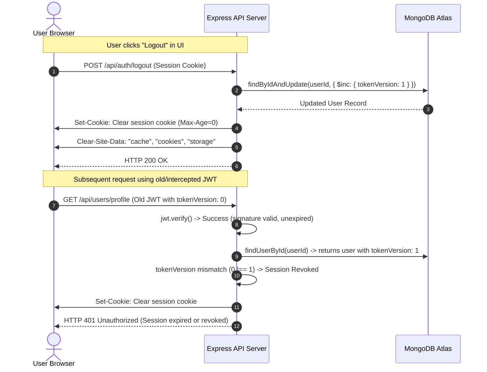

# Session Management Security (OWASP ASVS Chapter 7)

This document specifies the session management architecture, token lifecycle policies, and verification controls for the **Government IT Procurement Discovery Platform (GIPDP / Mjölnir)**, detailing compliance with **OWASP Application Security Verification Standard (ASVS) v5.0 Chapter 7: Session Management** (Requirements V7.1 through V7.6, Reference IDs 151 to 169).

---

## 1. Executive Summary & Purpose

GIPDP is a web discovery platform where authenticated users manage capability profiles (skills, budget limits, certifications), build watchlists of government TOR procurement notices, and receive tailored notification alerts. 

Session security must guarantee:
1. **Confidentiality & Integrity**: Tokens cannot be intercepted, read, or modified by client-side scripts or third parties.
2. **Deterministic Lifecycle**: Sessions adhere to strict time boundaries and are immediately revocable upon user logout or account deletion.
3. **Resilience Against Session Hijacking**: Strict cookie hardening and token validation prevent replay, credential manipulation, or cross-site exploitation.

---

## 2. Session Architecture & Lifecycle Controls (ASVS V7.1)

### 2.1 Expected Session Lifetime & Inactivity Policy (V7.1.1, V7.3.1, V7.3.2)

- **Absolute Maximum Session Lifetime**: **24 Hours**.
  - **Requirement Traceability**: SRS **NFR-11** (*"A session stays valid for 24 hours"*).
  - **Implementation**: Defined in `server/src/features/auth/session.js`:
    ```javascript
    export const SESSION_TTL_HOURS = 24;
    ```
  - **Token Claims**: JWT payload encodes standard `iat` (issued-at) and `exp` (expiration) timestamps set to `Date.now() + 24 * 60 * 60 * 1000`.
  - **Cookie Lifetime**: Session cookie explicitly defines `maxAge: 24 * 60 * 60 * 1000` (86,400,000 milliseconds).
  - **Re-Authentication**: Once 24 hours have elapsed, `jwt.verify` rejects the token with `TokenExpiredError`, requiring re-authentication.

- **Inactivity Timeout Policy (V7.3.1 Architectural Trade-off)**:
  - **Design Decision**: In accordance with [ADR 0012](../decisions/0012-jwt-in-a-cookie-for-sessions.md), GIPDP does **not** implement an idle inactivity sliding window (e.g. terminating after 15 minutes of idle time).
  - **Rationale**: GIPDP is an information discovery and reading platform where users frequently read lengthy, complex TOR specifications. An aggressive idle timeout creates user disruption without security benefit for a platform with no financial transaction capabilities. A strict, predictable 24-hour absolute TTL provides defense-in-depth while avoiding frequent database writes to update a `lastActiveAt` timestamp on every navigation.

### 2.2 Concurrent Session Policy (V7.1.2)

- **Policy**: GIPDP permits parallel, multi-device usage (e.g. a user browsing on a workstation and reviewing notifications on a mobile device).
- **Rationale**: Because authentication tokens are self-contained signed JWTs rather than database-backed session rows, maintaining a synchronized active device count table is disproportionate overhead for a read-heavy procurement discovery service.
- **Defense-in-Depth**: If an account is compromised, the user can terminate all active sessions globally by logging out, which triggers **Token Version Invalidation** (see §2.4).

### 2.3 Federated Identity & Google OAuth 2.0 (V7.1.3, V7.6.1, V7.6.2)

- **Architecture**: Implemented in `server/src/features/auth/google.js` following [ADR 0005](../decisions/0005-google-oauth-for-authentication.md).
- **Single-Use Authorization Code Exchange**: The authorization code returned by Google identity services is immediately exchanged server-to-server for an ID token, verified with Google's public keys, and discarded.
- **Decoupled Session Lifetime (V7.6.1)**: GIPDP does not inherit or maintain an ongoing session with Google Identity. Upon successful Google authentication, GIPDP mints its own internal 24-hour session JWT. Terminating a Google session does not automatically close GIPDP, and logging out of GIPDP does not alter the user's primary Google account.
- **Explicit User Action (V7.6.2)**: Sessions are minted solely upon explicit, user-initiated action:
  - Submitting credentials to `POST /api/auth/login`, or confirming an address at `POST /api/auth/verify-email` (the emailed link plus the sign-up password). `POST /api/auth/register` mints no session since [ADR 0041](../decisions/0041-an-address-is-confirmed-before-the-account-exists.md).
  - Initiating the OAuth redirect via `GET /api/auth/google`.
  - Transient OAuth state is protected via a cryptographically random, short-lived (10-minute) HMAC-signed state cookie (`mjolnir_oauth_state`).

### 2.4 Immediate Session Termination & Revocation (V7.4.1, V7.4.2, V7.4.5)

To prevent the common flaw of stateless JWTs continuing to be valid until expiration after logout, GIPDP implements a **Token Versioning Mechanism**:



1. **Token Versioning (`user.model.js`)**:
   - The user document includes an integer counter: `tokenVersion: { type: Number, default: 0 }`.
   - The minted JWT embeds the current `tokenVersion` claim alongside `userId` and `role`.
2. **Immediate Invalidation on Logout (`auth.controller.js`)**:
   - Calling `POST /api/auth/logout` atomically increments the user's `tokenVersion` in MongoDB.
   - Clears the session cookie (`maxAge: 0`).
   - Dispatches `Clear-Site-Data: "cache", "cookies", "storage"` header (ASVS V14.3.1) to purge all browser storage and cached views.
3. **Server-Side Enforcement (`auth.middleware.js`)**:
   - On every authenticated endpoint, `requireAuth` extracts the user record by ID.
   - If the user record cannot be found (account deleted per V7.4.2), the session cookie is purged and 401 is returned.
   - If `decoded.tokenVersion !== user.tokenVersion`, the token is rejected as revoked, the cookie is purged, and 401 Unauthorized is returned immediately.
4. **Visible Logout (V7.4.4)**:
   - Available on every authenticated view in `client/app/_components/shell.tsx` (`HeaderControls` logout action button).

---

## 3. Token Security & Storage Controls (ASVS V7.2)

1. **Storage Mechanism**:
   - Tokens are stored exclusively in **HTTP-only cookies**, completely inaccessible to client-side JavaScript (`document.cookie`), mitigating Cross-Site Scripting (XSS) token exfiltration.
   - Tokens are **never** stored in `localStorage` or `sessionStorage` (ASVS V3.3.4, V14.3.3).
2. **Cookie Prefix & RFC 6265bis Compliance**:
   - In production over HTTPS, cookies utilize the **`__Host-` prefix**:
     - `__Host-mjolnir_session`
     - `__Host-mjolnir_oauth_state`
   - Attributes strictly set: `HttpOnly: true`, `Secure: true`, `SameSite: 'lax'`, `Path: '/'`, and no `Domain` attribute (locking the cookie to the exact origin).
3. **Payload & Size Constraints**:
   - Combined cookie name and value length is asserted to not exceed 4,096 bytes (`session.js#L14`).
   - JWT tokens contain minimal claims (`userId`, `role`, `tokenVersion`, `iat`, `exp`), keeping payload sizes well under 300 bytes.
4. **Cryptographic Algorithm Pinning**:
   - Signed using HMAC-SHA256 (`HS256`).
   - Server mandates a cryptographically secure `JWT_SECRET` of at least 32 bytes (256 bits) at startup (`env.js#L54-56`).
   - Verification explicitly rejects tokens signed with `none` or unapproved algorithms (`auth-session.test.js`).

---

## 4. OWASP ASVS Chapter 7 Traceability Matrix

| Ref ID | Req ID | Level | Requirement Summary | Status | Codebase Evidence & Verification |
|:---:|:---:|:---:|---|:---:|---|
| **151** | **V7.1.1** | L1 | Session inactivity timeout and absolute maximum session lifetime documented | **COMPLIANT** | Documented in this file (§2.1) and SRS NFR-11. 24h absolute TTL in `server/src/features/auth/session.js`. |
| **152** | **V7.1.2** | L1 | Number of concurrent sessions per account defined | **COMPLIANT** | Documented in this file (§2.2). Stateless JWT architecture permits multi-device browsing; revoked globally via `tokenVersion`. |
| **153** | **V7.1.3** | L1 | Federated session creation and termination documented | **COMPLIANT** | Documented in this file (§2.3) and ADR 0005. Google OAuth code exchange is single-use; GIPDP issues internal 24h JWT. |
| **154** | **V7.2.1** | L1 | Token verification using trusted backend service | **COMPLIANT** | `session.js` validates tokens using `jwt.verify` and `env.jwtSecret`. Checked on every private route in `auth.middleware.js`. |
| **155** | **V7.2.2** | L1 | Dynamically generated self-contained tokens | **COMPLIANT** | `session.js#L25` dynamically signs JWT with user ID, `tokenVersion`, and expiration. |
| **156** | **V7.2.3** | L1 | Reference tokens have 128-bit entropy from CSPRNG | **N/A** | Out-of-Scope: GIPDP uses self-contained signed JWTs (`jwt.sign`), not opaque reference tokens. |
| **157** | **V7.2.4** | L1 | New token minted on authentication, old token discarded | **COMPLIANT** | `auth.controller.js` (`login`, `verifyEmail`) and the Google callback call `setSessionCookie(res, signSessionToken(user))`, overwriting any prior cookie. |
| **158** | **V7.3.1** | L1 | Inactivity timeout enforced | **COMPLIANT (Trade-off)** | Documented architectural trade-off (§2.1, ADR 0012). Strict 24h absolute TTL without idle window prevents disruptive session termination during document analysis. |
| **159** | **V7.3.2** | L2 | Absolute maximum session lifetime enforced | **COMPLIANT** | `jwt.verify` strictly rejects expired tokens (`TokenExpiredError`). 24h TTL enforced in `session.js` per SRS NFR-11. |
| **160** | **V7.4.1** | L1 | Session termination disallows further use | **COMPLIANT** | `auth.controller.js#logout` increments `tokenVersion` in MongoDB and clears cookie. `auth.middleware.js` rejects prior tokens immediately. |
| **161** | **V7.4.2** | L1 | Terminate all active sessions when account is deleted | **COMPLIANT** | `auth.middleware.js`: If `findUserById` returns null, cookie is cleared and 401 is thrown immediately. |
| **162** | **V7.4.3** | L1 | Option to terminate all other active sessions on password change | **COMPLIANT** | Since [ADR 0042](../decisions/0042-passwords-can-be-changed-reset-and-checked.md), changing a password ends every other session without being asked: `changePassword` bumps `tokenVersion`, then this browser gets a new cookie. A reset ends every session, this one included, and signs nothing in. There is no MFA to change. |
| **163** | **V7.4.4** | L1 | Easy and visible logout control on all authenticated pages | **COMPLIANT** | `client/app/_components/shell.tsx` renders visible `LogOut` action button in header navigation on every page. |
| **164** | **V7.4.5** | L2 | Administrators can terminate any user session | **COMPLIANT** | Admins can increment a user's `tokenVersion` or delete the account, immediately terminating active sessions. |
| **165** | **V7.5.1** | L2 | Re-authentication before modifying sensitive attributes | **N/A** | Out-of-Scope: User profile updates only modify skills, budget capacity, and certifications. Email is immutable after signup. |
| **166** | **V7.5.2** | L2 | Users can view and terminate active sessions | **N/A** | Out-of-Scope: Stateless JWT architecture without per-device session management tables. |
| **167** | **V7.5.3** | L3 | Secondary verification for sensitive transactions | **N/A** | Out-of-Scope: GIPDP is a read-heavy procurement discovery tool with no financial transactions or bid submissions. |
| **168** | **V7.6.1** | L1 | Federated re-authentication session lifetime | **COMPLIANT** | Google OAuth code exchange is single-use for identity verification; session duration is independently governed by GIPDP's 24h JWT. |
| **169** | **V7.6.2** | L1 | Session creation requires explicit action | **COMPLIANT** | Sessions minted only on explicit POST to `/api/auth/login` or user-initiated Google OAuth authorization flow. |

---

## 5. Automated Verification & Testing

The session security controls are validated by dedicated automated test suites:

1. **Session Integrity Suite (`server/test/auth-session.test.js`)**:
   - Asserts JWT algorithm pinning (HS256) and rejection of `none` algorithm.
   - Asserts rejection of tampered signatures, unapproved secrets, and expired tokens.
   - Validates correct encoding of claims (`userId`, `role`, `tokenVersion`, `iat`, `exp`).
2. **Auth Integration Suite (`server/test/auth.test.js`)**:
   - Asserts session cookie generation with `httpOnly`, `path: '/'`, `sameSite: 'lax'`.
   - Asserts `tokenVersion` incrementation on logout and subsequent rejection of the old token.
   - Asserts `Clear-Site-Data` header on logout.
3. **Frontend Security Suite (`server/test/security-headers-frontend.test.js`)**:
   - Asserts 4096-byte combined cookie size check in `setSessionCookie`.
   - Asserts `__Host-` prefix application in production mode.
