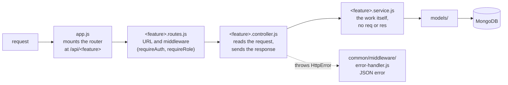
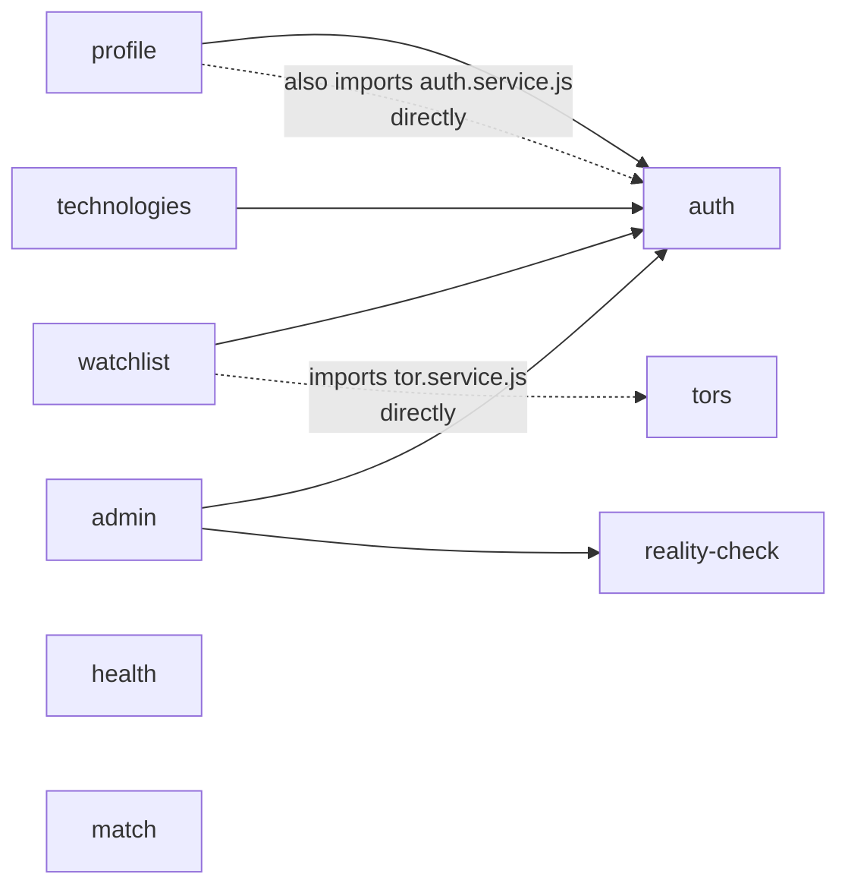
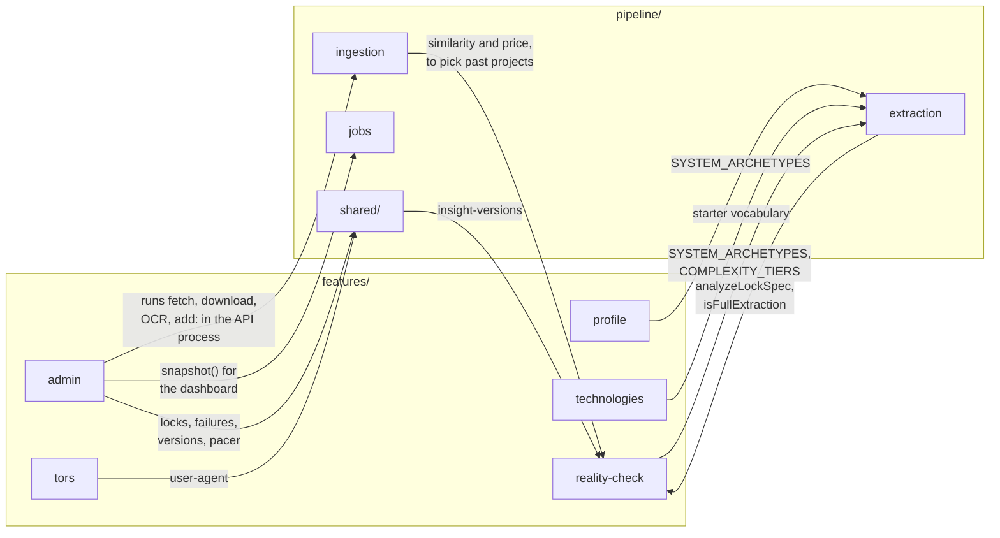

# How the server is put together

`server/src/` is sliced by feature
([0003](decisions/0003-feature-based-server-layout.md)). Each feature folder
owns its URLs and the work behind them. The two pipelines sit beside the
features in `pipeline/`, and everything shares `common/` and `models/`.

This page covers what each part owns, which parts use which, and the few places
the rules bend. For a one-line description of every file, see the
[project map](project-map.md#server).

```
server/src/
├── server.js     connects to MongoDB, then listens
├── app.js        builds the Express app and mounts each feature's router
├── common/       config, database connection, errors, middleware
├── models/       every Mongoose schema, shape only
├── features/     one folder per feature
└── pipeline/     ingestion, extraction, the scheduled jobs, and what they share
```

## Inside one feature

A request passes through the same four layers in every feature:



| File | Job |
| :--- | :--- |
| `<feature>.routes.js` | Which URL calls which controller, and which middleware guards it |
| `<feature>.controller.js` | Turns the HTTP request into arguments, calls the service, picks the status code |
| `<feature>.service.js` | The logic. It takes plain values and returns plain values, so tests and scripts can call it without HTTP |
| `<feature>.validation.js` | Checks a request body before the service sees it (auth, profile, watchlist) |
| `index.js` | What the rest of the server may import. Anything not exported here is private to the feature |

## The features

| Feature | Mounted at | What it does | Writes |
| :--- | :--- | :--- | :--- |
| `auth` | `/api/auth` | Register, sign in with a password or Google, sign out, "who am I". Exports `requireAuth` and `requireRole`, which every other feature uses to guard its routes | `User`: the account (email, password hash, name, role) |
| `profile` | `/api/profile` | Saves the capability profile that drives matching (FR-12) | `User.profile` |
| `watchlist` | `/api/watchlist` | Saves and removes TORs, and lists them with what changed since they were saved (FR-17) | `User.watchlist` |
| `tors` | `/api/tors` | The catalog with its filters and facets, one TOR's detail, its PDF. Decides what the public may see (`visibilityFilter`, `toPublic`) | nothing: reads `Tor` and `TorInsight` |
| `technologies` | `/api/technologies` | The technology names search can filter by; a signed-in user can ask for a new one | `Technology` (requests) |
| `admin` | `/api/admin` | The admin dashboard (FR-22), the review workspace (FR-23), pipeline controls: retry, skip, dismiss, add a project, run a fetch | `TorInsight` (corrections), `Technology`, `TitleScreen`, `PipelineFailure`, `IngestionLog` |
| `health` | `/health` | Liveness and the database's connection state, outside `/api` on purpose ([0009](decisions/0009-api-prefix-without-a-version.md)) | nothing |
| `reality-check` | no routes | A library: comparable projects, the price benchmark, lock-spec risk. The pipelines call it and save what it returns | nothing itself |
| `match` | no routes | A server-side match score. **Only its test calls it**; the score users see is computed in the browser by `client/app/_lib/match.ts` | nothing |

## How the features depend on each other

Barely, and that's the point of the layout. Most features use one other
feature, `auth`, and only for its middleware:



Solid arrows go through the other feature's `index.js`. The two dotted ones
reach past it, which [0003](decisions/0003-feature-based-server-layout.md)
forbids (see [where the rules bend](#where-the-rules-bend)).

`health` and `match` use nothing. `tors` uses no other feature: it's public, so
it needs no `auth`.

## Where the features meet the pipelines

The pipelines aren't features. They have no routes and run as their own
processes, on a schedule or from the command line
([pipeline-guide.md](pipeline-guide.md)). Ingestion writes `Tor`, extraction
writes `TorInsight`, and the two meet only in the database
([0013](decisions/0013-split-ingestion-and-ai-extraction.md)).

Features and pipelines still import each other in a few places:



Three things here are worth knowing before you change one of these files:

- **`admin` runs pipeline steps inside the API process.** "Run a fetch", "add
  a project" and a retry marked "run now" call `runFetchStep`, `runAddStep`,
  `runDownloadStep` or `runOcrStep` directly and wait for them. They don't
  start a job, so a slow step holds the API request open for as long as it
  takes.
- **`reality-check` and `extraction` import each other.** Extraction calls
  `analyzeLockSpec` when it assembles an insight; reality-check reads
  extraction's lists of system archetypes and complexity tiers. It works
  because neither uses the other's values while the modules load. Keep it that
  way, or move the shared lists somewhere both can import.
- **`scripts/find-comparable.js`**, the nightly comparison run, is the main
  caller of `reality-check`. It writes `analytics.priceAnalysis` and refreshes
  `analytics.lockSpec` on every TOR.

## What everything shares

### `common/`

Plumbing with no knowledge of any feature. It imports nothing from
`features/` or `pipeline/` (rule 3 of
[0003](decisions/0003-feature-based-server-layout.md), and it holds).

| File | What it gives you |
| :--- | :--- |
| `config/env.js` | `env`: every environment variable, read and checked once at start. A missing required one (`MONGO_URI`, `JWT_SECRET`) stops the server booting. Also `isProduction`, `isGoogleConfigured` |
| `db/connect.js` | `connectDatabase`, `disconnectDatabase`: used by the server and every script |
| `errors/http-error.js` | `HttpError`, and `badRequest`, `unauthorized`, `forbidden`, `notFound`. Throw one from a controller or service; the error handler turns it into a JSON reply |
| `middleware/error-handler.js` | Every error becomes JSON. In production a 500 says "Internal server error" and nothing more |
| `middleware/not-found.js` | Unknown routes get a JSON 404, not an HTML page |
| `middleware/rate-limit.js` | `limitByIp` (and `limitByUser`, unused so far): the building blocks of auth's limits ([0007](decisions/0007-rate-limiting-on-the-auth-routes.md)) |

### `models/`

Every Mongoose schema, exported from `models/index.js`. Shape only: fields,
defaults, enums, indexes. The rules that fill them live with whoever writes
them. Two files hold shared lists rather than schemas:

- `project-categories.js`: the 7 kinds of IT project a TOR can have, up to 3
  ([0034](decisions/0034-a-tor-can-have-several-categories.md))
- `standard-conditions.js`: the eligibility conditions every e-GP TOR repeats,
  as keys, so matching can compare them exactly

How the collections relate, and who writes each: [data-model.md](data-model.md).

### `pipeline/shared/`

Used by both pipelines, and by `admin`:

| File | What it does |
| :--- | :--- |
| `request-pacer.js` | At most one request a second per government site, counted across processes (NFR-03, [0016](decisions/0016-pipeline-runs-are-safe-to-repeat.md)) |
| `run-lock.js` | One run of each pipeline at a time |
| `failures.js` | Counts a TOR's failures per step, and gives up after 3 |
| `status-engine.js`, `announcement-codes.js` | A TOR's status from its e-GP codes ([0017](decisions/0017-read-the-egp-feed-as-egp-defines-it.md)) |
| `insight-versions.js`, `amendments.js` | Keeps the summary a change replaces, records what changed, rolls back ([0031](decisions/0031-keep-the-summary-a-change-replaces.md), [0032](decisions/0032-record-what-changed-in-a-tor.md)) |
| `workable.js`, `queues.js` | Which projects are worth the work, and the three kinds of work in the order a day's delay costs most ([0030](decisions/0030-run-the-night-in-priority-waves.md)) |
| `deadline.js` | The time box: with `--until`, a step takes no new work after that time ([0027](decisions/0027-run-the-pipeline-on-a-schedule.md)) |
| `egp-links.js`, `user-agent.js`, `thai-text.js`, `thai-number-words.js` | e-GP URLs, our honest User-Agent, Thai text helpers |

## Where the rules bend

[0003](decisions/0003-feature-based-server-layout.md) sets three rules. Here
is how the code stands against each, so you know which exceptions are
deliberate and which are debts:

1. **"A collection has one owning feature, and only the owner writes to it."**
   Partly.
   - `User` has three writers: `auth` (the account), `profile`
     (`User.profile`), `watchlist` (`User.watchlist`). Each keeps to its own
     fields, so ownership is by field.
   - `TorInsight` is extraction's ([0013](decisions/0013-split-ingestion-and-ai-extraction.md)),
     but `admin` writes corrections, `pipeline/shared/insight-versions.js`
     writes rollbacks, and `scripts/find-comparable.js` writes `analytics`.
   - `Technology` is extraction's vocabulary, but `technologies` adds requests
     and `admin` curates it.

   The 0003 example, a pipeline calling `upsertTorFromExtraction()`, never
   existed: the pipelines write their collections directly.
2. **"Cross-feature imports go through the feature's `index.js`."** Two
   exceptions, both debts: `profile.controller.js` imports
   `auth/auth.service.js`, and `watchlist.service.js` imports
   `tors/tor.service.js`. The fix for each is to export what's needed from the
   other feature's `index.js`.
3. **"`common/` never imports from `features/` or `pipeline/`."** Holds.

## Adding a feature

1. Make `features/<name>/` with `routes`, `controller`, `service` and
   `index.js`. Export only what other code needs.
2. Mount its router in `app.js`, under `/api/<name>`.
3. Guard routes with `requireAuth` or `requireRole('admin')` from
   `#features/auth/index.js`.
4. Put any new schema in `models/` and export it from `models/index.js`.
5. Throw `HttpError`s for failures; don't send error responses by hand.
6. Write tests in `server/test/` against the `mjolnir_test` database, as
   `admin.test.js` does.
7. Add the new files to the [project map](project-map.md).
